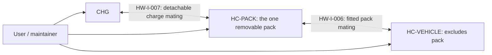

# ARCH-002 — Hardware architecture and physical allocation

**Draft vehicle baseline — 2026-09-16.** The complete vehicle hardware allocation, physical interfaces, host/state boundaries and acceptance gates are retained. The supplied pack remains an integration boundary and regeneration charge-acceptance constraint.
**Draft 1.4 — 2026-09-21; successor to ARCH-002-R1.1.** This controlled refinement records the owner-selected DRV8300DRGE-EVM traction-power-board baseline, WeAct STM32H723VGT6 vehicle host, motor Hall evidence and Hall-required position-estimation/FOC physical allocation. It preserves the approved requirement baseline while tracing the new draft MotorPositionEstimation and MotorSignalMeasurement allocation; detailed design and physical acceptance remain open under completion point B.

## Scope and interpretation

The two root assemblies are **HC-VEHICLE** Rwithout the removable pack) and **HC-PACK**. HC-PACK is the one physical 14S5P battery in every applicable vehicle configuration: fitted riding, connected-but-unseated handling, removed storage and service. It mounts in HC-CARRIER when fitted; mounting, electrical mating and containment do not make a duplicate pack or put HC-PACK inside HC-VEHICLE.

An assembly row may contain boards, wiring, connectors, thermal parts, fasteners and enclosures needed to realize its stated boundary. It does not select a discrete component, connector pinout, isolation topology, fuse, sensor, threshold, diagnostic coverage or timing bound. Human removal/refitting and service procedures are external collaborators, not hardware components.

HC-CELLS and HC-BMS remain supplied/fixed integration boundaries. HC-BMS includes its manufacturer firmware R**SC-BMS**); this document neither decomposes nor changes it. The DRV8300DRGE-EVM is the selected fixed board baseline for `HC-TRACTION-POWER`, subject to the project [integration and requirements-fit record]RDRV8300DRGE-EVM/DRV8300DRGE-EVM_Integration_and_Requirements_Fit.md) and [allocated traction HSI]RDRV8300DRGE-EVM/DRV8300DRGE-EVM_WeAct_STM32H723VGT6_Traction_HSI.md). The WeAct STM32H723VGT6 is selected as `HC-CONTROLLER` under its [allocated traction HSI]RDRV8300DRGE-EVM/DRV8300DRGE-EVM_WeAct_STM32H723VGT6_Traction_HSI.md); it does not establish resource, power or physical acceptance.

## Containment and configurations

The diagram shows configuration relationships only. HC-PACK may mate with HC-VEHICLE **; normal operation uses one mating configuration and one active BMS endpoint. Every logical channel need not have a separate connector. Prevention or treatment of unintended simultaneous attachment remains physical-interface acceptance work. A mating assembly may carry energy and data channels, but the connector, pinout, sequencing, reference management and isolation remain open.

| Configuration | Present assemblies and intended boundary | Required architecture consequence |
|---|---|---|
| Fitted riding / normal shutdown | HC-VEHICLE + one seated, locked HC-PACK | HC-CARRIER provides the tray/original lock and physical retention. Connection before seating conveys no Ready. HC-CONTROLLER and HC-TRACTION-POWER are vehicle-resident. |
| Removal/refitting / empty bay | HC-VEHICLE, HC-PACK and handler, across the prescribed physical sequence | HC-PACK is not contained by HC-VEHICLE while lifted or detached. HC-PACK-IF, HC-VEH-HARNESS, HC-CARRIER and enclosures contribute to accessible-contact, residual-energy, routing and inspection boundaries. No connection/lock sensor or interlock is implied. |
| Storage / service | HC-PACK fitted or removed; applicable assembly may be powered, unpowered or disconnected | Energy, wake/polling, access, residual energy and current service state require configuration-specific qualification. Service access does not grant a BMS write, propulsion permission or regenerative acceptance. |

## Hardware components

Each canonical ID appears once. “Parent” declares containment only; attachment/mating and electrical connections are described in the interface tables.

| ID | Type / parent | Physical allocation and boundary contribution |
|---|---|---|
| HC-VEHICLE | Root assembly / — | The scooter without HC-PACK. Contains retained vehicle hardware and HC-VEH-EPCS; accepts the one removable pack through the fitted mating. |
| HC-PACK | Root assembly / — | The one removable battery assembly. Contains the fixed cells, supplied BMS and pack interface/enclosure. Fits HC-CARRIER; it is never a second vehicle-contained cell bank. |
| HC-MECH | Retained hardware / HC-VEHICLE | Retained steering and front/rear mechanical brake assemblies. Mechanical steering/braking remain physically independent of EPCS power, rider-network interpretation and regeneration. |
| HC-CARRIER | Retained/modified carrier / HC-VEHICLE | Frame, wheels/tyres, running-gear bearings/attachments, battery tray, original mechanical lock and retention features; excludes HC-MOTOR and its internal parts. Supplies physical support, pack fit/retention, HC-MOTOR attachment interface, mounting clearances and routing/environment interfaces; does not contain HC-MOTOR or sense lock/pack state. |
| HC-MOTOR | Supplied replacement assembly / HC-VEHICLE | Fixed replacement rear hub motor mounted by HC-CARRIER. Its mechanical/electrical output and thermal/mounting compatibility require system acceptance. |
| HC-RIDER | Supplied interface assembly / HC-VEHICLE | VD18MT with its opaque supplied SC-VD18MT firmware, accelerator and the fixed passive coded brake electrical network. This treats the display as a supplied assembly, not proof that its behavior is wholly hardware. The brake network remains one shared two-wire coded interface; no independent electrical channels or new sensing coverage is asserted. |
| HC-LAMPS | Retained/supplied lamps / HC-VEHICLE | Physical front and rear lamps. Their electrical characteristics, visibility, dim/full realization and environmental acceptance remain open. |
| HC-VEH-EPCS | Project-developed composite / HC-VEHICLE | Contains vehicle electronic hardware, power distribution, harness and enclosure. It physically joins the rider, motor, lamps and fitted-pack interfaces while keeping their supplied/retained identities. |
| HC-CONTROLLER | Shared vehicle host / HC-VEH-EPCS | One allocated host for supervision and traction-control execution. It receives front-end and BMS observations for software qualification, exchanges command/status with traction hardware and exports HMI information. It receives a conditioned VD18MT on/wake signal at a compatible input for the selected deep-sleep mode; exact mode/input and post-wake setup remain open. Shared hosting needs later timing, resource, reset and common-cause acceptance; it does not prove independent protection. It provides state retention across its own reset/power loss for the reached-10%-SOC positive-propulsion inhibition required by SOC-006, distinct from fault history. The retention mechanism is open. |
| HC-INPUT-FE | Project-developed shared physical front-end assembly / HC-VEH-EPCS | Conditions/protects/acquires the physical observations used by accelerator, `LE-BRAKE-SIGNAL`, nonbattery-temperature/supply qualification, the protected BMS endpoint and Traction Hall capture for HC-CONTROLLER. It also conditions the VD18MT pin-5 switched voltage for the controller wake input while the MCU is in deep sleep. It provides shared physical conditioning/acquisition only; the named logical functions retain semantic ownership. The brake boundary remains the one shared passive two-wire electrical interface, with no independent left/right channel or diagnostic-coverage claim. This includes motor Hall supply/return, external-pull-up/conditioning and the sampled acquisition boundary. Exact realization, levels, filtering, reference, sensing, wake protection/leakage/unpowered behavior and diagnostic coverage are open. |
| HC-TRACTION-POWER | Project-developed power assembly / HC-VEH-EPCS | Uses the selected DRV8300DRGE-EVM bridge board and required host adapter/augmentation to convert applicable vehicle energy for HC-MOTOR and expose physical traction-path status to controller/protection coordination. Its Hall-required position-estimation/FOC allocation is a complementary three-phase bridge, three low-side phase-leg current channels, timer-synchronous ADC windows, fast DC-link voltage observation and independent fault shutdown. It supplies `MotorSignalMeasurement` with physical Hall/current measurement and integrity evidence and has no credited applied-winding-voltage observer source until the separate time-coherence gate is met; [MCD-001](../Motor/MCD-001_Hall_Sensored_FOC_Technical_Design.md) and the [EVM fit record](DRV8300DRGE-EVM/DRV8300DRGE-EVM_Integration_and_Requirements_Fit.md) own the technical contract. The EVM alone is not credited for independent shutdown, host compatibility, limits/protection or physical acceptance. |
| HC-ENERGY-DIST | Project-developed distribution assembly / HC-VEH-EPCS | Receives fitted-pack energy and distributes it to vehicle power consumers under the eventual configuration-specific protection and service-isolation arrangement. It does not imply final conductor, switching, pre-charge, fuse or isolation topology. |
| HC-AUX-POWER | Project-developed auxiliary supply assembly / HC-VEH-EPCS | Supplies applicable controller, rider/HMI and lamp-drive auxiliary power. It may realize logical LightPower alongside those other supply obligations; this does not select a dedicated converter or topology. It must be assessed with residual/storage loads and the required continued HMI/lighting behavior; it supplies no all-load protection claim. |
| HC-LAMP-DRIVE | Project-developed output assembly / HC-VEH-EPCS | Realizes `LightActuation`: drives HC-LAMPS from selected Front Off/On and Rear Off/Dim/Full modes and provides the powered-start/reset rear-Full default until the qualified brake-lever and actual electrical-braking states permit release, including before software executes (REQ-VEH-LGT-009). Full/dim/off output still requires physical qualification. It does not make a selected mode proof of actual illumination. |
| HC-VEH-HARNESS | Vehicle wiring/interface assembly / HC-VEH-EPCS | Routes vehicle energy/data/signals to HC-CARRIER, HC-MOTOR, HC-RIDER, HC-LAMPS and HC-PACK-IF. Conductor, connector, sealing, strain relief, reference and powered/unpowered behavior remain open. |
| HC-VEH-ENCLOSURE | Vehicle electronics enclosure / HC-VEH-EPCS | Houses/protects applicable EPCS hardware and contributes mounting, accessible-surface, thermal, ingress and service boundaries. It establishes no environmental rating or service procedure. |
| HC-CELLS | Fixed supplied hardware / HC-PACK | Owner-built 14S5P, 70-cell Samsung INR18650-35E bank. It is one physical cell bank, fixed in HC-PACK. Cell condition, connections, heat transfer, actual energy and pack acceptance remain open. |
| HC-BMS | Supplied composite / HC-PACK | Selected JBD SP14S004P14S50A monitoring/balancing/protective-switching assembly hosting supplied SC-BMS firmware. Its revision, settings, actual protection behavior, UART electrical constraints and coverage require qualification. |
| HC-PACK-IF | Pack interface assembly / HC-PACK | Provides the battery/energy mating boundary for protected vehicle energy and BMS-data channels under the eventual routing/protection arrangement. It contains no automatic immutable electronic identity, no direct external J5 exposure and no normal BMS-write path. |
| HC-PACK-ENCLOSURE | Pack enclosure / HC-PACK | Contains/protects cells, BMS and internal interfaces; contributes retention, accessible-surface, thermal, moisture/contamination, propagation and service/inspection boundaries. Performance and coverage remain open. |

## Physical interfaces and power/data paths

The HW interfaces are local physical contracts. They map to logical `IF-A-*` identities in ARCH-001; mapping does not equate an information contract to a connector. All data-bearing channels retain value, validity, freshness/source age and reset/configuration context. Energy protection is distributed across the named assemblies; a status bit, a software disable request or zero torque command is not proof of physical isolation.

| HW interface | Physical parties and channels | Logical mapping | Required boundary / open realization |
|---|---|---|---|
| HW-I-001 — rider and HMI | HC-RIDER ↔ HC-VEH-HARNESS/HC-INPUT-FE/HC-AUX-POWER/HC-CONTROLLER: accelerator, fixed coded brake trunk, VD18MT supply/UART, pin-5 switched on/wake and applicable status | IF-A-001, IF-A-002, IF-A-006 | The VD18MT five-wire physical boundary is allocated between supplied HC-RIDER and vehicle HC-VEH-HARNESS. HC-AUX-POWER/HC-ENERGY-DIST make display supply available; HC-INPUT-FE acquires display UART and conditions pin-5 switched voltage to a compatible HC-CONTROLLER wake input. The harness carries vehicle TX to display RX and display TX back to the input front end. See [hardware physical connection model](HardwareArchitecture/Modelling/Vd18mtElectricalConnection.sysml). Pin identity is known; connector identity, selected sleep/wake input, electrical limits, unpowered behavior, reference, protection, qualification and timing remain open. |
| HW-I-002 — mechanical carrier | Rider / HC-MECH / HC-MOTOR / HC-PACK ↔ HC-CARRIER | IF-A-012, IF-A-013 | Carrier provides mounting, wheel/motor support, tray and original lock. Mechanical braking/steering are available without electrical operation; retention, loads, clearance and environmental duty remain open. |
| HW-I-003 — vehicle traction path | HC-ENERGY-DIST ↔ HC-TRACTION-POWER ↔ HC-MOTOR, with an open selected host/adapter command/status interface and HC-INPUT-FE Hall acquisition | IF-A-004, IF-A-005, IF-A-010, IF-A-011 | Power, Hall acquisition and control are distinct channels. The selected EVM supplies three low-side shunts and local voltage feedback, while the host/adapter must establish PWM/ADC timing, Hall 5-V supply with 3.3-V pull-up conditioning, reference paths and reset-safe behavior. Its slow regular phase-voltage channels are diagnostic only. Any applied winding-voltage evidence for `MotorSignalMeasurement` requires a separately qualified direct-sensing or PWM/bridge reconstruction design with coherent time/reference/frame, bandwidth, skew and error bounds. Define commanded/actual output, generated-energy, failed-control, motor/cable limits and physical response without crediting software command acceptance or PWM-off. |
| HW-I-004 — auxiliary and lamps | HC-AUX-POWER/HC-LAMP-DRIVE/HC-VEH-HARNESS ↔ HC-LAMPS and HC-RIDER | IF-A-006, IF-A-010, IF-A-011 | Carries auxiliary energy and lamp outputs. Startup/reset behavior, lamp electrical data, output protection, load budget and actual visibility require separate qualification. |
| HW-I-005 — vehicle internal energy and maintenance | HC-ENERGY-DIST/HC-AUX-POWER/HC-CONTROLLER ↔ HC-VEH-HARNESS/HC-VEH-ENCLOSURE and qualified maintainer equipment | IF-A-010, IF-A-011, IF-A-013 | Defines vehicle-internal power and maintenance boundary without selecting a connector or energized task. Physical access cannot grant propulsion permission or normal BMS writes. |
| HW-I-006 — fitted pack mating | HC-PACK-IF ↔ HC-VEH-HARNESS/HC-ENERGY-DIST, with its selected BMS data channel routed through the shared HC-INPUT-FE physical front end to HC-CONTROLLER | IF-A-003, IF-A-009, IF-A-010, IF-A-011, IF-A-013 | HC-PACK-IF is the battery/energy mating boundary; its protected pack-energy and selected BMS-data channels may share that assembly. Exact contact system, data protection, sequencing, reference shifts and isolation are open; connection before seating never proves Ready. |
| HW-I-008 — BMS data endpoint | HC-BMS ↔ HC-CONTROLLER through HC-PACK-IF and the shared HC-INPUT-FE physical front end | IF-A-003, IF-A-009 | One active, protected BMS UART endpoint exists in the fitted-pack configuration. J5 stays internal: its B+ is not logic supply and it is not directly exposed. Characterize actual board/firmware, ground/reference shifts, logic levels, unpowered/backfeed behavior and the manufacturer external-load warning before selecting the electrical arrangement. |
| HW-I-012 — enclosure, thermal and accessible boundaries | HC-VEH-ENCLOSURE / HC-PACK-ENCLOSURE  / HC-CARRIER ↔ people and environment | IF-A-010, IF-A-011, IF-A-013 | Covers physical mounting, heat paths, ingress/contamination, touchable surfaces, cable routing and exposed-bay/removed-pack cases. Criteria, materials, sealing, thermal margins and fault coverage remain open. |
| HW-I-013 — maintenance/handling collaboration | Maintainer/handler procedures ↔ HC-VEHICLE and HC-PACK | IF-A-011, IF-A-013 | Applies prescribed remove/refit, inspection and isolation procedures. Human action is not a sensed hardware state; no new interlock, sensor, programming connector or BMS-write capability follows. |

### VD18MT physical refinement

The [hardware model](HardwareArchitecture/Modelling/Vd18mtElectricalConnection.sysml) defines the physical pin-level boundary and an `IfA006Vd18mtElectricalConnection` interface instance between explicit HC-VEH-HARNESS and supplied HC-RIDER connection endpoints. It imports the raw `HmiPowerLockSignal` from [HmiElectricalInterface.sysml](SystemArchitecture/Modelling/HMIControl/Decomposition/HmiElectricalInterface.sysml) for pin 5. `Vd18mtElectricalConnectionContext` is a connection-modeling context only; it adds no selected component and changes no containment. HC-VEH-HARNESS owns the vehicle-side routing; HC-RIDER remains the supplied display assembly. Existing HC-AUX-POWER/HC-ENERGY-DIST allocation supplies P+ to the display boundary; HC-INPUT-FE acquires its UART receive wire and conditions pin-5 switched voltage to a compatible HC-CONTROLLER wake input, including while the MCU sleeps. HC-CONTROLLER supplies transmitted UART bytes and consumes received data. The conditioned wake path is a distinct electrical refinement; the pin-level model does not assert a raw direct wire to the MCU or select a circuit, voltage or pin. The five physical wires remain unchanged.

| Logical HMI contract ([`IfA006HmiDeviceConnection`](SystemArchitecture/Modelling/HMIControl/Decomposition/HmiElectricalInterface.sysml)) | Physical realization in `IfA006Vd18mtElectricalConnection` |
|---|---|
| `displayPower:VehicleElectricalPower` | Pin 3 yellow P+ supply and pin 1 black ground return |
| `informationToDisplay:HmiControllerReportData` | Pin 2 green controller TX to display RX, referenced to pin 1 ground |
| `informationFromDisplay:HmiDisplayRequestData` | Pin 4 white display TX to controller RX, referenced to pin 1 ground |

The pin-5 wake refinement is `HC-RIDER` → HC-VEH-HARNESS raw pin-5 conductor → HC-INPUT-FE conditioning → compatible HC-CONTROLLER wake input. At the logical layer, raw `HmiPowerLockSignal` is carried within the HMI electrical boundary and becomes a distinct conditioned `ControllerWakeSignal`; see [REQ-SYS-HMIE-002](SystemArchitecture/Modelling/HMIControl/Decomposition/HmiElectricalInterface_Requirements.md#req-sys-hmie-002) and [REQ-SYS-CMPH-001](SystemArchitecture/Modelling/ComputeHardware_Requirements.md#req-sys-cmph-001). It asserts the confirmed on/wake function from selected deep sleep. Wake does not grant drive permission; the full common startup/Ready guard remains required. Mode, eligible input, electrical thresholds, loading, protection, leakage, unpowered behavior, clock/context/timebase restoration and finite wake acceptance remain open.

This is a documented trace/refinement mapping, not a formal realization proof. Bytes and vehicle-local source, validity, freshness and integrity qualification are realized by UART acquisition and controller-side processing; they are not metadata transmitted on the physical wires. The model records the known pin/color mapping and direction only. Exact connector identity, harness routing details, electrical limits, thresholds, circuits, protection and MCU pins remain unselected. Acceptance still requires characterization of the supplied display behavior, electrical levels and references, power availability and protection, UART unpowered/backfeed behavior, signal integrity, and applicable timing/qualification.

## Hosts, state and physical protection boundaries

HC-CONTROLLER is the shared vehicle host for supervision and traction. The [runtime integration contract]RRuntime_Integration_Contract.md) assigns project startup/IRQ/DMA bindings within this host; it does not turn an OS task or generic driver module into a logical component.

| State / action | Physical owner | Required separation |
|---|---|---|
| Riding Ready, riding fault history, rider command and traction execution | HC-CONTROLLER with vehicle physical contributors | A vehicle-controller restart starts ineligible and has no old fault history; fresh qualification is required.  |
| Reached-10%-SOC positive-propulsion inhibition | HC-CONTROLLER retention provision | It survives HC-CONTROLLER reset/power loss until actual SOC exceeds 20%, per SOC-006. It is an operating restriction, not retained failure history; exact retention realization remains open. |
| Cell-path backstop, balancing and vendor observations | HC-BMS | BMS trip/recovery/telemetry return is not a vehicle policy reset. Its qualified configuration and actual behavior remain supplied-component acceptance work. |

The following are allocation boundaries, not completeness or independence claims:

- **Pack-local:** HC-CELLS, HC-BMS, HC-PACK-IF and HC-PACK-ENCLOSURE contain stored energy and supplied path functions. BMS protection is a backstop, not commanded-current regulation or proof of all fault coverage.
- **Vehicle-local:** HC-ENERGY-DIST, HC-TRACTION-POWER, HC-AUX-POWER, HC-VEH-HARNESS and HC-VEH-ENCLOSURE must provide the eventual assigned response for vehicle energy, residual energy and wheel generation, including unavailable controller/supply/UART states.
- **Accessible and service boundary:** HC-CARRIER, interfaces, harnesses and enclosures must be assessed through fitted, unseated, removed, empty-bay, removed storage and service states. A dark HMI, UART response, FET status or zero command does not demonstrate safe physical exposure or isolation.

## Allocation limits and completion work

This architecture baseline introduces no new system requirement or hardware leaf below the stated assemblies. In particular, it selects neither a new sensor/interlock, an immutable electronic pack identity, normal BMS parameter-write capability, direct BMS J5 exposure, UART isolation implementation, current/voltage/thermal setpoint, fuse/protection circuit, torque controller circuit or claimed diagnostic coverage.

Before physical allocation acceptance, complete the existing `OI-040`–`049`, `OI-057`, `OI-061`–`063` and applicable `WS-OI` evidence: actual BMS identity/settings/UART electrical behavior; pack/vehicle power, reference and connector arrangement; all-load/storage budget; generated/residual energy and accessible-interface response; host reset/state retention; routing, thermal, enclosure, retention and service acceptance; and shared HC-CONTROLLER timing/resource/common-cause analysis. [BAT-001](../Battery/BAT-001_Selected_Pack_and_BMS.md), [battery integration](SystemArchitecture/Modelling/BatteryControl/Battery_Integration.md), [energy protection](../Requirements/System_Requirements/Energy_and_Protection.md), and ARCH-001 remain controlling.
