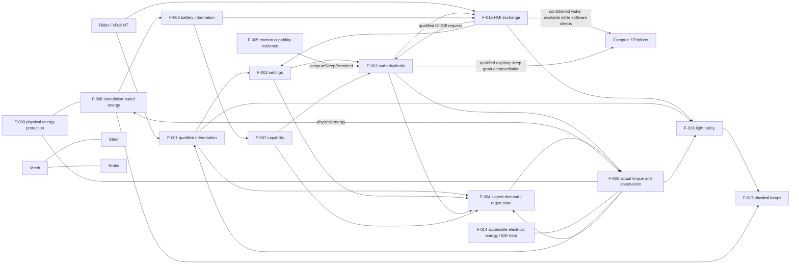
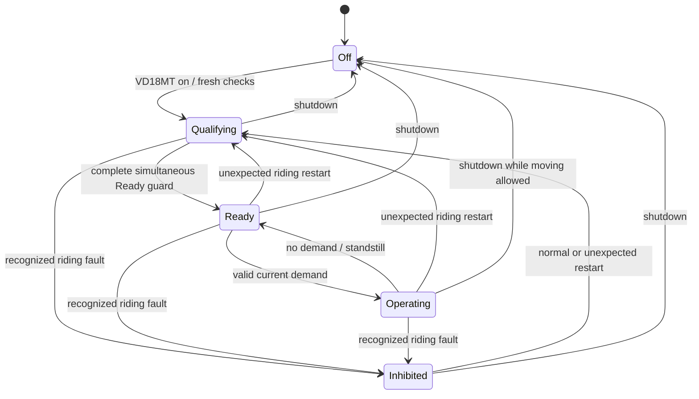

# FC-001 — Functional concept

**Draft EPCS baseline — 2026-10-06.** Active functions cover the electrical/electronic retrofit and its electrical safety boundary. BMW X2City mechanics and handling procedures are external platform context under [ID-001 §2.1](../Requirements/ID-001_Item_Definition.md#external-mechanical-platform-assumption).
| Attribute | Value |
|---|---|
| Revision / status | Historical source release 1.1, 2026-09-14; current EPCS scope is Draft dated 2026-10-06 |
| Inputs | REQ-001-R1.6 at `ac43704a3b814143734ee614a1d8c7a50d398c6d`; HARA-001-R1.0 / SG-001-R1.0 at `2d4a39e4c761c148eb777751dae5a78076a2cba8`; their source statuses, assumptions and open gates remain effective |
| Scope | EPCS electrical retrofit and one supplied removable battery across operation, regeneration, electrical storage and service states |
| Related work | [Exact requirement/function trace](FC-002_Function_Trace.md), [logical architecture](SystemArchitecture/X2CityMCU.md), [working requirement catalogue](../Requirements/REQ-001_Requirements.md), [released goals](../Safety/SG-001_Safety_Goals.md) |

## Purpose and interpretation

This concept answers **what functions cooperate to deliver the required behavior and safety outcomes**. Functional decomposition connects requirements, behavior and interfaces before detailed realization; NASA describes this role in its [logical-decomposition guidance](https://www.nasa.gov/reference/4-3-logical-decomposition/). The safety part connects the released goals to functional responses, conditional safe states and derived requirements, within the existing ISO-inspired tailoring; ISO Part 3 identifies the [functional safety concept as a concept-phase work product](https://www.iso.org/standard/68385.html). No formal ASIL or conformity claim is introduced.

The 14 active EPCS functions below are behavior/responsibility views of the current logical architecture. A function may involve several realization components; functional decomposition is neither a software task list nor proof of independent protection. Requirement targets and allocation status remain controlled by the canonical requirements baseline. The named logical owner records the coordinating responsibility for each complete function. Software realization, lower-level allocations and the wider structural/behavioural architecture remain pending, except for requirement bindings already approved in R1.6.

**Authority:** released requirements and safety goals remain controlling. The historical FC-001-R1.1 release approved the prior functional definition; this scope update remains Draft with the qualifications in the [release record](#release-record). The 12 referenced FSC refinements remain explicitly Draft in REQ-001 Draft1.7; no requirement-status promotion or numeric default follows from the concept release. The trace distinguishes a function's contribution from a requirement derivation parent. Fixed cells/BMS, VD18MT and the shared two-wire coded brake electrical interface remain supplied givens; BMW mechanical details are external platform context. HARA's broad context assumptions remain assumptions. Hall-required FOC remains the selected functional contribution; its realization remains pending.

## Functional decomposition

The overall purpose is rider-controlled transport with safe lifecycle use. It decomposes into the functional groups below. Physical properties such as mass and durability constrain their combined realization; verification activities are not invented operational functions.

### Shared contract semantics

Every information-bearing interface distinguishes value, validity, freshness/source age, applicable operating context and qualification. Unavailable is not measured zero; receipt time is not automatically measurement time. Each producer owns truthful status for its output; consumers withhold the dependent permission when required information is unqualified. Initial qualification/waiting, ordinary operating restriction and recognized fault retain their separate released meanings.

Required self-tests and detection are distributed across the functions providing observations or physical effects. F-003 owns riding-session inhibition and F-009 coordinates vehicle and pack energy protection. No single diagnostic display or policy function supplies all fault coverage. Known valid-code aliases, shared references, BMS group/probe limitations and physical output faults remain in the fault envelope even when observation cannot distinguish them.

### Function contracts

Each row states one coordinating logical owner, principal inputs/outputs, applicable modes and unavailable/fault behavior. Numeric ranges, timing and verification criteria follow the linked requirements and the budgets below. The [record-level trace](FC-002_Function_Trace.md) identifies every supporting requirement and safety goal.

| Function / owner | Purpose; inputs → outputs | Modes, limits and unavailable/fault behavior |
|---|---|---|
| F-001 — Qualify rider and motion information · LE-EPCS (LE-ACCELERATOR, LE-MECHANICAL-BRAKE and LE-TRACTION contributors) | Physical accelerator, brake and nonbattery-temperature observations, current-context rider/HMI communication evidence and Traction-owned motion evidence → qualified travel/rest, `BrakeLeverState` (`State` plus `Qualification`), speed/direction/standstill, required temperatures and source/diagnostic status. | Startup, riding, shutdown and controlled diagnostics. LE-ACCELERATOR owns accelerator position/rest; LE-MECHANICAL-BRAKE owns brake measurement/state identification and provides the full brake composite to RidingControl (including demand arbitration) and Light plus its exact Qualification projection to Platform; the logical traction-control responsibility includes local temperature and supply qualification; LE-TRACTION owns motion and actual-output evidence. Physical rest differs from virtual neutral; unknown speed cannot establish standstill. Preserve unknown/ambiguous input and report recognized faults to F-003. Qualification does not claim detection of all plausible stuck values or coded-brake aliases. Battery observations are F-006. |
| F-002 — Manage rider settings · LE-RIDING | Qualified VD18MT requests plus coherent standstill/physical rest and startup context → requested, latest pending and active level/speed, and current-startup receipt evidence. | VD18MT selects Levels 0–5; zero or above-40 speed requests normalize to 40. Apply changes only at simultaneous standstill/rest. Retain valid current-session settings on link loss; no stale receipt satisfies a new startup. No pending indication or scooter-defined default is introduced. |
| F-003 — Establish riding authority and fault response · LE-RIDING | Qualified required inputs/settings, self-tests, current battery operating assessment, temperature evidence, traction startup-condition evidence, power/reset events and recognized faults → current Ready/authority, session inhibition and selected fault report. | Every normal/unexpected restart begins ineligible with no past-cycle fault effect or report history. BatterySupervision retains a recognized restart-required battery fault as unqualified operating branches with zero effective limits until restart; RidingControl applies those limits/qualification to battery functional behavior and independently owns session report selection/lifetime. TractionControl qualifies and evaluates local GVDD and supplies startup prerequisite/fault-category evidence; RidingControl also owns sleep eligibility. It grants/revokes sleep using qualified explicit Off plus qualified traction `computeSleepPermitted` capability evidence; Platform validates the current request at entry and executes it. Complete simultaneous Ready guards and required valid/released brakes govern drive-off. Recognized faults retain both-sign inhibition until clean restart; every fault reaction applies despite one selected report. VD18MT communication loss alone preserves otherwise permitted function. |
| F-004 — Determine permitted signed wheel torque · LE-RIDING | Valid current rider demand, active settings, authority, motion/applied-output evidence and capability → one signed rear-wheel command and regenerative-episode state. | Positive means forward torque; Level 0 uses the full positive range and coasts at rest. Levels 1–5 have the common provisional neutral and qualified maps/taper. Brake levers suppress positive demand and never request regen. Both-sign cutoff/fault authority overrides demand. BatterySupervision supplies the qualified current capability; a zero discharge bound suppresses propulsion and applies to all loads. Low-charge warning `0x01` is reporting only. Recovery while powered uses existing ramps and guards; after power loss normal startup and Ready apply. These limits leave otherwise permitted regeneration to its independent capability and riding guards; hand-push/actual-powered-forward guards remain distinct. Applied-output feedback qualifies the regeneration re-entry decision; otherwise eligible positive demand after Ready does not require prior positive output. |
| F-005 — Produce and qualify physical wheel torque · LE-TRACTION | Current-context authority and unexpired signed command, physical energy and motor feedback → Hall-required electrical rotor position, explicit phase-current feedback, actual wheel torque, qualified applied-output/braking observations and traction fault/protection status. | Riding and controlled diagnostic operation; no drive before authority. A static accepted Hall sector may establish electrical angle at startup without an edge, but no-edge evidence alone does not establish standstill. Current/applied-winding-voltage assistance may refine/check only the Hall-based estimate while observable; it never supplies sensorless fallback, alignment or holding. Reject obsolete command context and withdraw on loss of authorization. Actual torque, drag and wheel generation require physical acceptance including failed normal control; a zero command is not a safe-output observation. Unauthorized-output monitoring/protection must remain effective when command acceptance is disabled or authority withdrawn; its operation cannot require acceptance of a new command. F-009 coordinates residual/generated-energy constraints. |
| F-006 — Qualify battery observations and identity · LE-BATTERY-CONTROL | Selected BMS/source observations, effective configuration and operating context → qualified pack voltage, signed current, actual SOC, 14 group voltages, available/required temperature/path status and source uncertainty. | Fitted riding, removed storage where available, startup and service. LE-BATTERY-SUPERVISION performs allocated UART interpretation and independently assesses battery-fault recognition, retained operational effect, BatteryStatus publication and restart reset under Draft `REQ-SYS-BATSUP-017`, `019`–021 and `023`–027. Physical battery thermal protection is allocated to BMSDEV-005; BatterySupervision recognizes and publishes BMS-reported faults under BATSUP-017/020. Its two dedicated startup checks establish firmware version 3.2 and 14 series groups from the accepted `0x03` response of the current startup; ordinary response, decode/scaling, NTC/source-age and first/cyclic operating assessments remain separate. Initial missing input is not itself a fault; failure withdraws only dependent qualification unless a defined recognized-fault condition applies. Physical BMS model/revision and protection/capacity configuration remain commissioning/integration evidence. Invalid/missing required data cannot authorize dependent propulsion or regenerative transfer. |
| F-007 — Determine battery capability · LE-EPCS | F-006 observations, qualified component/configuration limits and operation context → qualified actual SOC, separate effective charge-acceptance and discharge-current capability limits, capability-restriction reasons, plus independent reporting-only BatteryStatus conditions. | LE-BATTERY-SUPERVISION uses qualified path states in the capability assessment and separately publishes recognized battery-fault and live low-discharge-voltage and MOS-warning conditions through BatteryStatus. A qualified charge or discharge MOS-disabled indication contributes a live low-priority 0x01 warning through BatteryStatus; it clears when both MOS states are qualified ON. Unknown MOS state is distinguishable and does not imply either path state. Recognized required-information faults are assessed separately under the existing recognition policy. Actual BMS-reported errors, including BMS thermal errors, form the battery-fault condition and use 0x07. Ordinary charge-temperature ineligibility, qualified zero capability and initial missing qualification are not automatically faults. Apply the selected temperature and group-voltage curves to the operating capability limits; physical current thresholds and protection are configured and validated in the supplied BMS, separate from these published budgets. Normal discharge capability reaches zero at or below the qualified lowest-group-voltage endpoint, currently assigned 3.10 V per group subject to product validation; the corresponding actual SOC is approximate and expected around 10%, not an exact cutoff or recovery point. Above the voltage endpoint, capability may recover subject to other limits. Charge capability reaches zero at the qualified highest-group-voltage endpoint, currently 4.10 V per group subject to product validation and approximately associated with 90% SOC, without an exact SOC guarantee. Low SOC alone does not inhibit charge. For regeneration, canonical BatterySupervision `REQ-SYS-BATSUP-007..011` uses `Ib = 0.30 × C` from the qualified BMS-reported nominal pack-capacity reference acquired at startup and held for the riding cycle, then takes the minimum of the temperature and maximum-group-voltage ceilings derived from that same base; later live capacity updates do not change `C`. This nominal reference is not measured/aged capacity; 17 Ah / 5.10 A is an example only. The highest-group-voltage endpoint, known charge-MOS-disabled state, recognized faults and existing qualified charge restrictions apply. BatterySupervision publishes the selected curve result subject to its existing path, required-data and retained-fault rules; configured BMS protection provides the physical pack-current trip. Qualified zero is known no capability; missing required evidence makes only its dependent assessment unqualified and its conservative effective limit zero. Charge-only or HMI-only missing information does not invalidate supported discharge. Zero charge acceptance suppresses requested regenerative braking without implying zero wheel torque. Vehicle-session latches and regeneration recovery are owned by F-003/F-004; restoring a capability does not clear them. |
| F-008 — Store, balance and distribute energy · LE-EPCS | Fixed 14S5P bank, supplied BMS balancing/path functions, vehicle load demands → physical stored/distributed energy and load/path observations. | Installed drive/regen/auxiliaries; detached storage; off/handling/service. External charging is outside the vehicle decomposition. Include every auxiliary, residual, polling and self-discharge load. Balance compatibly with the 80% external ceiling. Preserve the distinct 10/20/80/90% policies and qualified cell/storage boundaries. Supplied components require acceptance; their ratings do not prove whole-system performance. |
| F-009 — Bound hazardous energy and interfaces · LE-EPCS | Physical pack, traction, auxiliary and accessible-path conditions; qualified protection status, configuration and fault envelope → assigned physical protective action, bounded remaining energy and truthful protection status. | All configurations, including controller/UART/supply absence, generated wheel energy, unknown path state and latent pack faults. Required protection remains effective for energized paths within the declared envelope. Detection, prevention and physical exposure limitation cover their assigned cases; do not assume all faults are observable or that a path report proves isolation. F-005/F-014/F-018 supply domain effects. |
| F-014 — Bound accessible electrical energy and E/E heat · LE-EPCS | Electrical energy paths, insulation/protection states and E/E-generated accessible heat → bounded electrical exposure, residual energy and truthful protection status. | Applies to fitted/disconnected pack interfaces and powered, unpowered or faulted EPCS states. It covers E/E heat and electrical contact hazards only; mechanical support, retention, enclosures, routing geometry, solar/mechanical heat and handling procedures are supplied platform context. |
| F-015 — Exchange rider settings and information · LE-HMI-CONTROL | Qualified transport/data, selected fault, usable charge/current information and VD18MT messages → decoded requests and protocol fields for the selected HMI, qualified `VehicleOperationRequest`, plus conditioned pin-5 hardware wake through LE-COMPUTE to LE-COMPUTE-HW. | HmiElectricalInterface publishes `HmiPowerLockObservation` (Active/Inactive/Unknown plus integrity) from the physical power-lock and separately conditions it for hardware wake. HmiInformationProcessing interprets that record into `VehicleOperationRequest` (`Request` plus `Qualification`) independently of UART and publishes it to RidingControl only. Unknown, invalid or stale observation cannot become Off; intended Inactive-to-Off mapping remains Draft pending selected-unit qualification. Hardware wake remains available while software sleeps and does not grant Ready or drive permission. UART framing/report encoding remain HmiInformationProcessing responsibilities. Current-session retained settings/lighting survive communication loss; preserve clipped `100 × (SOC − 10) / 70` usable-charge display (0–100%), unsigned current magnitude/clamp and invalid 0 A fallback without exporting them as control evidence. No dedicated regen, Ready or pending-change indication is added; accepted wheel-setting display error remains separate from true control speed. |
| F-016 — Determine lighting modes · LE-LIGHT-CONTROL | Qualified `runningLightStateIn`, mechanical `brakeLeverStateIn` and Traction-owned actual `electricalBrakingStateIn` → Front Off/On and Rear Off/Dim/Full modes. | Initial normal request Off; preserve last valid request during VD link loss. Rear Full for either lever, active electrical braking or either unqualified state. Return requires qualified both-released/no-electrical-braking. Passive slowing alone is excluded. A qualified unavailable lighting-availability input inhibits all lamps, including brake indication and the Rear Full startup fallback; loss/unknown qualification after that restriction does not clear it, and qualified availability restores the current selected modes without a new rider request. Initially unknown availability retains the existing powered startup/fault fallback subject to protection. Selected modes do not prove physical brightness. |
| F-017 — Produce vehicle lighting · LE-LIGHT-CONTROL | LightPower-provided protected supply, qualified lighting-availability input and F-016 selected modes → physical front illumination/rear dim/full signaling and qualified integration/diagnostic evidence where observable. | Powered startup, riding, torque-inhibited and shutdown transitions wherever protection permits. Provide the required unknown-state startup output before qualified braking information exists only while no qualified unavailable restriction is retained. Qualified unavailable lighting availability overrides selected modes and startup fallback; initially unknown availability retains the existing fallback. Actual visibility/dim-full distinction, response and supply-loss behavior require acceptance; no indication is promised without usable power. |
| F-018 — Enable controlled electrical service and safe return · LE-EPCS | Task, electrical energy state, component condition and effective configuration plus diagnostics → controlled electrical isolation or explicitly energized task conditions, inspection/configuration acceptance and return-to-operation evidence. | Inspection, electrical replacement, isolated and energized diagnostics, and post-storage return. Account for wheel generation and residual heat/energy. Service completion grants no torque or regeneration authority; normal riding guards and battery charge-acceptance limits apply. Replacement does not reset the vehicle-life clock. |

Current operational variables may be inspected through the debugger during engineering service. That is an inspection method for the SVC-001 obligation, outside the runtime functional decomposition: it adds no service-information function, aggregation, telemetry/report flow, persistent logger or service authority. It cannot clear latches, prove isolation or create riding authority.

### Cross-cutting constraints

| Constraint / accountable scope | Functional contribution and acceptance |
|---|---|
| Vehicle mass and payload context · LE-EPCS | Supplied vehicle mass and payload are mission inputs for EPCS performance/energy analysis. The 30 kg / 130 kg reference remains a context assumption; no mechanical mass design or structural qualification is claimed. |
| Range, speed, acceleration and hills · LE-EPCS with supplied platform context | EPCS functions and supplied vehicle performance assumptions inform the qualified Level 5 duty. F-015/017 and all internal loads enter the range budget. Normal operation remains required in other levels; performance qualification does not assign their calibration. |
| Electrical environment, storage and life · LE-EPCS | F-008/009/014/017 preserve E/E suitability; F-018 supports inspection/replacement and post-storage qualification. Retain 168 h fitted/exposed-bay and 672 h detached duties at normal-full entry, component-temperature limits and the original commissioning/life origin. |
| Local operation and supplied parts · LE-EPCS | All essential functions operate without phone/cloud/wireless/internet dependency. Qualify the supplied BMS and retained interfaces at their boundary; no vendor software internals or redundant project implementation is invented. |

## Functional interactions

The diagrams show information and physical interactions in their applicable configuration. They do not imply that riding functions occur simultaneously with service/handling states, that arrows are separate wires, or prescribe implementation.

### Interface responsibility

[ARCH-001](SystemArchitecture/X2CityMCU.md#allocation-records-and-component-contracts) owns canonical IF-A contracts. The bindings below identify function endpoints and the physical interfaces added by this concept. Initial values, invalidity, operating context and finite response apply at both ends; no consumer silently substitutes a different mode or reset lifetime.

| Interface | Functional producer → consumer / exchange |
|---|---|
| IF-A-001 | F-001 → F-002/003/004/016: qualified rider/motion/required-temperature information |
| IF-A-002 | F-015 with F-001 transport qualification → F-002/003/004: current-startup receipt, requested/pending/active settings |
| IF-A-003 | F-006/007/008, F-005 → F-003/004/009/010: qualified battery/output envelope, readiness, restriction/fault causes |
| IF-A-004 | F-003/004 → F-005: current authorization and signed wheel command with validity/expiry/context |
| IF-A-005 | F-005 with F-001 → F-003/004/016: qualified actual motion, applied torque and active electrical braking |
| IF-A-005a | Within F-005: physical Hall/current/bridge observation → LE-MOTOR-SIGNAL → LE-MOTOR-POSITION-PROC → LE-MOTOR-CTRL, LE-PLATFORM and LE-RIDING. MotorPositionEstimation solely owns the direct Hall and phase observation inputs; LE-TRACTION-HW does not relay them. The same complete `MotorPosition` (`Position` + `Qualification`) reaches all three consumers, including when angle is unavailable or only Qualification changes; no separate Qualification-only transmission is defined. Existing RidingControl/Platform fault policy receives the current fault evidence through the composite and remains unchanged. `MotorPosition` keeps angle qualification separate from signed electrical-speed validity, and phase current remains an explicit control input. |
| IF-A-008 | Within F-005/F-003: LE-TRACTION-CONTROL → LE-RIDING publishes `TractionConditionEvidence`, including the startup prerequisite and categorized traction conditions. GVDD qualification/evaluation stays local; RidingControl owns session vehicle fault latch, report selection, and restart lifetime. |
| IF-A-006 | F-003/006 → F-015 → VD18MT; F-015/001/005 → F-016 → F-017; F-007 qualified lighting availability → LightControl/LightActuation: rider reports, normal/braking light modes and energy-limited lamp permission |
| IF-A-009 | Supplied BMS/source → F-006, including LE-BATTERY-SUPERVISION interpretation: protected UART information and source qualification |
| IF-A-010 | F-008 ↔ F-005; F-008 → F-017/other loads: physical energy, current/voltage/thermal bounds and available path evidence |
| IF-A-011 | F-005/008/011/014 ↔ F-009: actual or bounded energy/output conditions, protection requests/actions and evidence; includes absent control/communication |

F-001/F-006 qualification must be possible without granting torque or unsafe regenerative charge. Initial observations are obtained under safe acquisition/test conditions; F-005 does not require a hazardous actuation merely to report ineligibility or qualified inactivity. If a required startup check needs energized motion/transfer, F-018 and the physical safety functions must establish its separately controlled conditions; the normal Ready guard cannot be bypassed. Positive propulsion or regenerative transfer can begin only from qualified vehicle authority and battery acceptance. Applied-positive-output evidence gates post-stop regeneration re-entry,  neither is a prerequisite for its own first permitted transfer. Unauthorized-output monitoring/protection continues without command acceptance; implementation dependencies and coverage still require qualification.

## Modes and transition rules

These are externally relevant behavioral conditions. Software realization remains pending. Vehicle-off, removed-pack storage and service are distinct configurations. F-008/009/014 remain relevant when normal software is unpowered; supplied mechanical controls are platform context. The item definition retains the canonical operating-state identifiers for vehicle context.

| Mode / transition | Required functional cooperation |
|---|---|
| VS-001 / VS-010 — isolated or controlled energized service | F-018 establishes the electrical service power state with F-009/014, including stored/generated energy. Debugger inspection distinguishes operational observations from permissions. Energized diagnostics are not normal riding or new riding authority. |
| VS-002 / VS-012 — fitted/off or detached storage | F-008 budgets all losses; F-009/014 retain assigned protection and environmental/access functions. Establish stored condition before conditioning or recharge can mask degradation. |
| VS-003 → VS-004 — startup to Ready | F-001/006 qualify required inputs and information; F-002 supplies fresh VD settings; all distributed checks pass; F-003 verifies simultaneous standstill/physical rest, valid released brakes and remaining permissions. F-004/005 grant no torque before that conjunction. F-016/017 maintain required unknown-state rear brightness while powered when qualified lighting availability does not impose a retained unavailable restriction. |
| VS-005 / VS-006 — propulsion, coasting or braking | F-004 applies current authority, speed and both-sign fault overrides; positive brake/voltage limits and negative charge/direction/episode gates act on their own branches. F-005 produces qualified actual output, F-008/009 constrain energy, and supplied platform dynamics remain external context. |
| Valid lever release / cutoff or discharge-capability recovery | F-004 resumes current positive demand using the released level ramp, once only for coincident positive recoveries. Level 0 uses Level 1's resumption ramp; Level 5 adds none. Fresh startup or fault recovery is not implied. |
| Stop / manual forward-backward push / relaunch | F-004 suppresses regen after every stop until F-005/F-001 qualify actual forward travel with applied positive motor torque. Manual motion, a blocked request and torque while still rolling backward do not qualify. Valid deliberate forward launch torque remains possible after Ready; supplied platform braking remains external context. |
| VS-008 — ordinary restriction versus recognized fault | F-007 distinguishes a discharge-capability restriction from a recognized battery fault; BatterySupervision applies the qualified lowest-group-voltage endpoint to normal discharge capability, and EnergyPath actuates the qualified total discharge bound across supplied loads. F-003 retains recognized riding-fault inhibition until clean restart. For a recognized restart-required battery fault, BatterySupervision retains both operating branches unqualified with zero effective limits until normal/unexpected restart; this preserves battery-fault inhibition independently of the report path and applies in both operating branches. Otherwise-valid measurements retain their own validity. Ordinary capability restrictions and initial missing qualification are not automatically faults. Regenerative capability recovery retains its range-exit/standstill and powered-forward gates; source/telemetry recovery cannot clear the retained battery effect. |
| VS-009 — moving or stationary shutdown | F-003/004 withdraw both torque signs under the released action; F-005/009 bound actual effects and remaining energy. supplied mechanical steering and braking remain external platform context. Shutdown does not create a gravity-proof speed limit, stationary hold or physical service-isolation claim. |
| VS-011 — electrical pack connection and disconnection | F-014 bounds electrical exposure and E/E-generated touch heat; F-018 controls electrical service state. Electrical connection alone never establishes Ready. F-009 protects remaining energized interfaces with host/UART absent. No lock or seating sensor is modeled. |

## Integrated functional safety concept

The selected **functional strategy** is to authorize only qualified current demand, constrain actual physical outputs/energy, constrain E/E energy and heat, and retain configuration-specific electrical recovery and service boundaries. Faults that cannot be observed reliably require prevention or physical outcome limitation in the assigned concept; fabricated diagnostics are not a solution. The detailed E/E protection mechanisms, coverage evidence and numeric safe envelope remain open.

In this concept, FSC-nnn is shorthand for the unique catalogue ID ending in FSC-nnn; [FC-002](FC-002_Function_Trace.md#safety-goal-contribution-and-derivation) provides each complete ID and canonical link. The following goal decomposition is a partial functional derivation. Each safety goal remains independently mandatory, including its complete hazardous-event scope. Existing R1.6 requirements contribute approved behavior; new FSC rows add distinct physical interaction requirements and remain Draft.

| Goal | Contributing functions | New functional requirement contribution / evidence boundary |
|---|---|---|
| SG-001 — positive torque authority | F-001/002/003/004/005/018 | FSC-001 actual output and FSC-003 profile/traction interaction; existing startup/command rules remain necessary. |
| SG-002 — reverse/braking/restraint | F-001/004/005/007/009/018 | FSC-001/003/005: permitted actual torque, combined effects and generated-energy/drag transitions; no arbitrary negative torque or protection-induced restraint. |
| SG-003 — drive transition control | F-003/004/005/007/009 | FSC-002/003: loss/recovery under grip, load, slope and human reaction; no continuous drive or automatic hold guarantee. |
| SG-004 — stopping through regen changes | F-004/005/007/009 | FSC-002/005: independent mechanical stopping through charge/speed/fault transitions without crediting a dedicated availability warning. |
| SG-007 — visibility/information | F-001/003/005/015/016/017 | FSC-012 adds actual signal/visibility acceptance. Existing HMI limits and truthful operational HMI information remain supporting constraints; no new indication is implied. |
| SG-008 — energy/material release | F-005/006/007/008/009/010/011/014/018 | FSC-005/006/007/008: generated energy, interface faults, repeated reset energy and unobservable pack-local failures; supplied BMS qualification alone is insufficient. |
| SG-009 — accessible heat | F-005/008/009/011/014/018 | FSC-010: material/contact-duration/exposure limits including passive solar heat and post-use handling, distinct from cell-surface operating ratings. |
| SG-010 — electrical exposure | F-005/006/008/009/011/014/018 | FSC-005/006: supplied, stored and generated energy through power/reference states, with physical access/isolation evidence. |

### Safe conditions and competing responses

| Condition | Functional response, retained functions and release condition |
|---|---|
| Unauthorized/stale/wrong wheel output | F-003/004 revoke affected intent and F-005 bounds the actual torque under FSC-001; F-009 manages residual energy. Supplied BMW mechanical controls remain external platform context. A recognized riding fault retains both-sign inhibition until the released clean-restart guard; communication loss alone is not that fault. |
| Regen forbidden or energy sink lost | F-007/004 withdraw forbidden charge intent, F-005/009 limit actual generated energy/drag, and the supplied mechanical braking capability provides stopping. Continuing unsafe battery charge to preserve deceleration is inadmissible. Recovery needs the relevant capability and episode guards; no increase during continuous moving regenerative demand without the qualifying event. |
| Thermal/protection fault | The affected domain applies its recognized-fault response; F-009 protects energy paths while F-003 retains the correct session inhibition. A normal discharge-only temperature range is a different condition. Torque inhibition alone does not protect auxiliaries or internal cell faults. |
| Lost auxiliary power or uncertain braking observation | F-016/017 apply the required powered-state light output when qualified lighting availability permits it, while F-009 retains protection limits. An inability to produce light is not concealed as verified output. Visibility consequences are assessed under FSC-012; no new display or guaranteed unpowered lamp is selected. |

**Response budgets:** derive event-specific bounds before accepting a dependent protection/control function. For an available hazard margin `M` and a conservatively bounded approach rate `r>0`, `t_response + t_uncertainty ≤ M/r` is a sufficient initial response-budget condition under the stated bounded-rate model; changing dynamics or multiple limits require the more restrictive justified reachability result. Allocate source age, detection/qualification, transfer, decision and physical response without double-counting overlap, including uncertainty and safe-condition duration. A UART wire time or software cycle is not a fault-tolerant interval. If no reliable observation/time margin exists, derive prevention or physical exposure limitation instead of assigning a fictitious deadline.

Use the existing [speed-cutoff uncertainty budget](../Requirements/System_Requirements/Interface_Qualification.md#speed-cutoff-uncertainty-and-response-budget). Qualify the voltage- and temperature-based current capability and physical protection response against applicable cell and pack current, energy and thermal exposures, including observation age, transfer and physical response. Measurement uncertainty is qualification evidence for those bounds; it does not introduce an adjustment to the runtime temperature or voltage inputs or an additional SOC control threshold. Reset/retry energy requires a cumulative bound over the physically credible reset sequence, not only a per-pulse limit.

Store each numeric reference, uncertainty, applicable state, safety outcome and allocation in its eventual canonical qualification/calibration record under the existing issue gates. The concept requires those bounds but supplies no unverified values. Response ordering must satisfy all simultaneous goals; assigning zero torque, opening a path or removing a supply alone cannot establish this.

## Scenario walkthroughs and planned acceptance

These are **document-level walkthroughs**, not executed vehicle tests. The current Draft scenarios cover the 28 retained electrical and vehicle-operation events. The 39-event figure belongs to the released history; HARA-001 is the current risk record.

| Scenario | Function sequence and distinguishing outcome | HARA event coverage |
|---|---|---|
| FC-S-001 — startup and moving restart | F-001/006/002 produce fresh qualification; F-003 requires all Ready guards together before F-004/005 grant torque. Held pedal, unknown speed, held/invalid brake and late input arrival remain ineligible. F-016/017 retain powered unknown-state rear Full unless a qualified unavailable restriction is retained. | HE-001, HE-033, HE-035 |
| FC-S-002 — demand and settings | F-015/002 retain latest pending settings until standstill/rest; F-004 keeps the active signed map; F-005 checks actual direction/authority. Include wrong sign, late setting, full endpoints and true-speed versus HMI wheel-size error. | HE-003, HE-005, HE-006, HE-007, HE-039 |
| FC-S-003 — coded brake observation faults | Exercise electrical coded-input aliases, invalid/stale observation and positive-torque priority through F-001/004. Negative pedal demand may add regen; the brake lever observation cannot request regen or imply mechanical brake adequacy. | HE-004, HE-008 |
| FC-S-004 — regenerative episodes | F-007 restriction reduction/clearance and F-004 range-exit/standstill state are varied in both orders; partial recovery obeys the same episode rule. Actual powered-forward travel after each stop remains an additional gate. | HE-009, HE-010, HE-012, HE-013 |
| FC-S-005 — pushing and rollback | After a stop, F-004/005 apply no regen to unpowered manual motion; supplied vehicle braking remains external platform behavior. Valid positive demand while rolling backward produces forward torque. Only actual powered forward travel qualifies post-stop regen. | HE-002, HE-010, HE-011, HE-039 |
| FC-S-006 — cutoffs, withdrawal and resumption | Cross active/40 km/h cutoff with both signs; apply the qualified lowest-group-voltage discharge-current cutoff across supplied loads; trigger fault/shutdown while descending or launching. F-005/009 bound physical effects, the supplied BMW mechanical steering/brakes preserve control, and F-004 resumes positive demand with one appropriate ramp after all guards. | HE-007, HE-011, HE-012, HE-013, HE-014 |
| FC-S-007 — protection and wheel generation | Lose a charge path/control/UART or spin the wheel externally at high SOC/charge-invalid temperature. F-005/008/009 preserve the wheel, energy and exposure envelopes simultaneously; an open-path report or zero command is not acceptance. | HE-014, HE-020, HE-021, HE-025, HE-036 |
| FC-S-009 — regeneration temperature restriction | F-006/007 distinguish discharge-valid/charge-invalid temperature from actual thermal fault. F-004 withdraws or limits regenerative demand while F-009 protects the physical energy path; supplied mechanical braking remains external platform context. | HE-008, HE-009, HE-021, HE-028 |
| FC-S-011 — storage and latent damage | F-008/009/014 support fitted 168 h and detached 672 h storage at qualified normal-full entry; include residual loads, weather, internal fault and unsafe depleted-entry misuse. F-018 establishes stored condition before recharging/conditioning. | HE-027, HE-028, HE-030, HE-038 |
| FC-S-012 — electrical access and pack disconnection | Exercise fitted/disconnected pack electrical interfaces, residual/generated energy, touch heat and no-propulsion behavior. Connection state is not treated as a mechanical seating or lock sensor. | HE-025, HE-028, HE-030, HE-031 |
| FC-S-013 — E/E maintenance and life | F-018 controls electrical service/isolation and configuration return; inspect E/E replacement state and distinguish actual, current, latched and diagnostic information. Supplied mechanical inspection is external platform procedure. | HE-019, HE-025, HE-031, HE-033 |
| FC-S-014 — visibility and HMI loss | F-015 retains valid settings/light request through link loss; F-016/017 enforce actual front/rear modes and unknown-state brightness unless qualified unavailable status is retained. Verify false overrides both lamps and brake indication, false persists through availability unqualification, true restores current requested modes without a new rider command, and initial unknown retains startup fallback within protection; verify dim/full perception, return after qualified brake release and passive-slowing exclusion. Exercise complete/inadequate normal illumination in dark/wet riding and consequent path/obstacle perception, plus unavailable or misleading charge/current/fault information under link loss and the accepted information omissions. | HE-017, HE-018, HE-019, HE-035 |
| FC-S-015 — E/E environmental and energy limits | Exercise F-008/009/014 electrical, cell-energy, thermal and protection boundaries. Supplied vehicle mechanics and unsupported-use fitness remain external platform assumptions. | HE-020, HE-028, HE-030, HE-038 |
| FC-S-016 — integrated performance and energy | F-004/005/007/008 plus auxiliary E/E loads are assessed together for the approved Level 5 speed, launch/hill, descent and RQ duties. Apply full RQ load/stop/temperature/SOC trace; actual in-window regen may contribute, while preliminary sizing retains zero credit. A feasibility failure triggers impact review, never an implicit target reduction. | Performance constraints; withdrawal/energy consequences also HE-011, HE-020, HE-027 |

## Completion and remaining gates

This Draft revises the active scope to 14 EPCS functions, 11 active interface identities and eight retained safety goals over 28 retained hazardous events. Earlier release counts and approvals remain historical in Git and in the release record; the 2026-10-06 scope update does not promote requirements or approve vehicle fitness. Documentary coverage is not physical satisfaction or an approved final functional safety concept.

**Document review — 2026-09-13:** bounded riding, energy and lifecycle reviews plus integration walkthroughs found no remaining conflict with released behavior. Checks confirmed exact coverage of 188 catalogue records, 11 goals and 39 hazardous events, 19 function owners, 13 interface identities, valid local links/anchors and acyclic explicit requirement derivation A76 retained and 23 new parent edges). Released catalogue and safety records remain historical; current active obligations follow the revised requirement and safety baselines. Diagram/table structure was inspected; no physical tests were executed.

The stated function contracts form this Draft concept baseline; physical realization, quantitative acceptance and release remain open. The existing conservative HARA context remains effective. The following evidence and approval gates remain explicit.

| Work / owner | Required output / gate |
|---|---|
| Concept review / requirement refinement · project owner | Functional-concept review and release completed 2026-09-13. Approval of the 12 Draft FSC requirements remains a separate REQ-001 revision gate; logical ownership and structural allocation remain provisional. A later conflict with a fixed interface or behavior requires a concrete decision and impact analysis before dependent acceptance. |
| Physical torque, input/diagnostic coverage and human controllability · engineering | Qualify F-001/003/004/005/012/013 envelopes, latent brake aliases, fault response and visibility transitions; derive numeric budgets under HA-OI-002/003/005 and WS-OI-001/002/003/005/006/007/010/012/013/015/016 before dependent functional-safety/control acceptance. |
| Battery/source/access/thermal and reset protection · engineering | Qualify F-006–011/014/018 data, BMS configuration, physical protection, cell-local fault exposure, generated energy, cumulative reset energy and contact/storage limits under HA-OI-004/005 and OI-040–046/049/057/061–063 before relevant integration/energization acceptance. |
| Architecture and realization · engineering | Refine project-developed composites, allocate remaining leaves, software hosts and physical endpoints, demonstrate coverage/independence where credited, and complete resource/timing contracts under WS-OI-020AB). F-009 is a distributed responsibility; no universal protection controller is selected. |
| Validation and residual-risk acceptance · engineering / owner | Execute planned acceptance against the released configuration and all goal/event conditions; record anomalies and justified remaining risk. No ASIL classification, safe-state validation, protection coverage or vehicle release is established by the document walkthroughs. |

The functional architecture, timing and fault envelope must be revised together when source facts, allocation or calibration change. Keep executed evidence and qualification records with their canonical artifacts; Git holds prior document baselines.

## Release identity

**FC-001-R1.0 / FC-002-R1.0 — released 2026-09-13 by the project owner.** The release identity covers the functional concept and trace. Current Draft refinements remain unreleased; Git retains review history, snapshots and detailed release checks.
