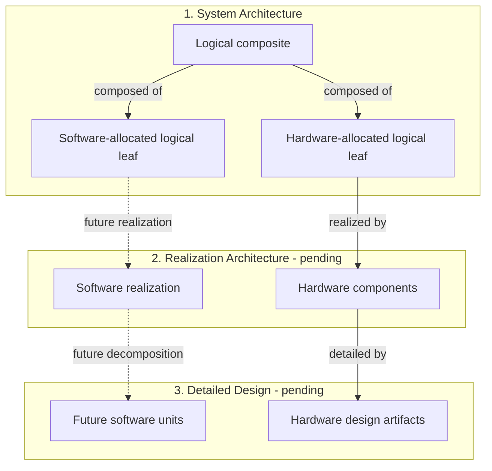
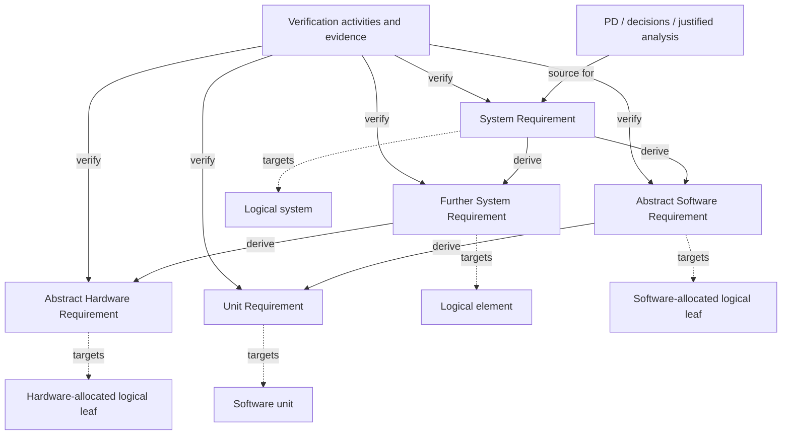

# REQ-001 — Requirements

**Working Draft successor — 2026-10-06.** REQ-001-R2.0 (2026-09-14) remains the historical released baseline. The current catalogue removes mechanical-platform design/qualification and updates mixed rows for E/E scope; no prior review or release approves this scope change. Full electrical allocation, verification and acceptance remain open. [Release history](README.md#release-and-history).

Canonical product obligations are the SysML requirement records; this document supplies methodology, index, upstream disposition and verification guidance. Owner decisions and item context retain their upstream authority and qualifications.

Sources: [PD-001](../../README.md), [item definition](ID-001_Item_Definition.md), [decisions/open issues](DEC-001_Decisions_and_Open_Issues.md), released [architecture](SystemArchitecture/X2CityMCU.md#release-identity) and [safety goals](../Safety/HARA-001_Hazard_Analysis.md#release-record). [BAT-001](SystemArchitecture/BatteryControl/BatteryAssembly/BatteryAssembly.md#fixed-inputs-and-provenance) is the canonical selected battery/BMS record. Source/release snapshots remain in Git. The original source paths and anchors recorded in the specification refer to the pre-conversion Git HEAD.

## Requirement types and architecture model

The owner selected this project model on 2026-09-09. Requirement type records abstraction and realization allocation; functional, performance, interface and environmental classifications are separate attributes. A requirement remains verifiable at its stated level even when called abstract. Reusable SysML classifications are defined in [RequirementTypes.sysml](RequirementTypes.sysml).

The operational/reporting interface guideline for future requirement derivation is [AG-001](SystemArchitecture/X2CityMCU.md#ag-001-operational-and-reporting-interfaces).

| Type | Responsible target | Permitted requirement derivation |
|---|---|---|
| **System Requirement** | Logical system or logical element; realization may remain open | May derive further System Requirements, Abstract Software Requirements or Abstract Hardware Requirements |
| **Abstract Software Requirement** | Logical leaf whose responsibility is allocated entirely to software | Software allocation of a System Requirement; may derive Unit Requirements when detailed design is established |
| **Abstract Hardware Requirement** | Logical leaf whose responsibility is allocated entirely to hardware | Hardware allocation of a System Requirement; traced to hardware design and verification |
| **Unit Requirement** | One software unit in a future detailed design | Derived only from Abstract Software Requirements; additional design/interface rationale is recorded as a source. This remains a valid requirement type; no active Unit Requirement catalogue is maintained. |

Abstract Software and Abstract Hardware Requirements remain **system-level requirements**. Allocation is an explicit logical responsibility decision, not inferred from words such as control, sensor or mechanical, from an ID prefix, or from historical implementation. An unchanged System Requirement may be reclassified when its logical responsibility is established, preserving its ID and existing parent/source chain; this requires neither a duplicate child nor an artificial parent. Derive a new child only for a distinct obligation. Future Unit Requirements can have multiple Abstract Software parents.

Architecture has three layers:

1. **System Architecture:** interconnected logical elements, recursively composed of logical elements. Composite elements may contain both hardware- and software-allocated leaves.
2. **Realization Architecture:** software and hardware components realizing logical responsibilities. The prior project software architecture and its host/unit assignments are withdrawn from the active workspace; future realization is pending.
3. **Detailed Design:** software components may later be decomposed into units. Unit Requirements remain a valid future type. Hardware detailed design and verification remain managed with its Hardware Architecture.

Hardware can include electrical, electronic, thermal and electromechanical realization. This project allocates requirements for electrical/electronic equipment and its supplied-platform interfaces; it does not develop or qualify BMW mechanical hardware. Supplied electrical components retain interface and integration obligations without requiring invented internal units. Abstract Software obligations retain their logical responsibility and verification intent. Software component responsibilities, interfaces, timing and resource contracts will be derived during future realization.

The diagrams define relationship kinds, not a selected scooter implementation. Hardware detail in layer 3 remains managed with the Hardware Architecture. Document interfaces at every applicable layer: endpoints, direction, exchanged information/energy/material, conditions and governing requirements. Interface requirements target a responsible element or common integrating parent; endpoint obligations are derived where needed.

### Current logical targets

These identifiers retain the responsibility scopes from [ID §2.1](ID-001_Item_Definition.md#21-vehicle-item-and-functional-development-system). Logical responsibility targets are registered in [ARCH-001](SystemArchitecture/X2CityMCU.md); realization bindings and implementation acceptance remain open. These assignments do not change the item boundary.

| Target | Scope and current assignment |
|---|---|
| `LE-EPCS` | Project EPCS functional development system, including energy storage/supervision and installed regeneration; responsible root for project E/E performance and use-context requirements. Explicit cluster/row targets identify narrower responsibilities. |

The same physical pack remains within EPCS responsibility across installed operation, removal/refitting and detached storage; requirements retain their applicable configuration and containment conditions explicitly. Cross-cutting obligations may remain at their responsible root or common parent.

## Traceability concept

Requirement derivation is an acyclic graph, independent of architectural composition. Maintain navigable traceability in both directions by stable IDs: forward references link to canonical records; reverse references can be found by searching that ID across the documentation without maintaining duplicate backlink tables. Many children may contribute to a parent and a child may have multiple parents.

| Relationship | Meaning / required record |
|---|---|
| **Source** | Each active requirement identifies its PD obligation, owner decision, fixed interface or justified analysis, retaining source conditions and status |
| **Derived from** | A child identifies its requirement parent(s) and contribution to their obligations; directly sourced top-level System Requirements need no requirement parent |
| **Required composition** | Architecture-aligned requirement collections conjunctively include canonical child usages through SysML `require` references; this coverage relation preserves canonical subjects and is distinct from derivation |
| **Targets** | Exactly one responsible logical element per System/Abstract requirement, or one detailed-design unit per future Unit Requirement; other affected elements are dependencies |
| **Realized by / composed of / hosted on** | Explicit architecture mappings with stable element identities and applicable configurations; none substitutes for requirement derivation |
| **Satisfied by** | Design/component/unit artifacts identify the requirements they are intended to satisfy, with the relevant rationale and coverage; a link alone is no proof |
| **Verified by** | Planned verification identifies requirements and acceptance; executed evidence identifies their revision, configuration, method, results and anomalies |

BatteryControl demonstrates the distinction between canonical usages, conjunctive composition, derivation and satisfaction assertions. Satisfaction assertions are design claims, not verification evidence. See the [BatteryControl composition hierarchy and derivation](SystemArchitecture/BatteryControl/BatteryControl.md#requirement-composition-and-derivation).

Arrow labels show direction. Any System Requirement can derive either allocation type; reclassifying an unchanged record preserves its existing trace chain. Record architecture-, interface- and hazard-derived rationale alongside the parent/source chain. Do not invent a requirement parent merely to fill a hierarchy.

Parents remain mandatory after decomposition. Record how children and their interfaces cover the complete parent obligation, including budgets and interactions. Verify the parent at its responsible level using direct evidence or a justified composition argument; passing child tests alone does not establish parent satisfaction. Missing decomposition, realization or acceptance remains assigned open work.

SysML requirement documentation retains source provenance and related requirements from the original Markdown fields; a cited requirement is **not automatically a derivation parent**. Modeled derivations use explicit, unambiguous parent information where permitted by the project’s type rules; other source and governing-contract references remain provenance. Earlier approved allocations remain historical. The current Draft scope retains electrical brake-state input and control priorities; supplied mechanical steering/braking are external platform assumptions. New INT/CTL rows record explicit partial contributions; no software command alone proves its physical parent. [REQ-SYS-STO-001](SystemArchitecture/Specification/EnvironmentAndStorage.sysml) contributes fitted-battery storage energy to [REQ-VEH-ENV-003](SystemArchitecture/Specification/EnvironmentAndStorage.sysml). For further children, record explicit parent information and design/verification links when those artifacts exist. Each canonical SysML record declares its requirement type and binds its subject to the responsible element; its documentation retains the original Markdown fields, defaults, exceptions and provenance. Deferred/Withdrawn records retain their historical scope only.

Functional contribution trace is a separate relation: [FC-002](FC-002_Function_Trace.md) maps active records to functions or cross-cutting constraints without changing their responsible target. Nine retained FSC rows explicitly derive from the current active safety-goal set; pure mechanical FSC-004, FSC-009 and FSC-011 are removed from the active catalogue. Existing supporting requirement citations are not additional parents unless named in the Derived from field.

Keep each canonical requirement in a coherent `Specification/<Topic>.sysml` file under its owning element, with one unique top-level package per file and its recorded type and subject binding. The structural `<Element>.sysml` contains no requirements; `<Element>.md` provides the overview and specification index. Keep stable per-record IDs when relocating records, update inbound links to the native record file without Markdown fragment anchors where the format has no such anchors, and update the cluster index; retain status/source/verification qualifications. Unresolved allocation is not closure. PD process obligations, assumptions and exclusions keep their [upstream disposition](REQ-001_Requirements.md#pd-obligation-disposition) without artificial hardware/software descendants.

This is project tailoring; method references are [NASA logical decomposition](https://www.nasa.gov/reference/4-3-logical-decomposition/) and [OMG requirement/allocation relationships](https://www.omg.org/sysml/sysmlv1/).

## Requirement quality guidelines

Apply these review criteria to System, Abstract Hardware and Abstract Software Requirements, and to future Unit Requirements. NASA’s [guidance on writing good requirements](https://www.nasa.gov/reference/appendix-c-how-to-write-a-good-requirement/) informs these criteria; project traceability and record rules above remain in force.

| Review criterion | Guidance |
|---|---|
| **Need and source** | State a necessary obligation grounded in an identified source, decision, fixed interface or justified analysis. Preserve applicable source conditions and status. |
| **Atomic obligation** | State one independently verifiable obligation per canonical record. Equivalent conditions may share one required outcome; split independently verifiable reactions or recovery duties into separate records. There is no fixed word limit; multiple `shall` clauses prompt review for separable obligations. |
| **Owner and scope** | Assign exactly one actual architectural responsible target, and make the title and scope match its responsibility. Put shared outcomes at the responsible parent and allocate distinct obligations to the appropriate logical leaves. |
| **Right level** | State what the responsible target must do and the needed outcome, not an invented realization. A selected fixed interface, constraint or explicit hardware/software allocation is valid when supported by its source. |
| **Clear conditions** | Define terms or link to their definitions; state applicable states, inputs, boundaries, units and qualifications. Distinguish an unqualified/invalid condition from zero where that difference matters. Use positive wording where practical; justified prohibitions are valid. |
| **Verifiable result** | Specify an observable pass condition, including timing, tolerance or boundary where relevant. Keep unresolved values explicit and link them to their existing issue or parameter record; do not invent numbers. |
| **Consistency and trace** | Check for conflict with parent, sibling and interface obligations. Keep one canonical owner; parents state parent outcomes and children refine them. Use stable source/derive/subject/satisfy/verification links; links support navigation but are not proof. |
| **Readable record** | Separate normative text from rationale, metadata, planned tests and examples. Keep prose and wrapping clear and uniform. Use `shall` for an obligation; a concise pattern is `<responsible target> shall <observable outcome> when <condition>`. |

For native SysML, keep the canonical natural-language obligation in the normative text of the canonical requirement; place rationale and metadata outside that normative statement. An unnumbered requirement collection may conjunctively reference canonical child usages and need not repeat their behavior.

## Reading and verification rules

REQ-001-R1.6 remains a historical approved baseline. This 2026-10-06 Draft removes pure mechanical qualifications and narrows mixed requirements to project electrical/electronic obligations; no prior review or release approves this scope change. Nine retained FSC records remain **Draft**. The ten reclassified records retain their historical identities. Historical approval does not establish full architecture B or implementation acceptance. `SYS` and `VEH` remain stable record identifiers; each active row's target metadata identifies current responsibility. PD-001 supplies objectives and constraints; each active row records its obligation, planned verification, source and unresolved dependencies.

Deferred and Withdrawn rows retain historical IDs/provenance only and impose no current obligation; Withdrawn means superseded by a later owner decision.

**No vehicle verification has been executed for this catalogue.** Methods: `I` inspection, `A` analysis, `T-SYS` system/vehicle test, `T-FI` fault-injection test, `T-SW` software component/interface test. Allocated software also uses component-interface tests against its parent contracts; no such tests have been executed here. Historical tested VD18MT code and terminal-resistance measurements support only their stated interface evidence, not vehicle acceptance. Numerical acceptance values must be derived before verification: standstill/rest/range definitions, torque/speed/SOC/temperature references and uncertainty, available envelopes, curves/gradients, recognition coverage, response bounds and restart observations. An unresolved value is not an assumed tolerance or passed result.

The following shared coverage applies where relevant; row cases add distinguishing observations. These are approved planned verification criteria, not executed evidence, additional rider actions or a selected test/sensing implementation.

| Key | Shared planned coverage |
| --- | --- |
| S — startup | Repeat normal start and unexpected restart, stationary and moving. Withhold each prerequisite alone while others hold; verify no Ready and zero both-sign torque. Establish all together; verify eligibility only under remaining permissives. Distinguish initial unqualified information from recognized fault. Late qualification after fault recognition cannot clear session inhibition. |
| F — fault response/recovery | Exercise each defined detectable fault at startup and during positive, negative and zero demand in applicable levels. Measure recognition/withdrawal against derived finite bounds, even if reporting is masked/unavailable. Restore the condition without restart; valid inputs, standstill, pedal/brake release, level changes, VD18MT return, cleared operating restrictions and repeated passing checks must not release retained torque inhibition. Restart normally/unexpectedly with repaired, persistent, new and overlapping faults: discard old history, run fresh checks/qualification and apply Ready guards or newly recognized inhibition. Verify EPCS brake-input priority and permitted electrical auxiliaries; mechanical braking remains an external assumption. |
| H — reporting | Observe transmitted VD18MT error-field byte 5 and separately record selected-unit visible presentation; hexadecimal assignment does not prove literal displayed text. Exercise recognition with no demand, communication absent then restored, ordered/overlapping faults and the defined priorities/ties. Selected session-retained reports survive physical clearance and nonrestart events; restarts select from newly recognized faults. Torque reaction and brake-light release are independent of which code is visible. No simultaneous display of all faults is assumed. |
| L — lighting | Exercise normal on/off, before first valid light command, subsequent communication loss/return and command changes during brake indication. Cover powered pre-Ready, stationary/moving, each/both levers, active electrical braking, invalid brake information, overlapping triggers and Level 0/unavailable regeneration. Only qualified both-released information and qualified absence of active electrical braking permit return to current normal dim/off, even while fault torque/report remain retained. Front follows normal command. Verify brightness, electrical suitability, protection limits, activation/release bounds and front/rear transition timing difference. |
| B — boundaries | Cross each relevant display-SOC, voltage and speed boundary in both directions, including exactly at it, repeated crossings, startup already beyond it and held/changed pedal demand. With qualified temperature, all group voltages, path states and startup nominal capacity unchanged, vary valid SOC through 0%, 10%, 90% and 100%, then make only SOC unavailable; verify current capabilities and Ready eligibility remain unchanged while SOC reporting follows its own qualification. Distinguish discharge-capability recovery, speed recovery, settings guards and remaining overlapping limits. Use qualified references, derived margins and controlled representative conditions. |
| E — torque/envelope | Compare requests and motor-produced wheel torque at equivalent speed, SOC, temperature and overriding limits, across applicable levels. Separate static profile, time response, permitted capability and actual output; measure derived tolerances. Required physical/protection response must not be mistaken for optional comfort shaping. |

## Common interpretation and upstream scope

- Accelerator travel is 0% at physical rest and 100% at full application. Physical rest differs from the provisional 35% virtual neutral for Levels 1–5.
- Positive wheel torque points forward; negative torque points oppositely. Travel direction is separate: forward torque may retard rollback. Slope, mechanical braking and passive drag affect motion independently of commanded torque. Zero command does not promise zero passive drag, generated voltage or physical energy.
- Requested/pending VD18MT settings differ from active settings. Standstill/rest guards concern startup and setting changes, not continued propulsion after Ready. No stationary holding torque does not prohibit deliberate launch.
- Available regenerative capability, accelerator demand and actual torque are distinct. Normal restriction recovery does not freeze actual torque, request braking, release fault inhibition or bypass post-stop powered-forward-travel qualification.
- Abrupt withdrawal is **required** at accepted VD18MT speed cutoffs and the unconditional 40 km/h ceiling. It is **permitted, not mandated**, for shutdown, specified voltage capability transitions and common faults; finite response/protection limits still apply. No claim of instantaneous physical response follows. The rider uses independent mechanical brakes to control gravity-driven overspeed.
- Actual SOC supports HMI presentation and the RQ-001 qualification window; its loss alone does not affect Ready or current capability. The report-only `0x01` cause follows the qualified low-voltage endpoint. Normal discharge has no explicit numerical SOC threshold: its capability reaches zero at or below the qualified lowest-group-voltage endpoint, currently assigned 3.10 V per group subject to product validation and expected around 10% SOC approximately, not as an exact SOC cutoff or recovery point. Eligible capability may recover above the voltage endpoint subject to the remaining limits. Low SOC alone does not inhibit charging. Powered recovery follows existing ramps and guards, and power loss requires normal startup and Ready. HMI usable charge is clipped as `100 × (SOC − 10) / 70` to 0–100%; its clipping does not determine control eligibility. External normal-full preparation remains at 80%; regeneration is limited by the highest-group-voltage and temperature equations, with 4.10 V/group currently assigned subject to product validation and approximately associated with 90% SOC. The RQ-001 qualification window remains 10–80%.
- Every error-code reporting obligation applies when VD18MT communication is available and that report is selected under the applicable priority rules. Recognized faults still cause their physical response when reporting is unavailable or masked.
- A riding restart discards past-failure history and applies fresh Ready qualification. This selects behavior, not a memory implementation.
- The PD obligation disposition below retains upstream obligations and identifies their active elaboration and remaining derivation; PD source status and conditions remain controlling.

## Requirement clusters

Canonical requirement records and their subjects, status, sources and verification are maintained in the SysML specifications indexed by [System Architecture](SystemArchitecture/X2CityMCU.md). Component overviews index their own specifications. Software realization and unit derivation remain pending. Historical release snapshots remain in Git.

## PD obligation disposition

Traceability review originated against released **PD-001-R1.1** on 2026-09-09 and is cross-checked against **PD-001 Draft1.2** on 2026-09-11. The earlier short upstream list omitted explicit dispositions for several constraints, interfaces and process duties. This table assigns all 317 defined PD records, retaining their IDs through the fixed-pack/temperature revision: 141 objective/use/performance/constraint/exclusion/mission/life records, 17 interfaces, 46 state/scenario/misuse records, and 113 assumptions/derived values/open issues. These are record counts, not a count of mandatory product requirements; retired constraints and provisional inputs retain their status. Obligatory prose and unnumbered tables are covered by the cited PD sections. The 2026-09-11 inventory/range expansion found all 317 IDs covered, with no missing or nonexistent disposition ID; requirements are a separate catalogue (171 active, 5 inactive). This establishes routing completeness; requirement approval follows the owner release, while executed compliance remains unproven.

**E** = elaborated in the named approved requirements, for the stated aspect only. **U** = retained explicitly as an upstream requirement, constraint, permission or qualified input; its complete PD wording/conditions remain controlling. **D** = remaining requirements, acceptance criteria or evidence assigned to the named downstream activity/issue and milestone. E does not mean the parent is fully satisfied or verified, and D does not suspend a current obligation. All active elaborations cited below are approved in this release, subject to their recorded qualifications. Deferred and Withdrawn records provide no active coverage. The source-document Draft statuses do not become released statuses through this disposition.

Dominik remains the default owner. Existing PD issue gates control dependent commitments; the reviewed routing, elaborations and milestones are approved with their existing open dependencies. This traceability review adds no product behavior, sensing/control realization or verification result.

**Draft successor note, 2026-10-06:** the EVM and WeAct wording in the `Custom development and OEM boundary` ledger row below reflects current working PD Draft references and links the Draft integration records. The narrowed project scope is also a Draft change outside released REQ-001-R2.0; historical approval claims continue to apply only to their Git-preserved snapshot.

| Topic | PD source | Requirement disposition | Remaining work / milestone |
|---|---|---|---|
| Use and scope | IU-001–002, IU-004, IU-007, IU-009, IU-014; CON-028–029, CON-031; EXC-001–006, EXC-015–016, EXC-026–028; PD §§1,4–5,6.1 | U: one-off private-property vehicle, rider/context and excluded functions; retain IU-002's assumption status. | Scope constraints apply throughout design and use; derive site/operating acceptance before powered tests (OI-060, WS-OI-013). |
| Custom development and OEM boundary | OBJ-002; CON-002, CON-011, CON-041–042; EXC-021–022; PD §§5.4–5.5,16 | U: built 14S5P 35E pack, selected SP14S004P14S50A/UART, owner-selected unmodified DRV8300DRGE-EVM traction-board baseline and owner-selected WeAct STM32H723VGT6 vehicle host; develop their vehicle adapter/protection integration and software while excluding OEM compatibility. E: [battery integration](SystemArchitecture/BatteryControl/BatteryControl.md), [cell-bank allocation](SystemArchitecture/BatteryControl/BatteryAssembly/Cells/Cells.sysml), [traction EVM fit](SystemArchitecture/Traction/TractionControl/TractionHardware/TractionHardware.md#drv8300drge-evm-integration-and-requirements-fit), [allocated traction HSI](SystemArchitecture/Traction/TractionControl/TractionHardware/TractionHardware.md#drv8300drge-evm--weact-stm32h723vgt6-traction-hsi) and [UART software](SystemArchitecture/BatteryControl/BatterySupervision/BatterySupervision.md) elaborate the working selections and integration obligations. | D: system requirements/architecture under OI-040–046, before the corresponding implementation commitments. |
| Supplied mechanical platform | OBJ-004; CON-003, PERF-006; PD §§4.5,5.5,10.1 | The BMW frame/running gear/steering/mechanical brakes/tray/lock are supplied external functions assumed mechanically suitable under [ID-001 §2.1](ID-001_Item_Definition.md#external-mechanical-platform-assumption). EPCS retains electrical brake-state input, propulsion priority and electrical compatibility. | External platform assumption; no mechanical design or qualification task is assigned. |
| Motor integration | OBJ-006; CON-005; EXC-019-020; IF-EPCS-001; PD sections 10.2, 11.3, 12 | U: supplied motor electrical interface and EPCS compatibility; reported ratings remain characterization inputs. E: [Hall position](SystemArchitecture/Traction/MotorPositionEstimation/MotorPositionProcessing/Specification/Requirements.sysml), [FOC control](SystemArchitecture/Traction/TractionControl/MotorControl/Specification/Requirements.sysml) and [traction hardware](SystemArchitecture/Traction/TractionControl/TractionHardware/Specification/Requirements.sysml) retain the logical and physical obligations; realization remains pending. | D: OI-013-025/043/048; resolve pinout, phase/Hall/NTC characteristics, supplied wheel reference, electrical/thermal torque envelope, generated-energy effects and 40-km/h voltage headroom before dependent sizing/powered tests. |
| HMI selection and protocol reuse | OBJ-007–008; CON-006, CON-012–013; EXC-023; IF-EPCS-006; PD §§10.3–10.4,11.4 | E: [REQ-SYS-LVL-001](SystemArchitecture/RidingControl/RidingPolicy/Specification/SettingsAndControlPolicy.sysml)–004, [REQ-SYS-SPD-002/004/005/008](SystemArchitecture/RidingControl/RidingPolicy/RidingPolicy.md#context-settings-and-control-policy-speed-selection-and-application) and [REQ-SYS-SPD-001/003/006/007/009](SystemArchitecture/RidingControl/RidingPolicy/RidingPolicy.md#context-rider-control-vd18mt-speed-settings-and-walk-assistance-exclusion), [REQ-SYS-FLT-001](SystemArchitecture/Specification/PowerStartupAndFaults.sysml)–002, active [REQ-VEH-HMI-001](SystemArchitecture/DriverInteraction/HMIControl/Specification/Requirements.sysml)–005/008/011–013/015–017/020, [REQ-VEH-HMI-006](SystemArchitecture/RidingControl/Specification/SessionReportPolicy.sysml)/007/009/010/014/018, [REQ-VEH-WLK-001](SystemArchitecture/Specification/RiderControl.sysml) and lighting rows. U: selected unit and proven protocol reuse; no required Ready/pending indication or cross-boot restoration. | D: OI-026–032 / WS-OI-008–009; selected-unit compatibility, current/charge encoding, validity and timing before HMI interface/integration verification. |
| Accelerator interface | CON-007; IF-EPCS-007; PD §§10.5,11.5 | E: [REQ-SYS-STA-001](SystemArchitecture/Specification/PowerStartupAndFaults.sysml)–003, [REQ-SYS-TRQ-001](SystemArchitecture/Specification/RiderControl.sysml)–010, [REQ-SYS-FLT-003](SystemArchitecture/Specification/PowerStartupAndFaults.sysml). U: selected Hall handle, supply/reference/signal and return behavior. | D: OI-033–036 / WS-OI-002–003; electrical endpoint and environmental characterization before sensing/profile acceptance; supplied mechanical travel/return are context only. |
| Fixed shared brake interface | CON-010; IF-EPCS-002–003; PD §§10.6,11.6 | E: active [REQ-SYS-BRK-001](SystemArchitecture/Specification/BrakeInterfaceAndPriority.sysml)–012, [REQ-SYS-FLT-004](SystemArchitecture/Specification/PowerStartupAndFaults.sysml), [REQ-VEH-HMI-005](SystemArchitecture/DriverInteraction/HMIControl/Specification/Requirements.sysml) and [REQ-VEH-LGT-008](SystemArchitecture/LightControl/Specification/LightingBehavior.sysml). U: fixed coded Y/network, left/front and right/rear association; intrinsic aliases/shared dependencies. | D: OI-037 / WS-OI-012; derive sensing, tolerances and diagnostic coverage before interface qualification. Deferred [REQ-SYS-BRK-009](SystemArchitecture/Specification/Historical.sysml)–011 do not establish coverage. |
| Lighting | CON-009; IU-011; IF-EPCS-004–005; PD §§10.7,11.7 | E: [REQ-VEH-LGT-001](SystemArchitecture/LightControl/Specification/LightingBehavior.sysml)–009, [REQ-VEH-FSC-012](SystemArchitecture/LightControl/Specification/LightingBehavior.sysml), [REQ-SYS-LGTPOL-001…004](SystemArchitecture/LightControl/LightModeSelection/Specification/Requirements.sysml), [REQ-SYS-LGTHW-001…004](SystemArchitecture/LightControl/LightActuation/Specification/Requirements.sysml) and [REQ-VEH-AUX-001](SystemArchitecture/Specification/AuxiliaryContinuity.sysml). U: retained lighting suitability; daylight/darkness remains an assumed operating context. | D: OI-038–039 / WS-OI-016; electrical/dimming compatibility, visibility/environment and response acceptance before lighting integration verification. |
| Predictable rider control | OBJ-003; IU-010; PD §§2,6.5,9 | E: [REQ-SYS-STA-001](SystemArchitecture/Specification/PowerStartupAndFaults.sysml)–007, [REQ-SYS-TRQ-001](SystemArchitecture/Specification/RiderControl.sysml)–010, active [REQ-SYS-BRK-001](SystemArchitecture/Specification/BrakeInterfaceAndPriority.sysml)–012, [REQ-SYS-REG-001](SystemArchitecture/Specification/RiderControl.sysml), [REQ-SYS-REG-002](SystemArchitecture/BatteryControl/Specification/OperatingPolicy.sysml), and remaining REG-003–011, [REQ-SYS-SPD-002/004/005/008](SystemArchitecture/RidingControl/RidingPolicy/RidingPolicy.md#context-settings-and-control-policy-speed-selection-and-application) and [REQ-SYS-SPD-001/003/006/007/009](SystemArchitecture/RidingControl/RidingPolicy/RidingPolicy.md#context-rider-control-vd18mt-speed-settings-and-walk-assistance-exclusion) and [REQ-SYS-FLT-001](SystemArchitecture/Specification/PowerStartupAndFaults.sysml)–011. | U: predictable behavior throughout the validated domain. D: remaining response bounds, permissives, fault coverage and safety refinement under WS-OI-001–003/005–007/010/013/015/017–019 before corresponding functional/safety requirements baseline. |
| Power state transitions | VS-002–004, VS-009; PD §§9,11.4 | E: [REQ-SYS-PWR-001](SystemArchitecture/Specification/PowerStartupAndFaults.sysml)–003 and [REQ-SYS-STA-001](SystemArchitecture/Specification/PowerStartupAndFaults.sysml)–007 define power-button control, moving shutdown, zero pre-Ready torque and fresh startup. | U: no commanded propulsion while off; shutdown is not service isolation. D: WS-OI-007–008 / OI-029/045; completion, residual/generated energy and power-lock/supply behavior before power-interface/safety acceptance. |
| External connectivity independence | CON-016; EXC-007, EXC-025; PD §§13,17 | Essential propulsion/fault handling cannot depend on phone/cloud/wireless/internet; unrelated connectivity is excluded before core completion. | Check independence during architecture and electrical failure-response review (OI-044/049). [REQ-SYS-ENE-004](SystemArchitecture/Specification/EnergyAndProtection.sysml) makes local independence explicit. |
| Supplied load and mass duty | IU-005–006; CON-034, CON-037–038; PD §6.2 and supplied-load input | 130 kg total carried mass is the EPCS performance/range load condition. No vehicle mass ceiling, payload certification or whole-platform mass qualification is a project requirement. | Prepare the stated test load and qualify EPCS performance at owner-defined conditions. |
| Mission and range qualification | OBJ-001; IU-003; CON-001, CON-035–036; RJ-001, RQ-001; EXC-033; PD §§6.3–6.6,12 | U: complete mission and new-battery range conditions, provisional trace/sensitivities, SOC window/auxiliaries and no initial regeneration credit. Fixed-profile in-window regeneration may count in qualification. E: [REQ-VEH-RNG-001](SystemArchitecture/Specification/VehicleQualification.sysml) elaborates the 70 km range outcome and acceptance basis in active Level 5 under DEC-RNG-001. | D: DEC-RNG-002 fixes the nominal RQ-001 riding sequence in Level 5; reproducible-trace tolerances, energy accounting and test acceptance under OI-053/058–059/061/063 / WS-OI-013/017, before dependent simulation/capacity baseline. RJ-001 energy/power remains separate; riding behavior rows alone do not prove range. |
| Flat speed and acceleration | PERF-001–002; CON-038; EXC-011; PD §6.5 | E: [REQ-SYS-SPD-002/004/005/008](SystemArchitecture/RidingControl/RidingPolicy/RidingPolicy.md#context-settings-and-control-policy-speed-selection-and-application) and [REQ-SYS-SPD-001/003/006/007/009](SystemArchitecture/RidingControl/RidingPolicy/RidingPolicy.md#context-rider-control-vd18mt-speed-settings-and-walk-assistance-exclusion) govern cutoffs/recovery. U: loaded speed achievement, accepted just-below-40 tolerance and average 0–20 acceleration under full reference conditions. E: [REQ-VEH-PERF-001](SystemArchitecture/Specification/VehicleQualification.sysml)–002 elaborate acceleration and sustained-speed acceptance in active Level 5 under DEC-PERF-001. | D: OI-018/054 / WS-OI-013/015; derive/validate the Level 5 test setup, reference-condition tolerances, measurement uncertainty and EPCS performance acceptance. Speed limiting and torque mapping alone do not satisfy speed/acceleration performance. |
| Hill propulsion and regenerative limits | PERF-003–005; CON-037; PD §6.5 | E: [REQ-SYS-TRQ-010](SystemArchitecture/Specification/RiderControl.sysml), [REQ-SYS-REG-003](SystemArchitecture/Specification/RiderControl.sysml)–004/009–011 and [REQ-VEH-PERF-003](SystemArchitecture/Specification/VehicleQualification.sysml)–005 cover EPCS climb, launch and electrical regeneration behavior. Mechanical braking remains assumed externally available and adequate. | D: OI-018/025/048/054 / WS-OI-006/013/017; EPCS launch/rollback behavior, hill SOC conditions and electrical charge acceptance. No descent braking adequacy or mechanical brake duty verification. |
| Environment and adverse-weather allowance | OBJ-012; PERF-007–008; IU-008, IU-012–013, IU-017; CON-039–040, CON-053; EXC-008–010, EXC-034; PD §§8.1–8.4 | E: [REQ-SYS-TMP-001](SystemArchitecture/Specification/PowerStartupAndFaults.sysml)–002 and fault/startup rows govern recognized temperature faults. U: full riding/storage domain, in-limit reductions, controllability and visible incompatibilities. E: [REQ-VEH-ENV-001–003](SystemArchitecture/X2CityMCU.md#context-environment-and-storage-riding-and-outdoor-storage) elaborate ambient/surface capability and both mandatory 168 h storage configurations (DEC-ENV-001) with DEC-STO-002 normal-full entry for the fitted pack; 20 mm snow remains provisional. | D: OI-025/036/038–039/052/055–057; derive traction/obstacle, ingress, salt, solar, shock/vibration, ESD/EMC and exposure acceptance before dependent environmental qualification/use. |
| SOC, regeneration and battery presentation | OBJ-014; CON-048–050; EXC-032; PD §6.6 | E: [REQ-SYS-SOC-003](SystemArchitecture/BatteryControl/Specification/OperatingPolicy.sysml), [REQ-SYS-SOC-004](SystemArchitecture/BatteryControl/Specification/OperatingPolicy.sysml), [REQ-SYS-SOC-005](SystemArchitecture/BatteryControl/Specification/OperatingPolicy.sysml), [REQ-SYS-SOC-008](SystemArchitecture/RidingControl/Specification/Requirements.sysml), [REQ-SYS-REG-001](SystemArchitecture/Specification/RiderControl.sysml), [REQ-SYS-REG-002](SystemArchitecture/BatteryControl/Specification/OperatingPolicy.sysml), and remaining REG-003–011, [REQ-VEH-HMI-002](SystemArchitecture/DriverInteraction/HMIControl/Specification/Requirements.sysml)–003/011–013, [REQ-VEH-HMI-009](SystemArchitecture/RidingControl/Specification/SessionReportPolicy.sysml), and [REQ-VEH-PWR-001](SystemArchitecture/Specification/AuxiliaryContinuity.sysml)–002. U: complete vehicle SOC policy, including normal-full/RQ-001 entry at no more than 80%, the qualified regenerative voltage endpoint, balancing compatibility, range accounting and separate all-load protection. [REQ-SYS-STO-001](SystemArchitecture/Specification/EnvironmentAndStorage.sysml) contributes fitted-battery storage energy/protection from DEC-STO-002 normal-full 80% entry; [REQ-SYS-STO-002](SystemArchitecture/Specification/EnvironmentAndStorage.sysml) adds the owner-confirmed 672 h detached duty, dry indoors at 15–30 °C, with the same normal-full entry. Higher/lower entry outside qualified normal full is excluded from both duration qualifications. | D: OI-041/048/053/061–063 / WS-OI-005/017–019; estimator, regenerative charge acceptance, margins and energy/protection continuity before BMS/control/capacity baselines. |
| Electrical battery handling | IU-018; CON-045; IF-EPCS-008; PD §§5.1,6.7,9,11.8 | [REQ-SYS-BAT-001](SystemArchitecture/Specification/BatteryHandling.sysml) and [REQ-SYS-BAT-003](SystemArchitecture/Specification/BatteryHandling.sysml) define no propulsion and accessible electrical/thermal/energy protection under the supplied procedure. Mechanical access and retention remain external. | D: OI-040/041/045/046/061 / WS-OI-007/011/018; electrical exposure, residual/generated-energy and abnormal electrical handling acceptance remain open. |
| Electrical/thermal safety and compatibility | OBJ-005; CON-018–019, CON-021; PD §§3.3,5.5,8.3,11,16 | E: riding inhibition/auxiliary behavior in [REQ-SYS-FLT-001](SystemArchitecture/Specification/PowerStartupAndFaults.sysml)–011, [REQ-SYS-TMP-001](SystemArchitecture/Specification/PowerStartupAndFaults.sysml)–002 and [REQ-VEH-AUX-001](SystemArchitecture/Specification/AuxiliaryContinuity.sysml). U: broader battery/distribution, short-circuit, overheating, insulation and mixed-voltage hazards; reported limits are not proof. | D: OI-027–030/040–046/049; hazard/safety concept and compatible protection/distribution/interfaces before dependent architecture/design/energization. Approved [REQ-SYS-ENE-001–003](SystemArchitecture/EnergyPath/EnergyPath.md#context-energy-and-protection-energy-and-protection-requirements) add all-load and residual/generated-energy obligations; the fault envelope and protective responses still require derivation. |
| Electrical service and durability | OBJ-009; IU-019–020; CON-027; DUR-001; EXC-012; PD §§6.6–6.7,9,11.8 | E: [REQ-SYS-STA-001](SystemArchitecture/Specification/PowerStartupAndFaults.sysml)–007 and [REQ-SYS-FLT-005](SystemArchitecture/Specification/PowerStartupAndFaults.sysml)–011 cover fresh startup/no persistent fault history. U: project electrical inspection/service, competent-maintainer assumption and 50,000 km/5-year electrical-equipment duty target. | D: OI-045–047/049–050; electrical service/isolation, debugger access, component replacement and electrical durability acceptance. Mechanical platform service life and wear remain external. |
| Evidence-based vehicle release | OBJ-010; CON-024–026, CON-047; PD §§5.5,18 | U: staged powered development, E/E integration verification, no critical unresolved safety anomaly in intended use, and identifiable as-built configuration. | D: integration/verification/anomaly/release work, including OI-060 and WS-OI-013; enforce electrical safety and EPCS test gates before energization/performance tests and intended-use release. PD release is not vehicle release. |
| Process, traceability and change control | OBJ-011; CON-014–015, CON-022–023, CON-046; EXC-013–014; PD §§1,3,14–16,18–20 | U: proportionate traceability, configuration, change impact/re-verification, accurate source/status distinctions and no compliance/ASIL claim. | Apply throughout each workstream/baseline; unresolved issues retain owner, evidence, affected decision and closure milestone. Historical release limitations remain WS-OI-014. |
| Resources and test-site suitability | IU-021; CON-054; PD §5.6 | U: confirmed access and permitted purchases/no fixed deadline; equipment availability/ratings and additional facilities are not assumed verified. | D: OI-009/060; establish task readiness before use and record expenditure before commitment. |
| External actors and interfaces | IF-EXT-001–004, IF-EXT-006–007; PD §§5,11.1 | U: rider, surface, surroundings, weather, parking and service interactions; ID-001 §2.2 traces every interface. | D: compatibility and acceptance in the relevant E/E motor, environmental, HMI and service rows above; supplied platform functions remain external context. |
| States, scenarios and misuse | Vehicle states/scenarios and foreseeable misuse retained in PD §§7,9 | E: startup/power/handling/riding/fault records in the [clusters](REQ-001_Requirements.md#requirement-clusters). U: service, detached-storage and complete vehicle scenario/misuse consideration; ID-001 §6 records lifecycle coverage. Context does not promise full function during misuse. | D: hazard analysis and response/protection/verification derivation under OI-045/048–049/062–063 and related WS issues before corresponding safety/design baselines. |
| Historical constraints | CON-032–033; PD §13 | Historical only: retired by the PD; no active requirement is restored. | Keep IDs/provenance. Private-property scope and retained-part suitability remain covered above. |
| Assumptions, derived values and open issues | ASM-001–037, DV-001–013, OI-001–063; PD §§12,14–16 | Retain each source's status, including closed/retired entries. Provisional values and worked examples are not new mandatory product targets; obligations to qualify inputs and respect gates remain upstream. DEC-ENV-001 confirms ASM-031 fitted/removed configuration coverage; DEC-STO-002 fixes normal-full entry. Quantitative acceptance and ASM-030 snow depth retain their qualifications. | D: use each OI's existing required evidence and closure gate; confirm/restrict/reject assumptions before dependent commitments. Model-specific duties are assigned in mission, mass, motor, energy and storage rows. |

This Draft disposition table maps PD obligations to elaboration, upstream retention or assigned derivation within the narrowed E/E scope. It does not claim that a prior review approved this scope or that coverage closes associated engineering or verification issues.

## Remaining derivation

The linked open items own unresolved parameters, detection/self-test coverage, interfaces, protection/auxiliary boundaries, recognition-order resolution and qualification evidence. DEC-FLT-010 defines deterministic ties; DEC-TMP-003 resolves discharge-only cell temperatures; DEC-LGT-002/FLT-011 settle unqualified-state lighting and lost actual-output information. The released definition includes battery configuration, qualification/event/UART contracts, host-loss protection, reset domains and [qualification evidence/feasibility calculations](SystemArchitecture/X2CityMCU.md#context-vehicle-qualification-qualification-evidence-rules); numerical bounds and physical verification remain at their recorded gates. The independent VD18MT reference defines device encoding; BAT-001 owns selected battery/BMS data. Vehicle policy remains in these project records.

## Controlled parameters and acceptance gates

Full allocation, numerical contracts, protection mechanisms, component/host acceptance and vehicle verification remain open. Each calibration or acceptance artifact shall identify its governing requirement IDs, source, configuration, units/reference, bound/tolerance, uncertainty, method, status and controlling issue. A proposed value is not an effective configuration or verification result.

| Group / trace | Required definition and derivation | Latest controlling gate |
|---|---|---|
| Motion and rider input: WS-OI-001/002/012/015 | Loaded 16-inch-wheel reference, standstill/direction/rest thresholds, four-state brake envelope, uncertainty and input age. Preserve the fixed passive interface; derive sensing separately | Input/control requirements acceptance; required characterization before sensing/profile and speed qualification |
| Torque/profile: WS-OI-003/006 | Use the approved normalized-shape/linearity acceptance and separate static endpoints from dynamic response and operating caps. Define calibrated curves, regenerative gradients, positive resumption, common taper onset with level-specific shapes and physical tolerances; 35% neutral remains provisional | Functional requirements/profile acceptance and validation gate before dependent release |
| End-to-end timing: WS-OI-007/010/015/016 | Bound recognition, qualification, transport, policy execution and physical output/indication response. Use the speed-error/rise/delay bound and worst-case contributing stages; distinguish required abrupt cutoffs from permitted abrupt withdrawal | Corresponding functional/protection/interface baseline; no assumed historical parser timeout or formal FTTI |
| SOC/energy/temperature: WS-OI-005/017–019, OI-041/061/063 | Qualified references, uncertainty and finite residual transfer; qualify external 80% normal-full preparation and the 3.10 V/group discharge and 4.10 V/group charge endpoints, including their approximate SOC contexts without exact SOC guarantees. Use BAT-001 configuration-derivation constraints and DEC-TMP-003 temperature applicability; derive integrated margins/thermal coverage, residual transfer and post-cutoff/storage budgets | Battery/BMS/regenerative-control integration acceptance and storage qualification; fixed cell selection is settled; SOC policy boundaries remain subject to estimator and integration qualification |
| HMI/lighting: WS-OI-008/009/016 | Actual electrical identity, update/rounding/current validity, selected-code visibility and tie resolution; rear dim/full compatibility, DEC-LGT-002 startup/unknown-state output and visibility/response | HMI/lighting integration acceptance; no new pending/regen-availability indication |
| Service: OI-041/045/047/049/050 | Task inventory and power/isolation conditions, current producer-owned diagnostic state, effective configuration correspondence, permitted changes and configuration-specific return acceptance | Debugger inspection and physical service acceptance; no application reporting aggregator is allocated |
| Performance/range: OI-053/054/059 | Exact trace, supplied mass/grade/wind/temperature/SOC inputs, just-below-40 sustained band/duration, EPCS hill-launch torque/rollback and electrical regeneration behavior | EPCS performance requirements and dependent simulation/capacity gates; mechanical brake/vehicle suitability remains external |
| Environment/storage/life: OI-050/055/056/062/063 | Electrical equipment temperature/contamination/EMC exposure, fitted/detached normal-full entry tolerance, electrical charge budget and post-storage acceptance; project E/E duty and maintenance criteria | Corresponding E/E environmental/life requirements and storage/service gates. Owner kept 20 mm snow as supplied use context; no mechanical traction qualification |

Required electrical inputs are not fabricated from reported component ratings. The 130 kg total mass remains a supplied EPCS duty input; it does not create a vehicle mass acceptance. The [feasibility ledger](SystemArchitecture/X2CityMCU.md#context-vehicle-qualification-coupled-feasibility-ledger-planning-evidence) identifies remaining electrical measurements/models. The open workstream issues retain parameter, analysis, design/test/use, historical-evidence and allocation-review work; their count is not a measure of requirements-release completeness. Any later evidence contradicting an assumption or obligation requires impact review and controlled refinement before the affected commitment.
