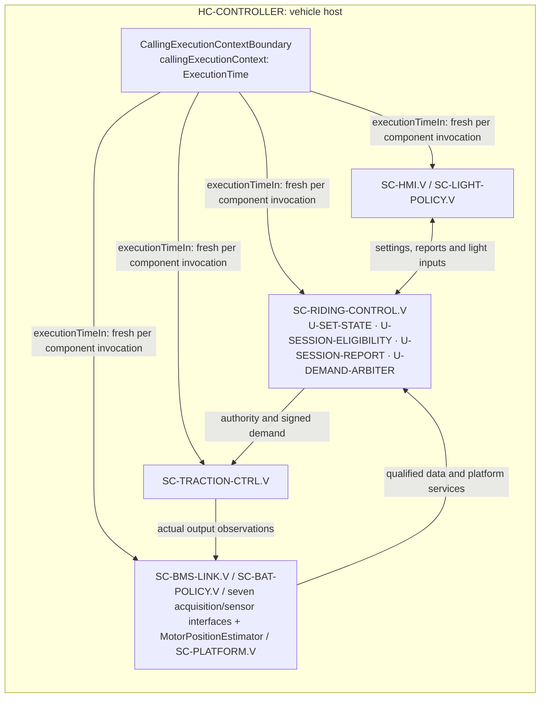
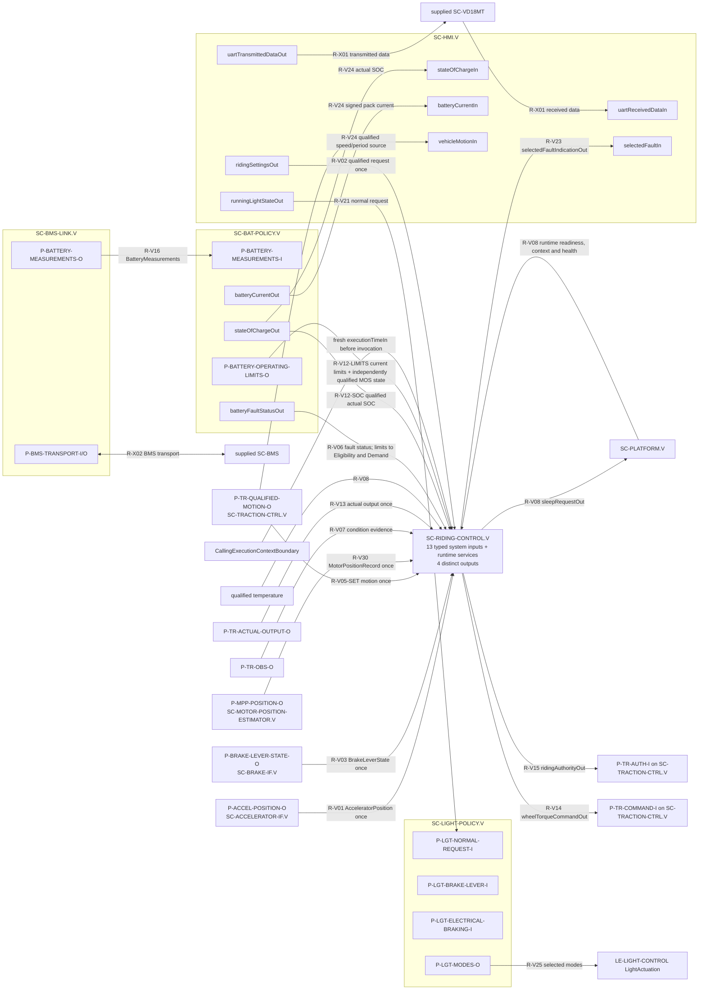
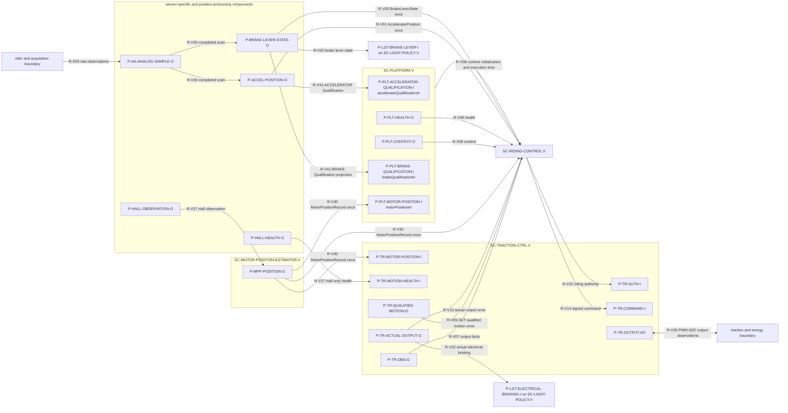
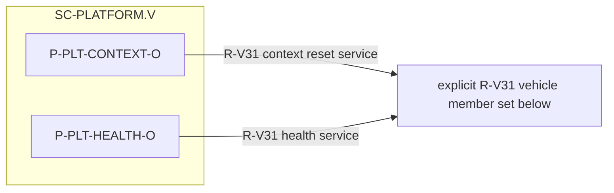

# ARCH-003 — Software architecture and deployment

**Draft EPCS baseline — 2026-10-06.** Software ownership and contracts support the E/E retrofit only. Supplied BMW mechanical behavior is platform context; the scope update does not add or validate a mechanical software responsibility.
**Historical Draft 1.4 — 2026-09-14; successor to ARCH-003-R1.1 (superseded for current scope).** This controlled refinement records Hall interpretation and Hall-sensored FOC responsibility with the selected EVM traction-board and WeAct vehicle-host boundaries while preserving existing released requirement targets. It remains consistent with [FC-001](../FC-001_Functional_Concept.md), [FC-002](../FC-002_Function_Trace.md) and REQ-001-R2.0. Timing, circuit, algorithm, diagnostic-coverage and physical-output acceptance remain derived work.

## Reading this architecture

ARCH-003 is the canonical software architecture document. It contains the static component, port, dataflow and state-ownership view. Its `SW-I-*`, `P-*` and `R-*` names are stable cross-view architecture identifiers. Component interfaces define contracts, not literal Rust statics, pins, task contexts, firmware APIs or presently delivered intercom endpoints. Troubleshooting inspects component-local state and operational records with a debugger; the architecture adds no reporting or aggregation path for that purpose. Supplied `SC-BMS` and `SC-VD18MT` remain external opaque components. All project component instances in this document are vehicle-scoped (`.V`) with independent producer/reset context and validity.

## Scope, component identities and hosts

`LE-*` remains the requirement-level responsibility. The component mappings below refine
the allocated logical responsibilities; the acquisition interfaces do not create a
blanket input allocation.

| Logical responsibility | Project component | Purpose |
|---|---|---|
| [LE-RIDING](../SystemArchitecture/ARCH-001_System_Architecture.md#le-riding) | SC-RIDING-CONTROL | One vehicle component containing U-SET-STATE, U-SESSION-ELIGIBILITY, U-SESSION-REPORT and U-DEMAND-ARBITER. U-SET-STATE settings, U-SESSION-ELIGIBILITY lifecycle/authority, U-SESSION-REPORT reporting and U-DEMAND-ARBITER demand state remain separate internally. |
| LE-HMI (`HmiInformationProcessing`, within LE-HMI-CONTROL) | SC-HMI | VD18MT protocol framing/interpretation and qualified settings, light and rider-information encoding. |
| LE-BATTERY-SUPERVISION | SC-BMS-LINK | Selected BMS UART response interpretation and qualification. |
| LE-BATTERY-SUPERVISION | SC-BAT-POLICY | Battery capability, restriction and battery-fault information policy. |
| LE-LIGHT-POLICY (`LightModeSelection`, within LE-LIGHT-CONTROL) | SC-LIGHT-POLICY | Normal-light retention and Front Off/On plus Rear Off/Dim/Full selection from qualified mechanical-lever and actual electrical-braking inputs. |
| LE-PLATFORM | SC-ANALOG-ACQ | Owns shared raw regular/injected record storage and loss admissibility. It serves accelerator, retained qualification and motor-position contributors without owning their semantic conversion or final position. |
| LE-ACCELERATOR-QUAL | SC-ACCELERATOR-IF | Owns accelerator position/rest semantic conversion and its composite qualification. |
| LE-BRAKE-STATE, within LE-MECHANICAL-BRAKE | SC-BRAKE-IF | Owns qualification of the four-state mechanical lever identity from the LE-BRAKE-SIGNAL measurement path. Its public `BrakeLeverState` composite has exactly `State` and `Qualification`. |
| LE-MOTOR-CTRL, within LE-TRACTION-CONTROL | SC-TEMPERATURE-IF and SC-SUPPLY-IF | Separate temperature and supply components perform traction-board/motor and PVDD/GVDD conversion. The wrapper allocates physical logical measurements to their existing acquisition/conversion chains; it adds no second sensor input or conversion component. |
| LE-MOTOR-POSITION-PROC, within LE-TRACTION | SC-HALL-IF, SC-MOTOR-PHASE-IF and SC-MOTOR-POSITION-ESTIMATOR | Joint semantic realization: Hall is mandatory, phase current and separately qualified applied voltage can assist only when observable. The estimator owns one final `MotorPositionRecord(Position, Qualification)` publication to TractionControl, RidingControl and Platform. Hall/phase interfaces retain their acquisition and semantic-conversion contributions. |
| LE-MOTOR-CTRL, within LE-TRACTION-CONTROL | SC-TRACTION-CTRL | The sole control core: authority-context command acceptance, final-position FOC execution, qualified output/energy observation, and local categorized temperature/supply/stage/protection condition evaluation. That evaluation remains active independently of authority; U-SESSION-ELIGIBILITY retains fault latch/report ownership. `MotorControlRealization` coordinates this core with the existing acquisition, temperature and supply components. |
| LE-PLATFORM | SC-PLATFORM | Local execution, reset-context, persistence and platform-health services. |

The following are supplied opaque software components, deliberately outside the project components above. `SC-BMS` is vendor firmware hosted by `HC-BMS`. `SC-VD18MT` is the display firmware hosted within the VD18MT assembly in `HC-RIDER`; neither receives project units or an invented vendor-internal decomposition. SC-HMI retains project responsibility for vehicle-side display protocol interpretation.

| Deployment | Instances | Host and boundary |
|---|---|---|
| Vehicle (`.V`) | SC-RIDING-CONTROL.V, SC-HMI.V, SC-BMS-LINK.V, SC-BAT-POLICY.V, SC-LIGHT-POLICY.V, SC-ANALOG-ACQ.V, SC-ACCELERATOR-IF.V, SC-BRAKE-IF.V, SC-TEMPERATURE-IF.V, SC-SUPPLY-IF.V, SC-MOTOR-PHASE-IF.V, SC-HALL-IF.V, SC-MOTOR-POSITION-ESTIMATOR.V, SC-TRACTION-CTRL.V and SC-PLATFORM.V | **HC-CONTROLLER** is the one selected vehicle host, including motor control. It exchanges electrical signals with the physical input, traction, lighting, energy and HMI components defined by ARCH-001/ARCH-002. |

The DRV8300DRGE-EVM and WeAct STM32H723VGT6 are selected vehicle traction board and `HC-CONTROLLER`, respectively, under their [integration contracts](../DRV8300DRGE-EVM/DRV8300DRGE-EVM_Integration_and_Requirements_Fit.md), [vehicle-host contract](../DRV8300DRGE-EVM/DRV8300DRGE-EVM_WeAct_STM32H723VGT6_Traction_HSI.md), [allocated traction HSI](../DRV8300DRGE-EVM/DRV8300DRGE-EVM_WeAct_STM32H723VGT6_Traction_HSI.md), and [runtime integration contract](Runtime_Integration_Contract.md). The HSI allocates the configuration-identified fast epoch integration and FOC execution chain: SC-ANALOG-ACQ.V owns raw regular/injected records, each named interface owns its semantic record, and SC-TRACTION-CTRL.V executes FOC from the qualified fast inputs and final motor position. The runtime contract maps logical owners to project bindings and direct/scheduled execution without making a component or unit synonymous with an OS task. It does not establish physical qualification evidence.

For the bounded MotorControl specialization pilot, `MotorControlRealization` is the
software specialization of the canonical `MotorControl` boundary represented by
`LE-MOTOR-CTRL`. It contains the one `SC-TRACTION-CTRL` core and references the existing
acquisition, temperature and supply components. The core remains the one FOC/output
writer and does not claim to perform all sensor conversions. Its detailed-design
selection and the five existing core unit parts are documented in [DD-003 — Static
software architecture views](TractionControl/DetailedDesign/TractionControl_Detailed_Design.md#draft-motorcontrol-specialization-pilot).
The `:>>` selection is an occurrence mapping across these views; it does not add a
runtime component or task.

The deployment view shows execution boundaries; detailed component membership is in the table above. Each deployed type has the explicit vehicle-local state shown below.

## Component contracts and owned state

| Component | Inputs / outputs | Owned state and exclusions |
|---|---|---|
| SC-ANALOG-ACQ and SC-ACCELERATOR-IF / SC-BRAKE-IF / SC-TEMPERATURE-IF / SC-SUPPLY-IF / SC-MOTOR-PHASE-IF / SC-HALL-IF / SC-MOTOR-POSITION-ESTIMATOR | Raw acquisition records → each owner’s typed value and qualification with producer/reset context and locally evaluated age | The seven acquisition/sensor interfaces keep raw acquisition and semantic conversion distinct. MotorPositionEstimator owns the sole final `MotorPositionRecord(Position, Qualification)` and publishes it once to TractionControl, RidingControl and Platform; its qualification carries current health/fault context even when Position is unavailable. AcceleratorInterface’s `AcceleratorPosition` contains `Position` and `Qualification`; its qualification carries current health/diagnostic evidence. None owns a rider-demand decision, physical truth or command authority. |
| SC-RIDING-CONTROL | Qualified `RiderSettingsRequest`, accelerator/brake/motion/motor-position, battery, traction, platform and runtime records → four separate outputs: `RidingAuthority`, `WheelTorqueRequest`, `SelectedFaultIndication`, and `ComputeSleepRequest` | One bounded invocation receives each shared input record once. U-SET-STATE owns requested/pending/active settings; U-SESSION-ELIGIBILITY owns Ready, lifecycle, authority and current-session inhibition; U-SESSION-REPORT owns selected-fault retention; U-DEMAND-ARBITER owns signed demand, 10% actual-SOC positive-propulsion eligibility boundary, electrical bounds, and regeneration/restriction episodes. Active settings are internal to RidingControl. Authority and command retain independent expiry/lifetime. The component does not own actual torque, raw ADC, FOC or hardware inhibition. |
| SC-TRACTION-CTRL | Authority-context command plus qualified fast observations → typed phase-excitation command, qualified physical-motion and actual-output evidence | It publishes vehicle speed/direction/standstill separately from actual applied wheel torque/active electrical braking. `U-ANALOG-ACQ-FAST` owns direct JEOS/JDR epoch publication; the phase, supply and motor-position contributors publish their typed qualified evidence; `U-TRACTION-CONTROL` produces next compare/context data including `CCR4`, and `U-TRACTION-OUTPUT` alone stages/commits CCR1..4/JSQR. `actuationInhibited` overrides requested excitation. Separately observed physical-stage evidence and independent hardware-protection evidence return from TractionHardware; neither is inferred from a software request or a zero command. It executes the MCD-001 Hall-sensored FOC contract only with valid current/voltage/configuration evidence; then rejects absent, invalid, expired or context-mismatched authority/commands and requests both torque signs inhibited within the derived bound (REQ-SYS-INT-004). |
| SC-BMS-LINK | Read-only UART transport → field-qualified `BatteryMeasurements` | Owns protocol interpretation and private per-source/per-field accepted-update timers, not UART electrical safety, BMS measurement time/accuracy, vendor firmware or BMS protection. |
| SC-BAT-POLICY | `BatteryMeasurements` and compiled pack configuration → recognized `BatteryFaultStatus`, current-only `BatteryOperatingLimitsAssessment`, actual SOC and signed pack current | Shared source-input checks are internal to BatteryProtection and included in each applicable branch qualification; discharge and charge branches qualify against their own startup, configuration, group and protection/path checks. Effective current limits are finite and non-negative; qualified zero is valid capability data, while missing required input leaves the affected branch unqualified with effective current zero. It owns battery-side voltage/current/temperature/protection/path restrictions, not vehicle wheel-torque or speed ceilings, hardware protection or the SC-RIDING-CONTROL fault latch. |
| SC-HMI / SC-LIGHT-POLICY | Qualified VD18MT receipts plus U-SESSION-REPORT-selected fault/no-error, battery and Traction motion records → encoded HMI fields; qualified normal-light request, separately qualified mechanical brake-lever and actual electrical-braking states → selected Front Off/On plus Rear Off/Dim/Full modes | SC-HMI realizes `HmiInformationProcessing`; the current Draft System allocation also assigns interpretation of `HmiPowerLockObservation` into `VehicleOperationRequest` to this function, while detailed port/unit mapping remains later refinement. Fault selection remains U-SESSION-REPORT, request normalization remains U-SET-STATE and normal-light retention remains LightPolicy. `LE-HMI-ELECTRICAL` owns display-supply/UART compatibility and conditions VD18MT pin-5 switched voltage for a compatible `LE-COMPUTE-HW` wake input. This physical wake path remains separate from the software operation-request interpretation. `U-PLATFORM-BINDING` owns selected low-power/wake hardware setup; `U-PLATFORM-CONTEXT` owns post-wake startup/context recovery. ARCH-002 retains the fixed five-wire physical bundle and pin realization. |
| SC-PLATFORM | Reset, scheduling and local health events → context services and self-test contribution | Owns project startup/peripheral/IRQ bindings, execution priority/scheduling selection and platform service state; each consumer owns interpretation of a lost/reset context. Generic register drivers remain resource access only. |

### Retained restriction and reset state

## Typed software interactions

These local interfaces refine, and do not replace, ARCH-001 `IF-A-001` through `IF-A-011`. Every project-host software component has the canonical typed `executionTimeIn` input carrying `ExecutionTime(currentTimeMicroseconds:Integer)` from its caller; supplied external endpoints do not. Data exchanges retain value, qualification and producer/reset context; measurement and event timestamps describe their actual source timing. Symbolic deadlines are derived later.

The caller samples the shared monotonic host clock immediately before each component invocation and holds that `currentTimeMicroseconds` value fixed for the invocation. It is never a planned release timestamp or a stale task-start snapshot reused after an unbounded delay. Direct and interrupt callers supply the same reference without a queue or scheduler. Each component owns its own timeout supervision and applies the supplied time to local age and expiry decisions; WCET and elapsed margin evidence bound the fixed invocation input. The current cyclic `src/os` path still passes planned `task.timestamp_us` to callbacks, which is a documented implementation limitation; a future calling-task adapter obtains live `GetElapsedMicroseconds` at the call boundary. No clock-provider component or Platform time broadcast is introduced.

| Local interface | Endpoints | Semantic kind | Exchange |
|---|---|---|---|
| SW-I-001 | SC-ACCELERATOR-IF / SC-BRAKE-IF / SC-TRACTION-CTRL → SC-RIDING-CONTROL; SC-BRAKE-IF → SC-LIGHT-POLICY | Data publication | IF-A-001 qualified `AcceleratorPosition` and `BrakeLeverState`; IF-A-005 qualified physical motion. Each shared record enters RidingControl once; its internal units apply their own contracts. |
| SW-I-002 | SC-HMI → SC-RIDING-CONTROL | Data publication | IF-A-002 current-startup settings receipt and decoded request. Requested, pending and active values remain internal to RidingControl; there is no active-settings component route. |
| SW-I-003 | BMS-LINK → BAT-POLICY; BAT-POLICY → SC-RIDING-CONTROL and SC-HMI | Data publication | IF-A-009 field-qualified `BatteryMeasurements`; IF-A-003 `BatteryFaultStatus`, `BatteryOperatingLimitsAssessment` with independent discharge/regenerative-charge branches, and rider-information fields. Sensor/traction condition evidence routes directly to RidingControl and does not fan into BAT-POLICY. |
| SW-I-004 | SC-RIDING-CONTROL → SC-TRACTION-CTRL | Control token plus data | IF-A-004 independent `RidingAuthority` and signed `WheelTorqueRequest`, each with its own validity/expiry. Traction acceptance fails closed for either absent, mismatched, invalid or expired record. |
| SW-I-005 | SC-TRACTION-CTRL → SC-RIDING-CONTROL, SC-HMI and SC-LIGHT-POLICY | Data publication | IF-A-005 qualified physical motion and actual applied-output evidence; actual electrical-braking state remains separately qualified. |
| SW-I-006 | SESSION/BAT-POLICY/TRACTION-CTRL → HMI; HMI/BRAKE-IF/TRACTION-CTRL → LIGHT-POLICY | Data publication | IF-A-006 `SelectedFaultIndication`, actual SOC, signed pack current, `QualifiedMotion` and `runningLightStateOut`; `brakeLeverStateIn` and `electricalBrakingStateIn`; LIGHT-POLICY emits selected LightModes to physical LE-LIGHT-CONTROL/LightActuation. |
| SW-I-008 | TEMPERATURE-IF / SUPPLY-IF → TRACTION-CTRL; qualified temperature → SC-RIDING-CONTROL and PLATFORM; qualified PVDD → PLATFORM | Data publication | IF-A-008 carries value-bearing qualified temperature and PVDD to their consumers. Fast local PVDD remains a traction-control input. GVDD is qualified and evaluated locally in TractionControl; RidingControl receives `TractionConditionEvidence` with startup prerequisite and categorized conditions, never the numeric GVDD value. Generic conversion-health evidence remains on its existing service-health route. |
| SW-I-009 | PLATFORM → all local components | Event and local service call | Startup, reset-context invalidation, watchdog/platform-health and scheduling-service events. |

Calls request a bounded local service and return completion/availability only; they do not transfer permission by themselves.  Data publications are sampled with explicit age/context checks at the consumer.  Events record a discrete reset, withdrawal, detected fault or physical transition; consumers must not reconstruct an event from a static value alone.

## Static port registry and connection catalogue

This is the canonical static architecture view: it identifies component instances, their explicit architectural ports, the payloads exchanged, connection ownership and the local host boundary. “Static” describes this structural view. It does **not** require global/static-memory variables, create an API, task, queue or intercom endpoint, or expose private implementation fields. Detailed unit-local fields, IRQ mechanics and implementation bindings remain in [DD-003](DetailedDesign/DD-003_Static_Software_Architecture_Views.md) and the [runtime integration contract](Runtime_Integration_Contract.md).

Each publication carries producer identity, producer/reset context, applicable configuration, semantic value and qualification. Where their unit contract defines a meaningful measurement or event timestamp, records retain that source time in the shared microsecond domain (or a qualified acquisition-boundary conversion); receipt time never retimestamps earlier evidence. Battery publications are the explicit exception: they carry values and field qualification only, while producer source-age and consumer delivery watchdogs remain private. Consumers independently validate what they use. `Unknown`, `Invalid`, `Stale` and `Qualified` remain different outcomes, with age determined locally from caller-supplied execution time and the owning contract. A control intent, zero request, command acceptance or output/activity observation is not physical-state evidence.

### Reading port views

The four endpoint-level views below show every selected `P-*` contract inside its host-scoped component. Each arrow is an existing `R-*` route with a short payload label. The registry remains the complete contract definition and the catalogue remains the complete connection index.

### Owned shared records and retained state

“Shared” here means a named owner publishes or gives bounded read access to a record. It does not mean a global variable. State private to a component is deliberately not listed.

| Owner | Named state or snapshot | Readers / route family | Boundary |
|---|---|---|---|
| `SC-ANALOG-ACQ.V` and SC-HALL-IF.V | `AnalogSample`, injected epochs and Hall capture rings with sampled state | the named sensor interfaces and `U-HALL-POSITION` | Analog acquisition owns scan storage/loss admissibility; Hall owns its capture and electrical-position interpretation. |
| `U-ANALOG-ACQ-FAST` / semantic phase, supply and motor-position contributors / `U-TRACTION-CONTROL` / `U-TRACTION-OUTPUT` | Direct injected epoch, typed phase/PVDD/final-position evidence and `PWMAndADCSamplingPlan` | the immediately following detailed unit only | These are not SC public ports or ARCH-003 `R-V*` routes. The runtime contract and DD own the direct JEOS-to-output allocation. |
| `SC-RIDING-CONTROL.V` | U-SET-STATE settings; U-SESSION-ELIGIBILITY lifecycle/authority/inhibition; U-SESSION-REPORT selected-fault lifetime; U-DEMAND-ARBITER arbitration/recovery state | Internal unit state; external outputs listed below | Active settings remain internal; independent authority/command expiry and report/fault lifetimes are preserved. |
| `U-DEMAND-ARBITER` | Current qualified actual SOC and positive-propulsion eligibility | Internal RidingControl decision; `stateOfChargeIn` | Positive propulsion is zero at or below 10% and eligible above 10% under the existing guards and ramp. Missing, invalid or stale SOC cannot establish eligibility. |
| `SC-BAT-POLICY.V` | Current-only `BatteryOperatingLimitsAssessment`, qualified actual SOC and signed pack current | typed SC-RIDING-CONTROL and HMI routes | Eligibility and Demand check SOC and operating-limit qualification with independent private publication-delivery watchdogs; battery outputs carry no assessment timestamp. It owns no positive-propulsion policy state. |

### Complete port registry

The port registry names each vehicle instance explicitly; the `.V` suffix keeps every concrete producer, consumer and reset context unambiguous.

| Port ID | Owner and instance scope | Direction | Payload or service contract | Lifecycle and ownership |
|---|---|---|---|---|
| `P-PLT-CONTEXT-O` | `SC-PLATFORM.V` | provided | New local context, startup/reset invalidation and component-start service | Platform owns local context creation. A reset withdraws affected prior-context records before they can be used. |
| `P-CALLING-EXECUTION-TIME-O` (`callingExecutionContext.executionTimeOut`) | `CallingExecutionContextBoundary` | provided | `ExecutionTime(currentTimeMicroseconds:Integer)` to each component `executionTimeIn` | Caller samples immediately before each component invocation. A bounded internal leaf dispatch may inherit the fixed reference; a new invocation samples again. This is a call argument dependency, not a queued time stream. |
| `P-PLT-HEALTH-O` | `SC-PLATFORM.V` | provided | Watchdog/platform-health, scheduling and local resource events | Components interpret their own lost/reset context. This port grants neither operating permission nor physical safety reaction. |
| `P-AA-ANALOG-SAMPLE-O` (`analogSampleOut`) / `P-AA-FAST-O` | `SC-ANALOG-ACQ.V` | provided internal record | `AnalogSample` / injected epoch snapshot | Acquisition owns storage and loss detection. DMA error, overwrite, cache/coherency loss, context change or incomplete scan is unavailable. |
| `P-ACCEL-POSITION-O` / `P-BRAKE-LEVER-STATE-O` (`brakeLeverStateOut`) | `SC-ACCELERATOR-IF.V` / `SC-BRAKE-IF.V` | provided | Composite `AcceleratorPosition` (`Position` plus `Qualification`) / exact `BrakeLeverState` (`State` plus `Qualification`) | Brake `State` contains `leverCombination` (`Neither`/`Left`/`Right`/`Both`) and actual `measurementTimeMicroseconds`. Its `Qualification` carries the logical qualification plus `initialQualificationPending` and `recognizedMeasurementFault`; it is never replaced by a released Boolean. |
| `P-HALL-OBSERVATION-O` | `SC-HALL-IF.V` | provided | Qualified Hall code, sector bounds and accepted transition evidence | It is not final electrical angle, speed, vehicle direction or standstill. |
| `P-MPP-POSITION-O` | `SC-MOTOR-POSITION-ESTIMATOR.V` | provided | Final `MotorPositionRecord(Position, Qualification)` composite | This is the sole final-angle publication to TractionControl, RidingControl and Platform. `SoftwareMotorPositionQualification` retains source/reason/event-time/configuration/reset context even when Position is unavailable; qualification-only updates do not refresh Position reference time. Hall-only bounded static angle and observer contribution have independent qualification. |
| `P-MPI-APPLIED-VOLTAGE-I/O` | `SC-MOTOR-PHASE-IF.V` | required/provided | Explicit applied-winding-voltage evidence / qualified observer-voltage publication | The input is unavailable until its source/frame/provenance/timing/error qualification exists; regular phase-voltage diagnostics have no route here. |
| `P-HALL-HEALTH-O` | `SC-HALL-IF.V` | provided | Hall capture/observation health evidence | HallInterface owns capture and observation interpretation; this health is also the motion-specific qualification input. |
| `uartReceivedDataIn` / `uartTransmittedDataOut` | `SC-HMI.V` | required/provided LE-HMI-ELECTRICAL boundary | Qualified received/transmitted VD18MT data | `U-HMI-ADAPTER` owns framing, parser and TX state. Link/byte loss is interpreted here; it neither creates a receipt nor a generic system fault. The driver/peripheral remains a realization decision. |
| `ridingSettingsOut` | `SC-HMI.V` | provided | `HmiRiderSettingsRequest` with concrete riding values, qualification, context and original frame receipt time | A setting exists only after valid current-context frame interpretation. Initial receipt is distinct from retained active settings. |
| `runningLightStateOut` | `SC-HMI.V` | provided | Qualified rider normal-light request | LightPolicy retains a valid request under its loss rule. |
| `selectedFaultIn`, `stateOfChargeIn`, `batteryCurrentIn`, `vehicleMotionIn` | `SC-HMI.V` | required | U-SESSION-REPORT-selected fault/no-error, qualified actual SOC, signed pack current and qualified physical vehicle motion | SC-HMI encodes parent-defined fields with fallback gates; it does not select faults, manufacture a measurement, acknowledge display receipt or receive a separate health-only route. |
| `executionTimeIn` | `SC-RIDING-CONTROL.V` | required | Caller-sampled `ExecutionTime` for this component invocation | One fresh fixed reference per invocation; all four internal units receive the same reference and do not resample. |
| `vehicleOperationRequestIn` / `runtimeInitializationIn` | `SC-RIDING-CONTROL.V` | required | Qualified vehicle On/Off request and current runtime readiness | Explicit qualified Off closes the operation session regardless of motion; unknown/unavailable is not Off. Runtime readiness is a startup prerequisite, not Ready. |
| `acceleratorPositionIn` / `brakeLeverStateIn` | `SC-RIDING-CONTROL.V` | required | Complete qualified `AcceleratorPosition` and `BrakeLeverState` records | Each shared record enters the component once. Its receiving units apply their own qualification, timing and behavior contracts. |
| `qualifiedVehicleMotionIn` / `motorPositionIn` | `SC-RIDING-CONTROL.V` | required | Qualified physical motion and complete estimator `MotorPositionRecord(Position, Qualification)` | One external publication each. Unknown motion is not standstill; motor-position qualification remains available when Position is unavailable. |
| `qualifiedTemperatureIn` / `tractionConditionEvidenceIn` | `SC-RIDING-CONTROL.V` | required | Qualified motor/board temperature and categorized traction condition/startup evidence | Local conversions and diagnostics remain with their existing owners; RidingControl applies vehicle latch/report policy. |
| `hmiRiderSettingsRequestIn` | `SC-RIDING-CONTROL.V` | required | Qualified concrete settings request with context and original receipt time | Only valid current-context receipt supplies startup receipt; requested, pending and active state is internal. |
| `batteryFaultStatusIn` / `stateOfChargeIn` / `batteryOperatingLimitsIn` | `SC-RIDING-CONTROL.V` | required | Recognized battery fault information, qualified actual SOC, and current assessed operating limits including independently qualified `mosDisabledState` | BatteryFaultStatus carries fault evidence only. Actual SOC feeds Eligibility, Demand and U-SESSION-REPORT; each independently checks delivery. The operating-limits stream feeds these units; report checks MOS-state delivery independently of current-limit branch qualification. Ready checks the qualified discharge branch without requiring positive capability, charge qualification or HMI-only current. MOS state is never inferred from zero current. |
| `actualTractionOutputIn` | `SC-RIDING-CONTROL.V` | required | Qualified actual output, applied torque, active electrical braking and powered-forward evidence | U-DEMAND-ARBITER and its regeneration rearm use actual qualified evidence; a request, PWM state or Hall state alone cannot rearm. |
| `platformContextIn` / `platformHealthIn` | `SC-RIDING-CONTROL.V` | required service | Current reset/context generation and platform-health evidence | Reset invalidates old prerequisite evidence; each unit retains its specified state lifetime. |
| `ridingAuthorityOut` | `SC-RIDING-CONTROL.V` | provided | Current authority generation, decision sequence/time and independent expiry | Consumer fails closed on loss, mismatch, invalidity or expiry. A newer torque command never refreshes authority. |
| `wheelTorqueCommandOut` | `SC-RIDING-CONTROL.V` | provided | `WheelTorqueRequest` signed rear-wheel torque plus independent discharge/regenerative-charge current bounds, qualification/context and command expiry | Separate output from authority. Traction accepts/rejects and applies current bounds by actual electrical transfer. |
| `selectedFaultIndicationOut` | `SC-RIDING-CONTROL.V` | provided | Selected reportable fault code or no-error with qualification/context | U-SESSION-REPORT selects and retains; HMI only encodes. Every recognized fault retains its independent physical response. |
| `sleepRequestOut` | `SC-RIDING-CONTROL.V` | provided | Qualified expiring `ComputeSleepRequest` after required traction output handoff | Platform validates the current grant at entry and does not renew permission; revocation/expiry cannot authorize sleep. |
| `P-BMS-TRANSPORT-I/O` | `SC-BMS-LINK.V` | required/provided external boundary | Selected BMS UART read transaction and received transport observations | Vendor firmware is opaque. No BMS write/control capability is exposed by this architecture. |
| `batteryMeasurementsOut` | `BmsLink.V` | provided | `BatteryMeasurements`: qualified pack voltage/current, SOC candidate/source evidence, all 14 group voltages, available BMS temperatures and protection/path state, each fieldwise qualified | Transaction/decode/publication owns protocol interpretation and private source timers. Packet return or BMS wake does not restore vehicle authority or regenerative charge acceptance. |
| `batteryMeasurementsIn` | `BatteryProtection.V` | required | Typed BatteryMeasurements | No temperature/supply/phase/traction observation fan-in exists. Separate discharge/regenerative candidates require their needed battery measurement evidence. |
| `batteryFaultStatusOut`, `batteryOperatingLimitsOut`, `stateOfChargeOut`, `batteryCurrentOut` | `BatteryProtection.V` | provided | Recognized battery fault information only; current-only effective operating limits with independent branch qualification; qualified actual SOC; signed pack current | Each applicable branch carries qualification from its own required startup/configuration, group and protection/path checks; qualified zero capability is valid and is not a fault. BatteryProtection does not publish vehicle positive-propulsion eligibility policy. The output records do not prove physical protection. |
| `P-TR-AUTH-I` | `SC-TRACTION-CTRL.V` | required | `ridingAuthorityOut` from SC-RIDING-CONTROL.V | Traction independently accepts or rejects authority. Loss/mismatch/expiry commands zero in the software realization. |
| `P-TR-COMMAND-I` | `SC-TRACTION-CTRL.V` | required | `wheelTorqueCommandOut` from SC-RIDING-CONTROL.V, with signed command and both battery current bounds | A command is accepted only with valid current authority, context and configuration. Traction enforces each effective current limit by actual electrical transfer direction. |
| `fastDcLinkVoltageIn` / `qualifiedTemperatureIn` / `regularSupplyVoltageIn` / `supplyHealthIn` | `SC-TRACTION-CTRL.V` | required | Qualified fast PVDD / temperature / regular GVDD / generic conversion-health evidence | Fast PVDD remains a fast-control input. Temperature and regular GVDD, stage/protection evidence, and generic health reach `U-TRACTION-ACCEPT` for local categorized condition evaluation independent of authority. RidingControl receives the resulting startup prerequisite and categorized condition evidence, not a numeric GVDD value. The wrapper allocates physical logical measurement responsibilities to the existing acquisition/conversion chains without adding another SC input. |
| `P-TR-MOTOR-POSITION-I` | `SC-TRACTION-CTRL.V` | required | Final `MotorPositionRecord(Position, Qualification)` | Traction receives this composite once, preserves `SoftwareMotorPositionQualification` for local gating, and forwards the same record to `U-TRACTION-CONTROL`, `U-TRACTION-MOTION` and `U-TRACTION-ACTUAL-OUTPUT`. Hall observation retains sector/transition evidence needed for independent motion qualification. |
| `P-TR-MOTION-HEALTH-I` | `SC-TRACTION-CTRL.V` | required | Hall capture/position health for motion qualification | `U-TRACTION-MOTION` consumes this Hall-only health; the broader FOC health fan-in remains on `sensorHealthIn`. |
| `P-TR-OUTPUT-I/O` | `SC-TRACTION-CTRL.V` | required/provided external boundary | Staged PWM/ADC context and output-stage state, timestamp, source and configuration provenance | `U-TRACTION-ACTUAL-OUTPUT` combines this physical-stage evidence with qualified current/position/motion and its immutable compiled estimator parameters to publish wheel-torque estimate; the boundary is not a demand command. `U-TRACTION-OUTPUT` alone commits literal `CCR1..4`/JSQR. |
| `P-TR-QUALIFIED-MOTION-O` | `SC-TRACTION-CTRL.V` | provided | Physical vehicle speed, direction and standstill with independent qualification | It is a validated interpretation of existing Hall/capture-health and calibration evidence; static or absent edges alone are unavailable, not standstill. Its criteria, timing and diagnostic coverage remain WS-OI-001/006 validation gates. |
| `P-TR-ACTUAL-OUTPUT-O` | `SC-TRACTION-CTRL.V` | provided | Actual applied wheel-torque estimate/evidence, active electrical-braking, output availability and powered-forward travel | It is not a demand command. Positive applied torque and powered-forward travel are independently qualified. |
| `P-TR-OBS-O` | `SC-TRACTION-CTRL.V` | provided | Aggregate output/energy/fault availability observation for SC-RIDING-CONTROL | It reports observation, never proof that a command achieved physical torque or zero output. |
| `P-TR-ELECTRICAL-BRAKING-O` | `SC-TRACTION-CTRL.V` | provided | Traction-owned actual active electrical-braking state, projected with current qualification and observation timing | A requested negative torque is not this state. |
| `P-LGT-NORMAL-REQUEST-I`, `P-LGT-BRAKE-LEVER-I`, `P-LGT-ELECTRICAL-BRAKING-I` | `SC-LIGHT-POLICY.V` | required | Separately typed normal request, exact mechanical `BrakeLeverState` composite, and actual electrical-braking state | LightPolicy derives actuation from a qualified lever combination; pending, faulted or stale brake state remains distinct from a valid `Neither`. |
| `P-LGT-MODES-O` | `SC-LIGHT-POLICY.V` | provided external intent | Selected Front Off/On and Rear Off/Dim/Full modes to `LE-LIGHT-CONTROL` LightActuation | Policy owns mode selection, not lamp electrical output, conservative startup behaviour or visibility. |
| `P-PLT-ACCELERATOR-QUALIFICATION-I` (`acceleratorQualificationIn`) | `SC-PLATFORM.V` | required | Concrete `AcceleratorPositionQualification` projection | Platform receives only the accelerator `Qualification` projection through its dedicated typed input; other sensor health inputs remain separate. |
| `P-PLT-BRAKE-QUALIFICATION-I` (`brakeQualificationIn`) | `SC-PLATFORM.V` | required | Exact `BrakeQualification` projection | Platform receives only `BrakeLeverState.Qualification`; a health-only update does not refresh the brake state measurement time or create a duplicate SC-RIDING-CONTROL health route. |

The registry contains **vehicle-scoped port contracts**, expressed by **the retained distinct `P-*` names**. The `.V` scopes identify the vehicle-local instances. This is not a count of physically instantiated endpoints, MCU pins or deployed API objects. Multiple consumer attachments to one output port are intentional fanout; a port's data owner remains its producer and each consumer owns acceptance/use.

Accelerator and brake each publish one complete typed record to RidingControl, whose internal units share that invocation snapshot; Platform alone receives the accelerator/brake qualification projections. MotorPositionEstimator sends one complete `MotorPositionRecord` to concrete `motorPositionIn` recipients on TractionControl, RidingControl and Platform. The remaining generic contextual and sensor-health inputs continue to serve their other records; no accelerator, brake or estimator composite is routed through them. Each typed recipient carries the full composite or the explicit qualification projection, including qualification evidence when its semantic state is unavailable.

### Complete connection route catalogue

Route IDs are used in every figure. Delivery labels describe the selected architectural realization, not a completed firmware transport. `Scheduled direct/owned snapshot` means a project-selected direct call or owner-managed record until a separately qualified intercom extension exists. `Direct fast` is a same-handler handoff. `Service` is a bounded local call/event, not an authorization transfer.

| Route | Producer port -> consumer port | `SW-I` / contract | Delivery and data owner | Age, loss and lifecycle rule |
|---|---|---|---|---|
| `R-V01` | `SC-ACCELERATOR-IF.V.P-ACCEL-POSITION-O` -> `SC-RIDING-CONTROL.V.acceleratorPositionIn` | SW-I-001/002, IF-A-001/002 | One scheduled/direct typed `AcceleratorPosition` snapshot to RidingControl | U-SET-STATE uses qualified `Position` rest evidence; eligibility and demand share the same input record and apply their own local checks. Initial absence cannot be replaced by retained active setting. |
| `R-V02` | `SC-HMI.V.ridingSettingsOut` -> `SC-RIDING-CONTROL.V.hmiRiderSettingsRequestIn` | SW-I-002, IF-A-002 | One scheduled adapter publication; HMI owns concrete request/qualification | Only a valid current-context frame supplies receipt; no duplicate settings route exists. |
| `R-V03` | `SC-BRAKE-IF.V.P-BRAKE-LEVER-STATE-O` -> `SC-RIDING-CONTROL.V.brakeLeverStateIn` | SW-I-001, IF-A-001 | One scheduled/direct exact `BrakeLeverState` composite snapshot | Eligibility and demand share the same record and evaluate their own age/recognition rules; no independent brake-health route exists. |
| `R-V05-SET` | `SC-TRACTION-CTRL.V.qualifiedMotionOut` -> `SC-RIDING-CONTROL.V.qualifiedVehicleMotionIn` | SW-I-001/005 | One scheduled/direct qualified motion snapshot | U-SET-STATE and U-DEMAND-ARBITER share the component input record; standstill is used only when qualified. |
| `R-V06` | `BatteryProtection.batteryFaultStatusOut` -> `SC-RIDING-CONTROL.V.batteryFaultStatusIn` | SW-I-003 | Scheduled direct/owned snapshots; BatteryProtection owns fault status and operating-limit assessment | U-SESSION-ELIGIBILITY consumes BatteryFaultStatus for recognized fault ordering and the same BatteryOperatingLimitsAssessment broadcast consumed by both Eligibility for the existing Ready guard and Demand for branch-specific limits. |
| `R-V07` | `SC-TRACTION-CTRL.V.tractionConditionEvidenceOut` -> `SC-RIDING-CONTROL.V.tractionConditionEvidenceIn` | SW-I-005 | Scheduled direct/owned snapshot; traction owns observation | Unavailable output/self-test facts cannot satisfy Ready. |
| `R-V08` | `SC-PLATFORM.V.runtimeInitializationOut`, `platformContextOut`, `platformHealthOut`, `executionTimeOut` -> corresponding RidingControl inputs | SW-I-009 | Platform services to one component invocation; execution-time reference sampled immediately before invocation | Reset invalidates old prerequisite evidence; nested units receive the fixed component reference. |
| `R-V16` | `BmsLink.batteryMeasurementsOut` -> `BatteryProtection.batteryMeasurementsIn` | SW-I-003, IF-A-003/009 | Scheduled direct/owned snapshot; BmsLink owns fieldwise measurements | Returned packet does not restore operating capability or session state. |
| `R-V12-SOC` | `SC-BAT-POLICY.V.stateOfChargeOut` -> `SC-RIDING-CONTROL.V.stateOfChargeIn` | SW-I-003, SOC-003, SOC-004, SOC-005 and SOC-008 | Scheduled direct/owned qualified actual-SOC publication | Eligibility and Demand consume the same record and maintain independent private delivery watchdogs; delivery liveness never requalifies BmsLink source data. Invalid, unqualified, missing, stalled or queued-old SOC cannot establish positive-propulsion eligibility. |
| `R-V12-LIMITS` | `SC-BAT-POLICY.V.batteryOperatingLimitsOut` -> `SC-RIDING-CONTROL.V.batteryOperatingLimitsIn` | SW-I-003 | Scheduled direct/owned current operating-limits publication with independently qualified `mosDisabledState` | Eligibility checks the discharge branch and Demand checks each consumed electrical branch with their own delivery watchdogs. U-SESSION-REPORT receives the same existing stream as a typed input and independently checks MOS-state delivery current under its private watchdog; it does not infer MOS state from zero current. No SOC wheel caps are carried here. |
| `R-V20` | `SC-BRAKE-IF.V.P-BRAKE-LEVER-STATE-O` -> `SC-LIGHT-POLICY.V.P-LGT-BRAKE-LEVER-I` (`brakeLeverStateIn`) | SW-I-001/006 | Scheduled direct/owned exact composite snapshot; BrakeInterface owns the mechanical-lever record | LightPolicy derives actuation from qualified enum State; pending/faulted input invokes the existing conservative physical-boundary rule, not an inferred lever state. |
| `R-V21` | `SC-HMI.V.runningLightStateOut` -> `SC-LIGHT-POLICY.V.runningLightStateIn` | SW-I-006 | Scheduled direct/owned snapshot; HMI owns request | Valid normal-light request retains across HMI link loss under the existing rule. |
| `R-V22` | `SC-TRACTION-CTRL.V.P-TR-ELECTRICAL-BRAKING-O` -> `SC-LIGHT-POLICY.V.P-LGT-ELECTRICAL-BRAKING-I` | SW-I-005/006 | Scheduled direct/owned projection; Traction owns actual-braking state | Qualified active braking and unqualified actual-braking state remain distinct. |
| `R-V23` | `SC-RIDING-CONTROL.V.selectedFaultIndicationOut` -> `SC-HMI.V.selectedFaultIn` | SW-I-006, IF-A-006 | Scheduled direct/owned `SelectedFaultIndication`; U-SESSION-REPORT owns selection | HMI transmission does not prove display receipt. |
| `R-V24` | `SC-BAT-POLICY.V.stateOfChargeOut` / `batteryCurrentOut`, `SC-TRACTION-CTRL.V.qualifiedMotionOut` -> `SC-HMI.V.stateOfChargeIn` / `batteryCurrentIn` / `vehicleMotionIn` | SW-I-005/006, IF-A-006 | Scheduled direct/owned snapshots; BatteryProtection and Traction own their records | Presentation fallback is not a qualified battery or motion fact; unresolved status/invalid speed/timing remain encoding gates. |
| `R-V25` | `SC-LIGHT-POLICY.V.P-LGT-MODES-O` -> `LE-LIGHT-CONTROL` LightActuation | SW-I-006, IF-A-006 | Local selected-mode intent; light policy owns selection | Intent does not prove lamp output or visibility. |
| `R-V26` | physical traction/energy boundary -> `SC-TRACTION-CTRL.V.P-TR-OUTPUT-I/O` | HSI-004/009 | Direct hardware acquisition/output binding | Hardware break/external inhibit withdraw physical permit independently. |
| `R-V27` / `R-V30` | `SC-HALL-IF.V.P-HALL-OBSERVATION-O` -> `SC-MOTOR-POSITION-ESTIMATOR.V`; `SC-MOTOR-POSITION-ESTIMATOR.V.P-MPP-POSITION-O` -> `SC-TRACTION-CTRL.V.motorPositionIn`, `SC-RIDING-CONTROL.V.motorPositionIn`, `SC-PLATFORM.V.motorPositionIn` | HSI-009, MPP | Direct Hall observation then one complete final-position publication | Each consumer receives `MotorPositionRecord(Position, Qualification)` even when Position is unavailable. Qualification-only updates retain Position reference time; the estimator has no separate health route or generic health fan-in. Motion separately evaluates retained Hall transition evidence; static or absent edges alone are unavailable, not standstill. |
| `R-V29` | Applied-voltage evidence boundary -> `SC-MOTOR-PHASE-IF.V` -> `SC-MOTOR-POSITION-ESTIMATOR.V` | REQ-SYS-MSM-002, MPP | Explicit observer-only source path | It remains unavailable until direct sensing or calibrated reconstruction qualifies source/frame/timing/provenance/bounds; slow regular diagnostics are excluded. |
| `R-V28` / `R-V43-SUPPLY` | `SC-SUPPLY-IF.V.fastDcLinkVoltageOut` -> `SC-TRACTION-CTRL.V.fastDcLinkVoltageIn`; `SC-SUPPLY-IF.V.supplyVoltageOut` -> `SC-TRACTION-CTRL.V.regularSupplyVoltageIn`; qualified temperature and supply values feed the documented TractionControl consumers; `supplyHealthOut` -> the generic `supplyHealthIn` route | SW-I-008, IF-A-008 | Fast PVDD and temperature retain their external consumers; the numeric regular-GVDD value remains internal to TractionControl, with condition evidence going to RidingControl | Fast PVDD remains the dedicated same-operation control input. Temperature/GVDD and stage/protection evidence support local categorized condition evaluation even while authority is absent. RidingControl receives startup and fault-category evidence and alone latches/reports recognized faults; generic health retains its separate route. |
| `R-V41-ACCELERATOR` | `SC-ACCELERATOR-IF.V.P-ACCEL-POSITION-O.Qualification` -> `SC-PLATFORM.V.P-PLT-ACCELERATOR-QUALIFICATION-I` (`acceleratorQualificationIn`) | SW-I-009, IF-A-001 | Scheduled direct/owned typed qualification projection | Platform receives the `Qualification` health/diagnostic reason/severity/protection request projection. This update may be published without a new ADC sample; it does not make `Position` valid. |
| `R-V41-BRAKE` | `SC-BRAKE-IF.V.brakeHealthOut.qualification` -> `SC-PLATFORM.V.P-PLT-BRAKE-QUALIFICATION-I` (`brakeQualificationIn`) | SW-I-009 | Scheduled direct/owned exact qualification projection | Platform receives only `BrakeQualification`. A qualification-only update does not refresh `BrakeLeverState.State.measurementTimeMicroseconds`, and no duplicate SC-RIDING-CONTROL health route exists. |
| `R-V30` | `SC-ANALOG-ACQ.V.P-AA-ANALOG-SAMPLE-O` -> each named regular sensor-interface raw input | runtime contract | Owned completed-record handoff; analog acquisition owns record and sensor interfaces consume it | A failed, overwritten, incomplete or old-context scan remains unavailable to semantic qualification. |
| `R-V31` | `SC-PLATFORM.V.P-PLT-CONTEXT-O`, `P-PLT-HEALTH-O` -> vehicle components' context-dependent ports | SW-I-009 | Service/event fanout; platform owns context/health events | Applies to every applicable vehicle component; figures show selected edges only. |
| `R-X01` | supplied SC-VD18MT `uartReceivedDataOut` / `uartTransmittedDataIn` <-> `SC-HMI.V.uartReceivedDataIn` / `uartTransmittedDataOut` | IF-A-002/006 | Logical LE-HMI-ELECTRICAL data boundary; HMI adapter owns information interpretation | Pin-5 on/wake is a separate physical path: HMI electrical hardware conditions it before the compatible Compute Hardware wake input. No direct raw wire-to-MCU connection is implied; wake does not grant drive permission. No UART on/off command or display acknowledgement is implied. No decoded setting exists on loss, restart or invalid frame. |
| `R-X02` | supplied BMS -> `SC-BMS-LINK.V.P-BMS-TRANSPORT-I/O` | IF-A-003/009 | One active protected endpoint in the fitted-pack vehicle configuration | BMS vendor internals are out of scope; no second master or exposed vendor endpoint is created. |
| `R-X03` | rider/input acquisition -> `SC-ANALOG-ACQ.V` and the named sensor interfaces’ raw routes | IF-A-001 | Local acquisition boundary | Raw signals/transfer alone are not qualified semantic observations. |

The vehicle catalogue uses route families rather than a fixed route count; individual family members are named where their source or consumer is distinct. `R-V31` is an explicit local fanout family, not an invented message API. Every selected port in the registry participates in at least one route or is a local external-boundary endpoint.

### Endpoint-level static dataflow views

#### Vehicle policy and rider-information ports

#### Vehicle input, traction and platform ports

#### Vehicle platform ports

`R-V31` applies its `P-PLT-CONTEXT-O` and `P-PLT-HEALTH-O` event family to context-dependent consumption in `SC-RIDING-CONTROL.V`, `SC-HMI.V`, `SC-BMS-LINK.V`, `SC-BAT-POLICY.V`, `SC-LIGHT-POLICY.V`, the seven acquisition/sensor interfaces, `SC-MOTOR-POSITION-ESTIMATOR.V`, `SC-TRACTION-CTRL.V` and `SC-PLATFORM.V`. Each component owns its immutable calibration parameter set as part of its firmware build; there is no calibration route. Each is scoped `.V` and keeps its producer ownership.

## Behavioural summaries and timing allocation

The material below explains lifecycle and execution constraints that apply to the static contracts. It does not alter the port ownership or route catalogue above. Detailed sequence/state views remain in [DD-004](DetailedDesign/DD-004_Dynamic_Software_Architecture_Views.md).

**Vehicle startup.** SC-PLATFORM.V creates a new context and marks prior observations unusable. Each software component uses its owner-local immutable calibration parameters compiled into the installed firmware. A parameter change requires a software rebuild, deployment and restart; it is never a runtime message, service activation or context rollover. SC-ANALOG-ACQ.V, the named sensor interfaces, SC-BMS-LINK.V and SC-TRACTION-CTRL.V execute their allocated self-tests/qualification, including applicable parameter checks, without granting torque; SC-RIDING-CONTROL.V receives the current-startup settings request once; SC-BAT-POLICY.V requalifies BatteryMeasurements and produces recognized BatteryFaultStatus, current-only qualified BatteryOperatingLimitsAssessment, actual SOC and signed current. U-DEMAND-ARBITER validates its remaining compiled profile and permits positive propulsion only when current qualified actual SOC is strictly above 10%; at or below 10% positive propulsion is zero. Ready requires qualified discharge-branch data, regardless of whether the effective current limit is positive; charge-branch qualification and HMI-only current do not gate Ready. Each producer reports pass/fail/incomplete with its context to SC-RIDING-CONTROL.V. SC-RIDING-CONTROL.V alone evaluates the simultaneous Ready guard and issues SW-I-004 authority. SC-RIDING-CONTROL.V may then publish a context-matched command only with its individually usable dependencies and its compiled demand profile, which SC-TRACTION-CTRL.V must separately accept. Torque remains commanded to zero until both current authority and a valid command are accepted, and returns to zero when either expires or becomes invalid; physical zero/output protection remains the traction and energy realization responsibility.

**Lever and output sequence.** SC-BRAKE-IF.V publishes exactly `BrakeLeverState(State, Qualification)`. `State.leverCombination` is `Neither`, `Left`, `Right` or `Both` and retains its actual measurement time; `Qualification` distinguishes startup pending from a recognized measurement fault. Its software refinement carries source/reason, recognition time, configuration and reset context for first-recognized-fault ordering without adding a third composite member. RidingControl internal units and Light receive the full composite once and apply local caller-time age checks. U-SESSION-ELIGIBILITY latches a recognized brake fault from the composite even when live U-BRAKE-QUALIFY later requalifies. Platform alone receives the exact Qualification projection, and qualification-only updates do not refresh State time. SC-RIDING-CONTROL.V derives any actuation from qualified `Left`/`Right`/`Both`, inhibits positive demand for it while retaining permitted accelerator-requested regeneration, and never treats a brake as a regeneration request. SC-TRACTION-CTRL.V separately projects its qualified actual electrical-braking state, preserving its observation time. SC-LIGHT-POLICY.V requests rear Full for valid lever actuation, qualified active electrical braking, or either unqualified state. LE-LIGHT-CONTROL LightActuation provides the required powered-start/reset behavior before the policy is executing; selected modes are neither lamp output nor visibility evidence.

**Settings sequence.** SC-HMI.V and SC-ACCELERATOR-IF.V publish current-startup receipt/rest evidence to SC-RIDING-CONTROL.V. SC-RIDING-CONTROL.V maintains requested/pending/active identity; absence or uninterpretable initial receipt cannot be replaced by a retained setting for Ready. The active setting is internal to RidingControl; a pending setting cannot alter torque mapping, regeneration profile or speed cutoff. After Ready, VD18MT link loss alone retains valid active/pending settings and the normal-light request; it does not withdraw driving authority or freeze the rider command. Qualified live accelerator/brake inputs continue to govern demand, with normal command renewal and all other authority/limit checks.

**Demand-policy contract.** SC-RIDING-CONTROL.V produces zero for every applicable both-sign inhibition, including lost/invalid/expired authority, unusable active setting/profile, unusable required qualified motion, and the active speed limit or 40 km/h forward cutoff. Its immutable compiled `DemandPolicyCalibration` includes paired, strictly ordered input breakpoints and output values covering the normalized full range and endpoints; Level 5 linear maps; equal positive endpoints; progressively increasing regenerative maxima; separate Level 1–4 regeneration torque-time gradients; and the positive finite maximum-input ages, independent operating-limits/SOC delivery timeouts, coherence window, decision period, command validity and authority maximum age used to derive the accepted end-to-end bound. Startup checks reject a missing, malformed or unvalidated required parameter set and keep the profile unavailable. Level 5 has no intentional dynamic gradient and the taper remains separate. Command decision sequence/time/expiry use the shared host monotonic domain; a valid command age or renewal never refreshes authority generation or expiry. Traction acceptance sets `effectiveAcceptedExpiryTimeMicroseconds=min(authorityExpiryTimeMicroseconds, commandExpiryTimeMicroseconds)`; a locally evaluated timeout independently rejects or withdraws the command. A valid brake inhibits positive accelerator demand only; the accelerator alone selects rider-requested regeneration. Level 0 remains non-regenerative. Levels 1–5 use the compiled profile with the provisional 35% neutral only as an unvalidated calibration premise. BatteryOperatingLimitsAssessment supplies independently qualified discharge/regenerative-charge current bounds to Traction through the command; Traction applies those bounds by actual electrical transfer. A zero or unqualified regenerative-charge current bound also suppresses rider-requested regenerative braking under the existing no-charge policy; this is command policy, while Traction still enforces electrical current bounds by actual transfer direction. Demand permits positive propulsion only above 10% qualified actual SOC; at or below 10%, it commands zero positive torque. This cutoff does not cancel otherwise available regeneration or auxiliary battery capability. U-DEMAND-ARBITER owns each regeneration recovery episode and its qualification from underlying operating-limit changes; a previous stop cannot qualify a later episode, and returned limits cannot clear a fault latch, grant Ready or bypass recovery guards. Following a stop from riding, regeneration remains inhibited until qualified actual positive applied torque during qualified forward travel occurs. At or below 10%, positive propulsion is zero. It becomes eligible above 10% under the existing authority, qualification, brake-release and level-ramp guards; no cutoff state carries across restart. Recovery uses existing level-dependent ramps; a speed cap alone can make positive torque zero without making regen ineligible or commanding automatic braking. Profile maps, ramps, low-speed taper, timing, source qualification and diagnostic coverage remain validation gates; no numerical calibration or timing is selected here.

## Execution and timing constraints

The architecture uses symbolic bounds only. Let `T_acq`, `T_qual`, `T_pub`, `T_consume`, `T_cmd`, `T_accept`, `T_stage`, and `T_phys` be the allocated contributions from acquisition, qualification, publication, consumer recognition, command production, traction acceptance, physical-stage response and physical output. For an applicable condition, the derived end-to-end bound is the relevant sum of those contributions; interfaces must preserve enough age/context information to assess it. `T_reset` includes context invalidation and any explicit retained-state restoration qualification.

SC-PLATFORM must schedule acquisition/qualification, authority withdrawal, command acceptance, self-test reporting and health supervision so the derived bounds for `IF-A-001`–`IF-A-011`, especially the speed-cutoff and command-authority budgets, are met. The timer-triggered ADC/PWM chain is an explicit exception to cyclic scheduling: project startup/IRQ bindings dispatch JEOS directly to `U-ANALOG-ACQ-FAST`; phase and supply conversion and the current final motor-position evidence then reach `U-TRACTION-CONTROL`, which produces the plan consumed by `U-TRACTION-OUTPUT` before the selected latch boundary. It is neither a 1-ms task nor an intercom queue route and may not perform blocking UART work, allocation or synchronous logging. `U-PLATFORM-BINDING` owns the shared fast-resource wrappers and uses only short fixed-operation checked token scopes for snapshot/commit/fault work; FOC and polling remain outside. PRIMASK defers software break service for the measured scope, while TIM8 break hardware and external inhibit withdraw physical permit immediately; the post-unmask break owner latches the fault and completes the software-safe state. [MCD-001](../../Motor/MCD-001_Hall_Sensored_FOC_Technical_Design.md) selects Hall-sensored FOC; platform rate, priority, watchdog period, timeout, circuit, estimator implementation and numeric deadline remain unqualified. Producers must expose incomplete and stale status before a consumer can rely on their value; a platform reset or shared rail event invalidates every affected producer context without conflating riding and BMS lifetimes.

## Acceptance boundaries

This baseline approves software component ownership, interfaces and deployment; implementation acceptance remains separate. Actual sensing, BMS/UART electrical acceptance, motor/inverter response, unauthorized-output protection, lamp startup/full brightness, energy-path protection and end-to-end timing remain hardware/system acceptance under ARCH-001 and the applicable requirements.  Distributed self-tests contribute evidence; SC-RIDING-CONTROL consuming their results does not establish their coverage.  The FSC contribution rows remain Draft and no component boundary claims independence.
