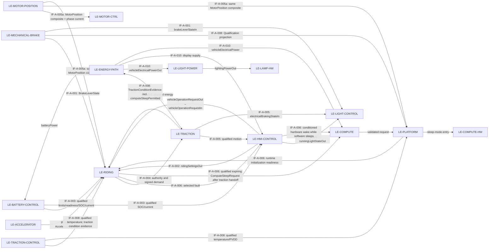

# ARCH-001 — System architecture and logical component decomposition

**Draft EPCS baseline — 2026-10-06.** Active ownership covers electrical/electronic propulsion control and its real electrical interfaces. BMW X2City mechanics are external platform context, not project logical components. This scope update does not claim altered-envelope fitness or promote prior draft/release decisions.

## Release identity

**Released 1.0 — 2026-09-13; ARCH-001-R1.0.** Component architecture developed from released [FC-001-R1.0](../FC-001_Functional_Concept.md), [FC-002-R1.0](../FC-002_Function_Trace.md), REQ-001-R1.6 and HARA/SG-R1.0. [REQ-001](../../Requirements/REQ-001_Requirements.md#requirement-types-and-architecture-model) controls the three-layer model. At that historical release, 12 FSC refinements remained Draft; the current requirements baseline is maintained separately. The owner-approved scope and retained gates are in the [release record](#release-record); ARCH0.3 remains frozen in the FC release commit `8a97f93427bfceb80151b2ba2b72af1ea087c88a`.

This document defines logical component types, composition and system interfaces for the EPCS and its supplied removable electrical pack. [ARCH-002](../ARCH-002_Hardware_Architecture.md) defines physical HW assemblies, ports and configurations; [ARCH-003](../SoftwareArchitecture/ARCH-003_Software_Architecture.md) defines SW components, hosting, state ownership and interactions.

## Modelling and configuration rules

A logical component has a bounded responsibility, owned subparts or state, and interfaces to other components. Functions from FC-001 are allocated behaviour; they are not interchangeable with component identities. Containment, connection, function allocation and software hosting are distinct relations. System interfaces state required energy, signal and data exchanges plus fixed constraints. Conductors, pins, ground, voltage classes and connector realization are owned by [ARCH-002](../ARCH-002_Hardware_Architecture.md); System does not import that physical refinement. This follows the structural/behavioural and allocation distinctions in the [OMG SysML overview](https://www.omg.org/sysml/sysmlv1/); these Markdown/Mermaid views use the relations declared here without claiming a tool-native SysML model.

The logical type catalogue decomposes the project EPCS. `X2CityMCU` (`LE-EPCS`) is the project system boundary and owns project E/E performance and use-context requirements. The supplied BMW X2City and its mechanical systems are external platform context under [ID-001 §2.1](../../Requirements/ID-001_Item_Definition.md#external-mechanical-platform-assumption); the project does not model their internals or claim fitness validation for an altered envelope.

Types are not physical instances. Component types in this model have EPCS-local state and hosting. The supplied electrical pack has one physical instance; its connection to EPCS is an electrical interface, not vehicle containment. BMW mechanical installation features remain given external context.

The 2026-10-06 Draft narrows active architecture ownership to E/E retrofit functions. BatteryControl, accelerator observation, electrical coded-brake detection and HMIControl remain within that boundary. Pure mechanical steering, braking, carrier, enclosure and integration roles have been removed from this active model; released history is not silently re-approved. A logical HW leaf can be realized by cooperating HW parts; a SW leaf may have several deployed instances of its component type. These logical leaves describe responsibility only: later realization can distribute the intended hardware and software contributions without establishing a fixed component owner here. Supplied assemblies retain opaque vendor software and boundary acceptance rather than invented project units. Device schematics, code units and numerical parameters remain downstream.

## Logical composition

Edges below mean **composed of**, not communication or power flow. The table gives every immediate parent, including children omitted from the overview.

```mermaid
flowchart TB
    Context["Installed BMW X2City context"] -.->|platform context| EPCS["X2CityMCU · LE-EPCS"]
    EPCS -->|contains| RidingControl["LE-RIDING · software-allocated leaf"]
    EPCS -->|contains| DriverInteraction["DriverInteraction (`LE-INPUT`)"]
    EPCS -->|contains| Traction["LE-TRACTION"]
    Traction -->|contains| TractionControl["LE-TRACTION-CONTROL: TractionControl"]
    TractionControl -->|contains| MotorControl["LE-MOTOR-CTRL: MotorControl"]
    TractionControl -->|contains| TractionHardware["LE-TRACTION-HW: TractionHardware"]
    Traction -->|contains| MotorPosition["LE-MOTOR-POSITION: MotorPositionEstimation"]
    MotorPosition -->|contains| MotorSignal["LE-MOTOR-SIGNAL: MotorSignalMeasurement"]
    MotorPosition -->|contains| MotorPositionProc["LE-MOTOR-POSITION-PROC: MotorPositionProcessing"]
    EPCS -->|contains| BatteryControl["LE-BATTERY-CONTROL"]
    EPCS -->|contains| EnergyPath["LE-ENERGY-PATH"]
    EPCS -->|contains| LightControl["LE-LIGHT-CONTROL"]
    EPCS -->|contains| Compute["LE-COMPUTE"]
    Compute -->|contains| ComputeHardware["LE-COMPUTE-HW"]
    Compute -->|contains| Platform["LE-PLATFORM"]
    DriverInteraction -->|contains| Accelerator["LE-ACCELERATOR"]
    Accelerator -->|contains| AcceleratorHw["LE-ACCELERATOR-HW: AcceleratorSignalMeasurement"]
    Accelerator -->|contains| AcceleratorQual["LE-ACCELERATOR-QUAL: AcceleratorPositionProcessing"]
    DriverInteraction -->|contains| MechanicalBrake["LE-MECHANICAL-BRAKE: MechanicalBrakeDetection"]
    DriverInteraction -->|contains| HmiControl["LE-HMI-CONTROL: HMIControl"]
    MechanicalBrake -->|contains| BrakeSignal["LE-BRAKE-SIGNAL: BrakeSignalMeasurement"]
    MechanicalBrake -->|contains| BrakeState["LE-BRAKE-STATE: BrakeStateIdentification"]
    HmiControl -->|contains| HmiElectrical["LE-HMI-ELECTRICAL"]
    HmiControl -->|contains| HMI["LE-HMI"]
    LightControl -->|contains| LightModeSelection["LE-LIGHT-POLICY: LightModeSelection"]
    LightControl -->|contains| LightActuation["LE-LAMP-HW: LightActuation"]
    LightActuation -->|contains| LightPower["LE-LIGHT-POWER: LightPower"]
```

**Kinds:** Composite = decomposed project component; HW/SW = explicitly allocated logical responsibility, including hardware composites; Supplied = provided assembly with qualified external behaviour. Realization links identify component types, not satisfaction evidence. Electrical interfaces and package features may realize several logical roles; project E/E containment is defined in ARCH-002, while supplied vehicle enclosures remain external context.

| Logical component | Immediate parent | Kind | Boundary / owned responsibility | Realization |
|---|---|---|---|---|
| LE-RIDING | [LE-EPCS](../../Requirements/REQ-001_Requirements.md#le-epcs) | SW leaf | One software-allocated leaf owning requested/pending/active settings, session lifecycle and fault/report state, Ready eligibility and authority, sleep eligibility, qualified actual-SOC propulsion policy under REQ-SYS-SOC-003/004/005/008, and signed wheel-torque arbitration. Its internal units retain separate state and contracts. Vehicle-side HMI interaction is its EPCS sibling. | [SC-RIDING-CONTROL](../SoftwareArchitecture/ARCH-003_Software_Architecture.md#sc-riding-control) |
| LE-HMI-CONTROL (`HMIControl`) | [DriverInteraction (`LE-INPUT`)](#le-input) | Composite | Vehicle-side interaction with the supplied VD18MT: qualified rider request/report exchange, display-power availability and forwarding of the conditioned hardware wake signal to Compute. It contains the electrical and information-processing leaves; raw-to-conditioned signal conversion belongs to LE-HMI-ELECTRICAL. | [HMIControl requirements](Modelling/DriverInteraction/Decomposition/HMIControl/HMIControl_Requirements.md) |
| LE-HMI-ELECTRICAL (`HmiElectricalInterface`) | [LE-HMI-CONTROL](#le-hmi-control) | HW | One `vd18mtConnection:HmiDevicePort` groups required display power, raw request/report bytes and the raw supplied power-lock line. It publishes `HmiPowerLockObservation` (Active/Inactive/Unknown plus integrity) to LE-HMI and separately conditions the signal to an MCU-safe `ControllerWakeSignal` forwarded through Compute. The hardware wake path does not require UART or software execution. | [HmiElectricalInterface requirements](Modelling/DriverInteraction/Decomposition/HMIControl/Decomposition/HmiElectricalInterface_Requirements.md) |
| LE-HMI (`HmiInformationProcessing`) | [LE-HMI-CONTROL](#le-hmi-control) | SW | Interprets the qualified HMI power-lock observation into `VehicleOperationRequest` (`Request` plus `Qualification`) for RidingControl only, independently of UART; also owns VD18MT framing, protocol interpretation, timestamps and report encoding from qualified selected fault, SOC, current and Traction motion. It owns no power switching, Ready, fault selection/latch, setting guard or light retention. | [SC-HMI](../SoftwareArchitecture/ARCH-003_Software_Architecture.md#sc-hmi) |
| DriverInteraction (`LE-INPUT`) | [LE-EPCS](../../Requirements/REQ-001_Requirements.md#le-epcs) | Composite | Rider interaction boundary composing AcceleratorPositionIdentification, MechanicalBrakeDetection and HMIControl. Its `driverElectricalConnection:DriverElectricalConnectionPort` groups separately typed accelerator, brake-lever and VD18MT logical subinterfaces. Each child retains its own qualification and timing. Required supply, reference and loading compatibility follows the child electrical requirements; ARCH-002 owns conductor, pin, ground, voltage class and circuit detail. TractionControl owns local temperature/supply observation and qualification. | [DriverInteraction requirements](Modelling/DriverInteraction/DriverInteraction_Requirements.md); owned children below |
| LE-ACCELERATOR | [DriverInteraction (`LE-INPUT`)](#le-input) | Composite | End-to-end accelerator electrical signal to one qualified `AcceleratorPosition` (`Position` plus `Qualification`), including normalized position, physical rest, actual measurement time and qualification/diagnostic state. No torque mapping, authority or session latch. | Intended later contributions may include HC-RIDER/HC-INPUT-FE and SC-ACCELERATOR-IF.V; mixed realization binding is deferred. |
| LE-ACCELERATOR-HW (`AcceleratorSignalMeasurement`) | [LE-ACCELERATOR](#le-accelerator) | HW | Provides adequate measurement evidence from the accelerator electrical signal at its `electricalSignalIn` boundary port. | Intended later hardware contributions are deferred; no circuit or acquisition mechanism is selected. |
| LE-ACCELERATOR-QUAL (`AcceleratorPositionProcessing`) | [LE-ACCELERATOR](#le-accelerator) | SW | Obtains and handles measurement evidence, then publishes semantic position/rest and qualification. Initial unqualification and recognized fault stay distinct. Owns one immutable compiled `AcceleratorEndpointCalibration` set; vehicle validation determines its four limits, and endpoint-band classification belongs here. | Intended later software acquisition, transfer and qualification contributions are deferred; algorithm and realization binding remain open. |
| LE-MECHANICAL-BRAKE (`MechanicalBrakeDetection`) | [DriverInteraction (`LE-INPUT`)](#le-input) | Composite | End-to-end coded brake electrical signal to one qualified `BrakeLeverState` (`State` plus `Qualification`), including four-state lever combination and actual measurement time. No brake-force interpretation, torque mapping, authorization, or lighting policy. | [Mechanical brake detection](Modelling/DriverInteraction/Decomposition/MechanicalBrakeDetection/README.md) |
| LE-BRAKE-SIGNAL (`BrakeSignalMeasurement`) | [LE-MECHANICAL-BRAKE](#le-mechanical-brake) | HW | Provides coherent abstract physical brake-response evidence and integrity from the passive coded-brake electrical signal at its `brakeElectricalSignalIn` boundary port. | [HC-INPUT-FE](../ARCH-002_Hardware_Architecture.md#hc-input-fe) and [HC-CONTROLLER](../ARCH-002_Hardware_Architecture.md#hc-controller) contribute physical compatibility, conditioning/protection, and shared acquisition; circuit, excitation, and acquisition selection remain open. |
| LE-BRAKE-STATE (`BrakeStateIdentification`) | [LE-MECHANICAL-BRAKE](#le-mechanical-brake) | SW | Converts brake-response evidence to semantic `Neither`/`Left`/`Right`/`Both` state, firmware measurement time, and qualification. Owns immutable compiled non-overlapping resistance bands for all four states. | [SC-BRAKE-IF](../SoftwareArchitecture/ARCH-003_Software_Architecture.md) owns state identification and qualification; shared acquisition/timebase support is provided by SC-ANALOG-ACQ.V and SC-PLATFORM.V. Transfer characterization, band values, timing, and diagnostic coverage remain open. |
| LE-TRACTION | [LE-EPCS](../../Requirements/REQ-001_Requirements.md#le-epcs) | Composite | Realize permitted signed torque with the installed motor; provide qualified applied-torque/motion information | Owned children below |
| LE-MOTOR-POSITION (`MotorPositionEstimation`) | [LE-TRACTION](#le-traction) | Composite | Hall-required electrical rotor position and explicit semantic phase-current feedback for MotorControl. Current/voltage model assistance is internal to the estimator, requires accepted observability and never provides sensorless fallback, forced alignment or stationary holding. | [Motor position estimation](Modelling/Traction/Decomposition/MotorPositionEstimation/README.md) |
| LE-MOTOR-SIGNAL (`MotorSignalMeasurement`) | [LE-MOTOR-POSITION](#le-motor-position) | HW | Physical Hall capture, phase-current and bridge-voltage observation evidence and integrity; no ADC/DMA/pin or software timestamp selection. | [HC-TRACTION-POWER](../ARCH-002_Hardware_Architecture.md#hc-traction-power), [HC-MOTOR](../ARCH-002_Hardware_Architecture.md#hc-motor), [HC-INPUT-FE](../ARCH-002_Hardware_Architecture.md#hc-input-fe) and [HC-CONTROLLER](../ARCH-002_Hardware_Architecture.md#hc-controller) contribute only physical conditioning, acquisition and capture. |
| LE-MOTOR-POSITION-PROC (`MotorPositionProcessing`) | [LE-MOTOR-POSITION](#le-motor-position) | SW | Timestamped acquisition and semantic conversion into the complete `MotorPosition` composite for MotorControl, Platform and RidingControl, plus explicit `PhaseCurrentMeasurements` for MotorControl, using immutable calibration. It distinguishes qualified angle from signed electrical-speed validity and preserves a static Hall-sector startup path. | [SC-ANALOG-ACQ.V, SC-HALL-IF.V, SC-MOTOR-PHASE-IF.V and SC-MOTOR-POSITION-ESTIMATOR.V](../SoftwareArchitecture/ARCH-003_Software_Architecture.md) |
| LE-TRACTION-CONTROL (`TractionControl`) | [LE-TRACTION](#le-traction) | Composite | Local traction-control composition: MotorControl and TractionHardware. Its command carries the requested three phase voltages relative to motor electrical neutral, an expiry and overriding `actuationInhibited`; observed stage state and independent protection evidence return separately. It carries local temperature/supply evidence without absorbing motor-position estimation. | [Traction control](Modelling/Traction/Decomposition/TractionControl/README.md) |
| LE-MOTOR-CTRL (`MotorControl`) | [LE-TRACTION-CONTROL](#le-traction-control) | SW | Qualifies traction-board/motor temperature and PVDD/GVDD evidence, accepts authority/command, controls phase excitation, and publishes condition, motion and actual-output evidence. Semantic conversion does not imply that the control core is the sensor-conversion implementation. | [MotorControl allocation](Modelling/Traction/Decomposition/TractionControl/Decomposition/MotorControl_Requirements.md) and [SC realization](../SoftwareArchitecture/ARCH-003_Software_Architecture.md#sc-traction-ctrl) |
| LE-TRACTION-HW (`TractionHardware`) | [LE-TRACTION-CONTROL](#le-traction-control) | HW | Physical traction-energy conversion, motor actuation, motor/board temperature and PVDD/GVDD measurement evidence, plus independent protective inhibition and stage evidence. It has no logical Hall, phase-current, or phase-voltage observation responsibility. | [TractionHardware allocation](Modelling/Traction/Decomposition/TractionControl/Decomposition/TractionHardware_Requirements.md) |
| LE-BATTERY-CONTROL | [LE-EPCS](../../Requirements/REQ-001_Requirements.md#le-epcs) | Composite | Owner-built BatteryAssembly and vehicle-host BatterySupervision: qualified actual SOC, physical/electrical battery capabilities and limits, readiness and fault contribution. | Owned children below |
| LE-BATTERY-ASSEMBLY | [LE-BATTERY-CONTROL](#le-battery-control) | Composite | Owner-built physical pack with the supplied BMS hardware/vendor firmware boundary. | [HC-CELLS](../ARCH-002_Hardware_Architecture.md#hc-cells), [HC-BMS](../ARCH-002_Hardware_Architecture.md#hc-bms) |
| LE-CELLS | [LE-BATTERY-ASSEMBLY](#le-battery-assembly) | HW | Fixed electrochemical storage bank in fitted/removed configurations. | [HC-CELLS](../ARCH-002_Hardware_Architecture.md#hc-cells) |
| LE-BMS | [LE-BATTERY-ASSEMBLY](#le-battery-assembly) | Supplied | Supplied monitoring, balancing and protective switching, with opaque vendor firmware. | [HC-BMS](../ARCH-002_Hardware_Architecture.md#hc-bms), [SC-BMS](../SoftwareArchitecture/ARCH-003_Software_Architecture.md#sc-bms) |
| LE-BATTERY-SUPERVISION | [LE-BATTERY-CONTROL](#le-battery-control) | SW | Vehicle-host BmsLink and BatteryProtection contributions; owns neither motor enforcement nor physical protection proof. | [SC-BMS-LINK](../SoftwareArchitecture/ARCH-003_Software_Architecture.md#sc-bms-link), [SC-BAT-POLICY](../SoftwareArchitecture/ARCH-003_Software_Architecture.md#sc-bat-policy) |
| LE-ENERGY-PATH | [LE-EPCS](../../Requirements/REQ-001_Requirements.md#le-epcs) | HW | Protected power distribution/coupling; physical path, residual-load and generated-energy treatment with traction and auxiliaries. It makes display supply available to LE-HMI-ELECTRICAL before MCU software runs. | [HC-PACK-IF](../ARCH-002_Hardware_Architecture.md#hc-pack-if), [HC-ENERGY-DIST](../ARCH-002_Hardware_Architecture.md#hc-energy-dist) |
| LE-LIGHT-CONTROL (`LightControl`) | [LE-EPCS](../../Requirements/REQ-001_Requirements.md#le-epcs) | Composite | End-to-end lighting control: qualified normal request, brake-lever and actual electrical-braking inputs to selected modes and physical light actuation. Vehicle electrical energy is received at its external `vehicleElectricalPowerIn` boundary. | Owned children below |
| LE-LIGHT-POLICY (`LightModeSelection`) | [LE-LIGHT-CONTROL](#le-light-control) | SW | Retain current-session normal-light requests and select Front Off/On plus Rear Off/Dim/Full modes from the qualified mechanical lever and actual electrical-braking state. | [SC-LIGHT-POLICY](../SoftwareArchitecture/ARCH-003_Software_Architecture.md#sc-light-policy) |
| LE-LAMP-HW (`LightActuation`) | [LE-LIGHT-CONTROL](#le-light-control) | HW composite | Receives selected light modes, owns LightPower, and provides physical driver/default output and retained front/rear lamps. | [HC-LAMP-DRIVE](../ARCH-002_Hardware_Architecture.md#hc-lamp-drive), [HC-LAMPS](../ARCH-002_Hardware_Architecture.md#hc-lamps) |
| LE-LIGHT-POWER (`LightPower`) | [LE-LAMP-HW](#le-lamp-hw) | HW | Receives distributed vehicle electrical energy and supplies lighting power used by LightActuation. It does not claim a dedicated converter or select a supply topology. | [HC-AUX-POWER](../ARCH-002_Hardware_Architecture.md#hc-aux-power), alongside its other controller/HMI/lamp supply obligations |
| LE-COMPUTE | [LE-EPCS](../../Requirements/REQ-001_Requirements.md#le-epcs) | Composite | Vehicle compute infrastructure, composed only of the selected controller hardware and its Platform services. It hosts system execution; function ownership remains with its logical components. Receives distributed vehicle electrical energy from EnergyPath. | Owned children below |
| LE-COMPUTE-HW | [LE-COMPUTE](#le-compute) | HW | Selected WeAct STM32H723VGT6 V1.2 controller board: power/reset and I/O, and direct conditioned HMI wake while software sleeps. It emits no awake power-lock observation. Compute delegates its EnergyPath input to this host. | [Compute overview](Modelling/Compute/README.md), [ComputeHardware requirements](Modelling/Compute/Decomposition/ComputeHardware_Requirements.md), [HC-CONTROLLER](../ARCH-002_Hardware_Architecture.md#hc-controller) |
| LE-PLATFORM | [LE-COMPUTE](#le-compute) | SW | Runtime services for software hosted by Compute: publishes runtime initialization readiness and validates/executes RidingControl's current sleep request at actual entry to ComputeHardware. RidingControl owns On/Off lifecycle, sleep eligibility and grant/revocation, Ready, fault latch and riding authority. | [Compute overview](Modelling/Compute/README.md), [SC-PLATFORM](../SoftwareArchitecture/ARCH-003_Software_Architecture.md#sc-platform), [Platform model](Modelling/Compute/Decomposition/Platform.sysml), [Platform requirements](Modelling/Compute/Decomposition/Platform_Requirements.md) |

The bounded MotorControl specialization pilot is traced from this system row through
`MotorControlRealization` to the existing `SC-TRACTION-CTRL` core and its selected
detailed-design occurrence in [DD-003 — Static software architecture views](../SoftwareArchitecture/TractionControl/DetailedDesign/TractionControl_Detailed_Design.md#draft-motorcontrol-specialization-pilot).
The wrapper contains the sole core and references the existing acquisition, temperature and supply components;
it creates neither another core, task, sensor conversion, nor output writer.

### Logical connections and electrical port contracts

This view shows component exchange through canonical IF-A contracts; containment is defined above. Physical energy and qualified information are different exchanges. Regenerative energy remains a vehicle transfer constrained by the supplied pack charge-acceptance envelope.

Qualified information-port types carry their value plus validity, source age, qualification uncertainty and reset/operation context where applicable. Physical-evidence ports intentionally defer their observed representation to sensing design. These are semantic fields, not a new wire protocol. Physical ports declare electrical energy/reference direction, accessible electrical states and applicable limits. Physical and software component contracts refine these boundaries in ARCH-002/003; one mating connector may carry several logical channels.

| IF-A family | Port type and endpoint boundary |
|---|---|
| IF-A-001/002 | LE-ACCELERATOR and LE-MECHANICAL-BRAKE each publish one complete qualified record to LE-RIDING. RidingControl routes those shared invocation snapshots internally to U-SET-STATE, U-SESSION-ELIGIBILITY and U-DEMAND-ARBITER as applicable; LightModeSelection remains a separate consumer of the brake record. HMI sends qualified settings through DriverInteraction to LE-RIDING. Active settings are retained inside RidingControl and are not an external interface. Physical rest remains explicit. |
| IF-A-007 | LE-BRAKE-SIGNAL observes the passive coded-brake electrical signal at its function boundary and provides abstract physical-response evidence to LE-BRAKE-STATE. Within LE-TRACTION-CONTROL, TractionHardware supplies motor/board thermal and PVDD/GVDD measurement evidence directly to MotorControl; physical conversion and actuation remain separate from semantic qualification. |
| IF-A-008 | LE-MECHANICAL-BRAKE publishes only its `BrakeQualification` projection to Platform. LE-TRACTION-CONTROL publishes qualified temperature/PVDD to Platform and temperature plus categorized `TractionConditionEvidence`, including `computeSleepPermitted` capability evidence, to RidingControl. GVDD is measured, qualified, and evaluated locally in TractionControl; RidingControl receives the startup prerequisite and categorized fault evidence, not the qualified voltage value. MotorControl's fast-PVDD use is internal to its realization. |
| IF-A-003/009 | BatteryControl exposes qualified battery readiness/fault, operating limits, SOC and current to their named consumers; BMS UART is read-only. Independent discharge and regenerative-charge ampere limits, qualified actual-SOC input to RidingControl propulsion policy, protected EPCS endpoint and fieldwise qualification remain distinct. |
| IF-A-004/005 | RidingControl publishes independent authority and signed wheel-torque-command outputs to Traction; Traction returns qualified motion and actual active motor-braking feedback, with expiry and producer context preserved. |
| IF-A-006 | RidingControl provides the selected fault indication; HMIControl exchanges qualified rider requests and reports. HmiElectricalInterface publishes the integrity-qualified physical power-lock observation to HmiInformationProcessing and separately conditions the hardware wake, which DriverInteraction forwards directly to ComputeHardware through Compute. HmiInformationProcessing publishes the request through `HMIControl.vehicleOperationRequestOut` and `DriverInteraction.vehicleOperationRequestOut` to `RidingControl.vehicleOperationRequestIn` only; interpretation is independent of UART. RidingControl evaluates sleep eligibility from qualified explicit Off and qualified traction capability evidence, then issues or revokes a current expiring request after the required traction output handoff. Platform validates the latest current-context valid, unexpired true request at actual entry and executes it without renewing permission; ComputeHardware enters the hardware mode. Platform publishes runtime readiness to RidingControl; it does not establish Ready. RidingControl retains lifecycle and Ready/fault authority. HMI protocol encoding does not select or latch faults. See [HMIControl overview](Modelling/DriverInteraction/Decomposition/HMIControl/README.md) and [Compute overview](Modelling/Compute/README.md) for details. |
| IF-A-010/011 | EnergyPath supplies distributed vehicle power to Compute, which delegates its input to ComputeHardware, and makes display supply available through DriverInteraction to HMIControl before MCU startup. BatteryControl `batteryPower` joins EnergyPath; EPCS retains assigned physical protection. |

**Selected sensing allocation retained from the current integration baseline.** The vehicle host receives three Hall edge channels; three phase-current observations; fast local PVDD; traction-board and motor temperature; separate accelerator and coded-brake observations; GVDD and three phase-voltage diagnostics; and supplied-BMS pack/group/current/SOC/temperature/path information. The source-to-measurement-to-qualification routes remain distinct from the shared acquisition realization. Platform owns shared-acquisition integrity support; it does not introduce ADC/DMA fields into these system records or own their semantic conversion. Sensor accuracy, wiring, protection, calibration and diagnostic coverage remain acceptance gates.

## Architecture decisions and limits

| Decision / status | Selected decomposition and remaining acceptance |
|---|---|
| Shared vehicle host — approved allocation, OI-044 acceptance open | HC-CONTROLLER hosts supervision, observation qualification and motor control. Components retain explicit exchange and state ownership. This avoids extra vehicle host/interconnect boundaries; prove scheduling/resources and common-cause/fault response before accepting sharing. A separate supervisory processor remains a change option if evidence rejects it. |
| Shared code, separate state — approved allocation | SC-BMS-LINK, SC-BAT-POLICY, SC-INPUT-QUAL and SC-PLATFORM have local V/C instances where used. Type reuse implies neither a live cross-host service nor shared session memory. |
| Physical domain protection — approved responsibility, HA-OI-002–005 | Pack/BMS and vehicle distribution/drive receive protective responsibilities with the controller absent/faulted. A software partition or second host proves no independence; coverage and mechanisms need evidence. |

The fixed brake interface remains one passive two-wire network with four valid codes and ambiguous/unknown cases. Mechanical braking is an external platform capability; LE-MECHANICAL-BRAKE models only electrical observation and state identification. Naming components selects no new sensor/channel, lock detector, connector pinout, motor algorithm, charge voltage, isolation topology or numerical safety bound.

## Allocation records and component contracts

Unchanged requirements may be reclassified without invented parents. New children below contribute only their stated interface/command obligations; their system parents and integration verification remain mandatory.

| Requirement allocation | Realization / responsibility | Parent coverage and remaining evidence |
|---|---|---|
| [REQ-SYS-LVL-001–004](../../Requirements/Abstract_Software_Requirements/Settings_and_Control_Policy.md#level-selection-and-application), [REQ-SYS-SPD-002/004/005/008](../../Requirements/Abstract_Software_Requirements/Settings_and_Control_Policy.md#speed-selection-and-application) → LE-RIDING | SC-RIDING-CONTROL maintains requested/pending/active level and normalized speed limit | Eight existing obligations and sources unchanged. Qualified requests and simultaneous standstill/rest, startup receipt and physical cutoff/profile application remain integration dependencies. |
| [REQ-SYS-CTL-001](../../Requirements/Abstract_Software_Requirements/Settings_and_Control_Policy.md#req-sys-ctl-001) → LE-RIDING | SC-RIDING-CONTROL produces eligibility/inhibition state | Partial contribution to startup/fault parents; qualified inputs, actual self-tests, power/reset behavior and physical zero torque remain system work. |
| [REQ-SYS-CTL-002](../../Requirements/Abstract_Software_Requirements/Settings_and_Control_Policy.md#req-sys-ctl-002) → LE-RIDING | SC-RIDING-CONTROL produces a signed wheel-torque command | Partial command-interface contribution to rider/limit parents; [Released calibration acceptance](../../Requirements/System_Requirements/Rider_Control.md#torque-profile-calibration-acceptance) defines normalized shape/endpoints and distinct dynamics/taper. Numeric calibration, timing and physical tracking remain open. |
| [REQ-SYS-ACC-001](Modelling/DriverInteraction/Decomposition/AcceleratorPositionIdentification/AcceleratorPositionIdentification_Requirements.md#req-sys-acc-001), [REQ-SYS-ACC-004](Modelling/DriverInteraction/Decomposition/AcceleratorPositionIdentification/AcceleratorPositionIdentification_Requirements.md#req-sys-acc-004)–[REQ-SYS-ACC-009](Modelling/DriverInteraction/Decomposition/AcceleratorPositionIdentification/AcceleratorPositionIdentification_Requirements.md#req-sys-acc-009), [REQ-SYS-ACC-022](Modelling/DriverInteraction/Decomposition/AcceleratorPositionIdentification/AcceleratorPositionIdentification_Requirements.md#req-sys-acc-022), [REQ-SYS-ACC-024](Modelling/DriverInteraction/Decomposition/AcceleratorPositionIdentification/AcceleratorPositionIdentification_Requirements.md#req-sys-acc-024), [REQ-SYS-ACC-026](Modelling/DriverInteraction/Decomposition/AcceleratorPositionIdentification/AcceleratorPositionIdentification_Requirements.md#req-sys-acc-026)–[REQ-SYS-ACC-027](Modelling/DriverInteraction/Decomposition/AcceleratorPositionIdentification/AcceleratorPositionIdentification_Requirements.md#req-sys-acc-027), [REQ-SYS-ACC-029](Modelling/DriverInteraction/Decomposition/AcceleratorPositionIdentification/AcceleratorPositionIdentification_Requirements.md#req-sys-acc-029), [REQ-SYS-ACC-031](Modelling/DriverInteraction/Decomposition/AcceleratorPositionIdentification/AcceleratorPositionIdentification_Requirements.md#req-sys-acc-031), [REQ-SYS-ACC-046](Modelling/DriverInteraction/Decomposition/AcceleratorPositionIdentification/AcceleratorPositionIdentification_Requirements.md#req-sys-acc-046)–[REQ-SYS-ACC-049](Modelling/DriverInteraction/Decomposition/AcceleratorPositionIdentification/AcceleratorPositionIdentification_Requirements.md#req-sys-acc-049) → LE-ACCELERATOR | The retained System group owns the accelerator contract; its hardware and software contributions are allocated by the linked child groups below. | Position/rest and actual measurement time remain in one semantic record with `Qualification` health/diagnostic state. Initial unqualification, recognized fault, health-only publication, accuracy, response, source-specific mapping, electrical compatibility and restart requalification remain distinct obligations; endpoint-band classification is implemented by the linked processing allocation; electrical transfer, calibration, diagnostic coverage and formal HW/SW realization binding remain open. |
| [REQ-SYS-ACC-002](Modelling/DriverInteraction/Decomposition/AcceleratorPositionIdentification/Decomposition/AcceleratorPositionProcessing_Requirements.md#req-sys-acc-002), [REQ-SYS-ACC-010](Modelling/DriverInteraction/Decomposition/AcceleratorPositionIdentification/Decomposition/AcceleratorPositionProcessing_Requirements.md#req-sys-acc-010)–[REQ-SYS-ACC-013](Modelling/DriverInteraction/Decomposition/AcceleratorPositionIdentification/Decomposition/AcceleratorPositionProcessing_Requirements.md#req-sys-acc-013), [REQ-SYS-ACC-017](Modelling/DriverInteraction/Decomposition/AcceleratorPositionIdentification/Decomposition/AcceleratorPositionProcessing_Requirements.md#req-sys-acc-017)–[REQ-SYS-ACC-018](Modelling/DriverInteraction/Decomposition/AcceleratorPositionIdentification/Decomposition/AcceleratorPositionProcessing_Requirements.md#req-sys-acc-018), [REQ-SYS-ACC-020](Modelling/DriverInteraction/Decomposition/AcceleratorPositionIdentification/Decomposition/AcceleratorPositionProcessing_Requirements.md#req-sys-acc-020)–[REQ-SYS-ACC-021](Modelling/DriverInteraction/Decomposition/AcceleratorPositionIdentification/Decomposition/AcceleratorPositionProcessing_Requirements.md#req-sys-acc-021), [REQ-SYS-ACC-038](Modelling/DriverInteraction/Decomposition/AcceleratorPositionIdentification/Decomposition/AcceleratorPositionProcessing_Requirements.md#req-sys-acc-038)–[REQ-SYS-ACC-040](Modelling/DriverInteraction/Decomposition/AcceleratorPositionIdentification/Decomposition/AcceleratorPositionProcessing_Requirements.md#req-sys-acc-040) → LE-ACCELERATOR-QUAL (`AcceleratorPositionProcessing`) | Retained Abstract Software contribution: obtain and handle measurement evidence, qualify it, and publish the `AcceleratorPosition` composite with its health projection. | This logical allocation selects neither a fixed software component nor an acquisition/transfer mechanism. Position/rest, endpoint-band implementation, actual measurement time, qualification, timeout and fault/restart boundaries remain as stated by the linked System contracts; the endpoint limits form one validation-derived immutable `endpointCalibration` set and no numeric values are selected here. |
| [REQ-SYS-ACC-003](Modelling/DriverInteraction/Decomposition/AcceleratorPositionIdentification/Decomposition/AcceleratorSignalMeasurement_Requirements.md#req-sys-acc-003), [REQ-SYS-ACC-014](Modelling/DriverInteraction/Decomposition/AcceleratorPositionIdentification/Decomposition/AcceleratorSignalMeasurement_Requirements.md#req-sys-acc-014), [REQ-SYS-ACC-043](Modelling/DriverInteraction/Decomposition/AcceleratorPositionIdentification/Decomposition/AcceleratorSignalMeasurement_Requirements.md#req-sys-acc-043) → LE-ACCELERATOR-HW (`AcceleratorSignalMeasurement`) | Retained Abstract Hardware contribution: provide observable accelerator measurement evidence and allocated electrical compatibility. | This logical allocation selects neither a physical circuit nor a conversion/buffering implementation. Measurement integrity/availability remains distinct from semantic position qualification; generic acquisition context and timing remain internal to the acquisition path. |
| [REQ-SYS-CTL-003](Modelling/DriverInteraction/Decomposition/HMIControl/Decomposition/HmiInformationProcessing_Requirements.md#req-sys-ctl-003) → LE-HMI | SC-HMI forms/consumes VD18MT protocol fields | Partial information-interface contribution to HMI parents; electrical transport, update bounds and visible display correspondence remain open. |
| [REQ-SYS-CELL-001](Modelling/BatteryControl/Decomposition/Cells.sysml) → LE-CELLS | HC-CELLS realizes the fixed series/parallel bank | Partial physical contribution to REQ-SYS-BAT-002; selected BMS/UART and whole-pack acceptance remain System Requirements. |
| [REQ-SYS-BMSIF-001–013](Modelling/BatteryControl/Decomposition/BatterySupervision.sysml) → LE-BATTERY-SUPERVISION | SC-BMS-LINK restricts requests to reads and qualifies response validation, installed payload layouts, decoded fields, observation age/retention, reset requalification and bounded service timing | Partial contribution to REQ-SYS-BMS-003; electrical transport, observation accuracy, SOC qualification and dependent physical reactions remain system work. |
| [REQ-SYS-BMSPOL-001](Modelling/BatteryControl/Decomposition/BatterySupervision.sysml) → LE-BATTERY-SUPERVISION | SC-BAT-POLICY qualifies actual SOC and produces effective charge/discharge current capability limits, capability-restriction reasons and battery-fault information | Partial contribution to BMS-001/006–008; physical limit enforcement, independent protection, source qualification and actual-SOC propulsion policy remain system/other-component obligations. |
| [REQ-SYS-CTL-004](../../Requirements/Abstract_Software_Requirements/Settings_and_Control_Policy.md#req-sys-ctl-004) → LE-RIDING | SC-RIDING-CONTROL selects/retains the fault-group report, using the lowest assigned code only for indistinguishable earliest ties | Physical reaction applies to every recognized fault; recognition timing/coverage and visible HMI acceptance remain open. |
| [REQ-SYS-LGTPOL-001](Modelling/LightControl/Decomposition/LightModeSelection_Requirements.md#req-sys-lgtpol-001)–[REQ-SYS-LGTPOL-004](Modelling/LightControl/Decomposition/LightModeSelection_Requirements.md#req-sys-lgtpol-004) → LE-LIGHT-POLICY (`LightModeSelection`) | SC-LIGHT-POLICY retains the normal request and selects Front Off/On and Rear Off/Dim/Full modes from qualified mechanical-lever and actual electrical-braking facts. | Partial contribution to LGT-001–009. Actual brightness, unqualified-state power-on/reset behavior before software execution and protected continuity remain physical integration obligations. |
| [REQ-SYS-LGTHW-001](Modelling/LightControl/Decomposition/LightActuation_Requirements.md#req-sys-lgthw-001)–[REQ-SYS-LGTHW-004](Modelling/LightControl/Decomposition/LightActuation_Requirements.md#req-sys-lgthw-004) → LE-LAMP-HW (`LightActuation`) | HC-LAMP-DRIVE / HC-LAMPS realize selected LightModes and protected rear-light continuity. | Draft child allocation contributes to LGT-001–009 and FSC-012; parent coverage, physical visibility/electrical acceptance, and numerical acceptance remain open. |
| [REQ-SYS-INT-004](../../Requirements/System_Requirements/Interface_Qualification.md#req-sys-int-004) → LE-TRACTION | System command-authority contract; Architecture allocation divides command acceptance into SC-TRACTION-CTRL and physical output into HC-TRACTION-POWER/HC-MOTOR | Authorization withdrawal and command validity must propagate through realization; software zero command alone does not establish physical inhibition, especially with failed output stages. |

[BAT-001](../../Battery/BAT-001_Selected_Pack_and_BMS.md) fixes component evidence and derived envelopes. HC-BMS and its hosted SC-BMS are a purchased assembly, not project-developed BMS firmware; system interface/integration acceptance substitutes for invented vendor-internal derivation. [Battery integration requirements](Modelling/BatteryControl/Battery_Integration.md) target the integrating LE-EPCS composite. Protect the cell bank against its own limits even where the BMS family defaults permit more. BMS recovery does not release system-session inhibition.

[ARCH-003](../SoftwareArchitecture/ARCH-003_Software_Architecture.md) defines software components and their selected host roles; [ARCH-002](../ARCH-002_Hardware_Architecture.md) owns physical assemblies and ports. The owner-selected WeAct STM32H723VGT6 is the vehicle host combining supervisory and motor-control execution; its [vehicle integration contract](../DRV8300DRGE-EVM/DRV8300DRGE-EVM_WeAct_STM32H723VGT6_Traction_HSI.md) retains resource, power, timing and fault qualification open. Execution order, scheduling and resource budgets must satisfy the end-to-end contracts below. No detailed software units are defined.

| Interface | Producer → consumer | Contract / source | Open acceptance and gate |
|---|---|---|---|
| IF-A-001 / IF-A-005: accelerator, brake and vehicle-motion data | LE-ACCELERATOR → LE-RIDING; LE-ACCELERATOR → LE-PLATFORM (Qualification projection); LE-MECHANICAL-BRAKE → LE-RIDING / LE-LIGHT-POLICY (complete composite); LE-TRACTION → LE-RIDING / LE-HMI | LE-ACCELERATOR owns end-to-end qualified `AcceleratorPosition`; LE-MECHANICAL-BRAKE owns `BrakeLeverState`; and LE-TRACTION is the sole producer of qualified physical vehicle speed, direction and standstill. HMI consumes that motion record for display encoding and does not produce a second speed source. | Electrical endpoints, range/transfer, timing/coherence and diagnostic coverage remain gates; no threshold, calibration, hardware selection or runtime realization is added. |
| IF-A-002: settings | LE-HMI-CONTROL → LE-RIDING; LE-HMI-CONTROL → LE-RIDING | HMI is the sole settings-request source. `RiderSettingsRequest` contains concrete requested level and speed fields with qualification. Current-startup receipt and retained request are evaluated within RidingControl. Requested, pending and active state remain internal; no active-settings output crosses the component boundary. | VD18MT encoding/transport, unrecognized frames and qualification timing: WS-OI-008/009/015. No fallback setting creates startup qualification. |
| IF-A-003: battery power envelope/status | LE-BATTERY-SUPERVISION → LE-RIDING / LE-HMI-CONTROL | Qualified battery observations/configuration feed battery policy; SOC/current are rider-information inputs with their own qualification. RidingControl owns fault/Ready retention and rider/re-entry arbitration internally. Input does not carry BMS or pack information. | Limits, margins, source freshness and fault classification: WS-OI-005/018/019, OI-041/048/049/061. |
| IF-A-004: eligibility and torque command | LE-RIDING → LE-TRACTION | RidingControl publishes independent `RidingAuthority` and signed rear-wheel `WheelTorqueRequest` outputs to Traction under INT-004. Positive means forward. Traction rejects obsolete/restarted-context inputs and withdraws on lost authority or command expiry. Physical response/protection remain separate | Command representation, complete arbitration, transfer/update/watchdog bounds and physical torque tolerance: WS-OI-003/007/010/015, OI-043/049. |
| IF-A-005: actual output information | LE-TRACTION → LE-RIDING / LE-LIGHT-POLICY | LE-TRACTION owns qualified actual applied torque, active braking and distinct motion feedback, with unqualified state explicit. DriverInteraction (`LE-INPUT`) does not republish output feedback. FLT-012 covers recognized loss; LGT-009 requires Full while braking state is unqualified. Request alone proves neither powered travel nor actual braking. Applied-positive-output evidence qualifies post-stop regeneration re-entry, not the first eligible positive demand. Unauthorized-output monitoring/protection remains effective without command acceptance or riding authority | Derive observability/reference/uncertainty/latency; no torque sensor or estimation method selected: WS-OI-001/006/016. |
| IF-A-005a: motor position and phase-current feedback | Physical Hall/current/bridge observation → LE-MOTOR-SIGNAL → LE-MOTOR-POSITION-PROC → LE-MOTOR-CTRL / LE-PLATFORM / LE-RIDING | The same complete `MotorPosition` (`Position` + `Qualification`) reaches all three consumers, including when angle is unavailable or only Qualification changes; qualification-only changes preserve the actual Position evidence reference time. Hall evidence is required for every available electrical-angle result. The direct physical inputs are owned solely by MotorPositionEstimation; they do not pass through LE-TRACTION-HW. Static Hall-sector startup without an edge is permitted, but absence of edges does not prove standstill. Qualified vehicle motion remains independent. Phase current and applied winding voltage refine/check the Hall estimate only with accepted model/observability evidence. The existing MotorPhaseInterface conversion path provides explicit phase-current feedback; applied-winding voltage remains internal observer evidence and slow diagnostic voltage cannot substitute. Existing RidingControl/Platform policy receives recognized lost/contradictory required-signal evidence through the composite and remains unchanged. | [Motor position estimation requirements](Modelling/Traction/Decomposition/MotorPositionEstimation/MotorPositionEstimation_Requirements.md#req-sys-mpe-001)–006; derive Hall map, electrical alignment, model/observer validity, time/skew, continuity and accepted error bounds. |
| IF-A-006: rider information, wake and session lifecycle | LE-RIDING ↔ LE-COMPUTE; LE-HMI-CONTROL ↔ VD18MT; LE-HMI-CONTROL / LE-MECHANICAL-BRAKE → LE-LIGHT-POLICY → LE-LIGHT-CONTROL / LE-LAMP-HW | RidingControl provides the selected fault indication; LE-HMI encodes it without selecting or latching priority. SOC/current and Traction motion remain qualified HMI inputs. HMI electrical hardware groups display power and raw bytes and conditions the power-lock signal. Compute wake, observation, runtime-readiness and sleep exchanges are summarized above; details are in the [Compute overview](Modelling/Compute/README.md). LE-LIGHT-POLICY retains accepted normal-light requests and arbitrates front/rear modes. | Physical connector realization is in ARCH-002; transport, quantization, timing and visible correspondence remain open. No display acknowledgement is modeled. |
| IF-A-007: retained physical observation routes | LE-BRAKE-SIGNAL → LE-BRAKE-STATE (passive coded brake); TractionHardware → MotorControl (motor/board thermal, PVDD and GVDD measurement evidence) | The brake electrical input and physical-measurement evidence are distinct. Their observed representation remains sensing-design work. | Sensing, conditioning, acquisition integrity and fault coverage remain HSI/integration acceptance work. Platform provides shared-acquisition integrity support, without a System ADC/DMA data contract. |
| IF-A-008: retained qualified observation routes | LE-MECHANICAL-BRAKE → LE-PLATFORM (`BrakeQualification` projection); LE-TRACTION-CONTROL → LE-PLATFORM (temperature/PVDD), LE-RIDING (temperature and categorized traction condition evidence) | Platform receives only the `BrakeQualification` projection. IF-A-001 carries the complete `BrakeLeverState` once to RidingControl and separately to LightModeSelection. Motor/traction-board thermal evidence becomes qualified temperature for RidingControl/Platform. TractionControl retains qualified GVDD locally and publishes startup-condition and categorized fault evidence to RidingControl; RidingControl applies vehicle latching, reporting, and clean-restart policy. MotorControl's fast-PVDD use is internal. | Conversion, freshness and fault-response acceptance remain open; evidence cannot imply policy or an ADC/DMA realization. |
| IF-A-009: selected BMS UART | LE-BMS ↔ LE-BATTERY-SUPERVISION, through the still-to-be-qualified electrical interface | BAT-001: 9600 8N1 read protocol, pack/SOC/current/14-group/temperature/protection/path information; current positive charging, negative discharging. Preserve validity/freshness and actual-unit scaling. | OI-041/045/046/049/061: resolve manufacturer non-isolated UART restriction, actual pin/logic/ground/B+ references, supported firmware/commands, update/timeout/accuracy, sleep load and reset behavior before electrical/software integration acceptance. |
| IF-A-010: physical energy paths | LE-EPCS ↔ LE-TRACTION; LE-EPCS → LE-LIGHT-POWER / LE-HMI-ELECTRICAL and other loads | `LE-ENERGY-PATH` delegates vehicle electrical supply to LightPower and makes display supply available to HMI electrical hardware before MCU startup. | HA-OI-004; OI-041/043/045/048/061/063: physical endpoint compatibility, load/storage budgets, path loss and finite residual-transfer acceptance. |
| IF-A-011: physical protection coordination | LE-EPCS ↔ LE-TRACTION | F-009 coordinates actual/bounded E/E energy conditions, assigned protection action and valid status across energized paths. Response includes unavailable normal control/UART, latent faults and generated energy; no universal software protection controller or independence claim is selected. | HA-OI-002/003/004/005; FSC-001/005–008: declare credible fault envelope, prevention/detection/outcome limits, response budgets, dependencies and actual-output evidence before protective allocation acceptance. |

### Battery protection and reset responsibilities

The [battery qualification/event matrix](Modelling/BatteryControl/Battery_Integration.md#battery-event-and-recovery-matrix) and [energy-state acceptance](../../Requirements/System_Requirements/Energy_and_Protection.md#energy-state-configuration-and-protection-acceptance) define required system observations. Current battery qualification needs operation-required source, configuration and protection-path evidence; neither an accepted frame nor a FET status bit proves physical protection. Protective functions for remaining energized paths must satisfy BMS-009 when vehicle host, vehicle supply or UART is unavailable. Their implementation, common dependencies and coverage remain to be allocated within LE-EPCS/LE-TRACTION.

| Event domain | Required retained/requalified behavior |
|---|---|
| BMS sleep/wake, UART outage/return | Requalify affected data as required by its age and validity evidence. Do not clear a riding-session latch merely because packets return. |
| Riding-controller normal/unexpected restart | Clear past-failure history and repeat all current-startup checks/Ready guards. Battery-dependent qualification follows BMS-006; a still-present/new fault creates fresh inhibition. |
| Shared power/reset event | Identify every affected domain and satisfy all applicable rows; a shared MCU or rail must not conflate their different state lifetimes. Shared supply disturbances still require assessment. Retention mechanisms and electrical reset behavior require qualification. |

The [speed-cutoff budget](../../Requirements/System_Requirements/Interface_Qualification.md#speed-cutoff-uncertainty-and-response-budget) connects source error/age and zero-command delay to the active cutoff without selecting a threshold. The [input/coherence and transport contracts](../../Requirements/System_Requirements/Interface_Qualification.md#information-coherence-and-command-authority) define current-context authority and nominal wire-time contributions. The [startup/runtime catalogue](../../Requirements/System_Requirements/Power_Startup_and_Faults.md#startup-and-runtime-fault-scope) assigns diagnostic contributors and coverage gaps. Neither selects a sensing circuit, execution monitor or completed protective architecture.

For every numerical or temporal contract, define its reference, valid range, uncertainty, qualification and local age and response budget before dependent allocation can be accepted. Logical validity metadata need not imply a particular wire format, timestamp implementation or sensor.

## Functional-concept binding

[FC-001](../FC-001_Functional_Concept.md#function-contracts) defines 14 active EPCS functions in the 2026-10-06 Draft; [FC-002](../FC-002_Function_Trace.md) maps current EPCS requirement and safety contributions. Scope changes and allocations remain Draft. Canonical requirements retain authority for Type, target, source and status; contributors do not become additional targets. FSC-nnn abbreviates the unique catalogue ID ending in FSC-nnn; the trace provides its full ID, canonical requirement and safety-goal parents.

| Logical owner | Coordinated functions / allocated contribution |
|---|---|
| LE-ACCELERATOR / LE-MECHANICAL-BRAKE / DriverInteraction (`LE-INPUT`) | LE-ACCELERATOR owns the accelerator contribution to F-001 from the electrical signal at its function boundary through logical measurement to qualified position/rest. LE-MECHANICAL-BRAKE owns the passive coded-brake contribution through physical response evidence to qualified lever state. DriverInteraction (`LE-INPUT`) composes accelerator, brake and HMI interactions; TractionControl owns local temperature and supply observation and qualification. LE-BATTERY-SUPERVISION supplies only allocated UART interpretation. Traction owns vehicle motion. Physical measurement/transport remains mixed. |
| LE-RIDING | F-002 settings / F-003 riding authority / F-004 signed demand and regen episodes, respectively; existing software leaves retained. |
| LE-TRACTION | F-005 actual torque/observation and FSC-001 physical fault-output responsibility. LE-MOTOR-POSITION supplies Hall-required electrical position and explicit phase feedback to MotorControl; command and physical protection contributors remain mixed. |
| LE-EPCS | F-007 capability, F-008 storage/distribution and F-009 energy protection. LE-BATTERY-SUPERVISION provides capability policy; LE-CELLS and supplied LE-BMS retain their fixed roles. FSC-007/008 target this owner. |
| LE-HMI-CONTROL / LE-HMI / LE-LIGHT-POLICY / LE-LAMP-HW / LE-LIGHT-POWER | LE-HMI-CONTROL owns the vehicle-side F-015 boundary; its LE-HMI child contributes supplied-display protocol processing. LE-LIGHT-POLICY contributes F-016 and LE-LAMP-HW / LightPower contribute F-017; FSC-012 targets LE-LIGHT-CONTROL. |
| LE-EPCS installation binding | The EPCS contributes torque, energy and protection behavior when installed on the supplied BMW X2City; external mechanical capability remains an assumption. |

A function owner accounts for missing/present information and dependency effects. IF-A-010/011 supplement the earlier electrical and information contracts. The HW/SW leaf and host choices above are approved architecture decisions with recorded acceptance gates; fault independence, coverage and numerical acceptance require evidence.

LE-EPCS owns electrical service, isolation and safe-return obligations. Human service and inspection procedures remain external collaborators; debugger inspection is an engineering method, not a modeled runtime component, port or report flow. Supplied-platform mechanical inspection remains outside this architecture.

## Remaining allocation coverage

Canonical record metadata gives the responsible target. The following contributors do not silently retarget other requirements or establish satisfaction.

| System obligation group | Principal contributors still requiring derivation/allocation |
|---|---|
| Vehicle mass, range, performance, life and environment | LE-EPCS and LE-TRACTION, using supplied vehicle mass/load/performance as mission context; no mechanical-design acceptance is claimed |
| Battery handling, fitted/removed storage and regeneration | LE-EPCS; electrical acceptance and state continuity remain open. Preserve DEC-STO-002 normal-full storage entry and the same physical pack |
| Input, Ready, fault and temperature behavior | LE-ACCELERATOR, LE-MECHANICAL-BRAKE, DriverInteraction (`LE-INPUT`), LE-RIDING, LE-EPCS and LE-TRACTION; detection, self-test coverage and physical inhibition are not closed by policy allocation |
| Rider torque, regeneration, speed and SOC behavior | LE-RIDING, LE-RIDING, LE-TRACTION and LE-EPCS; calibrated demand and physical envelopes/response still required |
| HMI, lights and auxiliary continuity | LE-HMI, LE-MECHANICAL-BRAKE, DriverInteraction (`LE-INPUT`), LE-TRACTION, LE-LIGHT-CONTROL, LE-LAMP-HW, LE-LIGHT-POWER and LE-EPCS; LightModeSelection is allocated, while startup/reset physical output, lamps and protection remain open |
| Energy/protection, connectivity independence and service | All affected contributors; debugger inspection does not establish diagnostic coverage, physical isolation or service acceptance. Derive fault-energy outcomes, responsibilities and coverage before corresponding commitments |

**Completion point B remains open:** initial component decomposition, HW/SW leaf allocation and host-role selection are now documented. Complete requirement refinements/parent-coverage arguments, numerical information/energy/timing/resource contracts, actual protection/measurement mechanisms and supplied-component/host acceptance before the corresponding baseline. Characterization may require controlled repartitioning. This architecture release does not establish physical qualification or a completed safety assessment.

## Document consistency checks

Current Draft review — 2026-10-06: the active logical model is limited to EPCS functions and contracts. Structural links and local anchors are being reconciled with the revised requirement and safety baselines. No SysML compiler or physical acceptance is claimed.

Current Draft review adds the logical accelerator function and its two responsibility leaves, and checks their canonical aliases, ports, flows and source-contract trace; it does not alter the released counts or claim runtime, compiler or physical acceptance.

## Release record

**ARCH-002-R1.1 / ARCH-003-R1.1 — released 2026-09-14 by Dominik, project owner.** The owner reviewed the motor-interface/Hall-sensored FOC changes and instructed their release. ARCH-001 remains R1.0. This refinement approves the Hall evidence and the physical/software realization allocations, while leaving components, pinout, algorithms, timing, PWM frequency, current limits, motor map, `Kt`, inductance, temperature curve, power/energy protection, 40-km/h headroom and verification open. It does not close Completion B or establish implementation, ISO certification or vehicle qualification.

**ARCH-001-R1.0 / ARCH-002-R1.0 / ARCH-003-R1.0 — released 2026-09-13 by Dominik, project owner.** The owner confirmed review of the architecture and explicitly instructed its release. This approves the reviewed component architecture for downstream requirement refinement, detailed realization and verification planning within the recorded evidence gates.

**Scope:** ARCH-001's 33 vehicle logical components, containment/configuration rules, realization mappings, the retained vehicle interface contracts and 17 vehicle functional bindings; ARCH-002's 20 vehicle HW components, physical ownership/configurations and the retained vehicle HW interfaces; ARCH-003's the retained project SW types, two supplied firmware types, 11 vehicle instances, nine SW interfaces, deployment, state ownership and interactions. Shared vehicle hosting and the stated retention/protection responsibilities are approved architecture allocations. Their mechanisms, numerical contracts and physical acceptance remain open. No software units or vendor-internal decomposition are introduced.

**Supporting snapshots:** PD1.3, ID1.2, DEC1.6, REQ-001 Draft1.7 and BAT0.1 retain their separate Draft document statuses. The owner-selected adapter placement is recorded in DEC-ARCH-001 and PD CON-051; OI-044 now records the shared-host choice with its acceptance work. This release preserves all 188 canonical requirement records (171 approved, 12 Draft FSC, three Deferred, two Withdrawn), their existing Type/Target and derivation bindings, and the released FC-001/002, HARA-001 and SG-001 files. It neither releases REQ-001-R1.7 nor globally releases its supporting documents.

**Remaining gates:** WS-OI-020(B) stays open for complete requirement refinements/parent coverage, numerical information/energy/timing/resource contracts, sensing/protection mechanisms and component/host acceptance. Existing characterization, diagnostic/protection coverage, controlled energization, physical verification and residual-risk/vehicle-acceptance gates are retained. This is architecture approval, not evidence of physical performance, independence, formal safety classification or completed safety assessment.

**Release checks — passed, 2026-09-13:** component/host/interface inventories, 17 vehicle functional bindings, containment and realization kinds reconcile. The reviewed architecture tables and four Mermaid bodies retain their technical content; changes promote status and record this release. All 188 requirement records in 23 clusters and the released FC/HARA/SG files are unchanged. All 1,348 local links in the architecture/context check resolve; Markdown structure and whitespace checks passed. A bounded release-scope review confirmed the separate statuses and open gates above. No runtime or physical test was executed.

**Git snapshot:** the commit titled `Release component architecture baseline ARCH-001/002/003-R1.0` contains this controlled architecture and its supporting snapshots. Resolve it with `git log --all --format=%H --fixed-strings --grep="Release component architecture baseline ARCH-001/002/003-R1.0"`. Retrieve released content from that commit; later working revisions have their own status. Prior releases remain in Git, without duplicate archives or generated manifests in the repository.
