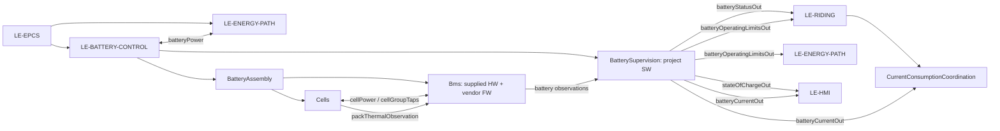
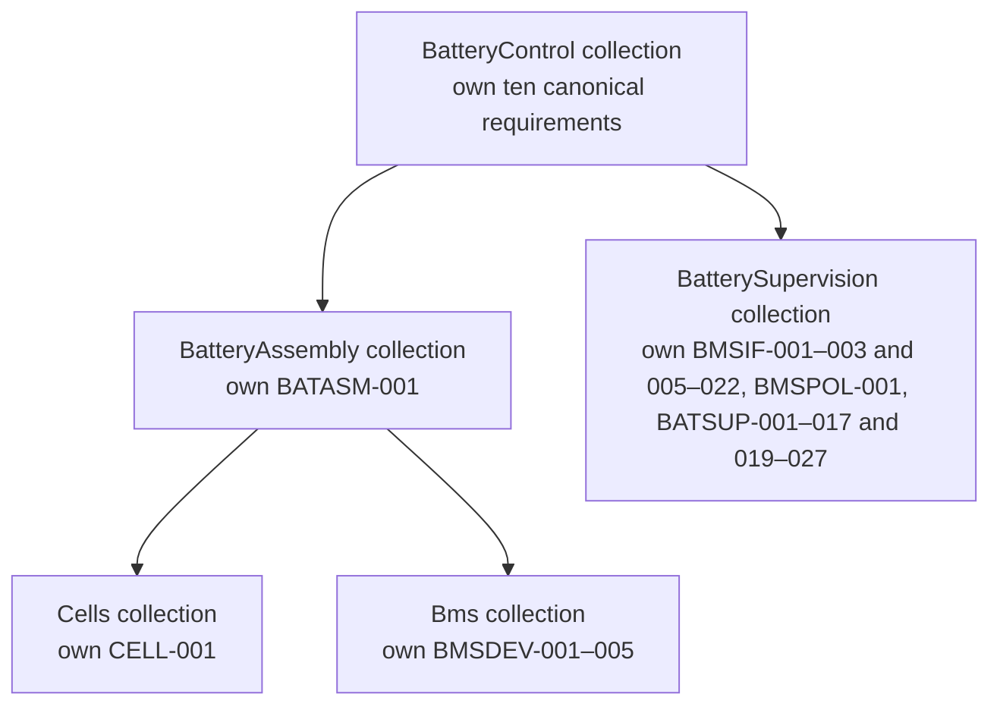

# BatteryControl

`LE-BATTERY-CONTROL` is an `LE-EPCS` child. It contains the owner-built physical `BatteryAssembly` (`Cells` plus the supplied `Bms` hardware and vendor firmware) and the vehicle-host `BatterySupervision` logical responsibility for reading and qualifying BMS information and determining capability. The energy wrapper is retired; `LE-ENERGY-PATH` is an EPCS sibling. BatteryControl supplies qualified battery information and capability; it does not own motor-controller enforcement or vehicle-wide physical protection.

## Decomposition and required information contracts

| Port or internal exchange | Mandatory members / consumer | Requirement source |
|---|---|---|
| `batteryPower` ↔ `LE-ENERGY-PATH` | physical pack energy only; energy-path protection and generated/residual energy remain EPCS responsibility | [BMS-004](../Specification/BatteryControl.sysml), [BMS-005](../Specification/BatteryControl.sysml), [BMS-009](../Specification/BatteryControl.sysml) |
| `batteryStatusOut` → `LE-RIDING` | Reporting-only concurrent conditions for recognized battery faults, including BMS-reported thermal faults, the live ordinary MOS-disabled warning and `lowDischargeVoltageWarning`, including distinguishable unknown status. Physical battery thermal protection is allocated to BMSDEV-005; BatterySupervision recognizes and publishes BMS-reported faults under BATSUP-017/020. The low-voltage condition uses all fourteen qualified group voltages and the qualified discharge cutoff: true at or below the cutoff, false above it, and unknown if the evidence is unavailable. It is independent of operating-limit qualification and is not a functional input, fault event, or HMI code. BatterySupervision captures recognized fault events in common recognition order; RidingControl retains/selects the report under its existing rules. No inference of isolation. | [BMS-010](BatteryControl.sysml) (BatteryStatus fields), [BMS-007](BatteryControl.sysml) (operational fault effect), [BATSUP-017/019–021/025–027](BatterySupervision/BatterySupervision.sysml), [HMI-007/018](../RidingControl/Specification/SessionReportPolicy.sysml) |
| `batteryOperatingLimitsOut` → `LE-RIDING`, `LE-ENERGY-PATH` | independent discharge and regenerative-charge branch qualification; applicable shared checks are internal and included in every dependent branch; finite, nonnegative effective current ceilings; and restriction-active/reason fields. Each published operating limit is the selected curve result for its branch (the minimum of the applicable temperature and voltage curves), subject to the existing path-disabled, required-data qualification and retained-fault rules; a qualified disabled/prohibited path contributes zero. BatterySupervision adds no generic physical/configuration current ceiling, runtime cap or settings input. Actual SOC is not required for either branch or startup eligibility. Missing required evidence leaves the affected branch unqualified with effective zero. A qualified zero is known zero capability; unqualified required information leaves every dependent branch unqualified and its effective current zero. A recognized restart-required battery fault retains both branches unqualified with effective zero until normal/unexpected restart; valid measurements otherwise retain their independent validity. RidingControl consumes limits and qualification for budgeting and battery functional behavior and suppresses requested regenerative braking when charge is unqualified or the qualified charge-current ceiling is zero. EnergyPath consumes the qualified total all-load bounds for physical enforcement. | [BMS-001](../Specification/BatteryControl.sysml), [REQ-SYS-BMS-008](Specification/OperatingPolicy.sysml), [REQ-SYS-BMSPOL-001](BatterySupervision/Specification/CommonCurrentCapabilities.sysml), [REQ-SYS-BATSUP-004/005](BatterySupervision/BatterySupervision.md#specification), [REQ-SYS-BATSUP-019](BatterySupervision/Specification/FaultHandling.sysml) |
| `stateOfChargeOut` → `LE-HMI` | qualified `actualStateOfChargePercent` and validity; HMI consumes the display members in HMI-002/003 and SOC supports display and range information; low-charge warning follows the independent low-voltage status condition. | [BMS-003](BatteryControl.sysml), [BATSUP-003](BatterySupervision/BatterySupervision.sysml), [SOC-008](../RidingControl/RidingControl.md), [HMI-002/003](../DriverInteraction/HMIControl/Specification/Requirements.sysml), [HMI-009](../RidingControl/Specification/SessionReportPolicy.sysml) |
| `batteryCurrentOut` → `LE-RIDING.CurrentConsumptionCoordination`, `LE-HMI` | The existing independently qualified `signedPackCurrentAmperes` scalar and its validity; positive is charging and negative is discharging. Field-only unavailability withdraws only this value's qualification and does not alter battery operating limits, BatteryStatus, or actual SOC. A complete Basic-response/transport loss still follows independent field-age and fault policies. HMI fallback has no effect on this value's qualification or operating-limit values. | Owner decision 2026-10-28; [REQ-SYS-BMS-003](Specification/BmsIntegration.sysml), [BMSIF-009](BatterySupervision/BatterySupervision.sysml), [BATSUP-002](BatterySupervision/BatterySupervision.sysml), [HMI-020](../DriverInteraction/HMIControl/Specification/Requirements.sysml) |
| Bms → BatterySupervision read requests/responses | read-only UART `0x03`, `0x04`, `0x05`, carrying `recordKind` (Basic/FourteenGroup/Identity), `packVoltageVolts`, `packCurrentAmperes`, `stateOfChargeCandidatePercent`, `cellGroupVoltagesVolts[14]`, `availableTemperatures` (`probeIdentifier`, `temperatureCelsius`) in selected `0x03` MOS/T1/T2 order; owner-confirmed T2 centre-pack probe feeds both current curves as `Tcell`, with decoding/qualification owned by BMSIF-008, `protectionPathState` (`protectionFlags`, charge/discharge-path enabled) and `socSourceEvidence` (reported remaining/nominal capacity, series count, identity/version). Both startup checks use the same current accepted Basic `0x03` response; `0x05` remains supported for informational identity decoding and is not a startup prerequisite. | [REQ-SYS-BMS-003](Specification/BmsIntegration.sysml), [REQ-SYS-BMSIF-001](BatterySupervision/Specification/MeasurementQualification.sysml) |
| Cells ↔ Bms `cellPower` / `cellGroupTaps` | pack energy and 14-group taps exchange for BMS supervision and balancing | [CELL-001](BatteryAssembly/Cells/Cells.sysml), [REQ-SYS-BMS-002](Specification/BmsIntegration.sysml), [REQ-SYS-BMS-003](Specification/BmsIntegration.sysml) |
| Cells → Bms `packThermalObservation` | available pack thermal observation; count and availability do not prove all individual-cell or thermal fault coverage | [REQ-SYS-BMS-003](Specification/BmsIntegration.sysml) |

BatterySupervision decodes and internally qualifies applicable source observations only after fieldwise validity, source-timeliness qualification and other applicable evidence; each value has an independent qualification indication. Runtime qualification does not compare different BMS measurements for agreement. Source-update timers and timing references remain private to BatterySupervision. No BMS measurement timestamp is inferred from host receipt time. Raw BMS RSOC/capacity is only `stateOfChargeCandidatePercent` until BMS-002/BMS-003 and the SOC policy qualify actual SOC. Among BMS measurement fields, actual SOC and signed pack current are externally published as qualified values; other source observations support the internal assessments that produce operating limits and status. A UART value, FET/path bit, or project-software limit does not prove physical isolation or protection; the EPCS duties in BMS-004/005/009 remain applicable.

### BatterySupervision timing

Owner-selected polling, startup, timeout and publication targets are defined normatively by [BMSIF-010–022 and BATSUP-001/017/022/023](BatterySupervision/BatterySupervision.sysml); BMSIF-013 owns the cyclic polling schedule, BMSIF-020 the 10 ms output-publication budget, and BATSUP-022 the initial startup-evidence deadline. See the [verification note](BatterySupervision/BatterySupervision.md#selected-polling-and-timing-targets). Installed-unit source age and downstream physical-response limits remain open evidence gates. Possible current-capability feedback oscillation is deferred to [WS-OI-017 product evaluation](../../DEC-001_Decisions_and_Open_Issues.md#ws-oi-017-current-capability-feedback).

## Requirement composition and derivation

The canonical requirements are held in their owning elements’ Specification packages and composed through architecture collections. Native SysML `require QualifiedPackage::canonicalUsage;` references provide conjunctive composition under SysML 2.0 §7.21.2; each referenced usage retains its canonical subject and body ([SysML 2.0 Language](https://www.omg.org/spec/SysML/2.0/Language/PDF)). The collections add no catalogue records. BMS010 separately owns BatteryStatus reporting from BMS-007 operating capabilities; REG-012 separately owns charge-voltage recovery from REG-002 cutoff. The existing BMSPOL-001 battery envelope policy uses independent temperature and voltage current envelopes; discharge and charge cutoffs follow the lowest- and highest-group voltage curves. Satisfaction assertions express design intent, not verification evidence; composition expresses coverage and does not create derivation edges.

The single per-startup nominal-capacity snapshot is captured once at controller startup and retained for that controller cycle. [BATSUP-007–011](BatterySupervision/BatterySupervision.sysml) define regenerative capacity, temperature and voltage ceilings; [BATSUP-012–015](BatterySupervision/BatterySupervision.sysml) define the corresponding discharge ceiling, using `IbD = 1.00 × C_Ah`, its specified temperature factor and the minimum qualified group-voltage bound. Both tapers use [BatterySupervision.voltageDeratingCalibration](BatterySupervision/BatterySupervision.sysml); qualification and its symbolic formulas are canonical there. Each direction publishes its selected temperature/voltage curve result subject to its existing path, qualification and retained-fault rules. Physical pack-current protection is configured and validated in the supplied BMS; it is distinct from the host-computed operating budgets and normal vehicle-side enforcement. The discharge cutoff is expected around 10% SOC, subject to product validation. Cells at or below −5°C yield zero discharge ceiling; owner-selected cold use therefore requires a sufficiently warm battery for propulsion while retaining −10…+40°C E/E startup conditions ([DEC-BAT-002](../../DEC-001_Decisions_and_Open_Issues.md#dec-bat-002), [OI-051](../../../../README.md#15-unresolved-issues)).

The component collections mirror `BatteryControl → (BatteryAssembly, BatterySupervision)` and `BatteryAssembly → (Cells, Bms)`. The three assembly contribution collections bridge individual parent obligations through the immediate architecture child: selection, commissioning configuration and source information. BatteryControl requires the assembly and supervision collections; the BatteryAssembly collection requires its canonical BATASM-001 requirement plus the Cells and Bms collections. Parent requirements also require the relevant bridge and supervision contributions: BAT-002 requires `assemblySelectionRequirements`; BMS-002 requires `assemblyConfigurationRequirements` and BMSIF-005 basic-field decoding; BMS-003 requires `assemblySourceInformationRequirements`, BMSIF-001–003, BMSIF-005–009, BMSIF-010–022 and BATSUP-003; BMS-006 requires BATSUP-001/002/022, BMSIF-005 basic-field decoding and BMSPOL-001; BMS-007 requires BMSPOL-001, BATSUP-004–017, BATSUP-019/021 and BATSUP-023/024/027; BMS-010 requires BATSUP-006/017/020/021/025/026; BMS-008 requires BMSPOL-001. These purpose-selected `require` references compose coverage and do not create derivation edges or architectural children. BMSIF-003 defines response-envelope conditions for measurement updates; BMSIF-014 adds outstanding-request correlation and success-status conditions; BMSIF-005–009/015–016 and related field requirements own schema and value decoding/qualification. BMSIF-013 owns only the cyclic polling schedule; BMSIF-020 owns output publication budget, while field expiry and startup/cyclic fault deadlines belong to BMSIF-010 and BATSUP-022/023. The BMSIF behavioral rules are canonical in BatterySupervision.sysml; [BatterySupervision documentation](BatterySupervision/BatterySupervision.md#selected-unit-uart-read-acceptance-contract) retains protocol facts and verification guidance, not a separate acceptance contract.

The existing parent-to-child `#derivation` connections in [BatteryControl.sysml](BatteryControl.sysml) use the standard `RequirementDerivation` domain library ([SysML 2.0 Language, §9.6](https://www.omg.org/spec/SysML/2.0/Language/PDF)), which the model workspace must load. The graph remains the distinct provenance/contribution DAG: the BMSIF and BATSUP children derive from their System Requirement parents, without Abstract Software to Abstract Software derivation; it need not mirror the architecture branches, and a source citation is not a derivation.

| Parent | Same-target refinement edges | Allocated assembly/BMS/software children |
|---|---|---|
| `REQ-SYS-BAT-002` | — | Physical: `REQ-SYS-CELL-001` (Cells), `REQ-SYS-BATASM-001` (BatteryAssembly), `REQ-SYS-BMSDEV-001` (Bms selected identity). |
| `REQ-SYS-BMS-002` | `REQ-SYS-BMS-006` | Physical: `REQ-SYS-BMSDEV-002` (configuration acceptance), `REQ-SYS-BMSDEV-004/005` (physical current and thermal protection). Software: `REQ-SYS-BMSIF-005/016` (Basic decoding and reported group-count qualification). |
| `REQ-SYS-BMS-003` | `REQ-SYS-BMS-006`, `REQ-SYS-BMS-007` | Physical: `REQ-SYS-BMSDEV-003` (Bms source measurements), `REQ-SYS-BMSDEV-004/005` (physical current and thermal protection). Software: `REQ-SYS-BMSIF-001`–003 and `REQ-SYS-BMSIF-005`–022 (request, frame-envelope and transaction/status acceptance, schema, field and observation qualification), `REQ-SYS-BATSUP-003` (actual-SOC qualification). |
| `REQ-SYS-BMS-006` | — | Software: `REQ-SYS-BMSPOL-001` (battery envelope policy), `REQ-SYS-BATSUP-001/002` (startup checks and operating-required qualification), `REQ-SYS-BATSUP-022` (startup evidence deadline), `REQ-SYS-BMSIF-005` (Basic field decoding). |
| `REQ-SYS-BMS-007` | — | Software: `REQ-SYS-BMSPOL-001` (battery envelope policy), `REQ-SYS-BATSUP-004/005` (charge/discharge path capability restrictions), `REQ-SYS-BATSUP-007–011` (capacity-referenced regenerative pack ceilings), `REQ-SYS-BATSUP-012–015` (capacity-referenced discharge pack ceilings), `REQ-SYS-BATSUP-017/019/021/023/024/027` (fault recognition, retained effect, restart reset, cyclic required-data fault, capacity retention and functional-input separation). Physical current and thermal protection are allocated to BMSDEV-004/005 respectively; configuration acceptance remains BMSDEV-002. |
| `REQ-SYS-BMS-010` | — | Software: `REQ-SYS-BATSUP-006/017/020/021/025/026` (separate BatteryStatus publication, fault reporting and independent warning status). |
| `REQ-SYS-BMS-008` | — | Software: `REQ-SYS-BMSPOL-001` (battery envelope policy). |
| `REQ-SYS-SOC-003/005` | — | Software: `REQ-SYS-BMSPOL-001` (battery envelope policy) and `REQ-SYS-BATSUP-014/015` (discharge voltage curve and pack ceiling). |
| `REQ-SYS-SOC-004` | — | Software: `REQ-SYS-BMSPOL-001` (branch independence). |
| `REQ-SYS-REG-002` | — | Software: `REQ-SYS-BMSPOL-001` (battery capability policy) and `REQ-SYS-BATSUP-010/011` (charge voltage curve and pack ceiling). |
| `REQ-SYS-REG-012` | — | Software: `REQ-SYS-BMSPOL-001` and `REQ-SYS-BATSUP-010/011` (charge-voltage recovery). This Draft requirement is sourced directly from DEC-REG-012 and has no incoming System Requirement derivation edge. |

This table follows the native edge set and distinguishes same-target refinement from allocated assembly/BMS/software children. The current BatteryControl allocation has 67 canonical requirements (48 Abstract Software, 18 System and 1 Abstract Hardware), eight collections, 75 total usages with satisfaction assertions, 147 required references and 79 derivation edges. The allocation is Draft. Any changed normative body is a Draft successor of its historical approved record; source and verification work remains open, and historical approval does not approve a successor. The Draft records allocate evidence and responsibilities; they do not claim compiler acceptance, electrical acceptance, completed verification, or closure of engineering parameters. All numbered records and unnumbered collections have explicit satisfaction assertions bound to their intended architectural subjects; these are design claims, with verification status and evidence tracked separately.

## Built battery and supplied BMS integration

**Type:** System Requirement; remaining records allocated to `LE-EPCS`.

Part of **REQ-001-R1.6**. This file retains the approved canonical records `REQ-SYS-BMS-001`, `REQ-SYS-BMS-004` and `REQ-SYS-BMS-009`, with Draft successor bindings to `LE-EPCS`. `REQ-SYS-BMS-005` is a Draft successor to its approved baseline; its historical approval provenance is retained. The six records assigned to `LE-BATTERY-CONTROL` are canonical in [BatteryControl.sysml](BatteryControl.sysml). The binding update preserves approved normative bodies for records without changed bodies, source owner decisions and historical release; it does not claim an approved allocation release. [Model and verification rules](../../REQ-001_Requirements.md) apply. These approved elaborations implement owner-confirmed [DEC-BAT-002](../../DEC-001_Decisions_and_Open_Issues.md#dec-bat-002); [BAT-001](BatteryAssembly/BatteryAssembly.md#fixed-inputs-and-provenance) is the canonical component/rating reference. Selection and reported initial fit are settled, while integrated acceptance remains open.

The fixed bank is allocated to hardware below. The supplied BMS includes manufacturer firmware and remains a composite acceptance boundary; it is not falsely classified as an entirely hardware logical leaf. Existing storage, handling, SOC, regeneration, range and fault requirements remain independently applicable.

### Battery qualification and operating classification

The following approved refinements turn the general integration obligations into admission, classification and loss-of-host contracts. [DEC-TMP-003](../../DEC-001_Decisions_and_Open_Issues.md#dec-tmp-003) supplies the new owner temperature decision. Other classifications below are engineering derivations of existing decisions; numerical recognition/response criteria and detection coverage remain open.

#### Qualification evidence and response budget

| Assessment | Minimum evidence to define and obtain |
|---|---|
| Configuration acceptance baseline | Controlled commissioning criteria identify the recorded 14S5P cell bank and installed BMS model, board revision and firmware; define accepted effective protection, balancing, capacity and SOC-calibration settings with units/scales, permitted changes, and qualified cell and system operating envelopes. Compare observable readback with controlled configuration evidence and retain the identity, settings and effective-behavior evidence for acceptance. The baseline is planned evidence; it is not yet qualified. Separate commissioning evidence from checks repeated at each startup. |
| Per-consumer information acceptance | Define each consumer's required-information subset and shared dependencies across 14-group voltages, pack voltage, SOC, current and available temperature coverage. Each BMS value is qualified internally on its own accepted response, schema/encoding/scaling, supported decoding, finite numeric value and source timeliness under BMSIF-009; SOC bounds are owned by BATSUP-003. Disagreement between measurements is not a runtime validity check. Among BMS measurement fields, actual SOC and signed pack current are externally published as qualified values; other source observations support the internal assessments that produce operating limits and status. Qualified signed pack current is consumed by RidingControl.CurrentConsumptionCoordination for shared-budget supervision as well as by HMIControl for display; field-only unavailability affects only the pack-current value's qualification and does not invalidate battery limits, status, or actual SOC. The selected three-value Basic (`0x03`) order MOS/T1/T2 and the owner-confirmed T2 centre-pack probe are documented in [BAT-001](BatteryAssembly/Bms/Bms.md#owner-reported-app-temperature-readings-2026-10-26); BMSIF-008 owns decoding and qualification. T2 supplies `Tcell` to both current curves. MOS/T1 are not additional capability prerequisites. Physical MOS/T1 roles and measurement adequacy remain open. Retain measurement accuracy, source-age, and measurement-to-response evidence gates. Display fallback shall not qualify control information or change operating limits. |
| SOC source acceptance | Record the accepted SOC source, calibration and capacity references, their uncertainty, and qualified SOC range and measurement age for SOC mapping, display and range information. Establish acceptance criteria for source qualification and reporting use; no calibration or accepted reference is assumed by this table. |
| Protection and paths | Supported protection meanings and expected charge/discharge states per configuration; distinguish reported FET command/status from proven physical transfer or isolation. Establish how detectable path/protection failures are recognized and which failures remain unobservable. |
| Time and margins | Canonical BatterySupervision rules allocate cyclic polling to BMSIF-013, source-field expiry to BMSIF-010, transaction response handling to BMSIF-014/018/019, component output publication to BMSIF-020, startup evidence deadline to BATSUP-022, and cyclic required-field fault recognition to BATSUP-023. Validate actual source sample age and internal refresh/response behavior, then bound downstream delivery/use, consumer action and physical response against the shortest applicable energy, thermal and voltage margins. Fast electrical protection cannot be justified solely by UART supervision. See [BMS information](BatterySupervision/BatterySupervision.md#selected-polling-and-timing-targets) for verification guidance. |
| Boundary transfers | Bound residual charge and energy transferred after inhibition using qualified current, voltage, temperature and response-time evidence and applicable physical operating envelopes. For example, a constant upper current bound gives `ΔQ = I_charge,max × t / 3600` Ah. This does not establish a response time or a complete physical margin. SOC calibration and uncertainty support display and range evidence, not a current-control trigger or margin; no runtime voltage or temperature uncertainty offset is prescribed here. |

Battery qualification is the current qualification of operation-required inputs and protection-path evidence represented by `batteryOperatingLimitsOut`, independent of effective limit magnitude. On every normal or unexpected controller startup, BATSUP-001 requires firmware 3.2 and 14 series groups from the same accepted Basic (`0x03`) response; BATSUP-022 allocates the startup evidence deadline. Field schemas, scales and installed-unit evidence remain under BMSIF-005–009/015–016; BMSIF-009 defines field qualification, BMSIF-010 source-field expiry, BATSUP-003 SOC bounds, BATSUP-007 cycle capacity capture and BATSUP-024 capacity-cycle retention. Required input subsets and temperature coverage remain consumer-specific evidence. Actual SOC is not required for startup or either current branch; SOC-only loss affects its own qualification. Pack-current-only loss affects its own published value and does not change battery limits, BatteryStatus or actual SOC, though CurrentConsumptionCoordination consumes the qualified current. Identity (`0x05`) is informational; physical configuration acceptance is commissioning evidence. Loss of shared data withdraws each dependent branch, while branch-only loss affects that branch. A qualified zero is known zero capability; an unqualified required constraint yields unqualified zero. A recognized required-information battery fault follows the existing retained-fault policy, with initial and cyclic required-field fault deadlines allocated to BATSUP-022/023. Polling, startup and host-update timeout behavior is defined by the canonical BMSIF/BATSUP requirements; source sample age, consumer physical response and protection margins remain evidence gates. See [BMS information](BatterySupervision/BatterySupervision.md#selected-unit-uart-read-acceptance-contract).

The shared startup nominal-capacity snapshot is captured once per controller cycle and is used by both directions. [REQ-SYS-BATSUP-007–011](BatterySupervision/Specification/StartupAndRestart.sysml) define regenerative temperature/voltage ceilings; [REQ-SYS-BATSUP-012–015](BatterySupervision/Specification/DischargeCapability.sysml) define the corresponding discharge ceiling. Both voltage tapers use the composite calibration and symbolic formulas defined by [REQ-SYS-BATSUP-016](BatterySupervision/Specification/CommonCurrentCapabilities.sysml). Capability uses the qualified reported T2 centre-pack-probe reading directly as `Tcell` and, for each direction, the maximum or minimum of the fourteen qualified group-voltage readings as specified; no numerical uncertainty compensation is applied. Each direction uses the exact minimum of its own temperature and voltage curves, subject to existing path status, source qualification and retained faults. Physical current protection is configured separately in the supplied BMS. SOC qualification is independent of both current branches and startup eligibility. Live SOC capacity information remains separate. Cells ≤−5°C produce zero discharge ceiling, so the owner's −10…+40°C ambient decision allows cold-soaked E/E startup but requires sufficiently warm cells for propulsion. Temperature accuracy, coverage, lag, calibration, applicable thermal-trip thresholds, source age and CurrentConsumptionCoordination's pack-current supervision limits remain open; pack-current field-only absence does not affect BatterySupervision branches or SOC. See [DEC-BAT-002](../../DEC-001_Decisions_and_Open_Issues.md#dec-bat-002) for the owner disposition.

#### Battery event and recovery matrix

This matrix applies existing vehicle policies to battery evidence; it is not a complete hazard analysis or proof that every listed failure is detectable. A recognized fault's physical response applies regardless of the selected report. All fault-group codes below use existing first-detected/tie selection and restart retention above low-priority `0x01`.

| Qualified event / classification | Riding response and indication | Trace |
|---|---|---|
| Initial required observations/checks incomplete | From polling start, wait up to 1 s for startup required checks/data; before the deadline, ordinary waiting is not a fault and dependent battery operating limits remain unqualified at zero. Failure to qualify at the deadline is a battery-information fault and invokes the existing both-sign session latch. SOC qualification remains independent and is not a startup guard. | STA-001/005–007; FLT-010; BMS-006; BATSUP-001/002/017–019 |
| Recognized UART/battery-information fault affecting required control data | Both-sign fault inhibition; 0x07 for the battery category. Recognize actual BMS-reported errors and firmware 3.2 / 14-group startup mismatches immediately. A 600 ms host-update timeout, measured since the last accepted qualified relevant update, also recognizes the fault; invalid, rejected, wrong, error, late or unrelated replies do not renew it. Restored data alone does not recover the session. | FLT-005–008; TMP-002; BMS-003/007; BATSUP-001/002/017–019 |
| Pack-current field unavailable while the Basic response and other source fields remain independently accepted | Withdraw qualification only from `BatteryCurrent.signedPackCurrentAmperes`; publish no fabricated measurement. This alone shall not change battery operating-limit qualification/effective limits, BatteryStatus, or actual-SOC qualification, and shall not create a fault. RidingControl.CurrentConsumptionCoordination and HMIControl consume the same independently qualified scalar; HMI fallback remains display-only. If the whole Basic response or transport is lost, independently age and assess each affected field and apply existing required-information and common-fault policies. | Owner decision 2026-10-28; HMI-020–024; BMS-003/007; BMSIF-009/010/012; BATSUP-002/003/019/020 |
| Qualified group voltage | At or below the calibrated lowest-group discharge voltage cutoff, BatterySupervision sets total discharge capability to zero; strictly above it the voltage curve may recover, subject to temperature and other limits. The cutoff is expected around 10% SOC, subject to validation. At or above the calibrated highest-group charge cutoff voltage, currently 4.10 V, regenerative charge capability is zero; below it the voltage curve recovers subject to temperature and other limits. The approximate 10/90 SOC points express longevity intent, not exact SOC guarantees. Auxiliary power, including brake lights, may be lost at the discharge cutoff; controls and Ready remain operable after power recovery. 0x01 remains subject to fault priority. | [SOC-003/004/005 and REG-002](BatteryControl.sysml); [SOC-008](../RidingControl/RidingControl.md); [VEH-PWR-001/002](../X2CityMCU.md); ENE-001 |
| Normal regeneration ceiling or valid charge-ineligible temperature | Effective regenerative-charge current is limited by qualified charge acceptance. If charging is forbidden (including a qualified cold-cell condition such as −5°C), the qualified charge-current ceiling is zero while independently qualified discharge capability remains available; RidingControl shall withhold the requested regenerative-braking application at this zero ceiling. No dedicated regeneration restriction/fault indication. Missing regen-only information or pack-current-field-only unavailability cannot invalidate independently qualified propulsion inputs. BatterySupervision publishes the selected operating charge limit as the exact minimum of its temperature and voltage curves, subject to the existing path-disabled, required-data qualification and retained-fault rules. A qualified disabled charge path contributes zero; required unqualified evidence leaves the branch unqualified with effective zero. It adds no generic physical/configuration current ceiling, runtime cap or settings input. Temperature recovery may raise charge acceptance but RidingControl's existing regenerative-recovery guard still governs re-entry; BatterySupervision publishes the current minimum and does not hold a reduced-regeneration episode. | REG-001/005–007; DEC-REG-003; DEC-TMP-003 |
| Required temperature information fault / actual applicable thermal violation | Both-sign fault inhibition. A BMS-reported fault, including a BMS-reported thermal fault, contributes to the BatteryStatus battery-fault condition and uses 0x07; physical battery thermal protection is allocated to the supplied BMS under BMSDEV-005. Independently recognized applicable thermal-limit faults outside this battery fault path use 0x06. Battery-domain information failure uses 0x07; another information category uses its specific code, otherwise 0x05. Missing temperature alone does not prove a thermal violation. Ordinary charge-temperature ineligibility is not a fault. | DEC-FLT-006–008; DEC-TMP-001–003; BMS-007 |
| Expected charge/discharge path disabled for qualified normal state | Independently apply known zero effective current to the affected branch while retaining its qualification if remaining criteria pass. Publish the BatteryStatus MOS-warning condition as known disabled when either current-qualified path state is disabled; it clears only when both path states are qualified enabled. RidingControl reports the current MOS warning as 0x01 under [HMI-009](../RidingControl/Specification/SessionReportPolicy.sysml); [HMI-010](../RidingControl/Specification/SessionReportPolicy.sysml) gives retained fault-group reports priority. Disabled status alone is neither a failure nor proof of isolation. Unknown/invalid/stale path-state inputs leave each dependent operating branch unqualified at zero and BatteryStatus MOS-warning state unknown. Existing recognized faults retain their operating effect and separate RidingControl report state; path-state recovery does not bypass RidingControl fault or regenerative re-entry guards. | BMS-005/007; BATSUP-004/005/006; HMI-009/010; REG-001/005–007 |
| Recognized electrical protection intervention or failed protective path, including group OV/UV, overcurrent/short or BMS internal fault | A BMS-reported fault, including BMS-reported thermal error, contributes to the BatteryStatus battery-fault condition and uses 0x07. Both use both-sign inhibition. Cell/group undervoltage protection is distinct from the normal lowest-group-voltage operating discharge cutoff. Apply assigned additional energy protection. | DEC-FLT-006–009; BMS-005/007/009; ENE-002–003 |
| BMS sleep/wake or UART return alone | Requalify affected evidence under ordinary source-loss and recovery rules. A recognized restart-required battery fault independently retains both operating branches unqualified with zero effective limits until normal/unexpected controller restart; report selection/lifetime remains RidingControl-owned. Packet return alone does not change controller-startup context. | FLT-005–006/011; BMS-005 |
| Normal/unexpected riding-controller restart | Discard prior-cycle BatterySupervision fault effect and diagnostic evidence; assess current inputs afresh, and recognize still-present faults anew. Both signs remain unavailable until fresh self-tests, current observations and complete simultaneous Ready guards pass. RidingControl separately starts a fresh report session; new/current faults establish new state. | DEC-STA-001; DEC-FLT-007 |
| Off/fault, accessible contacts or wheel generation with charge path absent | Observe physical current, voltage, energy and unintended torque/drag; zero command alone does not establish a safe energy state. Continue auxiliary functions only where protection permits. | ENE-001–003; BMS-004/009; DEC-FLT-009 |

Rows retain the complete Ready, brake, speed, profile and regenerative-application guards. A common reset spanning several vehicle controllers must satisfy each affected domain's rules; transport restoration cannot silently reset a riding session. Derive exact power/reset-domain evidence in ARCH-001 and the existing open issues.

## Specification

- [AssemblySelection](Specification/AssemblySelection.sysml)
- [BmsIntegration](Specification/BmsIntegration.sysml)
- [OperatingPolicy](Specification/OperatingPolicy.sysml)
- [Reporting](Specification/Reporting.sysml)
- [RequirementSet](Specification/RequirementSet.sysml)
- [StartupAndClassification](Specification/StartupAndClassification.sysml)
- [BatteryControl](../Specification/BatteryControl.sysml)

## Battery handling

**Target:** [LE-EPCS](../../REQ-001_Requirements.md#le-epcs).

Draft successor dated **2026-10-06**. The basic BMW tray/lock access and normal handling sequence are supplied platform context at [ID-001 §2.1](../../ID-001_Item_Definition.md#external-mechanical-platform-assumption); they are not project mechanical requirements. This cluster covers EPCS propulsion inhibition during the supplied procedure and electrical/thermal/residual/generated-energy safety of accessible interfaces.

The built 14S5P 35E pack and selected JBD BMS/UART are fixed by [DEC-BAT-002](../../DEC-001_Decisions_and_Open_Issues.md#dec-bat-002). [Battery integration](BatteryControl.md) adds qualified cell charge-acceptance limits, balancing/configuration and UART protection obligations needed for riding and regeneration.

### Normal battery handling

**Electrical handling acceptance:** Map the supplied handling procedure to electrical connector, pack and cover states; connection before seating must be covered. Verify accessible energy and residual/generated-energy protection separately from no-propulsion/Ready behavior. Define electrical inspection/recovery for wet/contaminated, damaged, mis-mated or incomplete interfaces (PD FM-017/018/024); mechanical access and retention remain external assumptions. Contact construction, protective topology and any electrical sensing remain downstream decisions.
