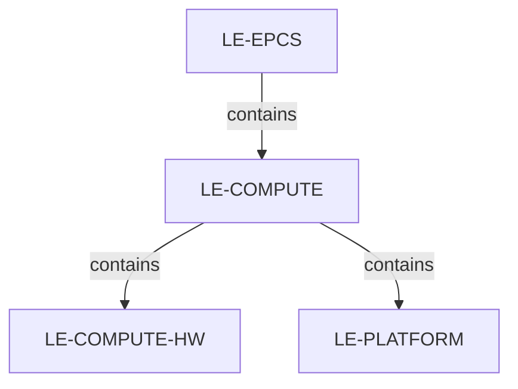
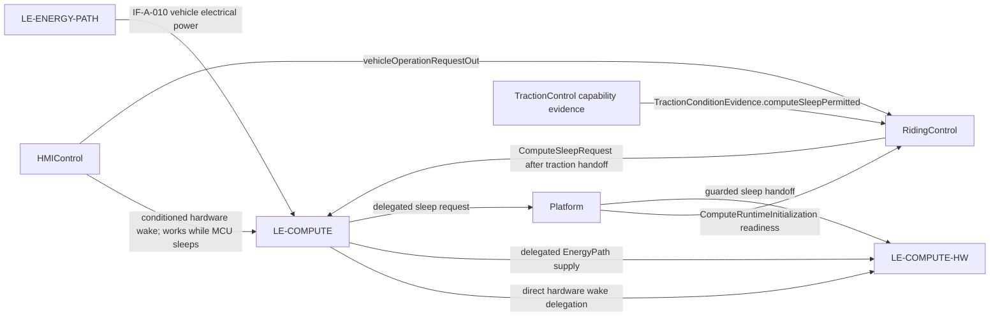

# Compute

`LE-COMPUTE` is the vehicle execution infrastructure composite. It contains only `LE-COMPUTE-HW` and `LE-PLATFORM`; system-function ownership remains with the owning logical components. The selected WeAct STM32H723VGT6 V1.2 board hosts vehicle execution. EnergyPath supplies distributed vehicle electrical power to Compute.

The conditioned HMI hardware wake is a direct path from HMIControl through Compute to ComputeHardware and remains available while the processor sleeps. After hardware wake, Platform initializes runtime independently of HMI request qualification. HMIControl publishes its qualified `VehicleOperationRequest` to RidingControl only; RidingControl evaluates sleep eligibility from qualified explicit Off and qualified traction `computeSleepPermitted` evidence, then grants or revokes the sleep request. Platform validates the RidingControl request at sleep entry and executes it; it does not re-evaluate HMI or traction eligibility or renew permission while forwarding. Platform does not observe or emit the awake power-lock signal.

Platform publishes `ComputeRuntimeInitialization` readiness for required clocks, peripherals and the runtime monotonic timebase used by caller-supplied time references. This is a runtime prerequisite and does not establish vehicle Ready. RidingControl owns On/Off lifecycle, vehicle Ready and fault-latch authority. A qualified explicit Off immediately closes the current operation session regardless of motion. A later qualified On requires fresh session qualification; it never resumes prior Ready or authority.

RidingControl requests sleep only after the required traction output handoff. Each true request is a current qualified grant with an expiry; false cancels it. Platform accepts only the latest current-context, valid, unexpired true request at actual entry, preserving its qualification, source context and expiry without renewing it. Revoked, invalid, missing, expired or superseded grants cannot initiate sleep, and a pending true handoff clears when no longer current. The traction `computeSleepPermitted` value is capability evidence used by RidingControl, not final permission. No physical disconnect/isolation behavior is implied.

## Decomposition

| Logical part | Role | Model and requirement navigation |
|---|---|---|
| `LE-COMPUTE` | System compute infrastructure composite and EnergyPath load | [Compute model](Compute.sysml), [requirements](Compute.md) |
| `LE-COMPUTE-HW` | Selected controller board, energy input, reset/I/O and direct hardware wake | [ComputeHardware model](ComputeHardware/ComputeHardware.sysml), [requirements](ComputeHardware/ComputeHardware.md) |
| `LE-PLATFORM` | Runtime initialization readiness and guarded sleep execution | [Platform model](Platform/Platform.sysml), [requirements](Platform/Platform.md) |

## Composition and exchanges

The first view means **composed of**. The second shows distinct energy, hardware wake, operation-record, runtime-readiness and lifecycle exchanges.

This Compute refinement and its allocations are Draft. The selected sleep mechanism, eligible wake mode/input, pin-5 electrical/Off mapping, timing and sleep-persistence behavior remain downstream derivation and qualification gates. See [system architecture](../X2CityMCU.md#le-compute), [SystemArchitecture navigation](../X2CityMCU.md), and [ARCH-002 hardware architecture](../../ARCH-002_Hardware_Architecture.md#hc-controller).

## Compute requirements

**Type:** System Requirement. **Target:** `LE-COMPUTE`. **Status:** Draft.

This composite contains the hardware wake/observation boundary and the software platform binding. RidingControl owns operation lifecycle, Ready, fault lifetime and riding authority. A Compute request or sleep handoff does not establish physical output safety or remove residual/generated energy.

| ID | Requirement | Derived from / governing contract | Planned verification / remaining gate |
|---|---|---|---|
| `REQ-SYS-CMP-002` **Draft — 2026-10-05** | Compute shall receive vehicle electrical power supplied from the EPCS `EnergyPath` through `vehicleElectricalPowerIn` for operation of the controller hardware. | [REQ-SYS-ENE-001](../../../Requirements/System_Requirements/Energy_and_Protection.md#req-sys-ene-001); `IfA010VehicleElectricalPower`, `IF-EPCS-010`. | `I`, `A`, `T-HW`, `T-SYS`: trace the vehicle electrical-power path to Compute's input and characterize compatibility and powered/unpowered behavior for the selected configuration. Supply, rail and load values, protection, and physical acceptance remain open. |

### Allocation

Compute receives the conditioned controller wake signal through [HMIControl](../DriverInteraction/HMIControl/HMIControl.md), while [HMI electrical](../DriverInteraction/HMIControl/HmiElectricalInterface/HmiElectricalInterface.md) publishes its awake observation and [HMI information processing](../DriverInteraction/HMIControl/HmiInformationProcessing/HmiInformationProcessing.md) derives the qualified operation request for RidingControl. Runtime initialization and validation/execution of the guarded sleep handoff remain allocated to [Platform](Platform/Platform.md). Qualified Off closes the operation session under [REQ-SYS-CTL-005](../../../Requirements/Abstract_Software_Requirements/Settings_and_Control_Policy.md#req-sys-ctl-005); RidingControl alone grants/revokes sleep eligibility under [REQ-SYS-CTL-006](../../../Requirements/Abstract_Software_Requirements/Settings_and_Control_Policy.md#req-sys-ctl-006), using the current traction evidence in [REQ-SYS-TRQACT-003](../Traction/TractionControl/MotorControl/MotorControl.md#req-sys-trqact-003). Compute does not consume the HMI request or traction evidence for eligibility. Physical output and energy behavior remain subject to [REQ-SYS-TRQHW-004](../Traction/TractionControl/TractionHardware/TractionHardware.md#req-sys-trqhw-004) and [REQ-SYS-ENE-002/003](../../../Requirements/System_Requirements/Energy_and_Protection.md#req-sys-ene-002)–003.
