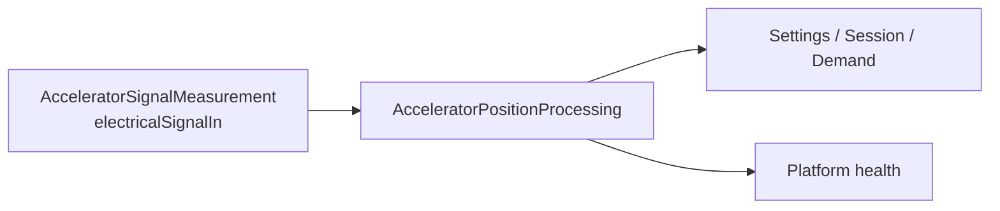

# AcceleratorPositionIdentification
## Accelerator position identification

`AcceleratorPositionIdentification` converts the rider electrical signal into one `AcceleratorPosition` composite. `Position` carries normalized percent, physical-rest status, and actual measurement time. `Qualification` carries usability and source-health attribution.

| Element | Responsibility | Requirements |
| --- | --- | --- |
| `AcceleratorPositionIdentification` (`LE-ACCELERATOR`) | End-to-end composition and policy/health routes. | [System requirements](AcceleratorPositionIdentification.md) |
| `AcceleratorSignalMeasurement` (`LE-ACCELERATOR-HW`) | Electrical observation to measured evidence. | [Hardware requirements](AcceleratorSignalMeasurement/AcceleratorSignalMeasurement.md) |
| `AcceleratorPositionProcessing` (`LE-ACCELERATOR-QUAL`) | Measurement to position/rest, measurement time, and qualification. | [Software requirements](AcceleratorPositionProcessing/AcceleratorPositionProcessing.md) |

Settings, Session, and Demand consume the composite; Platform consumes its Qualification projection. The lower acquisition boundary may retain raw source, rank, sequence, and compiled binding information, but those details are not exported by `Position`.

`AcceleratorPositionProcessing` owns one immutable compiled `AcceleratorEndpointCalibration` set containing four endpoint bounds. Its members are TBD values in volts, measured relative to the sensor reference return. Vehicle validation establishes them from stationary-handle voltage variation at each mechanical stop; their bands have ordered bounds and do not overlap. It classifies only otherwise qualified measurements: fault, stale, invalid, unavailable, or absent evidence cannot become valid through endpoint-band membership. A qualified value outside the rest band is not at rest; this model does not select intermediate mapping shape, polarity, clamping, or hardware measurement implementation.

Electrical mapping and rest characterization, sensor compatibility, error, freshness, response, and recognized-fault characterization remain Draft acceptance work. This model selects no ADC, DMA, driver, circuit, queue, or Session-latch implementation.

## Accelerator position identification requirements

**Draft addition — 2026-09-18.** **Type:** System Requirement. **Target:** [LE-ACCELERATOR](../../X2CityMCU.md#le-accelerator).

`AcceleratorPosition` has exactly two semantic members: `Position` and `Qualification`. `Position` contains normalized travel, physical-rest status, and its actual measurement time. `Qualification` carries authoritative usability and source-health information.

## Specification

- [Requirements](Specification/Requirements.sysml)
