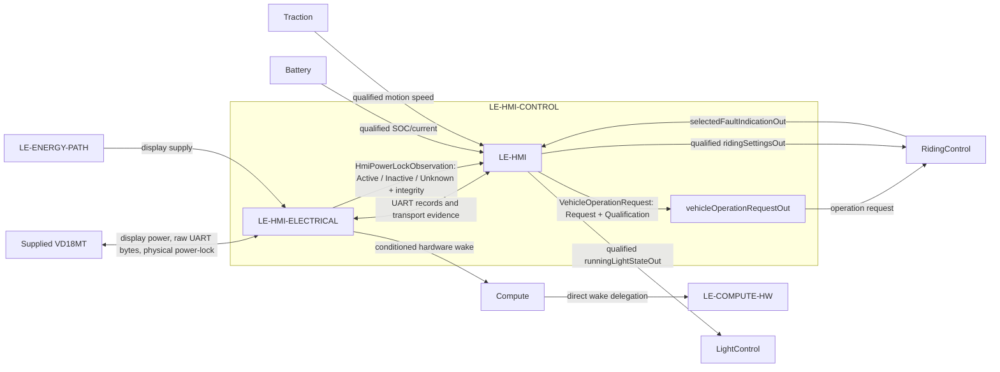

# HMIControl

`LE-HMI-CONTROL` is a child of [DriverInteraction](../DriverInteraction.sysml). It owns the VD18MT interaction, including power-button observation and On/Off request qualification. It contains electrical interface hardware and information processing; the conditioned hardware wake path is forwarded through DriverInteraction to Compute and remains available while software sleeps.

| Scope | Model | Allocated requirements |
|---|---|---|
| `LE-HMI-CONTROL` | [HMIControl.sysml](HMIControl.sysml) | [HMIControl requirements](HMIControl.md) |
| `LE-HMI-ELECTRICAL` | [HmiElectricalInterface.sysml](HmiElectricalInterface/HmiElectricalInterface.sysml) | [HmiElectricalInterface requirements](HmiElectricalInterface/HmiElectricalInterface.md) |
| `LE-HMI` | [HmiInformationProcessing.sysml](HmiInformationProcessing/HmiInformationProcessing.sysml) | [HmiInformationProcessing requirements](HmiInformationProcessing/HmiInformationProcessing.md) |



`HmiElectricalInterface` publishes `HmiPowerLockObservation` as Active, Inactive or Unknown with integrity from the supplied physical power-lock signal. It also conditions that signal to an MCU-safe hardware wake output, forwarded through Compute to ComputeHardware independently of execution and UART. This preserves wake while the MCU sleeps; the wake path does not depend on software or UART.

`HmiInformationProcessing` interprets the electrical observation into `VehicleOperationRequest` (`Request` plus `Qualification`) and publishes it through `HMIControl.vehicleOperationRequestOut` to `RidingControl.vehicleOperationRequestIn` only. RidingControl owns sleep eligibility and issues or revokes the sleep request using qualified explicit Off and qualified traction capability evidence. This interpretation is independent of UART framing and link health. Unknown, invalid or stale observation cannot become Off. The intended Inactive-to-Off mapping remains Draft pending selected-unit qualification; no confirmed pin-level behavior is asserted.

HmiInformationProcessing also owns UART framing, protocol interpretation, timestamps and VD18MT encoding. It receives concrete selected fault, SOC, current and speed records, each with qualification, and produces outgoing bytes without claiming visible-display acknowledgement. It reuses `RiderSettingsRequest`; setting acceptance and active-policy state remain in `RidingControl`. Vehicle control uses a fixed nominal 16-inch basis independently of the configurable VD18MT display wheel-size setting. Changing that display setting can make shown speed inaccurate, but cannot change control speed, direction, standstill or regeneration.

RidingControl owns lifecycle, Ready, fault-latch authority and riding permission. Runtime initialization readiness is a prerequisite, not Ready. The [Compute overview](../../Compute/Compute.md) describes startup and guarded sleep execution. This logical contract makes no physical disconnect/isolation claim. Transmission provides no display acknowledgement; selected-device presentation validation remains open.

Pins, wire colours, ground, connector topology, voltage classes and electrical limits are owned by the [VD18MT electrical refinement](HmiElectricalInterface/HmiElectricalInterface.sysml). The project-independent [VD18MT reference](#vd18mt-device-reference-vd18mt-tongsheng-uart-interface) remains the source for supplied-device evidence.

## HMI control requirements

**Type:** System Requirement. **Target:** `LE-HMI-CONTROL`. **Status:** Draft allocation of retained approved vehicle requirements.

`LE-HMI-CONTROL` composes the supplied VD18MT electrical boundary and project information processing. Its electrical leaf conditions pin-5 for a compatible `LE-COMPUTE-HW` wake input and publishes the awake `HmiPowerLockObservation`; its information-processing leaf derives the qualified `VehicleOperationRequest` delivered to RidingControl. The wake path does not require UART or running application code and does not grant drive permission. This function does not own Session authority, sleep eligibility, RidingControl session fault/report retention, normal-light policy, or lamp actuation. Each information exchange carries its semantic value and its qualification in one record; invalidity is published as invalidity. Initial state, transport activity, or a transmitted report never establishes a received setting or display acknowledgement.


### Retained HMI presentation requirements

These are System requirements targeted to `LE-HMI-CONTROL`. The information-processing leaf provides only the bounded software contribution; RidingControl retains session report lifetime, priority and low-charge selection.


The confirmed VD18MT device reference remains project-independent. Its historical implementation is evidence only. Selected-unit identity, connector electrical limits, timing, UART transport limits, display presentation, speed-status fallback and period remain open acceptance work under `WS-OI-008`/`009`. Pin-5 conditioning and wake-input compatibility are traced by [REQ-SYS-HMIE-002](HmiElectricalInterface/Specification/Requirements.sysml) and [REQ-SYS-CMPH-001](../../Compute/ComputeHardware/Specification/Requirements.sysml). The awake observation and operation-request derivation are allocated to [REQ-SYS-CMPH-002](HmiElectricalInterface/Specification/Requirements.sysml) and [REQ-SYS-PLT-004](HmiInformationProcessing/Specification/Requirements.sysml); raw physical Inactive-to-Off recognition remains Draft pending selected-unit qualification and is not a measured fact.

## Specification

- [Historical](Specification/Historical.sysml)
- [Requirements](Specification/Requirements.sysml)

<a id="context-vd18mt-implementation-reference-vd18mt-historical-implementation-reference"></a>
## VD18MT Historical Implementation Reference

**Status:** Approved and released evidence reference, Revision 1.0. Historical observations retain their stated limits; this document is not implementation or vehicle qualification.

**Revision:** 1.0, 2026-09-09

**Purpose:** Preserve historical implementation details, source provenance and qualification limits supporting the Item Definition & Requirements workstream. The [project-independent VD18MT interface reference](#vd18mt-device-reference-vd18mt-tongsheng-uart-interface) describes the device interface. Current vehicle behavior is recorded in the [decisions and open issues](../../../DEC-001_Decisions_and_Open_Issues.md), [requirements](../../../REQ-001_Requirements.md) and [item definition](../../../ID-001_Item_Definition.md). This reference does not create requirements or allocate their implementation.

<a id="context-vd18mt-implementation-reference-project-reference-and-source-authority"></a>
### Project reference and source authority

The [historical PD-001 Rev1.0](../../../README.md#release-and-history), released 2026-09-05, preserves the historical source authority. [PD-001 Rev1.1](../../../../../README.md), reviewed and released 2026-09-09, is now the current upstream baseline, maintained in the root README; its release does not alter this historical VD18MT evidence. PD-001 Rev1.0 §10.4 (preserved in Git) establishes the prior successful VD18MT implementation as a confirmed project input. The owner identified **`30fcc91f2066eb2d2e554e1c2776fe32549a0752`**, dated 2026-08-31, subject “Implemented Brake and Accelerator Input,” and directed that its tested and proven behavior be adopted into the interface documentation. This source-authority decision is traced as **DEC-REF-001** in the decision record.

The source is in historical Git path **`src/vd18mt`**. All source paths and line anchors below refer to that commit, not to files necessarily present in the current working tree. The independently maintained interface reference describes the device interface; this note records how the project uses that reference and the qualifications on its evidence.

The source uses `VD18MT*` names for display-to-controller data and `VT8MT*` names for controller-to-display data. These are historical Rust names for the two directions of the same VD18MT interface. They do not identify different selected devices.

The implementation replaced earlier generic Tongsheng/TSDZ2 assumptions for assist selection, battery indication, current, wheel-speed encoding, error mapping and controller transmission scheduling. Basic protocol discovery is not reopened. Further work concerns missing capabilities, the identified manual discrepancy, selected-unit correlation and final verification under PD-001 §10.4.

<a id="context-vd18mt-implementation-reference-relationship-to-decisions-and-open-issues"></a>
### Relationship to decisions and open issues

Owner behavior decisions formerly held in `VD18MT_Project_Notes.md` are consolidated in the [decision record](../../../DEC-001_Decisions_and_Open_Issues.md) and expressed as [requirements](../../../REQ-001_Requirements.md). Relevant decision traces are **DEC-LVL-001** (profiles 0–5), **DEC-LVL-002** (requested and active levels), **DEC-LVL-003** (VD18MT authority across restarts), **DEC-BRK-002** (brake-release resumption) and **DEC-HMI-001** (no indication of reduced or unavailable regeneration). These are vehicle choices, not inherent display behavior or evidence that the historical UART module implements them.

The [open-issue register](../../../DEC-001_Decisions_and_Open_Issues.md) holds the remaining integration scope, with links to **PD-001 OI-026–OI-032**. It covers selected-unit and manual correlation, electrical characterization, connector qualification, vehicle HMI functions and settings, battery presentation, level and power integration, timing, message freshness and communication-fault response. The error-presentation correlation below is retained as evidence for **OI-026 / WS-OI-008**.

No error value has been assigned to normal regenerative-braking limitation. The interface reference defines no arbitrary-text command. A historical enum name alone does not establish an available or required vehicle indication. The decoder's initial `Level0` value, before any valid received request, is local initialization rather than a received display request or evidence of a permitted vehicle default.

<a id="context-vd18mt-implementation-reference-selected-connector-and-electrical-provenance"></a>
#### Selected connector and electrical provenance

The selected **five-pin display connector** and its verified pinout come from PD-001 Rev1.0 §11.4 (preserved in Git), not from the historical parser. The independent interface reference carries the pinout table. The generic six-pin Tongsheng motor-side connector is a different interface location: its wire colors and brake-cutoff conductor must not be substituted for the selected five-pin display connection.

PD-001 §11.4 and the historical communication record establish the display-side 5 V UART logic class. The historical controller used a 3.3 V/5 V level interface, with MCU allocation and circuit details belonging to that implementation. Those details do not allocate the final vehicle hardware or establish final electrical qualification. The historical record leaves circuit ratings, margins, loading, power-off behavior and back-powering qualification open.

<a id="context-vd18mt-implementation-reference-error-mapping-discrepancy"></a>
#### Error-mapping discrepancy

At the reference commit, `src/vd18mt/frame.rs:51` defines `VT8MTErrorCode`, and `src/vd18mt/mod.rs:296` serializes its numeric value directly into controller-to-display byte 5. The adopted reference has no enum value for `0x08` or communication fault `0x30`.

The [VD18MT TS-UART manual, p. 20](https://device.report/m/8eadeca26f13eecf8b0f56e22f02b41615385c72a112dff4c1755f3e408e53fd.pdf) gives **displayed** error descriptions that differ from those Rust labels. It does not establish their raw UART encoding. The independent interface reference preserves both sets without equating them. Correlation of manual variant, historical meanings and actual selected-unit display behavior remains associated with **OI-026**.

The earlier claims that displayed code 30 establishes raw UART byte `0x30`, or proves that the display generates that byte locally, are unsupported by the implementation and manual. Communication-loss timing and undefined-code presentation remain unresolved.

<a id="context-vd18mt-implementation-reference-historical-implementation-choices"></a>
### Historical implementation choices

This section preserves host-software behavior separately from device encoding. These choices are evidence about the tested implementation, not requirements imposed by the VD18MT or a selection of the final firmware design.

<a id="context-vd18mt-implementation-reference-initialization-field-validation-and-numeric-helpers"></a>
#### Initialization, field validation and numeric helpers

| Historical source at the reference commit | Implementation behavior and its boundary |
|---|---|
| `src/vd18mt/frame.rs:103` | Initial transmit data is empty battery indication, no status flags, zero current, no error and zero speed. Its encoded frame is `43 00 00 00 00 00 07 07 51`. These initial values do not declare actual battery state or vehicle readiness. |
| `src/vd18mt/frame.rs:165` | Initial receive data is Level 0, headlight false, wheel-size setting zero and speed-limit setting zero. This is local initialization, not a received display selection. |
| `src/vd18mt/mod.rs:187` | A complete frame must pass checksum, exact assist-value matching after removal of headlight bit `0x01`, and wheel-size range validation before replacing decoded data. Accepted wheel settings are 4–35 inclusive. |
| `src/vd18mt/mod.rs:218` | Bytes 2 and 4 are ignored without a zero check. The speed-limit byte is passed through without a range check or a legacy fallback. This describes parser behavior rather than an accepted vehicle speed requirement. |
| `src/vd18mt/frame.rs:142` | All assist values or combinations outside the six adopted mappings are rejected after masking the headlight bit. In particular, `0x20` alone or combined with an otherwise valid selection is rejected. This limits parser coverage; it does not prove that the device cannot issue walk requests. |
| `src/vd18mt/frame.rs:70` | The current helper accepts 0–51 A, asserts on inputs outside that range, and quantizes using `floor(current_A × 5 + 0.5)`. For example, 12.3 A becomes raw 62 (`0x3E`), representing 12.4 A. API assertions and rounding are software choices. The representable field range is not a vehicle current limit, and the reference defines no negative-current encoding for regeneration. |
| `src/vd18mt/mod.rs:296` | The encoder transmits byte 3 as zero and current in byte 4. This replaces the earlier generic torque-tare/torque-actual interpretation for the established reference. |
| `src/vd18mt/mod.rs:322` | The speed helper takes unsigned 16-bit integer (`u16`) `SpeedKmh` and the latest accepted setting named `WheelDiameterInches`. The source comment assigns 0.04 m circumference per setting unit. It rounds the computed millisecond period to the nearest integer, clamps it to 1–65535 and changes a moving value equal to `0x0707` to `0x0706` to avoid the stationary sentinel. Zero speed or an invalid/uninitialized wheel setting produces `0x0707`. Validation, fallback, rounding, clamping and the sentinel-collision guard are software choices. |

The historical wheel-speed helper computes `numerator = wheel_setting × 4 × 3600`, `denominator = speed_kmh × 100`, then `floor((numerator + floor(denominator / 2)) / denominator)` before the guard behavior above. Wheel setting 26 at 25 km/h produces period 150 (`0x0096`). The Rust name `WheelDiameterInches` does not override the source's display-setting conversion or establish the scooter's physical dimensions. The earlier generic 0.00204 seconds-per-unit conversion and legacy LCD cutoff are not used by this reference.

The battery symbols `Empty`, `OneSixth` through `FiveSixths`, and `Full`, plus the named status/error symbols, are implementation labels retained for traceability. Their wire definitions are in the independent interface reference; assigning vehicle conditions to them remains project work.

<a id="context-vd18mt-implementation-reference-receive-handling-and-scheduling"></a>
#### Receive handling and scheduling

- `src/vd18mt/mod.rs:102`: `0x59` starts a seven-byte candidate frame. An embedded `0x59` in an otherwise valid frame remains data.
- `src/vd18mt/mod.rs:229`: after a rejected complete frame, the parser searches backward for the last embedded `0x59` and retains that suffix as a possible next frame.
- `src/vd18mt/mod.rs:155`: UART parity, framing, noise or overrun errors discard the partial frame and the associated error-marked byte. The step processes at most 16 queued receive bytes, using the step timestamp for processed bytes.
- `src/vd18mt/mod.rs:127`: receive processing occurs before expiry checking. A remaining partial frame is discarded when more than 20,000 microseconds have elapsed since its last processed byte. Invalid traffic or partial-frame expiry leaves the latest accepted data and timestamp unchanged.
- The 20 ms threshold is a parser timeout based on processing timestamps. It is not an on-wire inter-byte tolerance, display transmission period, complete-message freshness limit or vehicle communication-loss policy. The historical communication record at `.devenv/specification/application/communication-interfaces.md:44` leaves a consumer freshness limit to application requirements.
- `src/vd18mt/mod.rs:25`, `:262` and `:360`: nominal controller transmission period is 100 ms (10 frames/s). The first protocol step can initiate the first frame; missed periods are skipped. This is host scheduling behavior, not a measured device timing tolerance or mandatory hardware constraint. The code does not specify a fixed display-to-controller transmission period.
- Completion of UART transmit-queue acceptance increments the implementation's transmitted-frame count. It is not an acknowledgement that the display received the frame. The frame format provides no acknowledgement or sequence counter.
- `src/mcu/vd18mtcommunication/mod.rs:13` and `:146` provide the historical 9600 bit/s, 8N1 communication binding. `.devenv/specification/application/communication-interfaces.md:33` records the historical 10 ms shared protocol task and interrupt-driven receive/transmit servicing; that task allocation is not part of the device specification.

<a id="context-vd18mt-implementation-reference-historical-evidence-and-qualification-limits"></a>
### Historical evidence and qualification limits

The owner's confirmation and PD-001 establish the implementation as tested and proven in use. The available artifacts provide the narrower evidence described here. This transfer is not a new test execution, proof of every indication/error presentation, or final vehicle qualification.

<a id="context-vd18mt-implementation-reference-host-test-artifacts"></a>
#### Host-test artifacts

The historical `.devenv/vd18mt-host-tests.rs` contains six tests:

| Source line | Coverage |
|---:|---|
| 129 | Valid Level 2/headlight request decoding. |
| 151 | Bad checksum rejection and resynchronization at an embedded start byte. |
| 171 | UART error discarding a partial protocol frame. |
| 201 | Partial-frame expiry after more than 20 ms. |
| 213 | Periodic initial/default transmission at 100 ms. |
| 233 | Application-data encoding, current quantization and speed encoding. |

`.devenv/test-vd18mt.ps1` is the historical host-test runner. Test source and a runner identify coverage; they do not by themselves establish execution on the selected physical display. The encoded application-data example from the test is `43 08 0C 00 3E 00 96 00 2B`; the valid Level 2/headlight request example is `59 41 00 1A 00 19 CD`.

<a id="context-vd18mt-implementation-reference-recorded-hil-observation"></a>
#### Recorded HIL observation

`.devenv/specification/application/communication-interfaces.md:46` records a 2026-08-27 Atmel-ICE RAM-debug HIL run with one uninterrupted scheduler interval containing **332 valid received display frames** and **419 controller frames accepted and drained by LPUART2**, with zero reported invalid frames, checksum failures, parser errors, UART errors or overruns.

The recorded latest received frame was `59 10 00 10 00 1E 97`. The intentionally neutral transmitted frame was `43 00 00 00 00 00 07 07 51`. That run **did not include external TX waveform capture or far-end reception proof**. The source's counts must not be described as proof that 419 frames were received by the display.

<a id="context-vd18mt-implementation-reference-remaining-qualification"></a>
#### Remaining qualification

The historical `.devenv/specification/application/verification.md:33` identifies physical UART configuration, timing, level, loading and device-behavior checks. Lines 35–38 retain qualification of the VD18MT level-interface circuit and power-off/back-powering behavior; sustained traffic, parser/error/overflow and disconnect/reconnect behavior; external capture of both physical directions; and consumer freshness rejection before requests affect safety-relevant behavior. The successful development HIL run alone does not close that scope.

The confirmed five-pin interface still requires the selected-unit electrical and environmental characterization tracked by PD-001 OI-027–OI-031. None of the historical board allocation, nominal software timing, available host-test source or recorded HIL counters establishes final vehicle hardware or system qualification.

<a id="context-vd18mt-implementation-reference-source-and-transfer-history"></a>
### Source and transfer history

The independent interface reference retains device frame definitions and their technical comparison sources. Project provenance retained here is:

- [PD-001 Rev1.0 in Git](../../../README.md#release-and-history): §10.4, §11.4 and OI-026–OI-032.
- Owner direction to adopt the implementation at `30fcc91f2066eb2d2e554e1c2776fe32549a0752` as tested and proven in use.
- Historical source, test and verification artifacts at that commit, with exact paths and line anchors above.
- [APT / Varstrom VD18MT TS-UART manual](https://device.report/m/8eadeca26f13eecf8b0f56e22f02b41615385c72a112dff4c1755f3e408e53fd.pdf), used for the displayed-error comparison; [generic TSDZ2 serial communication](https://github.com/hurzhurz/tsdz2/blob/master/serial-communication.md) and [motor-side connector pinout](https://github.com/hurzhurz/tsdz2/blob/master/pinout.md), retained as the origins of earlier generic assumptions.

Earlier editorial and relocation history is preserved in [Git](../../../README.md#release-and-history).


<a id="vd18mt-device-reference-vd18mt-tongsheng-uart-interface"></a>
## VD18MT Tongsheng UART Interface — project-independent device-reference annex

**Device:** APT/Varstrom VD18MT (MiniTouch), Tongsheng UART variant

**Status:** Released unofficial technical reference based on tested interface definitions and manufacturer documentation

**Revision:** 1.0, 2026-09-09

<a id="vd18mt-device-reference-scope-and-applicability"></a>
### Scope and Applicability

This reference describes the connector, serial frames and encoded values of the documented five-pin VD18MT variant. The exact hardware and firmware revision associated with the tested definitions has not been identified. Compatibility with other VD18MT variants is not established.

The wire definitions below come from a tested communication implementation. Manufacturer documentation supplies the displayed error descriptions compared in §5. Electrical limits and behaviors not established by these sources are identified in §6.

<a id="vd18mt-device-reference-1-physical-interface-and-timing"></a>
### 1. Physical Interface and Timing

| Parameter | Value / characterization |
|---|---|
| Interface | Asynchronous UART, separate TX and RX |
| Baud rate | 9600 bit/s |
| Format | 8 data bits, no parity, 1 stop bit (8N1) |
| UART logic class | 5 V; exact input/output thresholds are unspecified |
| Controller → Display update interval | 100 ms (10 frames/s) is a known working operating point; the permitted interval range is not characterized |
| Display → Controller update interval | Not characterized for the documented variant |

<a id="vd18mt-device-reference-five-pin-display-connector"></a>
#### Five-pin display connector

Directions are from the display perspective. This pinout applies to the documented five-pin variant.

| Pin | Wire colour | Function | Direction / interface |
|---:|---|---|---|
| 1 | Black | Ground | Common reference / return |
| 2 | Green | Display RX | Into display; 5 V UART |
| 3 | Yellow | Battery positive `P+` | Into display; battery-voltage supply |
| 4 | White | Display TX | Out of display; 5 V UART |
| 5 | Red | Power lock / switched `P+` | Display power-control function; switched battery-voltage interface |

Supply and power-lock conductors carry battery-voltage-class signals. UART conductors use the 5 V logic class. Exact continuous supply limits, power-lock voltage/drop and switching characteristics, unpowered UART behavior and connector identity are not characterized for the documented variant.

<a id="vd18mt-device-reference-manufacturer-specifications"></a>
#### Manufacturer specifications

The [manufacturer manual, p. 2](https://device.report/m/8eadeca26f13eecf8b0f56e22f02b41615385c72a112dff4c1755f3e408e53fd.pdf) lists these device-family specifications. Correlation with the exact hardware revision of the documented five-pin variant remains unresolved.

| Characteristic | Manufacturer specification |
|---|---|
| Low-voltage version | Nominal systems: 24, 36, 48 or 52 V |
| High-voltage version | Nominal systems: 48, 52, 60 or 72 V |
| Current output to controller | Maximum 1 A |
| Leakage when off | Less than 5 µA |
| Operating temperature | −15 to +40 °C |
| Storage temperature | −20 to +50 °C |
| Enclosure ingress rating | IP67 |

Nominal system voltages do not specify the exact permissible continuous input-voltage limits. The manual's enclosure rating does not identify a mating connector or its sealing conditions.

<a id="vd18mt-device-reference-2-controller--display-frame"></a>
### 2. Controller → Display Frame

**Length:** 9 bytes

**Start byte:** `0x43`

| Byte | Field | Definition |
|---:|---|---|
| 0 | Start | `0x43` |
| 1 | Battery indication | Encoded indication state |
| 2 | Controller status | Status bitfield |
| 3 | Fixed field | `0x00` in the documented encoding; other meanings are unspecified |
| 4 | Battery current | Unsigned current in 0.2 A units |
| 5 | Error | Wire-code mapping in §5 |
| 6 | Wheel period L | Low byte of encoded period |
| 7 | Wheel period H | High byte of encoded period |
| 8 | Checksum | 8-bit additive checksum; see §4 |

<a id="vd18mt-device-reference-status-byte"></a>
#### Status byte

| Mask | Meaning |
|---|---|
| `0x00` | No flags |
| `0x01` | Battery undervoltage |
| `0x02` | Unspecified |
| `0x04` | Controller working |
| `0x08` | Pedal activity |
| `0x10`, `0x20`, `0x40`, `0x80` | Unspecified |

Defined flags can be combined by bitwise OR.

<a id="vd18mt-device-reference-battery-indication"></a>
#### Battery indication

| Value | Indication state |
|---|---|
| `0x00` | Empty |
| `0x02` | One sixth |
| `0x04` | Two sixths |
| `0x06` | Three sixths |
| `0x08` | Four sixths |
| `0x0A` | Five sixths |
| `0x0C` | Full |

These values select indication states. No battery-voltage or state-of-charge thresholds are defined by this encoding table.

<a id="vd18mt-device-reference-battery-current"></a>
#### Battery current

The one-byte unsigned field represents 0–51 A in 0.2 A increments:

```text
represented_current_A = current_raw × 0.2
```

For example, `0x3E` (62) represents 12.4 A. The documented field has no signed negative-current representation.

<a id="vd18mt-device-reference-wheel-speed"></a>
#### Wheel speed

The period field is a little-endian unsigned 16-bit value:

```text
period_raw = SpdL | (SpdH << 8)
```

The documented conversion uses milliseconds and **0.04 m circumference per display wheel-size setting unit**:

```text
encoding_circumference_m = wheel_setting × 0.04
period_ms = period_raw

speed_kmh ≈ encoding_circumference_m × 3600 / period_ms
          = 144 × wheel_setting / period_raw
```

This relation applies to nonzero period values other than the stationary sentinel. The scaling describes the display encoding; the wheel-size field is labelled in inches in the display interface.

**Stationary sentinel:** `0x0707` (1799), transmitted as `07 07`. This value indicates stationary speed rather than a moving-wheel period. The meaning of period zero is unspecified.

As an encoding example, wheel setting 26 and speed 25 km/h give a calculated period of 149.76 ms. An integer period of 150 (`0x0096`) represents this value to the nearest millisecond.

<a id="vd18mt-device-reference-encoded-examples"></a>
#### Encoded examples

Empty battery indication, no status flags, zero current, no error and stationary speed:

```text
43 00 00 00 00 00 07 07 51
```

Four-sixths battery indication, controller-working and pedal-activity flags, 12.4 A, no error and period 150 ms:

```text
43 08 0C 00 3E 00 96 00 2B
```

<a id="vd18mt-device-reference-3-display--controller-frame"></a>
### 3. Display → Controller Frame

**Length:** 7 bytes

**Start byte:** `0x59`

| Byte | Field | Definition |
|---:|---|---|
| 0 | Start | `0x59` |
| 1 | Control | Assist selection and headlight bit |
| 2 | Unused | `0x00` in the documented examples; no meaning established |
| 3 | Wheel size | Display wheel-size setting, labelled in inches |
| 4 | Unused | `0x00` in the documented examples; no meaning established |
| 5 | Speed-limit setting | km/h; valid range and special values are unspecified |
| 6 | Checksum | 8-bit additive checksum |

<a id="vd18mt-device-reference-assist-selection-and-headlight"></a>
#### Assist selection and headlight

Bit `0x01` indicates a headlight request. Removing this bit leaves the assist-selection value:

| Assist value | Display selection |
|---|---|
| `0x10` | Level 0 |
| `0x80` | Level 1 |
| `0x40` | Level 2 |
| `0x02` | Level 3 |
| `0x04` | Level 4 |
| `0x08` | Level 5 |

The headlight bit can coexist with each listed selection. For example, `0x41` indicates Level 2 and headlight requested.

The level values communicate the display selection; this table does not define motor torque or braking behavior.

<a id="vd18mt-device-reference-other-control-values"></a>
#### Other control values

Generic [Tongsheng protocol observations](https://github.com/hurzhurz/tsdz2/blob/master/serial-communication.md) describe `0x20` as a walk-assist flag. Its wire behavior and combinations for the documented VD18MT variant are not established here. Unlisted control values have no definition in this reference.

<a id="vd18mt-device-reference-wheel-size-setting"></a>
#### Wheel-size setting

The [VD18MT manual, p. 16](https://device.report/m/8eadeca26f13eecf8b0f56e22f02b41615385c72a112dff4c1755f3e408e53fd.pdf) describes a wheel-size setting range of 4–35 inches. The setting is carried in byte 3; the associated speed-encoding scale is given in §2.

<a id="vd18mt-device-reference-encoded-example"></a>
#### Encoded example

Level 2, headlight requested, wheel setting 26 and speed-limit setting 25 km/h:

```text
59 41 00 1A 00 19 CD
```

<a id="vd18mt-device-reference-4-checksum"></a>
### 4. Checksum

For both frame types, the checksum includes the start byte and all subsequent bytes before the checksum:

```text
checksum = (sum of all bytes before checksum) & 0xFF
```

For example, with hexadecimal values:

```text
59 + 41 + 00 + 1A + 00 + 19 = CD
=> 59 41 00 1A 00 19 CD
```

These fixed-length frame formats contain no CRC, escaping, length field, acknowledgement or sequence counter. A start-byte value can also occur as data within a frame.

<a id="vd18mt-device-reference-5-error-codes"></a>
### 5. Error Codes

<a id="vd18mt-device-reference-documented-wire-code-mapping"></a>
#### Documented wire-code mapping

The following meanings are taken from the tested interface definitions for controller-to-display byte 5.

| Wire value | Meaning |
|---|---|
| `0x00` | No error |
| `0x01` | Under- or overvoltage |
| `0x02` | Torque sensor error |
| `0x03` | Speed sensor error |
| `0x04` | Motor blocked |
| `0x05` | Unspecified |
| `0x06` | Overtemperature |
| `0x07` | Battery overcurrent |
| `0x09` | EEPROM check error |
| `0x0A` | Throttle sensor error |
| `0x0B` | Unspecified |
| `0x0D` | Cadence sensor error |

Unlisted values, including `0x08` and `0x30`, have no established meaning in this wire-code mapping.

<a id="vd18mt-device-reference-manufacturers-displayed-error-codes"></a>
#### Manufacturer's displayed error codes

The [VD18MT TS-UART manual, p. 20](https://device.report/m/8eadeca26f13eecf8b0f56e22f02b41615385c72a112dff4c1755f3e408e53fd.pdf) lists these **displayed codes**:

| Displayed code | Manual description |
|---|---|
| 01 | Controller temperature protection |
| 02 | Short-circuit protection |
| 04 | Throttle fault |
| 05 | Three-phase power fault |
| 06 | Torque sensor signal fault |
| 07 | Motor fault |
| 08 | Battery low |
| 09 | Overvoltage protection |
| 30 | Communication fault |

The manual does not specify UART values for these displayed codes. Its descriptions differ from the documented wire-code meanings. Correspondence between the two tables and applicability to specific hardware/firmware variants remain unresolved.

Displayed code 30 alone does not establish raw byte `0x30`, local error-generation behavior or a communication-loss timeout.

<a id="vd18mt-device-reference-6-unspecified-characteristics"></a>
### 6. Unspecified Characteristics

| Area | Information not established for the documented variant |
|---|---|
| Identification | Exact hardware/firmware revision and compatibility across variants |
| Supply | Permissible continuous voltage range, brownout behavior and active/off-state current |
| Power lock | Output voltage/drop and switching behavior; applicability of the manual's output-current/leakage ratings to the exact hardware revision |
| UART electrical behavior | Input/output thresholds, loading limits and unpowered behavior |
| Connector | Exact connector family, mating details and sealing |
| Timing | Permitted message intervals, tolerances and display communication-loss timeout |
| Extended display data | Encoding of any additional power, brake, range, regeneration-status or arbitrary-text functions |
| Error presentation | Wire-code/display-code correspondence and response to undefined values |
| Settings | Assist-selection retention across power cycles and any controller-writable assist-selection mechanism |

<a id="vd18mt-device-reference-sources"></a>
### Sources

- [APT / Varstrom VD18MT TS-UART User Manual](https://device.report/m/8eadeca26f13eecf8b0f56e22f02b41615385c72a112dff4c1755f3e408e53fd.pdf): display functions, settings and displayed error descriptions.
- [hurzhurz — TSDZ2 serial communication](https://github.com/hurzhurz/tsdz2/blob/master/serial-communication.md): generic Tongsheng protocol observations; variant-specific mappings in this reference take precedence over the generic level and telemetry interpretations.
- [hurzhurz — TSDZ2 connector pinout](https://github.com/hurzhurz/tsdz2/blob/master/pinout.md): background on the separate motor-side connector; it is not the five-pin display pinout in §1.
