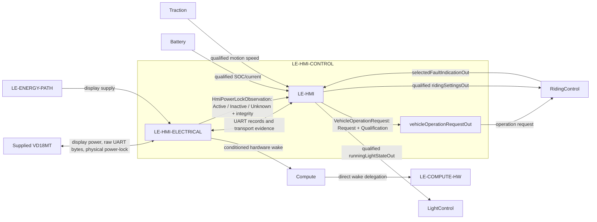

# HMIControl

`LE-HMI-CONTROL` is a child of [DriverInteraction](../DriverInteraction.sysml). It owns the VD18MT interaction, including power-button observation and On/Off request qualification. It contains electrical interface hardware and information processing; the conditioned hardware wake path is forwarded through DriverInteraction to Compute and remains available while software sleeps.

| Scope | Model | Allocated requirements |
|---|---|---|
| `LE-HMI-CONTROL` | [HMIControl.sysml](HMIControl.sysml) | [HMIControl requirements](HMIControl.md) |
| `LE-HMI-ELECTRICAL` | [HmiElectricalInterface.sysml](HmiElectricalInterface/HmiElectricalInterface.sysml) | [HmiElectricalInterface requirements](HmiElectricalInterface/HmiElectricalInterface.md) |
| `LE-HMI` | [HmiInformationProcessing.sysml](HmiInformationProcessing/HmiInformationProcessing.sysml) | [HmiInformationProcessing requirements](HmiInformationProcessing/HmiInformationProcessing.md) |

`HmiElectricalInterface` publishes `HmiPowerLockObservation` as Active, Inactive or Unknown with integrity from the supplied physical power-lock signal. It also conditions that signal to an MCU-safe hardware wake output, forwarded through Compute to ComputeHardware independently of execution and UART. This preserves wake while the MCU sleeps; the wake path does not depend on software or UART.

`HmiInformationProcessing` interprets the electrical observation into `VehicleOperationRequest` (`Request` plus `Qualification`) and publishes it through `HMIControl.vehicleOperationRequestOut` to `RidingControl.vehicleOperationRequestIn` only. RidingControl owns sleep eligibility and issues or revokes the sleep request using qualified explicit Off and qualified traction capability evidence. This interpretation is independent of UART framing and link health. Unknown, invalid or stale observation cannot become Off. The intended Inactive-to-Off mapping remains Draft pending selected-unit qualification; no confirmed pin-level behavior is asserted.

HmiInformationProcessing also owns UART framing, protocol interpretation, timestamps and VD18MT encoding. It receives concrete selected fault, SOC, current and speed records, each with qualification, and produces outgoing bytes without claiming visible-display acknowledgement. It reuses `RiderSettingsRequest`; setting acceptance and active-policy state remain in `RidingControl`. Vehicle control uses a fixed nominal 16-inch basis independently of the configurable VD18MT display wheel-size setting. Changing that display setting can make shown speed inaccurate, but cannot change control speed, direction, standstill or regeneration.

RidingControl owns lifecycle, Ready, fault-latch authority and riding permission. Runtime initialization readiness is a prerequisite, not Ready. The [Compute overview](../../Compute/Compute.md) describes startup and guarded sleep execution. This logical contract makes no physical disconnect/isolation claim. Transmission provides no display acknowledgement; selected-device presentation validation remains open.

Pins, wire colours, ground, connector topology, voltage classes and electrical limits are owned by the [VD18MT electrical refinement](../../../HardwareArchitecture/Modelling/Vd18mtElectricalConnection.sysml) in [ARCH-002](../../../ARCH-002_Hardware_Architecture.md). The project-independent [VD18MT reference](../../../../VD18MT/VD18MT_Tongsheng_UART_Interface.md) remains the source for supplied-device evidence.

## HMI control requirements

**Type:** System Requirement. **Target:** `LE-HMI-CONTROL`. **Status:** Draft allocation of retained approved vehicle requirements.

`LE-HMI-CONTROL` composes the supplied VD18MT electrical boundary and project information processing. Its electrical leaf conditions pin-5 for a compatible `LE-COMPUTE-HW` wake input and publishes the awake `HmiPowerLockObservation`; its information-processing leaf derives the qualified `VehicleOperationRequest` delivered to RidingControl. The wake path does not require UART or running application code and does not grant drive permission. This function does not own Session authority, sleep eligibility, RidingControl session fault/report retention, normal-light policy, or lamp actuation. Each information exchange carries its semantic value and its qualification in one record; invalidity is published as invalidity. Initial state, transport activity, or a transmitted report never establishes a received setting or display acknowledgement.

| ID | Requirement | Derived from / governing contract | Planned verification / remaining gate |
| --- | --- | --- | --- |
| `REQ-SYS-HMIC-001` **Draft** | `LE-HMI-CONTROL` shall provide the complete qualified VD18MT settings/report exchange by composing [HmiElectricalInterface](HmiElectricalInterface/HmiElectricalInterface.md) and [HmiInformationProcessing](HmiInformationProcessing/HmiInformationProcessing.md). | [REQ-SYS-HSI-002](../../../../Requirements/System_Requirements/System_Hardware_Software_Interface.md#req-sys-hsi-002); [F-015](../../../FC-001_Functional_Concept.md#f-015). | `I`, `T-SYS`: trace the electrical and information leaves through the selected display; verify loss, reset, invalidity and restart do not manufacture receipt or acknowledgement. |
| `REQ-SYS-CMP-001` **Draft — 2026-10-05** | `LE-HMI-CONTROL` shall provide RidingControl with the current `VehicleOperationRequest` derived from the awake HMI power-lock observation, with request and qualification distinct. Only supported qualified On or Off may be represented; Unknown, unavailable, invalid-integrity or stale evidence shall remain unqualified and shall not represent Off. VD18MT UART availability or loss shall not alter this request. | [REQ-SYS-PWR-001](../../../../Requirements/System_Requirements/Power_Startup_and_Faults.md#req-sys-pwr-001), [REQ-SYS-PWR-002](../../../../Requirements/System_Requirements/Power_Startup_and_Faults.md#req-sys-pwr-002), [REQ-SYS-FLT-002](../../../../Requirements/System_Requirements/Power_Startup_and_Faults.md#req-sys-flt-002), [REQ-SYS-HSI-002](../../../../Requirements/System_Requirements/System_Hardware_Software_Interface.md#req-sys-hsi-002), [DEC-PWR-001](../../../../Requirements/DEC-001_Decisions_and_Open_Issues.md#dec-pwr-001); allocated to [REQ-SYS-CMPH-002](HmiElectricalInterface/HmiElectricalInterface.md#req-sys-cmph-002) and [REQ-SYS-PLT-004](HmiInformationProcessing/HmiInformationProcessing.md#req-sys-plt-004); `IF-EPCS-006`. | `A`, `T-SW`, `T-FI`, `T-SYS`: exercise qualified On/Off, unknown/unavailable/integrity-invalid/stale observations, UART loss/recovery independent of the power-state path, and source/context changes. Raw physical Inactive-to-Off interpretation remains a selected-unit qualification gate and is not a measured pin-5 fact. |

### Retained HMI presentation requirements

These are System requirements targeted to `LE-HMI-CONTROL`. The information-processing leaf provides only the bounded software contribution; RidingControl retains session report lifetime, priority and low-charge selection.

| ID | Requirement | Sources / verification / gate |
| --- | --- | --- |
| `REQ-VEH-HMI-001` **Approved body; Draft target** | The HMI shall provide no dedicated reduced/unavailable-regeneration indication; underlying fault reporting shall remain effective. | `DEC-HMI-001`, `DEC-HMI-006`; `0x01` MOS warning is status reporting, not a blanket regeneration-availability indication. `I`, `T-SYS`: exercise ordinary full/partial restrictions and clearance, and verify fault indication without regenerative demand. `WS-OI-008/009/010/019`. |
| `REQ-VEH-HMI-002` **Draft successor; historical approval retained** | Normal battery indication, including any visible percentage, shall linearly represent usable charge from 0% at 10% actual SOC to 100% at 80%, hiding actual-SOC limits from normal charge presentation. | `DEC-HMI-002`, `DEC-SOC-001`; `I`, `A`, `T-SYS`: 27.5/45/62.5% actual → 25/50/75% usable before quantization. `WS-OI-005/008/009/013/017/018`; scale is 100 × (actual SOC − 10)/70 and display capability/accuracy remain open. |
| `REQ-VEH-HMI-003` **Draft successor; historical approval retained** | Battery indication shall clamp to empty/0% at/below 10% actual SOC and full/100% at/above 80%. | `DEC-HMI-002`, `DEC-REG-001`; `I`, `T-SYS`: 0/10/80/90% → empty/empty/full/full. `WS-OI-005/008/009/013/017/018`; display clamping does not determine charge acceptance. |
| `REQ-VEH-HMI-004` **Approved body; Draft target** | A selected accelerator-input fault shall report VD18MT error-field `0x0A`, retained under [REQ-VEH-HMI-006](../../../../Requirements/System_Requirements/Session_Report_Policy.md#req-veh-hmi-006). | `DEC-FLT-003`; `I`, `T-SYS`, `T-FI`: defined invalid accelerator cases and valid-input exclusion. `OI-026`, `WS-OI-008/009/010`. |
| `REQ-VEH-HMI-005` **Approved body; Draft target** | A selected shared-loop brake-input fault shall report VD18MT error-field `0x0D`, retained under [REQ-VEH-HMI-006](../../../../Requirements/System_Requirements/Session_Report_Policy.md#req-veh-hmi-006). | `DEC-FLT-003`, `DEC-REF-002`; `I`, `T-SYS`, `T-FI`: detectable brake-invalidity and valid finite states. `WS-OI-008/009/010/012`; no handle identity or universal alias claim. |
| `REQ-VEH-HMI-008` **Approved body; Draft target** | A selected vehicle-speed-input fault shall report VD18MT error-field `0x03`, retained under [REQ-VEH-HMI-006](../../../../Requirements/System_Requirements/Session_Report_Policy.md#req-veh-hmi-006). | `DEC-FLT-004`, `DEC-FLT-003`; `I`, `T-SYS`, `T-FI`: defined unreliable-speed cases, excluding wheel-setting display mismatch. `WS-OI-001/008/009/010/015`. |
| `REQ-VEH-HMI-011` **Draft successor — 2026-10-26** | Selected actual battery faults shall report `0x07`, including BMS-reported thermal faults. SOC field loss or failed SOC initialization alone shall not generate `0x07`. Independently recognized temperature-limit faults use `0x06` under HMI-013. | `DEC-FLT-006`, `DEC-TMP-001`, `DEC-FLT-007`; `I`, `T-SYS`, `T-FI`: BMS battery/thermal fault, SOC-only loss/init without a fault report, and independently recognized temperature fault/overlap cases. `WS-OI-008/009/010/018`. |
| `REQ-VEH-HMI-012` **Approved body; Draft target** | Unavailable trustworthy SOC, including initial startup, shall display empty/0% without using that fallback as control SOC, qualification evidence or a charge-threshold decision. | `DEC-HMI-005`, `DEC-HMI-002`, `DEC-FLT-005`; `I`, `A`, `T-SYS`, `T-FI`: recover valid mapping without restart while preserving independently retained fault effects. `WS-OI-005/007/008/009/010/018`. |
| `REQ-VEH-HMI-013` **Draft successor — 2026-10-26** | Independently recognized upper/lower temperature-limit faults outside the supplied-BMS battery fault path shall report `0x06` whenever selected/communicable, independently of current demand or observable torque reaction. A temperature fault reported by the BMS remains an actual battery fault reported as `0x07` under HMI-011. | `DEC-TMP-001`, `DEC-HMI-006`; `I`, `T-SYS`, `T-FI`: independently recognized non-battery hot/cold limits, all demand states, startup and riding; BMS-reported battery thermal faults use HMI-011. `OI-026`, `WS-OI-008/009/019`. |
| `REQ-VEH-HMI-015` **Approved body; Draft target** | A selected recognized fault shall be indicated whenever VD18MT communication is available, independently of affected functions or functional reaction. | `DEC-HMI-006`; `I`, `T-SYS`, `T-FI`: each fault with and without demand. `WS-OI-008/009/010/019`; no simultaneous competing-fault display is implied. |
| `REQ-VEH-HMI-016` **Approved body; Draft target** | A selected recognized fault without a specifically assigned project code shall report `0x05`. | `DEC-FLT-008`; `I`, `T-SYS`, `T-FI`: generic versus assigned categories. `WS-OI-008/009/010/019`; invalid temperature data alone does not justify `0x06`. |
| `REQ-VEH-HMI-017` **Approved body; Draft target** | A selected recognized blocked-motor fault shall report `0x04`. | `DEC-FLT-008`; `I`, `T-SYS`, `T-FI`: derived blockage cases and restart assessment. `WS-OI-008/009/010`; standstill, brake actuation or absent motion alone is not blockage. |
| `REQ-VEH-HMI-019` **Withdrawn** | Additional pending-setting feedback is no longer required. | `DEC-HMI-007`; no pending-feedback implementation or communication-loss requirement remains. |
| `REQ-VEH-HMI-020` **Approved body; Draft target** | The vehicle shall continuously provide the magnitude of battery current to the VD18MT, representing both discharge and regenerative charging as positive values clamped to 51 A; unavailable or invalid battery-current information shall be reported as 0 A. | `DEC-HMI-008`; `I`, `T-SYS`: +12.4 A and −12.4 A encode 62, 0 encodes 0, at/above 51 A encodes 255; invalid information encodes 0. `WS-OI-008/009`; rounding, accuracy and period remain open. |

The confirmed VD18MT device reference remains project-independent. Its historical implementation is evidence only. Selected-unit identity, connector electrical limits, timing, UART transport limits, display presentation, speed-status fallback and period remain open acceptance work under `WS-OI-008`/`009`. Pin-5 conditioning and wake-input compatibility are traced by [REQ-SYS-HMIE-002](HmiElectricalInterface/HmiElectricalInterface.md#req-sys-hmie-002) and [REQ-SYS-CMPH-001](../../Compute/ComputeHardware/ComputeHardware.md#req-sys-cmph-001). The awake observation and operation-request derivation are allocated to [REQ-SYS-CMPH-002](HmiElectricalInterface/HmiElectricalInterface.md#req-sys-cmph-002) and [REQ-SYS-PLT-004](HmiInformationProcessing/HmiInformationProcessing.md#req-sys-plt-004); raw physical Inactive-to-Off recognition remains Draft pending selected-unit qualification and is not a measured fact.
