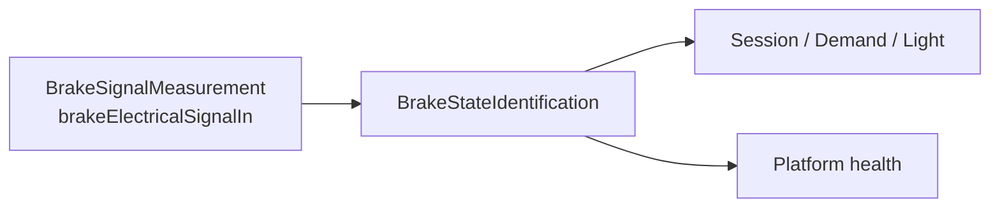

# MechanicalBrakeDetection
## Mechanical brake detection

`MechanicalBrakeDetection` converts the passive coded-brake electrical signal exposed at `BrakeSignalMeasurement.brakeElectricalSignalIn` into one `BrakeLeverState` composite. `State` carries the `Neither`/`Left`/`Right`/`Both` lever combination and the actual measurement time. `Qualification` carries usability and measurement-health attribution.

| Element | Responsibility | Requirements |
| --- | --- | --- |
| `MechanicalBrakeDetection` (`LE-MECHANICAL-BRAKE`) | End-to-end composition and consumer/health routes. | [System requirements](MechanicalBrakeDetection.md) |
| `BrakeSignalMeasurement` (`LE-BRAKE-SIGNAL`) | Coded electrical observation to abstract response evidence. | [Hardware requirements](BrakeSignalMeasurement/BrakeSignalMeasurement.md) |
| `BrakeStateIdentification` (`LE-BRAKE-STATE`) | Measurement to semantic state, firmware measurement time, and qualification. | [Software requirements](BrakeStateIdentification/BrakeStateIdentification.md) |

Session, Demand, and Light consume the complete composite; Platform consumes only its `Qualification` projection. No independent `brakeLeverActuated` value is exported.

`BrakeStateIdentification` owns one immutable compiled `BrakeStateCalibration` set with `neitherPressed`, `leftPressed`, `rightPressed`, and `bothPressed` resistance-acceptance bands. All values are TBD; vehicle validation establishes their ordered bounds. The bands must not overlap and startup validation rejects an invalid set. This model chooses no excitation, circuit, ADC, DMA, raw representation, or timestamp source; firmware owns the published measurement time.

## Mechanical brake detection requirements

**Draft successor allocation — 2026-09-26.** **Type:** System Requirement. **Target:** [LE-MECHANICAL-BRAKE](../../X2CityMCU.md#le-mechanical-brake). The logical function is composed of [LE-BRAKE-SIGNAL](../../X2CityMCU.md#le-brake-signal) and [LE-BRAKE-STATE](../../X2CityMCU.md#le-brake-state). It refines the fixed passive two-wire brake interface without changing the retained mechanical-braking allocation or selecting an excitation, sensing circuit, numerical threshold, timing limit, diagnostic coverage, or rider proof test.

`BrakeLeverState` is the sole public brake-information composite. It has exactly `State` and `Qualification`. `State` carries `leverCombination` (`Neither`, `Left`, `Right`, or `Both`) and `measurementTimeMicroseconds`. `Qualification` carries usability, `initialQualificationPending`, and `recognizedMeasurementFault`. A state is usable only when its Qualification permits use; unavailable information does not stand for any lever combination.

The [brake-signal measurement](BrakeSignalMeasurement/BrakeSignalMeasurement.md) leaf owns physical measurement evidence. The [brake-state identification](BrakeStateIdentification/BrakeStateIdentification.md) leaf owns band classification, qualification, age, startup and recovery. Existing braking priority remains at `REQ-SYS-BRK-001`–005; `REQ-SYS-BRK-012` remains the Session/Ready integration guard. `REQ-SYS-BRK-009`–011 remain deferred in [Brake interface and priority](MechanicalBrakeDetection.md).

## Specification

- [Requirements](Specification/Requirements.sysml)

## Brake interface and priority

**Target:** [LE-EPCS](../../../REQ-001_Requirements.md#le-epcs).

Part of **REQ-001-R1.6**. [Model, status and cluster index](../../../REQ-001_Requirements.md) · [Shared verification](../../../REQ-001_Requirements.md#reading-and-verification-rules) · [Common interpretation](../../../REQ-001_Requirements.md#common-interpretation-and-upstream-scope). These rules apply to every row; relocation preserves its approval/status and qualifications.

### Brake priority and release

The supplied mechanical brakes are assumed available and adequate under [ID-001 §2.1](../../../ID-001_Item_Definition.md#external-mechanical-platform-assumption). This cluster covers only the fixed electrical lever-state input, its EPCS priority behavior and any permitted electrical regeneration; it does not qualify mechanical brake performance.

### Deferred resistance-coded brake diagnostics

The fixed passive shared two-wire interface is defined by [Brake_Input_Reference](BrakeSignalMeasurement/BrakeSignalMeasurement.md), [DEC-REF-002](../../../DEC-001_Decisions_and_Open_Issues.md#dec-ref-002) and PD `CON-010`. The canonical approved bodies `REQ-SYS-BRK-006`–008 and their Draft successor allocation are in [MechanicalBrakeDetection requirements](MechanicalBrakeDetection.md). Only the handle/harness terminal interface is adopted; sensing and diagnostic realization remain downstream.
