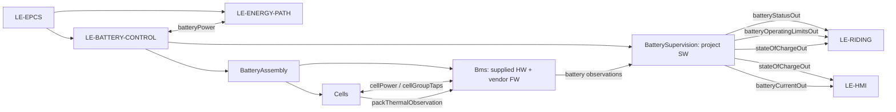
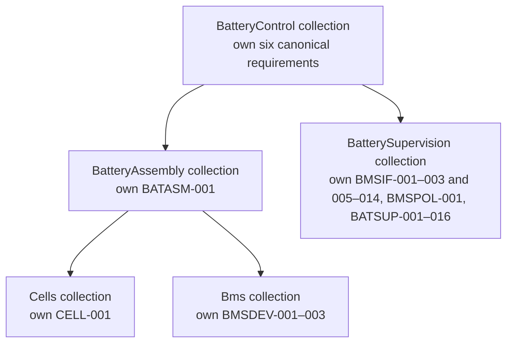

# BatteryControl

`LE-BATTERY-CONTROL` is an `LE-EPCS` child. It contains the owner-built physical `BatteryAssembly` (`Cells` plus the supplied `Bms` hardware and vendor firmware) and the vehicle-host `BatterySupervision` logical responsibility for reading and qualifying BMS information and determining capability. The energy wrapper is retired; `LE-ENERGY-PATH` is an EPCS sibling. BatteryControl supplies qualified battery information and capability; it does not own motor-controller enforcement or vehicle-wide physical protection.

## Decomposition and required information contracts

| Port or internal exchange | Mandatory members / consumer | Requirement source |
|---|---|---|
| `batteryPower` ↔ `LE-ENERGY-PATH` | physical pack energy only; energy-path protection and generated/residual energy remain EPCS responsibility | [BMS-004](Battery_Integration.md#req-sys-bms-004), [BMS-005](Battery_Integration.md#req-sys-bms-005), [BMS-009](Battery_Integration.md#req-sys-bms-009) |
| `batteryStatusOut` → `LE-RIDING` | Reporting-only concurrent conditions for recognized battery faults, local actual thermal faults and the live ordinary MOS-disabled warning, including distinguishable unknown status. It is independent of operating-limit qualification and carries no local priority or HMI code. BatterySupervision captures recognized fault events in common recognition order; RidingControl retains/selects the report under its existing rules. No inference of isolation. | [BMS-007](BatteryControl.sysml), [BATSUP-017–021](Decomposition/BatterySupervision.sysml#req-sys-batsup-017), [HMI-007/018](../../../../Requirements/System_Requirements/Session_Report_Policy.md#req-veh-hmi-007) |
| `batteryOperatingLimitsOut` → `LE-RIDING` | independent discharge and regenerative-charge branch qualification; applicable shared checks are internal and included in every dependent branch; finite, nonnegative effective current ceilings; and restriction-active/reason fields. Each qualified effective current ceiling equals the exact minimum of its computed pack ceiling and every other applicable qualified battery-side current ceiling or restriction; a qualified disabled/prohibited path contributes zero. Missing or unqualified required applicable constraints leave the branch unqualified with effective zero, not omitted. With no other lower limit the computed pack ceiling is published; no arbitrary additional derating is permitted. A qualified zero is known zero capability; unqualified required information leaves every dependent branch unqualified and its effective current zero. A recognized restart-required battery fault retains both branches unqualified with effective zero until normal/unexpected restart; valid measurements otherwise retain their independent validity. RidingControl consumes limits and qualification for battery functional behavior and suppresses requested regenerative braking when charge is unqualified or the qualified charge-current ceiling is zero. Downstream physical enforcement remains external. | [BMS-001](Battery_Integration.md#req-sys-bms-001), [REQ-SYS-BMS-008](BatteryControl.sysml), [REQ-SYS-BMSPOL-001](Decomposition/BatterySupervision.sysml), [REQ-SYS-BATSUP-004/005](Decomposition/BatterySupervision.sysml), [REQ-SYS-BATSUP-019](Decomposition/BatterySupervision.sysml#req-sys-batsup-019) |
| `stateOfChargeOut` → `LE-HMI`, `LE-RIDING` | qualified `actualStateOfChargePercent` and validity; HMI consumes the display members in HMI-002/003 and RidingControl consumes actual SOC for low-SOC propulsion policy and the HMI-009 low-charge warning. | [REQ-SYS-BMS-003](BatteryControl.sysml), [REQ-SYS-SOC-003/004/005/008](../RidingControl/Riding_SOC_Requirements.md), [HMI-002/003](../DriverInteraction/Decomposition/HMIControl/HMIControl_Requirements.md#req-veh-hmi-002), [HMI-009](../../../../Requirements/System_Requirements/Session_Report_Policy.md#req-veh-hmi-009) |
| `batteryCurrentOut` → `LE-HMI` | qualified `signedPackCurrentAmperes` and validity; positive is charging and negative is discharging. Display fallback has no effect on operating-limit qualification or values. | [REQ-SYS-BMS-003](BatteryControl.sysml), [HMI-020](../DriverInteraction/Decomposition/HMIControl/HMIControl_Requirements.md#req-veh-hmi-020) |
| Bms → BatterySupervision read requests/responses | read-only UART `0x03`, `0x04`, `0x05`, carrying `recordKind` (Basic/FourteenGroup/Identity), `packVoltageVolts`, `packCurrentAmperes`, `stateOfChargeCandidatePercent`, `cellGroupVoltagesVolts[14]`, `availableTemperatures` (`probeIdentifier`, `temperatureCelsius`), `protectionPathState` (`protectionFlags`, charge/discharge-path enabled) and `socSourceEvidence` (reported remaining/nominal capacity, series count, identity/version). Both startup checks use the same current accepted Basic `0x03` response; `0x05` remains supported for informational identity decoding and is not a startup prerequisite. | [REQ-SYS-BMS-003](BatteryControl.sysml), [REQ-SYS-BMSIF-001](Decomposition/BatterySupervision.sysml) |
| Cells ↔ Bms `cellPower` / `cellGroupTaps` | pack energy and 14-group taps exchange for BMS supervision and balancing | [CELL-001](Decomposition/Cells.sysml), [REQ-SYS-BMS-002](BatteryControl.sysml), [REQ-SYS-BMS-003](BatteryControl.sysml) |
| Cells → Bms `packThermalObservation` | available pack thermal observation; count and availability do not prove all individual-cell or thermal fault coverage | [REQ-SYS-BMS-003](BatteryControl.sysml) |

`BatteryMeasurements` projects these source fields only after fieldwise validity, consistency, source-timeliness qualification and other required evidence; each value has an independently named qualification indication. Source-update timers and timing references remain private to BatterySupervision and are not published alongside observations. No BMS measurement timestamp is inferred from host receipt time. Raw BMS RSOC/capacity is only `stateOfChargeCandidatePercent` until BMS-002/BMS-003 and the SOC policy qualify actual SOC. A UART value, FET/path bit, or project-software limit does not prove physical isolation or protection; the EPCS duties in BMS-004/005/009 remain applicable.

## Requirement composition and derivation

The current catalogue contains 310 canonical requirements, including 46 numbered native usages held in their owning component files and composed through eight unnumbered architecture collections. Native SysML `require QualifiedPackage::canonicalUsage;` references provide conjunctive composition under SysML 2.0 §7.21.2; each referenced usage retains its canonical subject and body ([SysML 2.0 Language](https://www.omg.org/spec/SysML/2.0/Language/PDF)). The collections add no catalogue records. BatterySupervision owns 35 of those numbered usages. The model has 54 satisfaction assertions, 97 required references, and a distinct 47-edge requirement-derivation graph. Satisfaction assertions express design intent, not verification evidence; composition expresses coverage and does not create derivation edges.

The single per-startup nominal-capacity snapshot is captured once at controller startup and retained for that controller cycle. [BATSUP-007–011](Decomposition/BatterySupervision.sysml#req-sys-batsup-007) define regenerative capacity, temperature and voltage ceilings; [BATSUP-012–015](Decomposition/BatterySupervision.sysml#req-sys-batsup-012) define the corresponding discharge ceiling, using `IbD = 1.00 × C_Ah`, its specified temperature factor and the minimum qualified group-voltage bound. Both tapers use [BatterySupervision.voltageDeratingCalibration](Decomposition/BatterySupervision.sysml#req-sys-batsup-016); qualification and its symbolic formulas are canonical there. Each direction uses its own applicable temperature/voltage envelope and path state; SOC, system fault, protection, component and physical limits remain independent constraints. Cells at or below −5°C yield zero discharge ceiling; owner-selected cold use therefore requires a sufficiently warm battery for propulsion while retaining −10…+40°C E/E startup conditions ([DEC-BAT-002](../../../../Requirements/DEC-001_Decisions_and_Open_Issues.md#dec-bat-002), [OI-051](../../../../../README.md#15-unresolved-issues)).

The component collections mirror `BatteryControl → (BatteryAssembly, BatterySupervision)` and `BatteryAssembly → (Cells, Bms)`. The three assembly contribution collections bridge individual parent obligations through the immediate architecture child: selection, commissioning configuration and source information. BatteryControl requires the assembly and supervision collections; the BatteryAssembly collection requires its canonical BATASM-001 requirement plus the Cells and Bms collections. Parent requirements also require the relevant bridge and supervision contributions: BAT-002 requires `assemblySelectionRequirements`; BMS-002 requires `assemblyConfigurationRequirements` and BMSIF-005 basic-field decoding; BMS-003 requires `assemblySourceInformationRequirements`, BMSIF-001–003, BMSIF-005–008, BMSIF-009–014 and BATSUP-003; BMS-006 requires BATSUP-001/002, BMSIF-005 basic-field decoding and BMSPOL-001; BMS-007 requires BMSPOL-001 and BATSUP-004–021; BMS-008 requires BMSPOL-001. These purpose-selected `require` references compose coverage and do not create derivation edges or architectural children. BMSIF-003 defines response-envelope conditions for measurement updates; BMSIF-014 adds outstanding-request correlation and success-status conditions; BMSIF-005–008 and related field requirements own schema and value decoding/qualification. The BMSIF behavioral rules are canonical in BatterySupervision.sysml; [BMS_Information.md](Decomposition/BMS_Information.md#selected-unit-uart-read-acceptance-contract) retains protocol facts and verification guidance, not a separate acceptance contract.

The existing parent-to-child `#derivation` connections in [BatteryControl.sysml](BatteryControl.sysml) use the standard `RequirementDerivation` domain library ([SysML 2.0 Language, §9.6](https://www.omg.org/spec/SysML/2.0/Language/PDF)), which the model workspace must load. The 47-edge graph remains the distinct provenance/contribution DAG: the BMSIF and BATSUP children derive from their System Requirement parents, without Abstract Software to Abstract Software derivation; it need not mirror the architecture branches, and a source citation is not a derivation.

| Parent | Same-target refinement edges | Allocated assembly/BMS/software children |
|---|---|---|
| `REQ-SYS-BAT-002` | — | Physical: `REQ-SYS-CELL-001` (Cells), `REQ-SYS-BATASM-001` (BatteryAssembly), `REQ-SYS-BMSDEV-001` (Bms selected identity). |
| `REQ-SYS-BMS-002` | `REQ-SYS-BMS-006` | Physical: `REQ-SYS-BMSDEV-002` (Bms effective configuration and commissioning acceptance). Software: `REQ-SYS-BMSIF-005` (Basic field decoding). |
| `REQ-SYS-BMS-003` | `REQ-SYS-BMS-006`, `REQ-SYS-BMS-007` | Physical: `REQ-SYS-BMSDEV-003` (Bms source measurements). Software: `REQ-SYS-BMSIF-001`–003 and `REQ-SYS-BMSIF-005`–014 (request, frame-envelope and transaction/status acceptance, schema, field and observation qualification), `REQ-SYS-BATSUP-003` (actual-SOC qualification). |
| `REQ-SYS-BMS-006` | — | Software: `REQ-SYS-BMSPOL-001` (battery envelope policy), `REQ-SYS-BATSUP-001` (the two Basic-response startup checks), `REQ-SYS-BATSUP-002` (current operation-required battery qualification), `REQ-SYS-BMSIF-005` (Basic field decoding). |
| `REQ-SYS-BMS-007` | — | Software: `REQ-SYS-BMSPOL-001` (battery envelope policy), `REQ-SYS-BATSUP-004/005` (charge/discharge path capability restrictions), `REQ-SYS-BATSUP-006` (qualified MOS warning status), `REQ-SYS-BATSUP-007–011` (capacity-referenced regenerative pack ceilings), `REQ-SYS-BATSUP-012–015` (capacity-referenced discharge pack ceilings), `REQ-SYS-BATSUP-017–021` (fault recognition, retained operating effect, BatteryStatus publication and restart reset). |
| `REQ-SYS-BMS-008` | — | Software: `REQ-SYS-BMSPOL-001` (battery envelope policy). |

This table follows the native edge set and distinguishes same-target refinement from allocated assembly/BMS/software children. The current BatteryControl allocation is Draft. Any changed normative body is a Draft successor of its historical approved record; source and verification work remains open, and historical approval does not approve a successor. The Draft records allocate evidence and responsibilities; they do not claim compiler acceptance, electrical acceptance, completed verification, or closure of engineering parameters. All numbered records and unnumbered collections have explicit satisfaction assertions bound to their intended architectural subjects; these are design claims, with verification status and evidence tracked separately.
