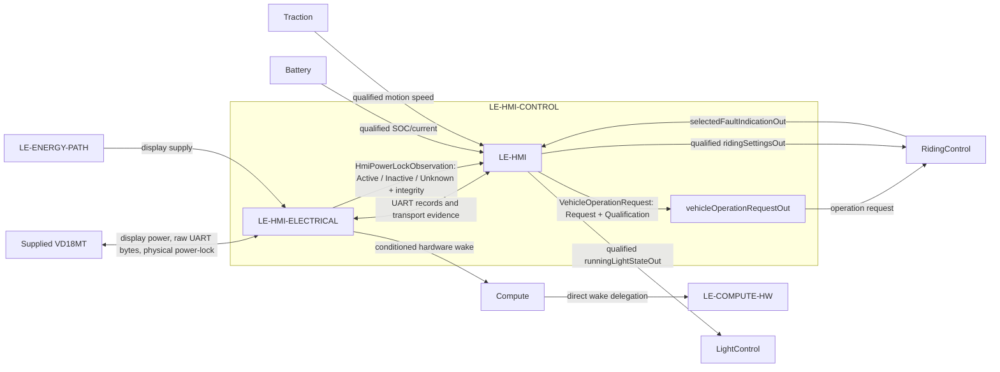

# HMIControl

`LE-HMI-CONTROL` is a child of [DriverInteraction](../../DriverInteraction.sysml). It owns the VD18MT interaction, including power-button observation and On/Off request qualification. It contains electrical interface hardware and information processing; the conditioned hardware wake path is forwarded through DriverInteraction to Compute and remains available while software sleeps.

| Scope | Model | Allocated requirements |
|---|---|---|
| `LE-HMI-CONTROL` | [HMIControl.sysml](HMIControl.sysml) | [HMIControl requirements](HMIControl_Requirements.md) |
| `LE-HMI-ELECTRICAL` | [HmiElectricalInterface.sysml](Decomposition/HmiElectricalInterface.sysml) | [HmiElectricalInterface requirements](Decomposition/HmiElectricalInterface_Requirements.md) |
| `LE-HMI` | [HmiInformationProcessing.sysml](Decomposition/HmiInformationProcessing.sysml) | [HmiInformationProcessing requirements](Decomposition/HmiInformationProcessing_Requirements.md) |

`HmiElectricalInterface` publishes `HmiPowerLockObservation` as Active, Inactive or Unknown with integrity from the supplied physical power-lock signal. It also conditions that signal to an MCU-safe hardware wake output, forwarded through Compute to ComputeHardware independently of execution and UART. This preserves wake while the MCU sleeps; the wake path does not depend on software or UART.

`HmiInformationProcessing` interprets the electrical observation into `VehicleOperationRequest` (`Request` plus `Qualification`) and publishes it through `HMIControl.vehicleOperationRequestOut` to `RidingControl.vehicleOperationRequestIn` only. RidingControl owns sleep eligibility and issues or revokes the sleep request using qualified explicit Off and qualified traction capability evidence. This interpretation is independent of UART framing and link health. Unknown, invalid or stale observation cannot become Off. The intended Inactive-to-Off mapping remains Draft pending selected-unit qualification; no confirmed pin-level behavior is asserted.

HmiInformationProcessing also owns UART framing, protocol interpretation, timestamps and VD18MT encoding. It receives concrete selected fault, SOC, current and speed records, each with qualification, and produces outgoing bytes without claiming visible-display acknowledgement. It reuses `RiderSettingsRequest`; setting acceptance and active-policy state remain in `RidingControl`. Vehicle control uses a fixed nominal 16-inch basis independently of the configurable VD18MT display wheel-size setting. Changing that display setting can make shown speed inaccurate, but cannot change control speed, direction, standstill or regeneration.

RidingControl owns lifecycle, Ready, fault-latch authority and riding permission. Runtime initialization readiness is a prerequisite, not Ready. The [Compute overview](../../../Compute/README.md) describes startup and guarded sleep execution. This logical contract makes no physical disconnect/isolation claim. Transmission provides no display acknowledgement; selected-device presentation validation remains open.

Pins, wire colours, ground, connector topology, voltage classes and electrical limits are owned by the [VD18MT electrical refinement](../../../../../HardwareArchitecture/Modelling/Vd18mtElectricalConnection.sysml) in [ARCH-002](../../../../../ARCH-002_Hardware_Architecture.md). The project-independent [VD18MT reference](../../../../../../VD18MT/VD18MT_Tongsheng_UART_Interface.md) remains the source for supplied-device evidence.
