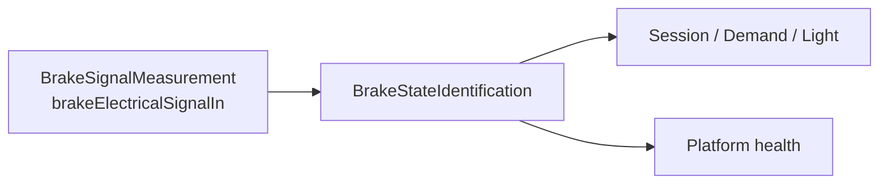

# Mechanical brake detection

`MechanicalBrakeDetection` converts the passive coded-brake electrical signal exposed at `BrakeSignalMeasurement.brakeElectricalSignalIn` into one `BrakeLeverState` composite. `State` carries the `Neither`/`Left`/`Right`/`Both` lever combination and the actual measurement time. `Qualification` carries usability and measurement-health attribution.

| Element | Responsibility | Requirements |
| --- | --- | --- |
| `MechanicalBrakeDetection` (`LE-MECHANICAL-BRAKE`) | End-to-end composition and consumer/health routes. | [System requirements](MechanicalBrakeDetection_Requirements.md) |
| `BrakeSignalMeasurement` (`LE-BRAKE-SIGNAL`) | Coded electrical observation to abstract response evidence. | [Hardware requirements](Decomposition/BrakeSignalMeasurement_Requirements.md) |
| `BrakeStateIdentification` (`LE-BRAKE-STATE`) | Measurement to semantic state, firmware measurement time, and qualification. | [Software requirements](Decomposition/BrakeStateIdentification_Requirements.md) |

Session, Demand, and Light consume the complete composite; Platform consumes only its `Qualification` projection. No independent `brakeLeverActuated` value is exported.

`BrakeStateIdentification` owns one immutable compiled `BrakeStateCalibration` set with `neitherPressed`, `leftPressed`, `rightPressed`, and `bothPressed` resistance-acceptance bands. All values are TBD; vehicle validation establishes their ordered bounds. The bands must not overlap and startup validation rejects an invalid set. This model chooses no excitation, circuit, ADC, DMA, raw representation, or timestamp source; firmware owns the published measurement time.
