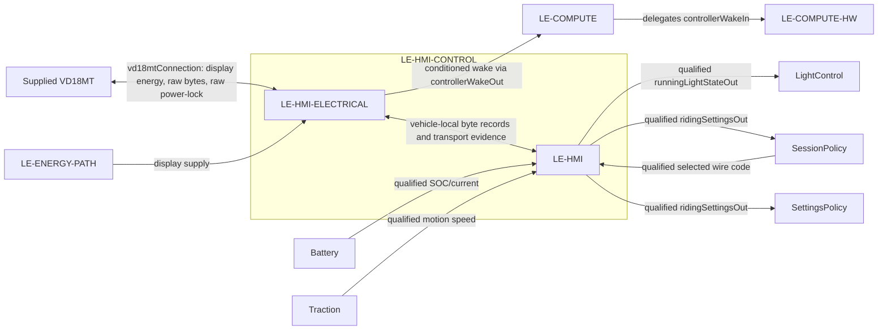

# HMIControl

`LE-HMI-CONTROL` is the vehicle-side interaction function for the supplied VD18MT. It contains hardware `LE-HMI-ELECTRICAL` and software `LE-HMI`; it is a sibling of riding policy inside `LE-EPCS`.

| Scope | Model | Allocated requirements |
|---|---|---|
| `LE-HMI-CONTROL` | [HMIControl.sysml](HMIControl.sysml) | [HMIControl requirements](HMIControl_Requirements.md) |
| `LE-HMI-ELECTRICAL` | [HmiElectricalInterface.sysml](Decomposition/HmiElectricalInterface.sysml) | [HmiElectricalInterface requirements](Decomposition/HmiElectricalInterface_Requirements.md) |
| `LE-HMI` | [HmiInformationProcessing.sysml](Decomposition/HmiInformationProcessing.sysml) | [HmiInformationProcessing requirements](Decomposition/HmiInformationProcessing_Requirements.md) |

`HmiInformationProcessing` owns UART framing, protocol interpretation, timestamps and VD18MT encoding. It receives concrete selected fault, SOC, current and speed records, each with its qualification, and produces outgoing bytes without claiming visible-display acknowledgement. It reuses `RiderSettingsRequest`, whose requested level and requested speed fields are concrete; setting acceptance and active-policy state remain in `SettingsPolicy`. Vehicle control uses a fixed nominal 16-inch basis independently of the configurable VD18MT display wheel-size setting. Changing that display setting can make the shown speed inaccurate, but cannot change control speed, direction, standstill or regeneration.

`HmiElectricalInterface` exposes one `vd18mtConnection:HmiDevicePort` that groups display power, raw request/report bytes and the raw supplied power-lock signal. It transforms the data exchanges to the physical realization and provides vehicle-local transport evidence with received bytes to `HmiInformationProcessing`; the supplied display does not send that evidence as metadata. The electrical leaf conditions the raw power-lock signal to a distinct MCU-safe `ControllerWakeSignal`, which HMIControl forwards to Compute. This is a hardware wake path available while the CPU is asleep; UART and software execution are not prerequisites. No raw-to-conditioned identity flow is implied. The vehicle supplies display power before MCU startup. Power-lock deassertion handling and the sleep-entry mechanism remain undecided; existing VD18MT on/off and shutdown requirements remain in effect. Transmission provides no display acknowledgement; selected-device visible-presentation validation remains open.

Pins, wire colours, ground, connector topology, voltage classes and electrical limits are owned by the [VD18MT electrical refinement](../../../HardwareArchitecture/Modelling/Vd18mtElectricalConnection.sysml) in [ARCH-002](../../../ARCH-002_Hardware_Architecture.md). The project-independent [VD18MT reference](../../../../VD18MT/VD18MT_Tongsheng_UART_Interface.md) remains the source for supplied-device evidence.
