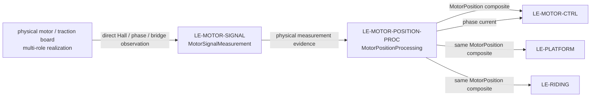

# Motor position estimation

`LE-MOTOR-POSITION` is a child of Traction and a sibling of `LE-MOTOR-CTRL`. It combines the hardware leaf `MotorSignalMeasurement` (`LE-MOTOR-SIGNAL`) and the software leaf `MotorPositionProcessing` (`LE-MOTOR-POSITION-PROC`) to supply electrical rotor position and explicit phase-current feedback to MotorControl.

Hall evidence is always required. A static accepted Hall sector is permitted at startup without an edge or qualified vehicle-standstill assertion, while interpolation is bounded. Current plus applied-winding voltage can improve the estimate only when observable; they never provide a sensorless fallback. No forced alignment, deliberate stationary holding, or motor actuation belongs here.

| Exchange | Producer → consumer | Required content / owner |
|---|---|---|
| `hallSignalsIn`, `motorPhaseElectricalIn` | Physical motor/traction board → `MotorSignalMeasurement` | Raw physical Hall electrical levels, phase current and bridge-voltage observation enter MotorPositionEstimation directly. The board may also realize TractionHardware, but it is not the logical producer on this path. No ADC/DMA/pin allocation. `REQ-SYS-MSM-001`–002. |
| `motorSignalMeasurementsOut` | `MotorSignalMeasurement` → `MotorPositionProcessing` | Physical evidence and integrity for subsequent timestamped software acquisition and semantic conversion. |
| `motorPositionOut` | `MotorPositionProcessing` → `LE-MOTOR-CTRL`, `LE-PLATFORM`, and `LE-RIDING` | The same complete `MotorPosition` (`Position` + `Qualification`) to all consumers, with angle, separately valid signed speed, reference time, accepted uncertainty and limited Hall evidence. Publication continues when angle is unavailable or only `Qualification` changes; qualification-only updates retain the actual position evidence reference time. Existing RidingControl session fault response owns inhibition and retention. `REQ-SYS-MPE-001`–004. |
| `phaseCurrentOut` | `MotorPositionProcessing` → `LE-MOTOR-CTRL` | Qualified semantic phase-current feedback from the logical processing responsibility. Applied-winding voltage stays internal observer evidence; fast DC-link voltage remains a separate existing control route. `REQ-SYS-MPE-005`. |

The caller supplies a fresh monotonic `ExecutionTime` for each software invocation; acquisition evidence retains its actual measurement/capture time. The software leaf owns this conversion and uses immutable compiled calibration. See [parent requirements](MotorPositionEstimation_Requirements.md), [signal measurement](Decomposition/MotorSignalMeasurement_Requirements.md), and [position processing](Decomposition/MotorPositionProcessing_Requirements.md).
