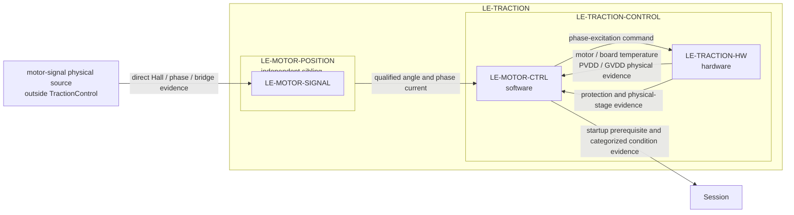

# Traction control

`LE-TRACTION-CONTROL` is the Traction child responsible for commanding phase excitation and for motor/traction-board temperature plus rail observation. It contains the software `LE-MOTOR-CTRL` and hardware `LE-TRACTION-HW` leaves. `LE-MOTOR-POSITION` remains an independent Traction sibling: it is the sole logical owner of Hall and phase-current/voltage measurement evidence and final electrical position. A physical traction board may realize signals for both functions without transferring their logical ownership.

`MotorControl` owns semantic qualification and the control law. It consumes qualified electrical angle and phase current from MotorPositionEstimation, then commands the selected Hall-sensored FOC phase excitation. A zero torque command, `PhaseExcitationCommand.actuationInhibited`, and `TractionStageEvidence` of physical output are three different facts. `TractionHardwareProtectionEvidence` records independent hardware shutdown, which remains effective independently of software. HC-TRACTION-POWER/HC-INPUT-FE can physically support both logical roles without creating a logical `LE-TRACTION-HW` to MotorSignalMeasurement observation route.

GVDD measurement, qualification, and local operating-condition evaluation remain inside TractionControl. RidingControl receives the resulting startup prerequisite and categorized condition evidence for its vehicle-level latch, report selection, and restart policy; no numeric qualified GVDD value crosses the boundary. Generic acquisition/conversion health continues over its existing service-health route.

| Boundary | Rationale |
|---|---|
| `LE-MOTOR-POSITION` → `LE-MOTOR-CTRL` | Qualified rotor angle and current are control inputs; direct Hall and phase observations remain with MotorSignalMeasurement. |
| `LE-TRACTION-HW` → `LE-MOTOR-CTRL` | Temperature and PVDD/GVDD remain physical evidence until MotorControl qualifies their semantics. Fast PVDD and regular GVDD stay distinct; qualified GVDD and its operating-condition decision remain local to TractionControl. |
| `LE-MOTOR-CTRL` → `LE-TRACTION-HW` | `PhaseExcitationCommand` is a command with explicit `actuationInhibited`; `TractionStageEvidence` and `TractionHardwareProtectionEvidence` return separately. |

See [parent requirements](TractionControl_Requirements.md), [MotorControl allocation](Decomposition/MotorControl_Requirements.md), and [TractionHardware allocation](Decomposition/TractionHardware_Requirements.md). Numerical thresholds, settling periods, detection budgets and protection coverage remain derivation and acceptance gates.
