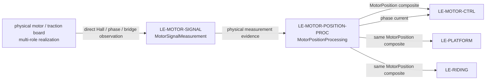

# MotorPositionEstimation
## Motor position estimation

`LE-MOTOR-POSITION` is a child of Traction and a sibling of `LE-MOTOR-CTRL`. It combines the hardware leaf `MotorSignalMeasurement` (`LE-MOTOR-SIGNAL`) and the software leaf `MotorPositionProcessing` (`LE-MOTOR-POSITION-PROC`) to supply electrical rotor position and explicit phase-current feedback to MotorControl.

Hall evidence is always required. A static accepted Hall sector is permitted at startup without an edge or qualified vehicle-standstill assertion, while interpolation is bounded. Current plus applied-winding voltage can improve the estimate only when observable; they never provide a sensorless fallback. No forced alignment, deliberate stationary holding, or motor actuation belongs here.

| Exchange | Producer → consumer | Required content / owner |
|---|---|---|
| `hallSignalsIn`, `motorPhaseElectricalIn` | Physical motor/traction board → `MotorSignalMeasurement` | Raw physical Hall electrical levels, phase current and bridge-voltage observation enter MotorPositionEstimation directly. The board may also realize TractionHardware, but it is not the logical producer on this path. No ADC/DMA/pin allocation. `REQ-SYS-MSM-001`–002. |
| `motorSignalMeasurementsOut` | `MotorSignalMeasurement` → `MotorPositionProcessing` | Physical evidence and integrity for subsequent timestamped software acquisition and semantic conversion. |
| `motorPositionOut` | `MotorPositionProcessing` → `LE-MOTOR-CTRL`, `LE-PLATFORM`, and `LE-RIDING` | The same complete `MotorPosition` (`Position` + `Qualification`) to all consumers, with angle, separately valid signed speed, reference time, accepted uncertainty and limited Hall evidence. Publication continues when angle is unavailable or only `Qualification` changes; qualification-only updates retain the actual position evidence reference time. Existing RidingControl session fault response owns inhibition and retention. `REQ-SYS-MPE-001`–004. |
| `phaseCurrentOut` | `MotorPositionProcessing` → `LE-MOTOR-CTRL` | Qualified semantic phase-current feedback from the logical processing responsibility. Applied-winding voltage stays internal observer evidence; fast DC-link voltage remains a separate existing control route. `REQ-SYS-MPE-005`. |

The caller supplies a fresh monotonic `ExecutionTime` for each software invocation; acquisition evidence retains its actual measurement/capture time. The software leaf owns this conversion and uses immutable compiled calibration. See [parent requirements](MotorPositionEstimation.md), [signal measurement](MotorSignalMeasurement/MotorSignalMeasurement.md), and [position processing](MotorPositionProcessing/MotorPositionProcessing.md).

## Motor position estimation requirements

**Draft addition — 2026-09-21.** **Type:** System Requirement. **Target:** [LE-MOTOR-POSITION](../../X2CityMCU.md#le-motor-position).

`MotorPosition` is one composite with `Position` and `Qualification`. `Position` carries electrical angle, separately qualified signed electrical speed, the reference time, accepted angle uncertainty, and only the Hall sector/edge evidence needed by consumers to assess motion independently. No System-level port selects ADC, DMA, pin, driver, scheduler, service or context mechanism.

| ID | Requirement | Derived from | Related / governing contracts | Planned verification / acceptance |
|---|---|---|---|---|
| `REQ-SYS-MPE-001` **Draft** | `LE-MOTOR-POSITION` shall publish one `MotorPosition` composite containing `Position` and `Qualification` to `LE-MOTOR-CTRL`, `LE-PLATFORM`, and `LE-RIDING`. `Position` carries electrical angle, separately valid signed electrical speed, reference time, accepted angle uncertainty, and the Hall sector/edge evidence required for independent motion qualification. Every consumer receives the complete composite, including when angle is unavailable or only `Qualification` changes. | [REQ-SYS-HSI-001](../../../../Requirements/System_Requirements/System_Hardware_Software_Interface.md#req-sys-hsi-001), [REQ-SYS-HSI-009](../../../../Requirements/System_Requirements/System_Hardware_Software_Interface.md#req-sys-hsi-009) | Producer: `REQ-SYS-MPP-001`; consumer/allocation: [REQ-SYS-TRQPOS-001](MotorPositionProcessing/MotorPositionProcessing.md#req-sys-trqpos-001), `REQ-SYS-TRQCTL-001`; existing RidingControl session fault policy is unchanged. | `I`, `T-SYS`: route qualified, unavailable, and qualification-only updates to all three consumers; verify complete member parity, distinct speed validity, and unchanged Position reference time on qualification-only updates. |
| `REQ-SYS-MPE-002` **Draft** | `LE-MOTOR-POSITION` shall use accepted Hall signal evidence for every available electrical-angle result, shall permit a static accepted Hall sector at startup without an edge, and shall use Hall interpolation only within its established bound. | [REQ-SYS-HSI-001](../../../../Requirements/System_Requirements/System_Hardware_Software_Interface.md#req-sys-hsi-001), [DEC-MOTOR-001](../../../../Requirements/DEC-001_Decisions_and_Open_Issues.md#dec-motor-001) | Hall evidence: `REQ-SYS-MSM-001`; interpolation and angle-error bound: `REQ-SYS-MPP-002`; allocation: `REQ-SYS-TRQPOS-001`. Absence of Hall edges alone does not establish standstill. | `T-SYS`, `T-FI`: exercise static startup, accepted transitions, interpolation boundary and missing-edge cases; verify the stated availability behavior. |
| `REQ-SYS-MPE-003` **Draft** | When accepted Hall evidence, phase-current evidence, applied-winding-voltage evidence, model qualification and observability acceptance are all available, `LE-MOTOR-POSITION` shall refine or check its Hall-based electrical-angle estimate using the current/voltage model; it shall use that evidence only under this condition and shall not make electrical angle available from it without accepted Hall evidence. | [REQ-SYS-HSI-009](../../../../Requirements/System_Requirements/System_Hardware_Software_Interface.md#req-sys-hsi-009), [DEC-MOTOR-001](../../../../Requirements/DEC-001_Decisions_and_Open_Issues.md#dec-motor-001) | Evidence source: `REQ-SYS-MSM-002`; observability and acceptance rule: `REQ-SYS-MPP-003`. Hall-only low-speed operation remains permitted. Slow phase-voltage diagnostics are excluded. | `T-SYS`, `T-FI`: vary observability and Hall availability; verify assistance under the accepted condition, Hall-only low-speed behavior, and no sensorless output. |
| `REQ-SYS-MPE-004` **Draft** | `LE-MOTOR-POSITION` shall withhold electrical angle when its accepted angle-error bound is not met while continuing to publish the complete `MotorPosition` composite and its `Qualification` to MotorControl, Platform, and Session. A qualification-only change shall retain the actual `Position.referenceTimeMicroseconds` of its position evidence. Recognized contradictory or lost required signal evidence shall remain available through `Qualification` to the existing fault-response path. | [REQ-SYS-HSI-001](../../../../Requirements/System_Requirements/System_Hardware_Software_Interface.md#req-sys-hsi-001), [REQ-SYS-FLT-003](../../../../Requirements/System_Requirements/Power_Startup_and_Faults.md#req-sys-flt-003) | Producer and delivery: `REQ-SYS-MPP-004`; fault response and retention remain owned by the existing Session path. Poor low-speed observer observability alone is not a recognized fault. | `T-SYS`, `T-FI`: exceed the accepted bound and inject contradictory/lost required evidence; verify angle withholding, full-composite delivery to all three consumers, unchanged position reference time on qualification-only updates, and existing fault-path delivery. |
| `REQ-SYS-MPE-005` **Draft** | `LE-MOTOR-POSITION` shall provide qualified semantic phase-current feedback to `LE-MOTOR-CTRL` as explicit `PhaseCurrentMeasurements`, separate from `MotorPosition`. | [REQ-SYS-HSI-009](../../../../Requirements/System_Requirements/System_Hardware_Software_Interface.md#req-sys-hsi-009), [DEC-MOTOR-001](../../../../Requirements/DEC-001_Decisions_and_Open_Issues.md#dec-motor-001) | Producer: `REQ-SYS-MPP-005`; physical evidence: `REQ-SYS-MSM-001`; consumer/allocation: `REQ-SYS-PHASE-IF-001`, `REQ-SYS-TRQCTL-001`. Existing fast DC-link voltage remains a separate MotorControl input. | `I`, `T-SYS`: trace phase current through the software leaf to MotorControl; verify it is not inferred from `MotorPosition` or replaced by an earlier epoch. |
| `REQ-SYS-MPE-006` **Draft** | `LE-MOTOR-POSITION` shall keep electrical angle within the validated continuity and accepted-error bounds while enabling or disabling current/voltage assistance or applying Hall-edge correction. | [REQ-SYS-MPE-002](#req-sys-mpe-002), [REQ-SYS-MPE-003](#req-sys-mpe-003) | Transition rule and bounds: `REQ-SYS-MPP-006`; no uncontrolled phase jump is permitted. | `T-SYS`, `T-FI`: introduce observable/unobservable transitions and Hall-edge corrections; verify continuity and accepted error. |

### Member, consumer and requirement map

| Member / exchange | Consumer | Requirement source |
|---|---|---|
| Complete `MotorPosition` composite (`Position` + `Qualification`), including angle/evidence and signed-speed validity | `LE-MOTOR-CTRL`, `LE-PLATFORM`, and `LE-RIDING`; vehicle-motion qualification remains independent | [MPE-001](#req-sys-mpe-001), [MPE-002](#req-sys-mpe-002), [TRQPOS-001](MotorPositionProcessing/MotorPositionProcessing.md#req-sys-trqpos-001) |
| `PhaseCurrentMeasurements` | `LE-MOTOR-CTRL` FOC contribution | [MPE-005](#req-sys-mpe-005), `REQ-SYS-MPP-005`; fast DC-link voltage is a separate existing route |
| Recognized fault/qualification status within `MotorPosition.Qualification` | `LE-PLATFORM` and `LE-RIDING`, as members of the complete composite; MotorControl receives the same composite | [MPE-001](#req-sys-mpe-001), [MPE-004](#req-sys-mpe-004), `REQ-SYS-MPP-004` |

Numerical error, interpolation, age, skew and observer-observability bounds are explicitly deferred to the stated software and HSI evidence gates; this set selects no motor numerical value.
