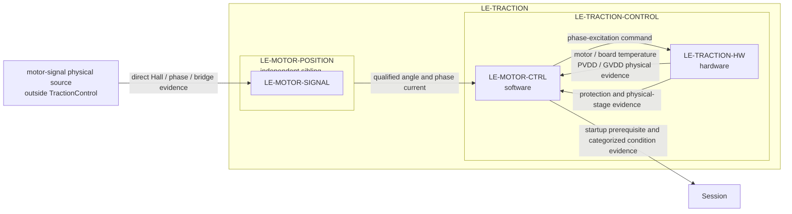

# TractionControl
## Traction control

`LE-TRACTION-CONTROL` is the Traction child responsible for commanding phase excitation and for motor/traction-board temperature plus rail observation. It contains the software `LE-MOTOR-CTRL` and hardware `LE-TRACTION-HW` leaves. `LE-MOTOR-POSITION` remains an independent Traction sibling: it is the sole logical owner of Hall and phase-current/voltage measurement evidence and final electrical position. A physical traction board may realize signals for both functions without transferring their logical ownership.

`MotorControl` owns semantic qualification and the control law. It consumes qualified electrical angle and phase current from MotorPositionEstimation, then commands the selected Hall-sensored FOC phase excitation. A zero torque command, `PhaseExcitationCommand.actuationInhibited`, and `TractionStageEvidence` of physical output are three different facts. `TractionHardwareProtectionEvidence` records independent hardware shutdown, which remains effective independently of software. HC-TRACTION-POWER/HC-INPUT-FE can physically support both logical roles without creating a logical `LE-TRACTION-HW` to MotorSignalMeasurement observation route.

GVDD measurement, qualification, and local operating-condition evaluation remain inside TractionControl. RidingControl receives the resulting startup prerequisite and categorized condition evidence for its vehicle-level latch, report selection, and restart policy; no numeric qualified GVDD value crosses the boundary. Generic acquisition/conversion health continues over its existing service-health route.

| Boundary | Rationale |
|---|---|
| `LE-MOTOR-POSITION` → `LE-MOTOR-CTRL` | Qualified rotor angle and current are control inputs; direct Hall and phase observations remain with MotorSignalMeasurement. |
| `LE-TRACTION-HW` → `LE-MOTOR-CTRL` | Temperature and PVDD/GVDD remain physical evidence until MotorControl qualifies their semantics. Fast PVDD and regular GVDD stay distinct; qualified GVDD and its operating-condition decision remain local to TractionControl. |
| `LE-MOTOR-CTRL` → `LE-TRACTION-HW` | `PhaseExcitationCommand` is a command with explicit `actuationInhibited`; `TractionStageEvidence` and `TractionHardwareProtectionEvidence` return separately. |

See [parent requirements](TractionControl.md), [MotorControl allocation](MotorControl/MotorControl.md), and [TractionHardware allocation](TractionHardware/TractionHardware.md). Numerical thresholds, settling periods, detection budgets and protection coverage remain derivation and acceptance gates.

## Traction control requirements

**Draft successor allocation — 2026-10-02.** **Type:** System Requirement. **Target:** `LE-TRACTION-CONTROL`, composed of `LE-MOTOR-CTRL` and `LE-TRACTION-HW`.

This successor moves the residual traction temperature and PVDD/GVDD responsibilities from the obsolete generic Input leaves into TractionControl. GVDD measurement, qualification, and operating-condition evaluation are local; only the resulting startup prerequisite and categorized condition evidence cross to RidingControl, which retains vehicle fault latching, report selection, and restart lifetime. It does not change the approved temperature response: an applicable temperature-limit or required-temperature-information fault inhibits both signs and recovers only through the existing qualifying restart. It adds no derating behavior.

| ID | Requirement | Derived from | Planned verification and gate |
|---|---|---|---|
| `REQ-SYS-TRQRAIL-001` **Draft** | `LE-TRACTION-CONTROL` shall provide Session a `TractionConditionEvidence` result with `startupTractionConditionsAccepted` true only after qualified GVDD startup evidence and the applicable qualified PVDD/traction-rail condition support operation. Initial, invalid, stale, mismatched, or failed qualification shall withhold that prerequisite, while motor/board-temperature and rail measurement/qualification continue with actuation inhibited. | Owner decision 2026-10-02; `REQ-SYS-STA-001`, `REQ-SYS-STA-006`, `REQ-SYS-HSI-009`. | `T-SYS`, `T-FI`: start with each rail absent, invalid, stale, mismatched, and then qualified; verify no Ready prerequisite is asserted until the accepted condition and qualification continues while inhibited. Thresholds, settling, startup period, rail set and detection budget require derivation. |
| `REQ-SYS-TRQRAIL-002` **Draft** | On a recognized runtime fault of a traction rail required by the accepted operating condition, `LE-TRACTION-CONTROL` shall withdraw both torque signs and set `TractionConditionEvidence.recognizedFault` with the applicable supply category. Restoration of rail evidence, including hardware UVLO auto-recovery, shall not itself re-enable actuation; RidingControl retains session the common current-session latch and reporting policy until a qualifying clean restart. An initial unknown rail state is not this recognized fault. | Owner decision 2026-10-02; `REQ-SYS-FLT-005`, `REQ-SYS-FLT-006`, `REQ-SYS-FLT-009`, `REQ-SYS-HSI-009`. | `T-FI`, `T-SYS`: inject each recognized rail fault during positive, negative, and zero command; restore evidence without restart, then perform clean/persistent restart cases. Recognition criteria, response time, coverage and report selection remain gates. |

The direct Hall and phase-current/voltage observations are outside this component's logical measurement boundary. [MotorPositionEstimation](../MotorPositionEstimation/MotorPositionEstimation.md) owns `LE-MOTOR-SIGNAL`; hardware can provide the shared physical realization without making TractionHardware the logical producer.
