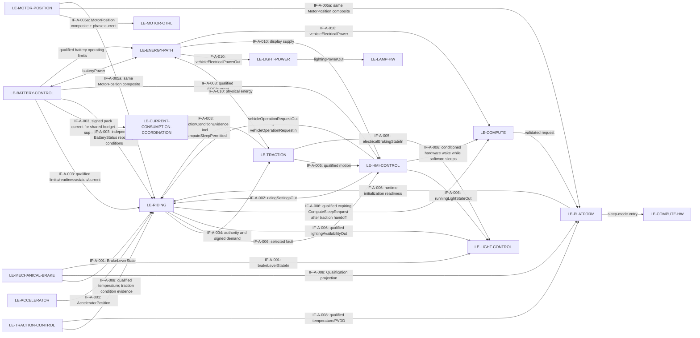

# X2CityMCU

**Canonical architecture document: ARCH-001 — System architecture and logical component decomposition.** This document consolidates the released ARCH-001-R1.0 architecture authority and the X2CityMCU root model overview. Release identity, provenance, status, and retained qualification gates are recorded below.

## Model files and loading

[`X2CityMCU.sysml`](X2CityMCU.sysml) is the top-level EPCS logical composite (`LE-EPCS`). Load all `.sysml` resources in this directory and its child directories recursively as one SysML v2 model, rooted at `X2CitySystemArchitecture`. [`SharedContracts.sysml`](SharedContracts.sysml) is a shared utility resource alongside the root model. The root model and named root document sit together; the seven direct child component models and their documents are in the directories below.

Children: [RidingControl](RidingControl/RidingControl.md) · [DriverInteraction](DriverInteraction/DriverInteraction.md) · [Traction](Traction/Traction.md) · [BatteryControl](BatteryControl/BatteryControl.md) · [EnergyPath](EnergyPath/EnergyPath.md) · [LightControl](LightControl/LightControl.md) · [Compute](Compute/Compute.md).

The model routes battery limits and pack power from BatteryControl to EnergyPath; EnergyPath distributes electrical power to lighting, rider interaction, and compute and provides traction electrical power to Traction. Other modeled routes carry rider requests, brake and accelerator state, battery status and measurements, motion and traction evidence, settings, and selected fault indications among the named components. See `X2CityMCU.sysml` for the complete interface connections.

**Draft EPCS baseline — 2026-10-06.** Active ownership covers electrical/electronic propulsion control and its real electrical interfaces. BMW X2City mechanics are external platform context, not project logical components. This scope update does not claim altered-envelope fitness or promote prior draft/release decisions.

## Release identity

**Released 1.0 — 2026-09-13; ARCH-001-R1.0.** Component architecture developed from released [FC-001-R1.0](../FC-001_Functional_Concept.md), [FC-002-R1.0](../FC-002_Function_Trace.md), REQ-001-R1.6 and HARA/SG-R1.0. [REQ-001](../REQ-001_Requirements.md#requirement-types-and-architecture-model) controls the three-layer model. At that historical release, 12 FSC refinements remained Draft; the current requirements baseline is maintained separately. The owner-approved scope and retained gates are in the [release record](#release-record); ARCH0.3 remains frozen in the FC release commit `8a97f93427bfceb80151b2ba2b72af1ea087c88a`.

This document defines logical component types, composition and system interfaces for the EPCS and its supplied removable electrical pack. [ARCH-002](../ARCH-002_Hardware_Architecture.md) defines physical HW assemblies, ports and configurations; software realization is pending.

## Modelling and configuration rules

A logical component has a bounded responsibility, owned subparts or state, and interfaces to other components. Functions from FC-001 are allocated behaviour; they are not interchangeable with component identities. Containment, connection, function allocation and software hosting are distinct relations. System interfaces state required energy, signal and data exchanges plus fixed constraints. Conductors, pins, ground, voltage classes and connector realization are owned by [ARCH-002](../ARCH-002_Hardware_Architecture.md); System does not import that physical refinement. This follows the structural/behavioural and allocation distinctions in the [OMG SysML overview](https://www.omg.org/sysml/sysmlv1/); these Markdown/Mermaid views use the relations declared here without claiming a tool-native SysML model.

The logical type catalogue decomposes the project EPCS. `X2CityMCU` (`LE-EPCS`) is the project system boundary and owns project E/E performance and use-context requirements. The supplied BMW X2City and its mechanical systems are external platform context under [ID-001 §2.1](../ID-001_Item_Definition.md#external-mechanical-platform-assumption); the project does not model their internals or claim fitness validation for an altered envelope.

Types are not physical instances. Component types in this model have EPCS-local state and hosting. The supplied electrical pack has one physical instance; its connection to EPCS is an electrical interface, not vehicle containment. BMW mechanical installation features remain given external context.

The 2026-10-06 Draft narrows active architecture ownership to E/E retrofit functions. BatteryControl, accelerator observation, electrical coded-brake detection and HMIControl remain within that boundary. Pure mechanical steering, braking, carrier, enclosure and integration roles have been removed from this active model; released history is not silently re-approved. A logical HW leaf can be realized by cooperating HW parts; a SW leaf may have several deployed instances of its component type. These logical leaves describe responsibility only: later realization can distribute the intended hardware and software contributions without establishing a fixed component owner here. Supplied assemblies retain opaque vendor software and boundary acceptance rather than invented project units. Device schematics, code units and numerical parameters remain downstream.

### AG-001 — Operational and reporting interfaces

**Owner guideline, 2026-10-28.**

Applies to System, HW/SW realization, Detailed Design and requirement derivation. Information exchanged between elements to determine operational behavior shall use operational interfaces with defined qualification semantics. Diagnostic and status interfaces shall serve reporting purposes only. Purpose determines classification: commands, measurements and effective limits are operational inputs; a brake-lever state remains operational even if named as state or represented as a boolean.

Qualification means suitable for the stated use and distinguishes a known qualified zero from missing or unreliable information; a valid measurement remains available even when its operational effect is prohibited. Operational contracts shall allocate required element-owned state, timing, configuration, fault effects, fallback and recovery, plus ownership and release conditions for any fault effect retained until restart, independently of diagnostic/report delivery.

Existing contracts require staged alignment in future revisions; this introduction does not implement that alignment.

## Logical composition

Edges below mean **composed of**, not communication or power flow. The table gives every immediate parent, including children omitted from the overview.

```mermaid
flowchart TB
    Context["Installed BMW X2City context"] -.->|platform context| EPCS["X2CityMCU · LE-EPCS"]
    EPCS -->|contains| RidingControl["LE-RIDING: RidingControl"]
    RidingControl -->|contains| RidingPolicy["LE-RIDING-POLICY: RidingPolicy"]
    RidingControl -->|contains| CurrentCoordination["LE-CURRENT-CONSUMPTION-COORDINATION"]
    EPCS -->|contains| DriverInteraction["DriverInteraction (`LE-INPUT`)"]
    EPCS -->|contains| Traction["LE-TRACTION"]
    Traction -->|contains| TractionControl["LE-TRACTION-CONTROL: TractionControl"]
    TractionControl -->|contains| MotorControl["LE-MOTOR-CTRL: MotorControl"]
    TractionControl -->|contains| TractionHardware["LE-TRACTION-HW: TractionHardware"]
    Traction -->|contains| MotorPosition["LE-MOTOR-POSITION: MotorPositionEstimation"]
    MotorPosition -->|contains| MotorSignal["LE-MOTOR-SIGNAL: MotorSignalMeasurement"]
    MotorPosition -->|contains| MotorPositionProc["LE-MOTOR-POSITION-PROC: MotorPositionProcessing"]
    EPCS -->|contains| BatteryControl["LE-BATTERY-CONTROL"]
    EPCS -->|contains| EnergyPath["LE-ENERGY-PATH"]
    EPCS -->|contains| LightControl["LE-LIGHT-CONTROL"]
    EPCS -->|contains| Compute["LE-COMPUTE"]
    Compute -->|contains| ComputeHardware["LE-COMPUTE-HW"]
    Compute -->|contains| Platform["LE-PLATFORM"]
    DriverInteraction -->|contains| Accelerator["LE-ACCELERATOR"]
    Accelerator -->|contains| AcceleratorHw["LE-ACCELERATOR-HW: AcceleratorSignalMeasurement"]
    Accelerator -->|contains| AcceleratorQual["LE-ACCELERATOR-QUAL: AcceleratorPositionProcessing"]
    DriverInteraction -->|contains| MechanicalBrake["LE-MECHANICAL-BRAKE: MechanicalBrakeDetection"]
    DriverInteraction -->|contains| HmiControl["LE-HMI-CONTROL: HMIControl"]
    MechanicalBrake -->|contains| BrakeSignal["LE-BRAKE-SIGNAL: BrakeSignalMeasurement"]
    MechanicalBrake -->|contains| BrakeState["LE-BRAKE-STATE: BrakeStateIdentification"]
    HmiControl -->|contains| HmiElectrical["LE-HMI-ELECTRICAL"]
    HmiControl -->|contains| HMI["LE-HMI"]
    LightControl -->|contains| LightModeSelection["LE-LIGHT-POLICY: LightModeSelection"]
    LightControl -->|contains| LightActuation["LE-LAMP-HW: LightActuation"]
    LightActuation -->|contains| LightPower["LE-LIGHT-POWER: LightPower"]
```

**Kinds:** Composite = decomposed project component; HW/SW = explicitly allocated logical responsibility, including hardware composites; Supplied = provided assembly with qualified external behaviour. Realization links identify component types, not satisfaction evidence. Electrical interfaces and package features may realize several logical roles; project E/E containment is defined in ARCH-002, while supplied vehicle enclosures remain external context.

| Logical component | Immediate parent | Kind | Boundary / owned responsibility | Realization |
|---|---|---|---|---|
| LE-RIDING (`RidingControl`) | [LE-EPCS](../REQ-001_Requirements.md#le-epcs) | Composite | Riding policy and centralized current-consumption coordination. It owns their routing and the external HMI, battery, traction, motion, lifecycle, and torque interfaces. Vehicle-side HMI interaction is its EPCS sibling. | [RidingControl model](RidingControl/RidingControl.sysml); software realization pending |
| LE-RIDING-POLICY (`RidingPolicy`) | [LE-RIDING](#le-riding) | SW | Owns requested/pending/active settings, session lifecycle and fault/report state, Ready eligibility and authority, sleep eligibility, capability recovery under REQ-SYS-SOC-008, and signed wheel-torque arbitration. It consumes coordinator-issued branch-qualified traction-current budgets. | [RidingPolicy model](RidingControl/RidingPolicy/RidingPolicy.sysml); software realization pending |
| LE-CURRENT-CONSUMPTION-COORDINATION (`CurrentConsumptionCoordination`) | [LE-RIDING](#le-riding) | SW | Sole shared pack-current budget authority. Derives independently qualified traction discharge and regenerative-charge allocations from qualified battery capability and a validated fixed worst-case auxiliary reserve; supervises sustained measured pack-current excess centrally. It also publishes qualified lighting availability from qualified discharge capability and the full worst-case auxiliary reserve, including lighting once. Qualified zero discharge capability produces known unavailable lighting even while other reserve evidence is unknown; otherwise, missing/unqualified reserve or insufficient validated capability does not authorize lighting. Pack-current loss alone does not invalidate other qualified limits or reserve-based budgets. If auxiliary demand alone exceeds battery discharge capability, zero traction cannot resolve it; existing all-load protection and auxiliary-continuity responsibilities remain applicable. | [Current-consumption coordination](RidingControl/CurrentConsumptionCoordination/CurrentConsumptionCoordination.sysml); reserve and calibration validation, auxiliary demand, uncertainty, thresholds and response acceptance pending |
| LE-HMI-CONTROL (`HMIControl`) | [DriverInteraction (`LE-INPUT`)](#le-input) | Composite | Vehicle-side interaction with the supplied VD18MT: qualified rider request/report exchange, display-power availability and forwarding of the conditioned hardware wake signal to Compute. It contains the electrical and information-processing leaves; raw-to-conditioned signal conversion belongs to LE-HMI-ELECTRICAL. | [HMIControl requirements](DriverInteraction/HMIControl/HMIControl.md) |
| LE-HMI-ELECTRICAL (`HmiElectricalInterface`) | [LE-HMI-CONTROL](#le-hmi-control) | HW | One `vd18mtConnection:HmiDevicePort` groups required display power, raw request/report bytes and the raw supplied power-lock line. It publishes `HmiPowerLockObservation` (Active/Inactive/Unknown plus integrity) to LE-HMI and separately conditions the signal to an MCU-safe `ControllerWakeSignal` forwarded through Compute. The hardware wake path does not require UART or software execution. | [HmiElectricalInterface requirements](DriverInteraction/HMIControl/HmiElectricalInterface/HmiElectricalInterface.md) |
| LE-HMI (`HmiInformationProcessing`) | [LE-HMI-CONTROL](#le-hmi-control) | SW | Interprets the qualified HMI power-lock observation into `VehicleOperationRequest` (`Request` plus `Qualification`) for RidingControl only, independently of UART; also owns VD18MT framing, protocol interpretation, timestamps and report encoding from qualified selected fault, SOC, current and Traction motion. It owns no power switching, Ready, fault selection/latch, setting guard or light retention. | Software realization pending |
| DriverInteraction (`LE-INPUT`) | [LE-EPCS](../REQ-001_Requirements.md#le-epcs) | Composite | Rider interaction boundary composing AcceleratorPositionIdentification, MechanicalBrakeDetection and HMIControl. Its `driverElectricalConnection:DriverElectricalConnectionPort` groups separately typed accelerator, brake-lever and VD18MT logical subinterfaces. Each child retains its own qualification and timing. Required supply, reference and loading compatibility follows the child electrical requirements; ARCH-002 owns conductor, pin, ground, voltage class and circuit detail. TractionControl owns local temperature/supply observation and qualification. | [DriverInteraction requirements](DriverInteraction/DriverInteraction.md); owned children below |
| LE-ACCELERATOR | [DriverInteraction (`LE-INPUT`)](#le-input) | Composite | End-to-end accelerator electrical signal to one qualified `AcceleratorPosition` (`Position` plus `Qualification`), including normalized position, physical rest, actual measurement time and qualification/diagnostic state. No torque mapping, authority or session latch. | Potential hardware contributions include [HC-RIDER](../ARCH-002_Hardware_Architecture.md#hc-rider) and [HC-INPUT-FE](../ARCH-002_Hardware_Architecture.md#hc-input-fe); hardware binding and software realization are pending. |
| LE-ACCELERATOR-HW (`AcceleratorSignalMeasurement`) | [LE-ACCELERATOR](#le-accelerator) | HW | Provides adequate measurement evidence from the accelerator electrical signal at its `electricalSignalIn` boundary port. | Intended later hardware contributions are deferred; no circuit or acquisition mechanism is selected. |
| LE-ACCELERATOR-QUAL (`AcceleratorPositionProcessing`) | [LE-ACCELERATOR](#le-accelerator) | SW | Obtains and handles measurement evidence, then publishes semantic position/rest and qualification. Initial unqualification and recognized fault stay distinct. Owns one immutable compiled `AcceleratorEndpointCalibration` set; vehicle validation determines its four limits, and endpoint-band classification belongs here. | Intended later software acquisition, transfer and qualification contributions are deferred; algorithm and realization binding remain open. |
| LE-MECHANICAL-BRAKE (`MechanicalBrakeDetection`) | [DriverInteraction (`LE-INPUT`)](#le-input) | Composite | End-to-end coded brake electrical signal to one qualified `BrakeLeverState` (`State` plus `Qualification`), including four-state lever combination and actual measurement time. No brake-force interpretation, torque mapping, authorization, or lighting policy. | [Mechanical brake detection](DriverInteraction/MechanicalBrakeDetection/MechanicalBrakeDetection.md) |
| LE-BRAKE-SIGNAL (`BrakeSignalMeasurement`) | [LE-MECHANICAL-BRAKE](#le-mechanical-brake) | HW | Provides coherent abstract physical brake-response evidence and integrity from the passive coded-brake electrical signal at its `brakeElectricalSignalIn` boundary port. | [HC-INPUT-FE](../ARCH-002_Hardware_Architecture.md#hc-input-fe) and [HC-CONTROLLER](../ARCH-002_Hardware_Architecture.md#hc-controller) contribute physical compatibility, conditioning/protection, and shared acquisition; circuit, excitation, and acquisition selection remain open. |
| LE-BRAKE-STATE (`BrakeStateIdentification`) | [LE-MECHANICAL-BRAKE](#le-mechanical-brake) | SW | Converts brake-response evidence to semantic `Neither`/`Left`/`Right`/`Both` state, firmware measurement time, and qualification. Owns immutable compiled non-overlapping resistance bands for all four states. | Software realization pending. Transfer characterization, band values, timing, and diagnostic coverage remain open. |
| LE-TRACTION | [LE-EPCS](../REQ-001_Requirements.md#le-epcs) | Composite | Realize permitted signed torque with the installed motor; provide qualified applied-torque/motion information | Owned children below |
| LE-MOTOR-POSITION (`MotorPositionEstimation`) | [LE-TRACTION](#le-traction) | Composite | Hall-required electrical rotor position and explicit semantic phase-current feedback for MotorControl. Current/voltage model assistance is internal to the estimator, requires accepted observability and never provides sensorless fallback, forced alignment or stationary holding. | [Motor position estimation](Traction/MotorPositionEstimation/MotorPositionEstimation.md) |
| LE-MOTOR-SIGNAL (`MotorSignalMeasurement`) | [LE-MOTOR-POSITION](#le-motor-position) | HW | Physical Hall capture, phase-current and bridge-voltage observation evidence and integrity; no ADC/DMA/pin or software timestamp selection. | [HC-TRACTION-POWER](../ARCH-002_Hardware_Architecture.md#hc-traction-power), [HC-MOTOR](../ARCH-002_Hardware_Architecture.md#hc-motor), [HC-INPUT-FE](../ARCH-002_Hardware_Architecture.md#hc-input-fe) and [HC-CONTROLLER](../ARCH-002_Hardware_Architecture.md#hc-controller) contribute only physical conditioning, acquisition and capture. |
| LE-MOTOR-POSITION-PROC (`MotorPositionProcessing`) | [LE-MOTOR-POSITION](#le-motor-position) | SW | Timestamped acquisition and semantic conversion into the complete `MotorPosition` composite for MotorControl, Platform and RidingControl, plus explicit `PhaseCurrentMeasurements` for MotorControl, using immutable calibration. It distinguishes qualified angle from signed electrical-speed validity and preserves a static Hall-sector startup path. | Software realization pending |
| LE-TRACTION-CONTROL (`TractionControl`) | [LE-TRACTION](#le-traction) | Composite | Local traction-control composition: MotorControl and TractionHardware. Its command carries the requested three phase voltages relative to motor electrical neutral, an expiry and overriding `actuationInhibited`; observed stage state and independent protection evidence return separately. It carries local temperature/supply evidence without absorbing motor-position estimation. | [Traction control](Traction/TractionControl/TractionControl.md) |
| LE-MOTOR-CTRL (`MotorControl`) | [LE-TRACTION-CONTROL](#le-traction-control) | SW | Qualifies traction-board/motor temperature and PVDD/GVDD evidence, accepts authority/command, controls phase excitation, and publishes condition, motion and actual-output evidence. Semantic conversion does not imply that the control core is the sensor-conversion implementation. | [MotorControl allocation](Traction/TractionControl/MotorControl/MotorControl.md); software realization pending |
| LE-TRACTION-HW (`TractionHardware`) | [LE-TRACTION-CONTROL](#le-traction-control) | HW | Physical traction-energy conversion, motor actuation, motor/board temperature and PVDD/GVDD measurement evidence, plus independent protective inhibition and stage evidence. It has no logical Hall, phase-current, or phase-voltage observation responsibility. | [TractionHardware allocation](Traction/TractionControl/TractionHardware/TractionHardware.md) |
| LE-BATTERY-CONTROL | [LE-EPCS](../REQ-001_Requirements.md#le-epcs) | Composite | Owner-built BatteryAssembly and vehicle-host BatterySupervision: qualified actual SOC, physical/electrical battery capabilities and limits, readiness and fault contribution. | Owned children below |
| LE-BATTERY-ASSEMBLY | [LE-BATTERY-CONTROL](#le-battery-control) | Composite | Owner-built physical pack with the supplied BMS hardware/vendor firmware boundary. | [HC-CELLS](../ARCH-002_Hardware_Architecture.md#hc-cells), [HC-BMS](../ARCH-002_Hardware_Architecture.md#hc-bms) |
| LE-CELLS | [LE-BATTERY-ASSEMBLY](#le-battery-assembly) | HW | Fixed electrochemical storage bank in fitted/removed configurations. | [HC-CELLS](../ARCH-002_Hardware_Architecture.md#hc-cells) |
| LE-BMS | [LE-BATTERY-ASSEMBLY](#le-battery-assembly) | Supplied | Supplied monitoring, balancing and protective switching, with opaque vendor firmware. | [HC-BMS](../ARCH-002_Hardware_Architecture.md#hc-bms); supplied vendor firmware |
| LE-BATTERY-SUPERVISION | [LE-BATTERY-CONTROL](#le-battery-control) | SW | Vehicle-host reading and qualification of BMS information; owns qualified capability policy, restart-retained battery fault operating effect and independent BatteryStatus publication; owns neither motor enforcement nor physical protection proof. | Software realization pending |
| LE-ENERGY-PATH | [LE-EPCS](../REQ-001_Requirements.md#le-epcs) | HW | Power distribution/coupling and actuation of BatterySupervision’s qualified total discharge-current bound across traction and auxiliary loads; physical path, residual-load and generated-energy treatment remain to be derived. It makes display supply available to LE-HMI-ELECTRICAL before MCU software runs. | [HC-PACK-IF](../ARCH-002_Hardware_Architecture.md#hc-pack-if), [HC-ENERGY-DIST](../ARCH-002_Hardware_Architecture.md#hc-energy-dist) |
| LE-LIGHT-CONTROL (`LightControl`) | [LE-EPCS](../REQ-001_Requirements.md#le-epcs) | Composite | End-to-end lighting control: qualified normal request, brake-lever and actual electrical-braking inputs to selected modes and physical light actuation, subject to RidingControl qualified lighting availability. Qualified unavailable status overrides every selected mode and startup fallback; retained unavailable restriction remains in force through lost qualification until qualified available status returns. Initially unknown status preserves existing startup/fault behavior wherever supply and protection permit. Vehicle electrical energy is received at its external `vehicleElectricalPowerIn` boundary. | Owned children below |
| LE-LIGHT-POLICY (`LightModeSelection`) | [LE-LIGHT-CONTROL](#le-light-control) | SW | Retain current-session normal-light requests and select Front Off/On plus Rear Off/Dim/Full modes from the qualified mechanical lever and actual electrical-braking state. It receives no lighting-availability input; a separate qualified hardware boundary applies the central availability restriction. | Software realization pending |
| LE-LAMP-HW (`LightActuation`) | [LE-LIGHT-CONTROL](#le-light-control) | HW composite | Receives selected light modes and qualified lighting availability, owns LightPower, and applies the qualified unavailable restriction to physical driver/default output and retained front/rear lamps, including brake indication and startup fallback. | [HC-LAMP-DRIVE](../ARCH-002_Hardware_Architecture.md#hc-lamp-drive), [HC-LAMPS](../ARCH-002_Hardware_Architecture.md#hc-lamps) |
| LE-LIGHT-POWER (`LightPower`) | [LE-LAMP-HW](#le-lamp-hw) | HW | Receives distributed vehicle electrical energy and supplies lighting power used by LightActuation. It does not claim a dedicated converter or select a supply topology. | [HC-AUX-POWER](../ARCH-002_Hardware_Architecture.md#hc-aux-power), alongside its other controller/HMI/lamp supply obligations |
| LE-COMPUTE | [LE-EPCS](../REQ-001_Requirements.md#le-epcs) | Composite | Vehicle compute infrastructure, composed only of the selected controller hardware and its Platform services. It hosts system execution; function ownership remains with its logical components. Receives distributed vehicle electrical energy from EnergyPath. | Owned children below |
| LE-COMPUTE-HW | [LE-COMPUTE](#le-compute) | HW | Selected WeAct STM32H723VGT6 V1.2 controller board: power/reset and I/O, and direct conditioned HMI wake while software sleeps. It emits no awake power-lock observation. Compute delegates its EnergyPath input to this host. | [Compute overview](Compute/Compute.md), [ComputeHardware requirements](Compute/ComputeHardware/ComputeHardware.md), [HC-CONTROLLER](../ARCH-002_Hardware_Architecture.md#hc-controller) |
| LE-PLATFORM | [LE-COMPUTE](#le-compute) | SW | Runtime services for software hosted by Compute: publishes runtime initialization readiness and validates/executes RidingControl's current sleep request at actual entry to ComputeHardware. RidingControl owns On/Off lifecycle, sleep eligibility and grant/revocation, Ready, fault latch and riding authority. | [Compute overview](Compute/Compute.md); software realization pending, [Platform model](Compute/Platform/Platform.sysml), [Platform requirements](Compute/Platform/Platform.md) |

### Logical connections and electrical port contracts

This view shows component exchange through canonical IF-A contracts; containment is defined above. Physical energy and qualified information are different exchanges. Regenerative energy remains a vehicle transfer constrained by the supplied pack charge-acceptance envelope.

Qualified information-port types carry their value plus validity, source age, qualification uncertainty and reset/operation context where applicable. Physical-evidence ports intentionally defer their observed representation to sensing design. These are semantic fields, not a new wire protocol. Physical ports declare electrical energy/reference direction, accessible electrical states and applicable limits. Physical and software component contracts refine these boundaries in ARCH-002/003; one mating connector may carry several logical channels.

| IF-A family | Port type and endpoint boundary |
|---|---|
| IF-A-001/002 | LE-ACCELERATOR and LE-MECHANICAL-BRAKE each publish one complete qualified record to LE-RIDING. RidingControl uses those shared invocation snapshots for settings, session eligibility and demand arbitration as applicable; LightModeSelection remains a separate consumer of the brake record. HMI sends qualified settings through DriverInteraction to LE-RIDING. Active settings are retained inside RidingControl and are not an external interface. Physical rest remains explicit. |
| IF-A-007 | LE-BRAKE-SIGNAL observes the passive coded-brake electrical signal at its function boundary and provides abstract physical-response evidence to LE-BRAKE-STATE. Within LE-TRACTION-CONTROL, TractionHardware supplies motor/board thermal and PVDD/GVDD measurement evidence directly to MotorControl; physical conversion and actuation remain separate from semantic qualification. |
| IF-A-008 | LE-MECHANICAL-BRAKE publishes only its `BrakeQualification` projection to Platform. LE-TRACTION-CONTROL publishes qualified temperature/PVDD to Platform and temperature plus categorized `TractionConditionEvidence`, including `computeSleepPermitted` capability evidence, to RidingControl. GVDD is measured, qualified, and evaluated locally in TractionControl; RidingControl receives the startup prerequisite and categorized fault evidence, not the qualified voltage value. MotorControl's fast-PVDD use is internal to its realization. |
| IF-A-003/009 | BatteryControl exposes qualified readiness and operating limits, SOC/current observations, plus an independent reporting-only BatteryStatus to their named consumers; BMS UART is read-only. RidingControl.CurrentConsumptionCoordination alone consumes signed pack current for central shared-budget supervision and issues independent traction discharge/charge budgets from qualified battery capability and the validated fixed auxiliary reserve. RidingPolicy consumes those allocations; MotorControl enforces them with its own qualified average inverter DC-current estimate, without pack-current input. Missing pack current alone affects only that observation's qualification and does not invalidate other battery outputs or reserve-based budgets. If auxiliary draw itself exceeds discharge capability, zero traction cannot resolve it; all-load protection/auxiliary continuity remains applicable. |
| IF-A-004/005 | RidingPolicy publishes independent authority and signed wheel-torque-demand outputs to Traction through RidingControl; demand carries the coordinator's independently qualified discharge/charge budgets. MotorControl enforces each electrical transfer allocation using its own qualified average inverter DC-current estimate. Traction returns qualified motion and actual active motor-braking feedback, with expiry and producer context preserved. |
| IF-A-006 | RidingControl provides the selected fault indication and qualified lighting availability from the shared battery-current coordinator to LightControl. HMIControl exchanges qualified rider requests and reports. HmiElectricalInterface publishes the integrity-qualified physical power-lock observation to HmiInformationProcessing and separately conditions the hardware wake, which DriverInteraction forwards directly to ComputeHardware through Compute. HmiInformationProcessing publishes the request through `HMIControl.vehicleOperationRequestOut` and `DriverInteraction.vehicleOperationRequestOut` to `RidingControl.vehicleOperationRequestIn` only; interpretation is independent of UART. RidingPolicy evaluates sleep eligibility from qualified explicit Off and qualified traction capability evidence, then issues or revokes a current expiring request after the required traction output handoff. Platform validates the latest current-context valid, unexpired true request at actual entry and executes it without renewing permission; ComputeHardware enters the hardware mode. Platform publishes runtime readiness to RidingControl; it does not establish Ready. RidingPolicy retains lifecycle and Ready/fault authority. HMI protocol encoding does not select or latch faults. See [HMIControl overview](DriverInteraction/HMIControl/HMIControl.md) and [Compute overview](Compute/Compute.md) for details. |
| IF-A-010/011 | EnergyPath supplies distributed vehicle power to Compute, which delegates its input to ComputeHardware, and makes display supply available through DriverInteraction to HMIControl before MCU startup. BatteryControl `batteryPower` joins EnergyPath; EPCS retains assigned physical protection. |

**Selected sensing allocation retained from the current integration baseline.** The vehicle host receives three Hall edge channels; three phase-current observations; fast local PVDD; traction-board and motor temperature; separate accelerator and coded-brake observations; GVDD and three phase-voltage diagnostics; and supplied-BMS pack/group/current/SOC/temperature/path information. The source-to-measurement-to-qualification routes remain distinct from the shared acquisition realization. Platform owns shared-acquisition integrity support; it does not introduce ADC/DMA fields into these system records or own their semantic conversion. Sensor accuracy, wiring, protection, calibration and diagnostic coverage remain acceptance gates.

## Architecture decisions and limits

| Decision / status | Selected decomposition and remaining acceptance |
|---|---|
| Shared vehicle host — approved allocation, OI-044 acceptance open | HC-CONTROLLER hosts supervision, observation qualification and motor control. Components retain explicit exchange and state ownership. This avoids extra vehicle host/interconnect boundaries; prove scheduling/resources and common-cause/fault response before accepting sharing. A separate supervisory processor remains a change option if evidence rejects it. |
| Physical domain protection — approved responsibility, HA-OI-002–005 | Pack/BMS and vehicle distribution/drive receive protective responsibilities with the controller absent/faulted. A software partition or second host proves no independence; coverage and mechanisms need evidence. |

The fixed brake interface remains one passive two-wire network with four valid codes and ambiguous/unknown cases. Mechanical braking is an external platform capability; LE-MECHANICAL-BRAKE models only electrical observation and state identification. Naming components selects no new sensor/channel, lock detector, connector pinout, motor algorithm, charge voltage, isolation topology or numerical safety bound.

## Allocation records and component contracts

Unchanged requirements may be reclassified without invented parents. New children below contribute only their stated interface/command obligations; their system parents and integration verification remain mandatory.

| Requirement allocation | Realization / responsibility | Parent coverage and remaining evidence |
|---|---|---|
| [REQ-SYS-LVL-001–004](RidingControl/RidingPolicy/RidingPolicy.md#context-settings-and-control-policy-level-selection-and-application), [REQ-SYS-SPD-002/004/005/008](RidingControl/RidingPolicy/RidingPolicy.md#context-settings-and-control-policy-speed-selection-and-application) → LE-RIDING-POLICY | LE-RIDING-POLICY maintains requested/pending/active level and normalized speed limit | Eight existing obligations and sources unchanged. Qualified requests and simultaneous standstill/rest, startup receipt and physical cutoff/profile application remain integration dependencies. |
| [REQ-SYS-CTL-001](RidingControl/RidingPolicy/Specification/SettingsAndControlPolicy.sysml) → LE-RIDING-POLICY | LE-RIDING-POLICY produces eligibility/inhibition state | Partial contribution to startup/fault parents; qualified inputs, actual self-tests, power/reset behavior and physical zero torque remain system work. |
| [REQ-SYS-CTL-002](RidingControl/RidingPolicy/Specification/SettingsAndControlPolicy.sysml) → LE-RIDING-POLICY | LE-RIDING-POLICY produces a signed wheel-torque command with coordinated current budgets | Partial command-interface contribution to rider/limit parents; [Released calibration acceptance](RidingControl/RidingPolicy/RidingPolicy.md#context-rider-control-torque-profile-calibration-acceptance) defines normalized shape/endpoints and distinct dynamics/taper. Numeric calibration, timing and physical tracking remain open. |
| [REQ-SYS-CUR-001](RidingControl/Specification/CurrentBudgeting.sysml) → LE-RIDING | LE-RIDING establishes one shared budget authority for traction and auxiliary energy use; auxiliary-only excess beyond discharge capability remains subject to existing all-load protection and continuity obligations. | Draft system parent; fixed reserve qualification, bounds, and physical protection remain open. |
| [REQ-SYS-CUR-002](RidingControl/CurrentConsumptionCoordination/Specification/SharedCurrentBudget.sysml), [REQ-SYS-CUR-003](RidingControl/CurrentConsumptionCoordination/Specification/SharedCurrentBudget.sysml) → LE-CURRENT-CONSUMPTION-COORDINATION | Derives reserve-based discharge and charge allocations and centrally supervises excess measured signed pack current. | Draft software allocations; pack-current unavailability alone does not withdraw otherwise qualified reserve-based budgets. Reserve and supervision thresholds/timing remain open. |
| [REQ-SYS-CUR-004](RidingControl/CurrentConsumptionCoordination/Specification/SharedCurrentBudget.sysml) → LE-CURRENT-CONSUMPTION-COORDINATION | Publishes qualified lighting availability from qualified discharge capability and a validated full worst-case auxiliary reserve that includes lighting once; qualified zero discharge capability is known unavailable even if other reserve evidence is unknown. | Draft Abstract Software allocation; the immutable battery-side lighting calibration remains provisional pending product validation, and the other auxiliary reserve plus system qualification/calibration evidence remain open. |
| [REQ-AS-TRQDC-001](Traction/TractionControl/MotorControl/Specification/Requirements.sysml), [REQ-AS-TRQDC-002](Traction/TractionControl/MotorControl/Specification/Requirements.sysml) → LE-MOTOR-CTRL | Estimates qualified average inverter DC current from local phase-current, applied modulation and permit evidence, then enforces coordinator-issued branch budgets. It receives no BMS pack-current input. | Draft software allocation; current-estimate accuracy/averaging and bounded response remain open. |
| [REQ-SYS-TRQDC-003](Traction/TractionControl/TractionHardware/Specification/Requirements.sysml) → LE-TRACTION-HW | Supplies qualified applied-modulation and permit/protection evidence needed by MotorControl's local inverter-current estimate. | Draft Abstract Hardware requirement; evidence timing, observability and reconstruction error remain open. |
| [REQ-SYS-ACC-001](DriverInteraction/AcceleratorPositionIdentification/Specification/Requirements.sysml), [REQ-SYS-ACC-004](DriverInteraction/AcceleratorPositionIdentification/Specification/Requirements.sysml)–[REQ-SYS-ACC-009](DriverInteraction/AcceleratorPositionIdentification/Specification/Requirements.sysml), [REQ-SYS-ACC-022](DriverInteraction/AcceleratorPositionIdentification/Specification/Requirements.sysml), [REQ-SYS-ACC-024](DriverInteraction/AcceleratorPositionIdentification/Specification/Requirements.sysml), [REQ-SYS-ACC-026](DriverInteraction/AcceleratorPositionIdentification/Specification/Requirements.sysml)–[REQ-SYS-ACC-027](DriverInteraction/AcceleratorPositionIdentification/Specification/Requirements.sysml), [REQ-SYS-ACC-029](DriverInteraction/AcceleratorPositionIdentification/Specification/Requirements.sysml), [REQ-SYS-ACC-031](DriverInteraction/AcceleratorPositionIdentification/Specification/Requirements.sysml), [REQ-SYS-ACC-046](DriverInteraction/AcceleratorPositionIdentification/Specification/Requirements.sysml)–[REQ-SYS-ACC-049](DriverInteraction/AcceleratorPositionIdentification/Specification/Requirements.sysml) → LE-ACCELERATOR | The retained System group owns the accelerator contract; its hardware and software contributions are allocated by the linked child groups below. | Position/rest and actual measurement time remain in one semantic record with `Qualification` health/diagnostic state. Initial unqualification, recognized fault, health-only publication, accuracy, response, source-specific mapping, electrical compatibility and restart requalification remain distinct obligations; endpoint-band classification is implemented by the linked processing allocation; electrical transfer, calibration, diagnostic coverage and formal HW/SW realization binding remain open. |
| [REQ-SYS-ACC-002](DriverInteraction/AcceleratorPositionIdentification/AcceleratorPositionProcessing/Specification/Requirements.sysml), [REQ-SYS-ACC-010](DriverInteraction/AcceleratorPositionIdentification/AcceleratorPositionProcessing/Specification/Requirements.sysml)–[REQ-SYS-ACC-013](DriverInteraction/AcceleratorPositionIdentification/AcceleratorPositionProcessing/Specification/Requirements.sysml), [REQ-SYS-ACC-017](DriverInteraction/AcceleratorPositionIdentification/AcceleratorPositionProcessing/Specification/Requirements.sysml)–[REQ-SYS-ACC-018](DriverInteraction/AcceleratorPositionIdentification/AcceleratorPositionProcessing/Specification/Requirements.sysml), [REQ-SYS-ACC-020](DriverInteraction/AcceleratorPositionIdentification/AcceleratorPositionProcessing/Specification/Requirements.sysml)–[REQ-SYS-ACC-021](DriverInteraction/AcceleratorPositionIdentification/AcceleratorPositionProcessing/Specification/Requirements.sysml), [REQ-SYS-ACC-038](DriverInteraction/AcceleratorPositionIdentification/AcceleratorPositionProcessing/Specification/Requirements.sysml)–[REQ-SYS-ACC-040](DriverInteraction/AcceleratorPositionIdentification/AcceleratorPositionProcessing/Specification/Requirements.sysml) → LE-ACCELERATOR-QUAL (`AcceleratorPositionProcessing`) | Retained Abstract Software contribution: obtain and handle measurement evidence, qualify it, and publish the `AcceleratorPosition` composite with its health projection. | This logical allocation selects neither a fixed software component nor an acquisition/transfer mechanism. Position/rest, endpoint-band implementation, actual measurement time, qualification, timeout and fault/restart boundaries remain as stated by the linked System contracts; the endpoint limits form one validation-derived immutable `endpointCalibration` set and no numeric values are selected here. |
| [REQ-SYS-ACC-003](DriverInteraction/AcceleratorPositionIdentification/AcceleratorSignalMeasurement/Specification/Requirements.sysml), [REQ-SYS-ACC-014](DriverInteraction/AcceleratorPositionIdentification/AcceleratorSignalMeasurement/Specification/Requirements.sysml), [REQ-SYS-ACC-043](DriverInteraction/AcceleratorPositionIdentification/AcceleratorSignalMeasurement/Specification/Requirements.sysml) → LE-ACCELERATOR-HW (`AcceleratorSignalMeasurement`) | Retained Abstract Hardware contribution: provide observable accelerator measurement evidence and allocated electrical compatibility. | This logical allocation selects neither a physical circuit nor a conversion/buffering implementation. Measurement integrity/availability remains distinct from semantic position qualification; generic acquisition context and timing remain internal to the acquisition path. |
| [REQ-SYS-CTL-003](DriverInteraction/HMIControl/HmiInformationProcessing/Specification/Requirements.sysml) → LE-HMI | LE-HMI forms/consumes VD18MT protocol fields | Partial information-interface contribution to HMI parents; electrical transport, update bounds and visible display correspondence remain open. |
| [REQ-SYS-CELL-001](BatteryControl/BatteryAssembly/Cells/Specification/CellBankComposition.sysml) → LE-CELLS | HC-CELLS realizes the fixed series/parallel bank | Partial physical contribution to REQ-SYS-BAT-002; selected BMS/UART and whole-pack acceptance remain System Requirements. |
| [REQ-SYS-BMSIF-001–013](BatteryControl/BatterySupervision/Specification/MeasurementQualification.sysml) → LE-BATTERY-SUPERVISION | LE-BATTERY-SUPERVISION restricts requests to reads and qualifies response validation, installed payload layouts, decoded fields, observation age/retention, reset requalification and bounded service timing | Partial contribution to REQ-SYS-BMS-003; electrical transport, observation accuracy, SOC display qualification and required-source physical reactions remain system work. |
| [REQ-SYS-BMSPOL-001](BatteryControl/BatterySupervision/Specification/CommonCurrentCapabilities.sysml) → LE-BATTERY-SUPERVISION | LE-BATTERY-SUPERVISION qualifies actual SOC and produces effective charge/discharge current capability limits and capability-restriction reasons. Normal discharge reaches zero at the qualified lowest-group-voltage endpoint; Battery fault recognition, retained operating effect and reporting publication are allocated separately. | Partial contribution to BMS-001/006–008; physical limit enforcement, independent protection and required source qualification remain system/other-component obligations. |
| [REQ-SYS-CTL-004](RidingControl/RidingPolicy/Specification/SettingsAndControlPolicy.sysml) → LE-RIDING-POLICY | LE-RIDING-POLICY selects/retains the fault-group report, using the lowest assigned code only for indistinguishable earliest ties | Physical reaction applies to every recognized fault; recognition timing/coverage and visible HMI acceptance remain open. |
| [REQ-SYS-LGTPOL-001](LightControl/LightModeSelection/Specification/Requirements.sysml)–[REQ-SYS-LGTPOL-004](LightControl/LightModeSelection/Specification/Requirements.sysml) → LE-LIGHT-POLICY (`LightModeSelection`) | LE-LIGHT-POLICY retains the normal request and selects Front Off/On and Rear Off/Dim/Full modes from qualified mechanical-lever and actual electrical-braking facts. | Partial contribution to LGT-001–009. Actual brightness, unqualified-state power-on/reset behavior before software execution and protected continuity remain physical integration obligations. |
| [REQ-VEH-LGT-010](LightControl/Specification/LightingBehavior.sysml) → LE-LIGHT-CONTROL | A qualified unavailable lighting restriction inhibits all lamps; retained unavailability persists through lost qualification until qualified available status returns. Initially unknown input retains existing startup/fault fallback subject to power and protection. | Draft System requirement; LightingAvailability interface implementation and product validation remain open. |
| [REQ-SYS-LGTHW-001](LightControl/LightActuation/Specification/Requirements.sysml)–[REQ-SYS-LGTHW-004](LightControl/LightActuation/Specification/Requirements.sysml) → LE-LAMP-HW (`LightActuation`) | HC-LAMP-DRIVE / HC-LAMPS realize selected LightModes and protected rear-light continuity. | Draft child allocation contributes to LGT-001–009 and FSC-012; parent coverage, physical visibility/electrical acceptance, and numerical acceptance remain open. |
| [REQ-SYS-LGTHW-005](LightControl/LightActuation/Specification/Requirements.sysml) → LE-LAMP-HW (`LightActuation`) | Applies qualified unavailable lighting restrictions through front/rear output, including startup fallback and brake indication, and retains that restriction through unqualified input. | Draft Abstract Hardware allocation; product-level protection, electrical realization and physical acceptance remain open. |
| [REQ-SYS-INT-004](Traction/Specification/InterfaceQualification.sysml) → LE-TRACTION | System command-authority contract; logical command acceptance and physical output into HC-TRACTION-POWER/HC-MOTOR; software realization is pending | Authorization withdrawal and command validity must propagate through realization; software zero command alone does not establish physical inhibition, especially with failed output stages. |

[BAT-001](BatteryControl/BatteryAssembly/BatteryAssembly.md#fixed-inputs-and-provenance) fixes component evidence and derived envelopes. HC-BMS and its hosted vendor firmware are a purchased assembly, not project-developed BMS firmware; system interface/integration acceptance substitutes for invented vendor-internal derivation. [Battery integration requirements](BatteryControl/BatteryControl.md) target the integrating LE-EPCS composite. Protect the cell bank against its own limits even where the BMS family defaults permit more. BMS recovery does not release system-session inhibition.

Software realization is pending; [ARCH-002](../ARCH-002_Hardware_Architecture.md) owns physical assemblies and ports. The owner-selected WeAct STM32H723VGT6 is the vehicle host combining supervisory and motor-control execution; its [vehicle integration contract](Traction/TractionControl/TractionHardware/TractionHardware.md#drv8300drge-evm--weact-stm32h723vgt6-traction-hsi) retains resource, power, timing and fault qualification open. Execution order, scheduling and resource budgets must satisfy the end-to-end contracts below. No detailed software units are defined.

| Interface | Producer → consumer | Contract / source | Open acceptance and gate |
|---|---|---|---|
| IF-A-001 / IF-A-005: accelerator, brake and vehicle-motion data | LE-ACCELERATOR → LE-RIDING; LE-ACCELERATOR → LE-PLATFORM (Qualification projection); LE-MECHANICAL-BRAKE → LE-RIDING / LE-LIGHT-POLICY (complete composite); LE-TRACTION → LE-RIDING / LE-HMI | LE-ACCELERATOR owns end-to-end qualified `AcceleratorPosition`; LE-MECHANICAL-BRAKE owns `BrakeLeverState`; and LE-TRACTION is the sole producer of qualified physical vehicle speed, direction and standstill. RidingPolicy consumes the riding records through its parent interface; HMI consumes motion for display encoding and does not produce a second speed source. | Electrical endpoints, range/transfer, timing/coherence and diagnostic coverage remain gates; no threshold, calibration, hardware selection or runtime realization is added. |
| IF-A-002: settings | LE-HMI-CONTROL → LE-RIDING-POLICY through LE-RIDING | HMI is the sole settings-request source. `RiderSettingsRequest` contains concrete requested level and speed fields with qualification. Current-startup receipt and retained request are evaluated by RidingPolicy. Requested, pending and active state remain internal; no active-settings output crosses the component boundary. | VD18MT encoding/transport, unrecognized frames and qualification timing: WS-OI-008/009/015. No fallback setting creates startup qualification. |
| IF-A-003: battery operating and reporting information | LE-BATTERY-SUPERVISION → LE-CURRENT-CONSUMPTION-COORDINATION / LE-RIDING-POLICY / LE-HMI-CONTROL | Separate logical paths carry qualified battery observations/configuration for operating policy and reporting-only BatteryStatus for recognized battery faults, including BMS-reported thermal faults, and ordinary low-discharge-voltage and MOS-disabled warning conditions. BatteryStatus distinguishes unknown state and is independent of operating-limit qualification. Physical battery thermal protection is allocated to BMSDEV-005; BatterySupervision recognizes and publishes BMS-reported faults under BATSUP-017/020. RidingPolicy maps qualified warning causes and retains report codes, priority and session lifetime; BatterySupervision publishes selected fault-group evidence in recognition order under BATSUP-025. CurrentConsumptionCoordination alone consumes signed pack current for shared-budget supervision and produces branch-qualified reserve-based allocations. HMI transports the selected report. Missing pack current alone does not invalidate other BatterySupervision outputs or reserve-based budgets. | Limits, reserve evidence/margins, source freshness, recognition/publication/delivery budgets, temperature measurement adequacy and coverage remain open under WS-OI-005/007/010/018/019, OI-041/048/049/061. The selected MOS/T1/T2 order and T2 centre-pack probe mapping are recorded in [BAT-001](BatteryControl/BatteryAssembly/Bms/Bms.md#owner-reported-app-temperature-readings-2026-10-26). No bit mask or data layout is selected here. |
| IF-A-004: eligibility and torque command | LE-RIDING → LE-TRACTION | RidingControl publishes independent `RidingAuthority` and signed rear-wheel `WheelTorqueRequest` outputs to Traction under INT-004. Positive means forward. Traction rejects obsolete/restarted-context inputs and withdraws on lost authority or command expiry. Physical response/protection remain separate | Command representation, complete arbitration, transfer/update/watchdog bounds and physical torque tolerance: WS-OI-003/007/010/015, OI-043/049. |
| IF-A-005: actual output information | LE-TRACTION → LE-RIDING / LE-LIGHT-POLICY | LE-TRACTION owns qualified actual applied torque, active braking and distinct motion feedback, with unqualified state explicit. DriverInteraction (`LE-INPUT`) does not republish output feedback. FLT-012 covers recognized loss; LGT-009 requires Full while braking state is unqualified. Request alone proves neither powered travel nor actual braking. Applied-positive-output evidence qualifies post-stop regeneration re-entry, not the first eligible positive demand. Unauthorized-output monitoring/protection remains effective without command acceptance or riding authority | Derive observability/reference/uncertainty/latency; no torque sensor or estimation method selected: WS-OI-001/006/016. |
| IF-A-005a: motor position and phase-current feedback | Physical Hall/current/bridge observation → LE-MOTOR-SIGNAL → LE-MOTOR-POSITION-PROC → LE-MOTOR-CTRL / LE-PLATFORM / LE-RIDING | The same complete `MotorPosition` (`Position` + `Qualification`) reaches all three consumers, including when angle is unavailable or only Qualification changes; qualification-only changes preserve the actual Position evidence reference time. Hall evidence is required for every available electrical-angle result. The direct physical inputs are owned solely by MotorPositionEstimation; they do not pass through LE-TRACTION-HW. Static Hall-sector startup without an edge is permitted, but absence of edges does not prove standstill. Qualified vehicle motion remains independent. Phase current and applied winding voltage refine/check the Hall estimate only with accepted model/observability evidence. LE-MOTOR-POSITION-PROC provides explicit phase-current feedback; applied-winding voltage remains internal observer evidence and slow diagnostic voltage cannot substitute. Existing RidingControl/Platform policy receives recognized lost/contradictory required-signal evidence through the composite and remains unchanged. | [Motor position estimation requirements](Traction/MotorPositionEstimation/Specification/Requirements.sysml)–006; derive Hall map, electrical alignment, model/observer validity, time/skew, continuity and accepted error bounds. |
| IF-A-006: rider information, wake and session lifecycle | LE-RIDING ↔ LE-COMPUTE; LE-HMI-CONTROL ↔ VD18MT; LE-HMI-CONTROL / LE-MECHANICAL-BRAKE → LE-LIGHT-POLICY → LE-LIGHT-CONTROL / LE-LAMP-HW | RidingControl provides the selected fault indication; LE-HMI encodes it without selecting or latching priority. SOC/current and Traction motion remain qualified HMI inputs. HMI electrical hardware groups display power and raw bytes and conditions the power-lock signal. Compute wake, observation, runtime-readiness and sleep exchanges are summarized above; details are in the [Compute overview](Compute/Compute.md). LE-LIGHT-POLICY retains accepted normal-light requests and arbitrates front/rear modes. | Physical connector realization is in ARCH-002; transport, quantization, timing and visible correspondence remain open. No display acknowledgement is modeled. |
| IF-A-007: retained physical observation routes | LE-BRAKE-SIGNAL → LE-BRAKE-STATE (passive coded brake); TractionHardware → MotorControl (motor/board thermal, PVDD and GVDD measurement evidence) | The brake electrical input and physical-measurement evidence are distinct. Their observed representation remains sensing-design work. | Sensing, conditioning, acquisition integrity and fault coverage remain HSI/integration acceptance work. Platform provides shared-acquisition integrity support, without a System ADC/DMA data contract. |
| IF-A-008: retained qualified observation routes | LE-MECHANICAL-BRAKE → LE-PLATFORM (`BrakeQualification` projection); LE-TRACTION-CONTROL → LE-PLATFORM (temperature/PVDD), LE-RIDING (temperature and categorized traction condition evidence) | Platform receives only the `BrakeQualification` projection. IF-A-001 carries the complete `BrakeLeverState` once to RidingControl and separately to LightModeSelection. Motor/traction-board thermal evidence becomes qualified temperature for RidingControl/Platform. TractionControl retains qualified GVDD locally and publishes startup-condition and categorized fault evidence to RidingControl; RidingControl applies vehicle latching, reporting, and clean-restart policy. MotorControl's fast-PVDD use is internal. | Conversion, freshness and fault-response acceptance remain open; evidence cannot imply policy or an ADC/DMA realization. |
| IF-A-009: selected BMS UART | LE-BMS ↔ LE-BATTERY-SUPERVISION, through the still-to-be-qualified electrical interface | BAT-001: 9600 8N1 read protocol, pack/SOC/current/14-group/temperature/protection/path information; current positive charging, negative discharging. Preserve validity/freshness and actual-unit scaling. | OI-041/045/046/049/061: resolve manufacturer non-isolated UART restriction, actual pin/logic/ground/B+ references, supported firmware/commands, update/timeout/accuracy, sleep load and reset behavior before electrical/software integration acceptance. |
| IF-A-010: physical energy paths | LE-EPCS ↔ LE-TRACTION; LE-EPCS → LE-LIGHT-POWER / LE-HMI-ELECTRICAL and other loads | `LE-ENERGY-PATH` delegates vehicle electrical supply to LightPower and makes display supply available to HMI electrical hardware before MCU startup. | HA-OI-004; OI-041/043/045/048/061/063: physical endpoint compatibility, load/storage budgets, path loss and finite residual-transfer acceptance. |
| IF-A-011: physical protection coordination | LE-EPCS ↔ LE-TRACTION | F-009 coordinates actual/bounded E/E energy conditions, assigned protection action and valid status across energized paths. Response includes unavailable normal control/UART, latent faults and generated energy; no universal software protection controller or independence claim is selected. | HA-OI-002/003/004/005; FSC-001/005–008: declare credible fault envelope, prevention/detection/outcome limits, response budgets, dependencies and actual-output evidence before protective allocation acceptance. |

### Battery protection and reset responsibilities

The [battery qualification/event matrix](BatteryControl/BatteryControl.md#battery-event-and-recovery-matrix) and [energy-state acceptance](EnergyPath/EnergyPath.md#context-energy-and-protection-energy-state-configuration-and-protection-acceptance) define required system observations. Current battery qualification needs operation-required source, configuration and protection-path evidence; neither an accepted frame nor a FET status bit proves physical protection. Protective functions for remaining energized paths must satisfy BMS-009 when vehicle host, vehicle supply or UART is unavailable. Their implementation, common dependencies and coverage remain to be allocated within LE-EPCS/LE-TRACTION.

| Event domain | Required retained/requalified behavior |
|---|---|
| BMS sleep/wake, UART outage/return | Requalify affected data as required by its age and validity evidence. Do not clear a riding-session latch merely because packets return. |
| Riding-controller normal/unexpected restart | Clear past-failure history and repeat all current-startup checks/Ready guards. Battery-dependent qualification follows BMS-006; a still-present/new fault creates fresh inhibition. |
| Shared power/reset event | Identify every affected domain and satisfy all applicable rows; a shared MCU or rail must not conflate their different state lifetimes. Shared supply disturbances still require assessment. Retention mechanisms and electrical reset behavior require qualification. |

The [speed-cutoff budget](X2CityMCU.md#context-interface-qualification-speed-cutoff-uncertainty-and-response-budget) connects source error/age and zero-command delay to the active cutoff without selecting a threshold. The [input/coherence and transport contracts](X2CityMCU.md#context-interface-qualification-information-coherence-and-command-authority) define current-context authority and nominal wire-time contributions. The [startup/runtime catalogue](RidingControl/RidingControl.md#context-power-startup-and-faults-startup-and-runtime-fault-scope) assigns diagnostic contributors and coverage gaps. Neither selects a sensing circuit, execution monitor or completed protective architecture.

For every numerical or temporal contract, define its reference, valid range, uncertainty, qualification and local age and response budget before dependent allocation can be accepted. Logical validity metadata need not imply a particular wire format, timestamp implementation or sensor.

## Functional-concept binding

[FC-001](../FC-001_Functional_Concept.md#function-contracts) defines 14 active EPCS functions in the 2026-10-06 Draft; [FC-002](../FC-002_Function_Trace.md) maps current EPCS requirement and safety contributions. Scope changes and allocations remain Draft. Canonical requirements retain authority for Type, target, source and status; contributors do not become additional targets. FSC-nnn abbreviates the unique catalogue ID ending in FSC-nnn; the trace provides its full ID, canonical requirement and safety-goal parents.

| Logical owner | Coordinated functions / allocated contribution |
|---|---|
| LE-ACCELERATOR / LE-MECHANICAL-BRAKE / DriverInteraction (`LE-INPUT`) | LE-ACCELERATOR owns the accelerator contribution to F-001 from the electrical signal at its function boundary through logical measurement to qualified position/rest. LE-MECHANICAL-BRAKE owns the passive coded-brake contribution through physical response evidence to qualified lever state. DriverInteraction (`LE-INPUT`) composes accelerator, brake and HMI interactions; TractionControl owns local temperature and supply observation and qualification. LE-BATTERY-SUPERVISION supplies only allocated UART interpretation. Traction owns vehicle motion. Physical measurement/transport remains mixed. |
| LE-RIDING / LE-RIDING-POLICY / LE-CURRENT-CONSUMPTION-COORDINATION | RidingPolicy contributes F-002 settings, F-003 riding authority and F-004 demand/regen policy. CurrentConsumptionCoordination centrally allocates and supervises traction-current budgets for F-007/F-009. |
| LE-TRACTION | F-005 actual torque/observation and FSC-001 physical fault-output responsibility. LE-MOTOR-POSITION supplies Hall-required electrical position and explicit phase feedback to MotorControl; command and physical protection contributors remain mixed. |
| LE-EPCS | F-007 capability, F-008 storage/distribution and F-009 energy protection. LE-BATTERY-SUPERVISION provides capability policy; LE-CELLS and supplied LE-BMS retain their fixed roles. FSC-007/008 target this owner. |
| LE-HMI-CONTROL / LE-HMI / LE-LIGHT-POLICY / LE-LAMP-HW / LE-LIGHT-POWER | LE-HMI-CONTROL owns the vehicle-side F-015 boundary; its LE-HMI child contributes supplied-display protocol processing. LE-LIGHT-POLICY contributes F-016 and LE-LAMP-HW / LightPower contribute F-017; FSC-012 targets LE-LIGHT-CONTROL. |
| LE-EPCS installation binding | The EPCS contributes torque, energy and protection behavior when installed on the supplied BMW X2City; external mechanical capability remains an assumption. |

A function owner accounts for missing/present information and dependency effects. IF-A-010/011 supplement the earlier electrical and information contracts. The HW/SW leaf and host choices above are approved architecture decisions with recorded acceptance gates; fault independence, coverage and numerical acceptance require evidence.

LE-EPCS owns electrical service, isolation and safe-return obligations. Human service and inspection procedures remain external collaborators; debugger inspection is an engineering method, not a modeled runtime component, port or report flow. Supplied-platform mechanical inspection remains outside this architecture.

## Remaining allocation coverage

Canonical record metadata gives the responsible target. The following contributors do not silently retarget other requirements or establish satisfaction.

| System obligation group | Principal contributors still requiring derivation/allocation |
|---|---|
| Vehicle mass, range, performance, life and environment | LE-EPCS and LE-TRACTION, using supplied vehicle mass/load/performance as mission context; no mechanical-design acceptance is claimed |
| Battery handling, fitted/removed storage and regeneration | LE-EPCS; electrical acceptance and state continuity remain open. Preserve DEC-STO-002 normal-full storage entry and the same physical pack |
| Input, Ready, fault and temperature behavior | LE-ACCELERATOR, LE-MECHANICAL-BRAKE, DriverInteraction (`LE-INPUT`), LE-RIDING, LE-EPCS and LE-TRACTION; detection, self-test coverage and physical inhibition are not closed by policy allocation |
| Rider torque, regeneration, speed, SOC and traction-current budget behavior | LE-RIDING-POLICY, LE-CURRENT-CONSUMPTION-COORDINATION, LE-TRACTION and LE-EPCS; validated auxiliary reserve, calibrated demand, current-estimation accuracy and physical envelopes/response still required |
| HMI, lights and auxiliary continuity | LE-HMI, LE-MECHANICAL-BRAKE, DriverInteraction (`LE-INPUT`), LE-TRACTION, LE-LIGHT-CONTROL, LE-LAMP-HW, LE-LIGHT-POWER and LE-EPCS; LightModeSelection is allocated, while startup/reset physical output, lamps and protection remain open |
| Energy/protection, connectivity independence and service | All affected contributors; debugger inspection does not establish diagnostic coverage, physical isolation or service acceptance. Derive fault-energy outcomes, responsibilities and coverage before corresponding commitments |

**Completion point B remains open:** initial component decomposition, HW/SW leaf allocation and host-role selection are now documented. Complete requirement refinements/parent-coverage arguments, numerical information/energy/timing/resource contracts, actual protection/measurement mechanisms and supplied-component/host acceptance before the corresponding baseline. Characterization may require controlled repartitioning. This architecture release does not establish physical qualification or a completed safety assessment.

## Document consistency checks

Current Draft review — 2026-10-06: the active logical model is limited to EPCS functions and contracts. Structural links and local anchors are being reconciled with the revised requirement and safety baselines. No SysML compiler or physical acceptance is claimed.

Current Draft review adds the logical accelerator function and its two responsibility leaves, and checks their canonical aliases, ports, flows and source-contract trace; it does not alter the released counts or claim runtime, compiler or physical acceptance.

## Release record

**Historical releases:** ARCH-001/002/003-R1.0 and ARCH-002/003-R1.1 were approved by the project owner on 2026-09-13 and 2026-09-14 respectively. Their original scope and acceptance gates remain in Git; this current working revision defers project software realization.

**Git snapshot:** the commit titled `Release component architecture baseline ARCH-001/002/003-R1.0` contains this controlled architecture and its supporting snapshots. Resolve it with `git log --all --format=%H --fixed-strings --grep="Release component architecture baseline ARCH-001/002/003-R1.0"`. Retrieve released content from that commit; later working revisions have their own status. Prior releases remain in Git, without duplicate archives or generated manifests in the repository.

## Specification

- [AuxiliaryContinuity](Specification/AuxiliaryContinuity.sysml)
- [BatteryControl](Specification/BatteryControl.sysml)
- [BatteryHandling](Specification/BatteryHandling.sysml)
- [BrakeInterfaceAndPriority](Specification/BrakeInterfaceAndPriority.sysml)
- [EnergyAndProtection](Specification/EnergyAndProtection.sysml)
- [EnergySafetyFunctions](Specification/EnergySafetyFunctions.sysml)
- [EnvironmentAndStorage](Specification/EnvironmentAndStorage.sysml)
- [Historical](Specification/Historical.sysml)
- [InterfaceQualification](Specification/InterfaceQualification.sysml)
- [LifecycleSafetyFunctions](Specification/LifecycleSafetyFunctions.sysml)
- [PowerStartupAndFaults](Specification/PowerStartupAndFaults.sysml)
- [RiderControl](Specification/RiderControl.sysml)
- [RidingSafetyFunctions](Specification/RidingSafetyFunctions.sysml)
- [ServiceAndDurability](Specification/ServiceAndDurability.sysml)
- [SystemHardwareSoftwareInterface](Specification/SystemHardwareSoftwareInterface.sysml)
- [VehicleQualification](Specification/VehicleQualification.sysml)
- [RequirementSet](Specification/RequirementSet.sysml)

## Auxiliary continuity

**Target:** `LE-EPCS`. This cross-cutting obligation is allocated to the integrating EPCS because its contributors include HMIControl, LightControl and battery protection.

## Environment and storage

**Targets:** E/E environmental and storage obligations → [LE-EPCS](../REQ-001_Requirements.md#le-epcs); use conditions remain supplied context.

Draft successor updated **2026-10-27**. Prior approval provenance remains historical only. [Model, status and cluster index](../REQ-001_Requirements.md) · [Shared verification](../REQ-001_Requirements.md#reading-and-verification-rules) · [Common interpretation](../REQ-001_Requirements.md#common-interpretation-and-upstream-scope). Existing rider-control, startup, fault and electrical-protection rules remain controlling.

[DEC-BAT-002](../DEC-001_Decisions_and_Open_Issues.md#dec-bat-002) fixes riding ambient at −10…+40°C and outdoor storage at −15…+40°C. Controller/electronics startup is required across the riding ambient domain, including cold soak. The owner requires the battery sufficiently warm for propulsion: Draft [BATSUP-012–015](BatteryControl/BatterySupervision/Specification/DischargeCapability.sysml) gives zero discharge ceiling at cell temperature ≤−5°C. This conditions propulsion availability without changing ambient startup capability. [BAT-001](BatteryControl/BatteryAssembly/BatteryAssembly.md#fixed-inputs-and-provenance) fixes cell discharge/charge references and estimates BMS-only storage consumption. Qualify component temperature coverage, cold-storage-to-riding transitions, actual sleep/wake loads and DEC-STO-002 normal-full entry tolerance; a cell storage rating does not qualify the complete pack.

[PD §8](../../../README.md#8-operating-environment) supplies the E/E exposure domain; [DEC-ENV-001](../DEC-001_Decisions_and_Open_Issues.md#dec-env-001) confirms both outdoor-storage configurations and retains **20 mm loose snow without underlying ice as a provisional use-condition interpretation**, not a project mechanical qualification. Electrical exposure profiles, local solar heating of project equipment, contamination/salt, cycling and acceptance limits remain OI-055/056 derivation. No test standard, ingress rating or realization is selected.

Riding ambient limits are not component-temperature or regenerative charge-acceptance limits. After a cold soak, required controller/electronics startup remains applicable, but propulsion requires qualified cell temperature above −5°C and a nonzero discharge ceiling under [BATSUP-012–015](BatteryControl/BatterySupervision/Specification/DischargeCapability.sysml), plus all other applicable limits. Validated reductions in cold EPCS performance remain permitted within qualified limits. Recognized temperature faults retain [REQ-SYS-TMP-001–002](RidingControl/RidingControl.md#context-power-startup-and-faults-temperature-limit-faults-and-common-fault-response). A protective fault response alone does not demonstrate the required environmental capability. Rating incompatibilities remain visible in engineering review under `CON-040`; this creates no new rider indication. Full dry/+20 °C reference hill/performance and RQ-001 results do not become winter guarantees.

### Fitted-battery storage energy

The following child contributes the fitted-battery energy aspect of [REQ-VEH-ENV-003](Specification/EnvironmentAndStorage.sysml) and does not cover the parent's other weather/interface obligations. Detached-pack duration/environment now follow [REQ-SYS-STO-002](Specification/EnvironmentAndStorage.sysml); DEC-STO-002 fixes normal-full entry and post-storage preparation, while quantitative acceptance remains OI-056/063 work; the empty-bay weather requirement does not extend the supplied scooter exposure domain to the detached pack.

### Storage charge budget and acceptance

[DEC-STO-002](../DEC-001_Decisions_and_Open_Issues.md#dec-sto-002) fixes both duties to normal-full entry; its conservative tolerance comes from the qualified 80% normal-full threshold, not an arbitrary lower starting SOC. The storage floor remains independent.

For each fitted/detached duty, qualify a lower bound on full-reference capacity `Qfull,L` in Ah, entry actual SOC `z_entry,L` and the necessary storage floor `z_floor,U` as fractions. Entry must be above that floor, and the conservative charge budget must satisfy:

`Qfull,L × (z_entry,L − z_floor,U) ≥ ∫ I_all-off,upper(t) dt + Q_self-discharge,upper + U_model`.

Time is in hours and current in amperes. Include BMS modes, other residual loads, interfaces/leakage, balancing and wake/poll events once in the electrical-load integral. Self-discharge and model uncertainty are additional qualified terms. Use battery-side consumption, including paths invisible to normal terminal telemetry; neither reported 0 A nor controller switch-off proves zero draw. Nonuniform group drains and all fourteen group-voltage/temperature limits need separate coverage throughout storage; an average SOC budget is insufficient. Any energy-form budget requires the qualified voltage/SOC relationship, not nominal voltage times a fixed SOC fraction.

[BAT-001's BMS-only table](BatteryControl/BatteryAssembly/BatteryAssembly.md#storage-load-estimate) supplies unqualified family reference bounds. Each additional continuous **1 mA** consumes **0.168 Ah over 168 h** or **0.672 Ah over 672 h**. Using the family's running rather than sleeping bound increases the budget by **1.428 Ah** or **5.712 Ah**, respectively; this compares reference bounds, not measured savings. Qualify actual mode transitions and residual consumption before crediting either mode. The documented undervoltage-related shutdown is not selected as normal storage control.

The lowest-group-voltage discharge cutoff does not guarantee a storage floor or eliminate parasitic and self-discharge consumption. Derive all-load protection and upper-SOC/cell-temperature acceptance independently; a protective trip does not alone prove storage suitability. Inspect and establish stored condition before any post-storage conditioning or energy preparation used for function checks, so replenishment cannot hide a storage-limit breach. The empty-bay exposure case has no fitted-pack energy budget. DEC-STO-002 fixes entry to qualified normal full at no more than 80% actual SOC and permits normal post-storage preparation; environmental profiles, capacity/loss evidence and margins remain OI-041/056/061/063.

## Lifecycle safety functions

**Status:** Draft, 2026-10-06. **Target:** `REQ-VEH-FSC-010` → `LE-EPCS` ([requirements model](../REQ-001_Requirements.md#requirement-types-and-architecture-model)).

This draft retains the electrical/thermal contact-protection obligation derived from the active safety goal. It does not cover passive chassis surfaces heated by sun, mechanical platform parts, select a physical device, add a rider indication or interlock, or claim completed qualification. [FC-001](../FC-001_Functional_Concept.md) supplies the functional contracts and analysis rationale; only the explicit safety-goal column records derivation parents.

### Scope and status notes

The retained row is a functional safety obligation with the stated SG parent. Product performance, load duty, range, storage duration, environmental capability and electrical-equipment durability remain constraints or qualification evidence rather than new operational functions. Mechanical brake adequacy is supplied external context; electrical brake-input and propulsion-priority behavior remain in their own requirements. Regeneration has no pending/unavailable indication, pending-setting indication remains withdrawn, startup lighting is conservatively Full when required state is unknown, and fault history is not retained across restart.

## Service and durability

**Draft successor dated 2026-10-06. Target:** project electrical/electronic durability and service obligations → `LE-EPCS` ([requirements model](../REQ-001_Requirements.md#le-epcs)). Mechanical platform age, wear, service life and wear-part replacement are external supplied assumptions at [ID-001 §2.1](../ID-001_Item_Definition.md#external-mechanical-platform-assumption).

Draft successor dated **2026-10-06**. [Model, status and cluster index](../REQ-001_Requirements.md) · [Shared verification](../REQ-001_Requirements.md#reading-and-verification-rules). Current scoped rows are Draft; they do not establish realized durability, service safety or passed tests.

**Draft successor clarification — 2026-10-06:** `REQ-SYS-SVC-001` and its debugger-observation acceptance are current working refinements of the historical service obligation. Debugger inspection observes producer-owned state and creates no application reporting endpoint or aggregator; the associated requirements have Draft scope/status.

The as-built/service record includes project electrical/electronic hardware, software, wiring, fixed cell-bank identity and selected BMS hardware, firmware and qualified configuration ([BAT-001](BatteryControl/BatteryAssembly/Bms/Bms.md#bms-configuration-derivation)). BMS diagnostic/parameter access requires the qualified electrical interface; UART selection alone does not authorize automatic configuration writes or erase protection obligations. The BMW mechanical platform's inspection and maintenance remain external owner/platform responsibilities and are not project durability evidence.

### Service acceptance contract

This Draft elaboration of SVC-001/002 and VEH-SVC-001 defines required evidence, not a workshop procedure. The applicable service task identifies the fitted or removed-battery configuration, affected E/E components and required power/isolation state. A documented procedure must establish accessible voltage/current/energy limits and wheel-generated-energy controls before the corresponding task; a command, status bit or dark display does not prove isolation. Controlled energized debugger inspection requires its own permitted conditions.

| Acceptance subject | Required observation / rejection condition |
|---|---|
| Inspection and task entry | Cover pre-use, post-impact/electrical-abnormal-event and post-storage inspection (PD IU-019, FM-011; DEC-STO-002), normal supplied battery handling and permitted battery/applicable normal electrical wear-part replacement. Establish stored condition before temperature conditioning or energy preparation can mask it. Define inspection/rejection and service-recovery criteria for project E/E equipment, electrical interfaces and protective enclosures; any known unresolved critical safety anomaly prevents return to regular use (CON-025/027). Mechanical damage/condition inspection remains the supplied platform owner's responsibility. Commissioning and permitted replacement records follow the durability basis below. |
| As-built and effective configuration | Relate installed component/firmware, BMS protection/capacity settings and calibration identity to the qualified configuration; distinguish intended settings from verified effective settings. Missing or mismatched evidence cannot pass acceptance. A change requires impact review and affected verification under PD CON-022/023/026, not merely a successful write/read transaction. |
| Diagnostic meaning | Distinguish current physical observations and validity, incomplete/passed/failed checks, currently recognized fault conditions, retained session inhibition and any selected HMI report. A hidden later fault still has its physical response. Unavailable data cannot be presented as measured zero, a passing check or proof of isolation. |
| Return to riding | Repeat the complete normal startup qualification with current inputs/settings; exercise failed/incomplete and persistent/new-fault cases. Service access, an old pass result or a cleared indication cannot grant Ready. Accepted rider settings retain their normal selection/application guards; they are not required to equal a fixed service value. |
| Observation access | Demonstrate the required current observations and identities through debugger inspection under each task's permitted power state. Missing observations remain explicitly unavailable. Qualify debugger loading and timing effects; inspection must not defeat required protection or functional limits. |

Configuration/calibration identity and the reached lowest-group-voltage discharge cutoff are operational/configuration state, not historical failure records. Their required lifetimes remain distinct from restart-cleared fault history. Commissioning, replacement and executed verification evidence belongs to controlled project/service records; this does not authorize an onboard persistent fault log. Actual supplied-BMS state/history behavior remains an integration check rather than assumed compliance.

### Durability acceptance basis

Maintain one electrical-retrofit commissioning origin and accumulated supplied-duty distance/time; replacement of a project electrical component does not restart the 50,000 km/five-year clock. Record installed electrical part identity, replacement point and affected verification. BMW mechanical platform condition, wear and maintenance remain external responsibilities and are not assessed against this project durability target.

Define the electrical/electronic duty profile covering supplied missions, load, starts/stops, grade, riding/storage environments and applicable calendar ageing; PD reference use does not prove an equivalent accelerated test. Qualification relates electrical-equipment exposure and inspection/function results to that profile and stops life accounting at the first reached target. Maintenance intervals, electrical component replacement limits, test acceleration and acceptance thresholds remain OI-050 derivations. New-battery RQ-001 remains distinct from aged-battery duty; no new cycle-life or aged-range target is introduced.

## Vehicle qualification

**Target:** `LE-EPCS` for the EPCS installed on the supplied BMW X2City.

Draft successor dated **2026-10-06**; mechanical vehicle-qualification rows are removed from current scope. [Model and cluster index](../REQ-001_Requirements.md) · [Shared verification](../REQ-001_Requirements.md#reading-and-verification-rules). The supplied platform's mechanical suitability is an external assumption at [ID-001 §2.1](../ID-001_Item_Definition.md#external-mechanical-platform-assumption). The 130 kg total-mass, wheel, speed and grade values remain electrical propulsion duty inputs.

### Vehicle mass, payload and reference performance

The current active requirements in this cluster address electrical propulsion performance and range using supplied duty inputs. No vehicle-mass ceiling, payload certification or mechanical fitness acceptance is assigned to this project. The 130 kg combined mass remains the owner-defined loading condition for EPCS performance/range characterization; the fixed nominal 16-inch wheel basis remains the speed-control input.

For REQ-VEH-PERF-001–005 below, qualify electrical propulsion motion, grade, ambient and SOC references, demand/settings, test geometry, repeatability and measurement uncertainty under `OI-054` / `WS-OI-013`; use the supplied 130 kg load case. Under owner-confirmed [DEC-PERF-001](../DEC-001_Decisions_and_Open_Issues.md#dec-perf-001), REQ-VEH-PERF-001–004 are expected and verified only in **active Level 5 with full accelerator demand**. Levels 0–4 retain their existing functional, torque-profile and protection requirements. Mechanical brake adequacy is external; brake electrical input and propulsion priority remain controlling. RQ-001's separate level choice is recorded in [DEC-RNG-001](../DEC-001_Decisions_and_Open_Issues.md#dec-rng-001).

Hill launch/climb SOC points, tolerances and margins remain to be derived within the 10–80% window, accounting for the qualified lowest-group-voltage discharge-current cutoff (`WS-OI-017`). Its 3.10 V/group assignment remains subject to product validation and is expected around 10% actual SOC approximately; the voltage/SOC relationship and hill capability need separate acceptance. Grade is rise/horizontal distance; the 100 m slope-length convention remains provisional. Descent assessment covers charge acceptance through the highest-group-voltage endpoint, currently 4.10 V/group subject to product validation and approximately associated with 90% SOC.

### Range qualification

[PD §6.6](../../../README.md#66-range-reserve-and-energy-sizing) controls RQ-001. Owner-confirmed [DEC-RNG-001](../DEC-001_Decisions_and_Open_Issues.md#dec-rng-001) selects **active Level 5 throughout the qualifying run**. Apply DEC-RNG-002's nominal accelerator/mechanical-brake sequence and derive its remaining acceptance against the qualified stop/cruise trace under `OI-053` / `OI-059` / `WS-OI-013`; pedal demand is modulated to follow that trace. Available in-window regeneration may contribute; no particular recovery amount is promised.

The following inputs identify their current status. DEC-RNG-002 fixes the nominal stop/cruise trace; the other qualification inputs and tolerances remain open. Nominal trace acceleration is a qualification condition, not an additional vehicle acceleration guarantee.

| Qualification input | Initial basis / remaining definition |
|---|---|
| Stop/cruise trace | 2 intermediate full stops/km, 30 s dwell, 30 km/h nominal cruise; 140 intermediate stops over 70 km, with departure/arrival counted separately. Initial/final speeds zero; DEC-RNG-002 fixes uniform spacing and 0.5/1.0 m/s² target acceleration/deceleration. Exact events are below; derive physical trace-following tolerances. |
| Surface and preparation | Dry surface conditions, negligible wind and initial battery thermally stabilized near +20 °C. Define grade, wind, temperature and preparation tolerances. |
| Auxiliary operation | Normal HMI, controls and lighting operate; record settings, duty and battery-side loads throughout travel and dwell. Qualify the exact configuration and loads. |

The 1–4 stops/km and 20/40 km/h sensitivity cases remain modelling checks; synthetic elapsed-time outputs are not acceptance targets. Preliminary capacity sizing retains zero regeneration credit and the actual interval-energy/allowance basis in PD §6.6 / DV-011, also checked by REQ-SYS-REG-008. The 60-percentage-point SOC window is not a fixed fraction of nameplate Wh. RQ-001 remains separate from RJ-001 hill duty, aged/adverse-condition range and post-ride storage allowances.

### Nominal reproducible RQ-001 trace

[DEC-RNG-002](../DEC-001_Decisions_and_Open_Issues.md#dec-rng-002) confirms the following nominal qualification profile. Pedal use is owner-confirmed, including reduction of excessive regenerative deceleration. A complete executable procedure, measurement tolerances and trace-following acceptance remain under `OI-053`, `OI-054`, `OI-059`, `OI-061` and `OI-063`; no test has been executed. Set the 70 km route to 141 equal travel segments, with intermediate full stops at positions `n × 70,000/141 m` for `n = 1…140`; departure and arrival are separate stops/events. Each segment is 496.454 m. Use 30 km/h cruise, zero departure/arrival speed, 0.5 m/s² target acceleration, 1.0 m/s² target deceleration, and 30 s dwell at every intermediate stop. The acceleration distance is `v²/(2a) = 69.444 m`, braking distance is `v²/(2b) = 34.722 m`, leaving 392.287 m at cruise per segment; the corresponding segment time is 72.074 s and the aggregate model elapsed time is 14,362.5 s = 239.375 min (a model result, not a target).

The nominal values are now owner-selected qualification conditions; their origin in provisional traffic/model assumptions does not make those assumptions measured facts. Owner decision `DEC-RNG-001` fixes active Level 5 for the run; modulate torque request to follow the trace. During each deceleration, use physical rest when its permitted Level 5 regeneration does not exceed the target; otherwise move the pedal toward virtual neutral to reduce regeneration and maintain 1.0 m/s², as clarified in DEC-RNG-002. Supplied mechanical braking is external context for stopping; no mechanical stopping or brake-effort criterion is assigned. Pedal modulation preserves the normal regenerative-permission/recovery rules; it does not select a test-only torque map. Release the levers before the next acceleration under the existing electrical brake-priority rules. No regeneration credit is guaranteed. Retain the complete actual-SOC 10–80% window, the qualified lowest-group-voltage discharge cutoff and the unconditional 40 km/h cutoff; do not count energy outside the window. The assigned 3.10 V/group endpoint is expected around 10% actual SOC approximately, not an exact SOC cutoff; validate its voltage/SOC relationship and event behavior. Remaining acceptance fields are wind, grade, mass, temperature, trace and speed tolerances/uncertainty, SOC reference/uncertainty, auxiliary loads, event timing and repeatability, plus EPCS hill-launch rollback criteria under `OI-053`, `OI-054`, `OI-059`, `OI-061` and `OI-063`. No environmental or tolerance number is selected here.

### Qualification evidence rules

These **Draft verification derivations** refine the planned checks above; they add no product target or test result. For each measured quantity `x`, establish justified lower/upper bounds `x_L/x_U` including calibration, configuration, dynamic response and sampling gaps. A displayed value or sampled extremum alone is insufficient. Apply the following conservative decision rules; overlapping acceptance and uncertainty remains inconclusive until resolved. Numerical tolerances, observation intervals and repeatability remain under `OI-053–054/059/061`.

| Obligation | Acceptance basis / remaining controlled parameters |
|---|---|
| PERF-001 | Qualified standstill-to-20 km/h endpoints and elapsed-time bounds demonstrate `Δv_L / Δt_U ≥ 0.5 m/s²`. Define the eligible-demand/start event and endpoint interpolation; do not obtain a pass by omitting an unresolved launch interval or using the rounded 11.11 s as an extra tolerance. |
| PERF-002 | Define the validated below-40 allowance, sustained interval and allowed variation before assessing capability. An uncertainty-adjusted sustained speed must meet that band. Independently verify actual-speed cutoff and both-sign torque response; a short peak, VD18MT indication or no-load wheel speed does not establish loaded performance. |
| PERF-003–005 | Use the supplied 14% grade duty and at least 100 m distance. Demonstrate the climb's speed lower bound ≥10 km/h throughout its qualifying segment. Separately bound EPCS hill-launch response/rollback and electrical regeneration/withdrawal behavior on descent. Define SOC points, entry conditions and measurement bounds before these tests; no mechanical brake performance is qualified. |
| RNG-001 | Demonstrate distance lower bound ≥70 km and `SOC_L ≥10%`, `SOC_U ≤80%` throughout the trace, including uncertainty between observations. Apply separately defined event/trace conformance bounds; neither a favorable average nor endpoint recovery excuses an earlier breach. |

Reference-condition tolerances cannot silently relax a product limit. Qualify instrumentation independently of the rider's VD18MT wheel-size setting; retain the fixed-wheel control policy. Numerical values reserved for validation remain open, and these rules alone do not close the performance baseline.

### Coupled feasibility ledger (planning evidence)

| Feasibility item | Input / equation | Current evidence | Missing evidence / closure gate |
|---|---|---|---|
| RQ energy in the SOC window | `E10–80 = Qfull ∫(0.10→0.80) V(z, duty, temperature, age) dz ≥ E_RQ (70 km trace, including loads) + necessary allowances` | Fixed 14S5P 35E bank; 16.75 Ah standard-cell capacity basis, 844.2 Wh nominal product, not measured usable energy; [BAT-001](BatteryControl/BatteryAssembly/Cells/Cells.md#cell-ratings-and-pack-arithmetic). PD `DV-011` retains actual 10–80% interval accounting and no preliminary regeneration credit | Use the positive-traction model below with qualified pack curve/capacity, auxiliaries, losses and SOC uncertainty; `OI-053`, `OI-059`, `OI-061`, `OI-063` before fixed-pack energy acceptance or capacity-changing decisions |
| Supplied load and mass | EPCS performance/range reference uses 130 kg total carried mass | Owner-defined duty input; no vehicle mass split or whole-platform mass acceptance is adopted | Prepare the stated test load; qualify only EPCS performance at the supplied duty condition |
| Battery electrical integration | Fitted pack uses owner-confirmed bay fit as supplied context | Fabricated working 14S5P pack initial fit is owner-confirmed (2026-09-10); this is not a project mechanical qualification | Qualify electrical interconnections, insulation, protection, energy, thermal behavior and charge acceptance; `OI-040/041/045/046/061` |
| Hill grade load and torque | Grade-only `F = 176.8 N`; illustrative `r = 0.20 m` gives `T = 35.4 N·m` before losses and margin | PD `DV-009` arithmetic only | Supplied wheel basis, electrical torque/thermal duty, control margin and qualified motor figures; `OI-018`, `OI-025`, `OI-054` |
| 40 km/h electrical capability | Qualified loaded motor voltage, current, speed and inverter capability at the retained cutoff | Conditional nominal-wheel calculation below gives about 55.0 V equivalent no-load reference at 40 km/h; BAT-001 fixes the pack, but loaded voltage and motor conventions remain unqualified | Electrical motor identification, voltage capability, thermal duty and control limits; `OI-014`, `OI-018`, `OI-054` |
| Storage offloads and energy | Fitted vehicle ≥168 h; detached battery ≥672 h, dry indoors at 15–30 °C, with off-load/self-discharge energy from DEC-STO-002 qualified normal-full entry | PD/DEC-ENV-001 establish vehicle outdoor duty; [DEC-STO-001](../DEC-001_Decisions_and_Open_Issues.md#dec-sto-001) establishes detached-pack duty; BAT-001 supplies BMS-only running/sleep/shutdown estimates; actual mode and other loads remain open; [DEC-STO-002](../DEC-001_Decisions_and_Open_Issues.md#dec-sto-002) fixes normal-full 80% entry for both duties | Entry tolerance, residual loads, self-discharge, exposure and all-load protection; `OI-056`, `OI-061`, `OI-063` |

This ledger uses the owner-fixed cell bank and BMS and takes the supplied initial bay fit as context. It records remaining electrical acceptance; it does not claim range, current, thermal or speed feasibility.

### Fixed-pack energy and motor feasibility

These calculations use the owner-selected RQ trace and 130 kg reference mass. They are planning evidence, not additional ratings or qualification results. At the battery-terminal boundary, use the positive wheel-power integral with qualified drive losses, auxiliaries and other loads; preliminary recovered energy remains zero. For a level, still-air model:

`F_res = m g Crr + 0.5 ρ CdA v²`; `E_traction = ∫ max(0, (m a + F_res) v) dt / 3600` in Wh for SI inputs.

There are **141 accelerations from rest**, including departure. Their translational wheel work is **176.794 Wh**. When `F_res < m b` throughout the nominal deceleration (`b = 1 m/s²`), positive traction occurs during acceleration/cruise only: its distance is **65,104.167 m** and its `∫v² ds` is **4,181,134.259 m³/s²**. Resistance during braking consumes existing kinetic energy; adding full-route resistance to all restart work would double-count that contribution. Otherwise evaluate the general integral and check whether the selected pedal sequence can follow the trace.

For that stated domain, the normalized battery-terminal model is:

`e_RQ = (2.52563 + 329.47359 Crr + 8.29590 ρ CdA) / η_drive + 0.056994 P_aux + E_other/70` Wh/km.

`Crr` is rolling coefficient; `ρ` air density in kg/m³; `CdA` drag area in m²; `η_drive` an effective battery-terminal-to-wheel traction efficiency; `P_aux` average battery-terminal auxiliary power in W over the full **3.989583 h**, including stops. `E_other` is additional terminal energy in Wh, with rotational/transient losses counted once. Use a speed/load-dependent efficiency model when a single effective value is unjustified. None of these unknown inputs is assigned a scooter value here. Each extra 10 W of average auxiliary load alone consumes **39.896 Wh** over the nominal run.

Compare the resulting `70 e_RQ` plus separately justified allowances with qualified actual 10–80% terminal energy. [BAT-001](BatteryControl/BatteryAssembly/Cells/Cells.md#cell-ratings-and-pack-arithmetic) provides only nominal capacity products, including its 590.94 Wh constant-voltage illustration. Those products cannot establish range success or failure. Actual RQ verification may use permitted regeneration; the zero-credit preliminary assessment remains separate.

For the motor screen, nominal diameter `0.4064 m` gives circumference `1.276743 m`, so 40 km/h corresponds to **522.16 rpm**. If the reported `9.5 rpm/V` describes the same no-load supply/control convention, that speed corresponds to **54.96 V** before loaded voltage/current losses. It is not a required pack setpoint, an 80%-SOC voltage or a demonstrated minimum DC-bus voltage for an unselected control method. Qualify loaded circumference, motor constant/conventions, loaded pack voltage at permitted SOC, winding/inverter losses and the torque-speed-temperature envelope before concluding compatibility. No boost or field weakening is selected. The grade-only force remains 176.8 N; multiplying by this illustrative nominal radius gives **35.9 N·m**, consistent with PD DV-009's separate 0.20 m illustration. Neither establishes launch margin, a motor rating or a battery-to-phase-current conversion.

RJ-001 needs its own grade/speed trace: use `m a + F_res + m g sin(θ)` in the integral, with slope rolling resistance `m g cos(θ) Crr`. Its 41 departures per 20 km leg do not all necessarily reach 30 km/h because hill events replace level travel. Record battery-terminal discharge, accepted regenerative charge and SOC changes consistently; internal battery losses prevent direct equivalence between terminal energy and stored charge. These analyses remain under `OI-018/040/048/053/054/058/059/061/063`.

## Input and output information qualification

**Draft successor allocation — 2026-09-21; retains REQ-001-R2.0.** **Successor allocation:** INT-001–002 → [LE-EPCS](X2CityMCU.md#le-epcs); INT-003–004 → [LE-TRACTION](X2CityMCU.md#le-traction). The R1.6 requirement bodies and their released historical allocation remain unchanged. INT-001–002 establish cross-cutting EPCS prerequisite/qualification semantics; INT-003 covers Traction-owned actual-motion/output evidence. Sensing/protection realization and numerical coverage remain open.

The [selected battery UART](BatteryControl/BatterySupervision/BatterySupervision.md#uart-information-contract) now fixes the BMS information source. [Battery integration](BatteryControl/BatteryControl.md) and [REQ-SYS-BMSIF-001](BatteryControl/BatterySupervision/Specification/MeasurementQualification.sysml) define the canonical software allocation; the [selected-unit UART acceptance contract](BatteryControl/BatterySupervision/BatterySupervision.md#selected-unit-uart-read-acceptance-contract) adds endpoint/interpretation evidence; [MOT-001](../../Motor/MOT-001_Motor_Interface_Evidence.md) records the separate observed motor Hall/Temp evidence. Electrical levels, ground isolation/protection, source accuracy and timing still require qualification. Initial Hall qualification is ordinary startup progress; only a separately defined recognized required-information or speed/output fault uses its existing common response and selected error code. No vendor Hall-fault code is introduced.

`REQ-SYS-ACC-001` is canonically stored in the component-owned [AcceleratorPositionIdentification requirements record](DriverInteraction/AcceleratorPositionIdentification/Specification/Requirements.sysml). The complete logical function remains decomposed into the stable hardware measurement leaf `LE-ACCELERATOR-HW` and software position-processing leaf `LE-ACCELERATOR-QUAL`; their realization may cooperate across hardware and software while the system contract remains end to end.

Interface endpoints and remaining contract fields are in [ARCH-001](X2CityMCU.md#allocation-records-and-component-contracts). A validity flag alone is not evidence of physical validity or complete diagnostic coverage.

### Information coherence and command authority

These contracts refine INT-001–004, not the given sensor interfaces. At every dependent decision, establish that the required values remain qualified for that decision and configuration. Different sources need not be sampled simultaneously, but their age, uncertainty and inter-source timing must justify the combined state. Derive permitted age/skew from motion, input changes and end-to-end response bounds; an arbitrary shared timestamp does not prove coherence.

| Information / consumer | Required semantic distinction / acceptance |
|---|---|
| Accelerator, brake and motion → Ready, settings, demand | Physical pedal rest differs from virtual neutral; four valid lever codes differ from unknown state; unknown speed is not standstill. Require jointly valid evidence when applying a guarded transition. A nominal resistance code or zero-motion sample alone does not prove source validity. |
| Applied output and motion → regeneration re-entry, light policy | Qualified forward travel with applied positive torque differs from command alone or hand pushing. Active motor braking differs from passive slowing and may occur without decreasing speed. Do not use net battery-current sign alone as braking proof. Reference/output uncertainty and source correlation remain to be qualified. Loss follows FLT-012; unqualified braking state follows LGT-009. |
| Settings versus actuator authority | Retain valid VD18MT settings as required. Separately bind torque command, eligibility and source validity to the current authorization context. No mixture of pre-restart command and post-restart authorization, or fresh command with withdrawn eligibility, may grant torque. |
| Qualification versus fault recognition | Preserve current validity/freshness, initial qualification progress and recognized fault state separately. Requalified data may restore a light indication or display but cannot clear retained riding fault inhibition. Initial waiting is not automatically a failure; each diagnostic has its own recognition rule. |

For the fixed brake interface, acceptable state envelopes must cover constituent/contact/harness/environmental errors plus acquisition uncertainty while keeping valid states distinguishable. Unresolved overlaps cannot be reported as qualified lever states. The nominal/effective resistances and single-harness observations are not tolerance limits; valid-code aliases and bypass-open faults remain possible. No excitation, sensing circuit, thresholds or diagnostic realization is adopted from history.

### Transport timing derivation

The [independent VD18MT reference](DriverInteraction/HMIControl/HMIControl.md#vd18mt-device-reference-vd18mt-tongsheng-uart-interface) and [BMS protocol basis](BatteryControl/BatterySupervision/BatterySupervision.md#uart-information-contract) both specify 9600 bit/s, 8N1: ten serial bits per byte. These calculated nominal wire times exclude baud-clock error, device processing, gaps, retries, scheduling and source measurement age; they are only transmission contributions to a complete budget.

| Transfer at the documented framing | Nominal wire time without gaps |
|---|---:|
| VD18MT outgoing 9-byte frame | 9.375 ms |
| VD18MT incoming 7-byte frame | 7.292 ms |
| JBD read with empty request and n-byte response payload | `10 × (14 + n) / 9600` seconds: seven request bytes plus seven response-overhead bytes and payload |
| JBD 0x04, fourteen group voltages (28-byte payload) | 43.750 ms request plus response |

The known-working VD18MT outgoing 100 ms interval is an initial integration operating point, not a verified permissible range, incoming period or safety deadline; it occupies 9.375% of that transmit line, not CPU execution time. Derive each link's schedule independently. For BMS reads, include the selected 0x03 payload length, command order, turnaround and observation skew; do not assume a new packet means a new measurement or that all quantities share one update instant. Identity/configuration checks need not repeat at the dynamic-data rate. Polling must also satisfy the storage-energy constraints.

Budget physical change → acquisition/source update → transport/qualification → policy → command transfer → physical output. Account for worst-case waits, nonoverlapping serial stages, uncertainty and shared dependencies; qualify any overlap instead of assuming it. A software execution budget or protocol floor alone cannot establish fault-withdrawal or visible-light response. Numerical end-to-end limits and selected-unit timing remain open at the existing interface/protection gates.

#### Speed-cutoff uncertainty and response budget

For [SPD-003](Specification/RiderControl.sysml), a nominal software comparison at the true cutoff is insufficient if information is uncertain or delayed. At a declared applicable operating condition, use consistent SI units: accepted cutoff Vcut in m/s, conservative measured-speed trigger Vguard, maximum speed under-reading Uv in m/s, upper forward-speed rise rate aup≥0 in m/s² and worst-case source-to-zero-command interval Δzero in seconds. A sufficient conservative budget is:

`Vguard + Uv + aup × Δzero ≤ Vcut`.

The interval includes source age, worst sampling/polling waits, qualification, execution and command propagation without double-counting shared stages. The rise bound includes applicable externally driven/downhill motion, not just commanded propulsion. Speed-reference errors include loaded-wheel calibration; unknown speed cannot supply a finite trusted margin. Qualify different operating bounds or a more accurate justified reachability calculation where the simple bound is unsuitable.

This is a derivation check, not a chosen trigger, recovery offset/hysteresis, numeric deadline or relaxation of the active/40 km/h cutoff. Confirm that the resulting margin is compatible with the Level 5 sustained-speed acceptance band. Command-zero evidence and subsequent physical torque withdrawal need separate references and bounds; protection against a failed output stage remains ENE-002/003. Verify worst-age observations and changes in motion, active limit and authorization, with both torque signs and repeated crossings. Numerical source/response evidence remains WS-OI-001/007/010/015 before dependent interface/control acceptance.

## System hardware/software interface

**Status:** Released clarification in REQ-001-R2.0. The released bodies and controlled Draft successors remain in SysML; successor allocations preserve their System parent trace. Each requirement has one named logical target; a later design allocation may identify its HC/SC realization and explicit contributing dependencies. This document defines semantic contracts at hardware/software boundaries. It neither selects a final controller, connector/pinout, rail, numeric timing value, protection topology or BMS configuration write.

Each endpoint transaction or observation carries its producer identity, configuration, reset/power context, semantic value, qualification state and freshness/source-age evidence.  A raw level, successful transfer, command acceptance, status bit or prior value does not by itself establish physical validity, output, energy isolation or authorization.  Quantitative electrical, timing, uncertainty, diagnostic-coverage and environmental acceptance is a later gate.

**Draft successor clarification — 2026-09-18:** HSI-008 uses debugger inspection of producer-owned state; it creates no runtime service-reporting boundary or schema. Parameter/configuration obligations remain in `REQ-SYS-PLT-CAL-001`; startup validation, rebuild/deployment/restart, and reset or failed-source context invalidation remain required. No runtime calibration context, bundle, activation, service or live-update path is selected.

### Hall-required FOC decision

Hall-required FOC remains the selected traction-control contribution under [DEC-MOTOR-001](../DEC-001_Decisions_and_Open_Issues.md#dec-motor-001) and the System MotorControl requirements. The allocated traction HSI retains selected hardware boundary and physical qualification evidence. Software realization remains pending. A requested current, PWM state or BMS packet does not prove torque, braking, physical zero or energy direction.

### Interface acceptance ledger

The confirmed facts are the passive coded brake network, the VD18MT five-pin 5 V-class UART and its protocol reference, the selected JBD BMS/UART protocol basis and the built battery. The owner-selected, unmodified DRV8300DRGE-EVM is the traction-board baseline under its [project integration record](Traction/TractionControl/TractionHardware/TractionHardware.md#drv8300drge-evm-integration-and-requirements-fit); its actual revision/jumper positions, host/adapter, power tree, endpoint allocation and vehicle electrical acceptance remain open. The owner-selected WeAct STM32H723VGT6 V1.2 is the vehicle `HC-CONTROLLER` under the [allocated traction HSI](Traction/TractionControl/TractionHardware/TractionHardware.md#drv8300drge-evm--weact-stm32h723vgt6-traction-hsi); its pin matrix, power path, adapter, endpoint allocation and vehicle electrical acceptance remain open. The endpoint requirements below refine this system contract without duplicating their parent behavioral requirements.

| Boundary | Producer → consumer | Required state at startup/off/fault | Later gate |
|---|---|---|---|
| Rider/input | supplied device/acquisition → input qualification → riding consumers | Unknown until current-context qualification; no stale prerequisite evidence | Electrical envelopes, sensing, freshness/skew and fault coverage |
| VD18MT | display ↔ HMI adapter | No inferred received selection; report transmission is not receipt confirmation | Selected-unit electrical/transport/power-off and presentation characterization |
| BMS | vendor BMS → one active vehicle endpoint | Packet return does not change controller-startup context; apply ordinary source requalification rules | Actual board firmware/configuration, isolation/reference/protection and scaling |
| Traction/lamp | policy → physical realization → output observation | Command intent is not output; required conservative lamp behavior precedes policy readiness | Actuator/lamp interface, actual-output reference and response/protection evidence |
| Debugger inspection | producer-owned diagnostic state → competent maintainer | Inspection preserves producer/reset context and cannot grant authority | Access, isolation/tooling and permitted task acceptance |
